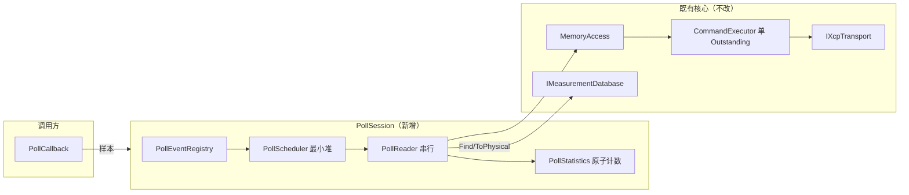
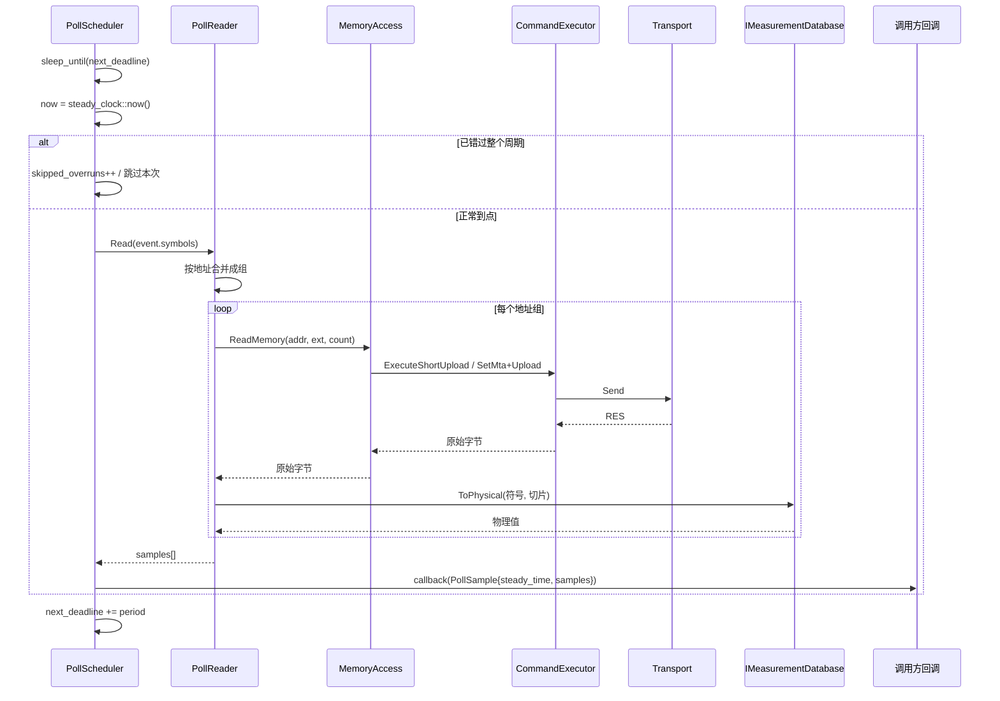
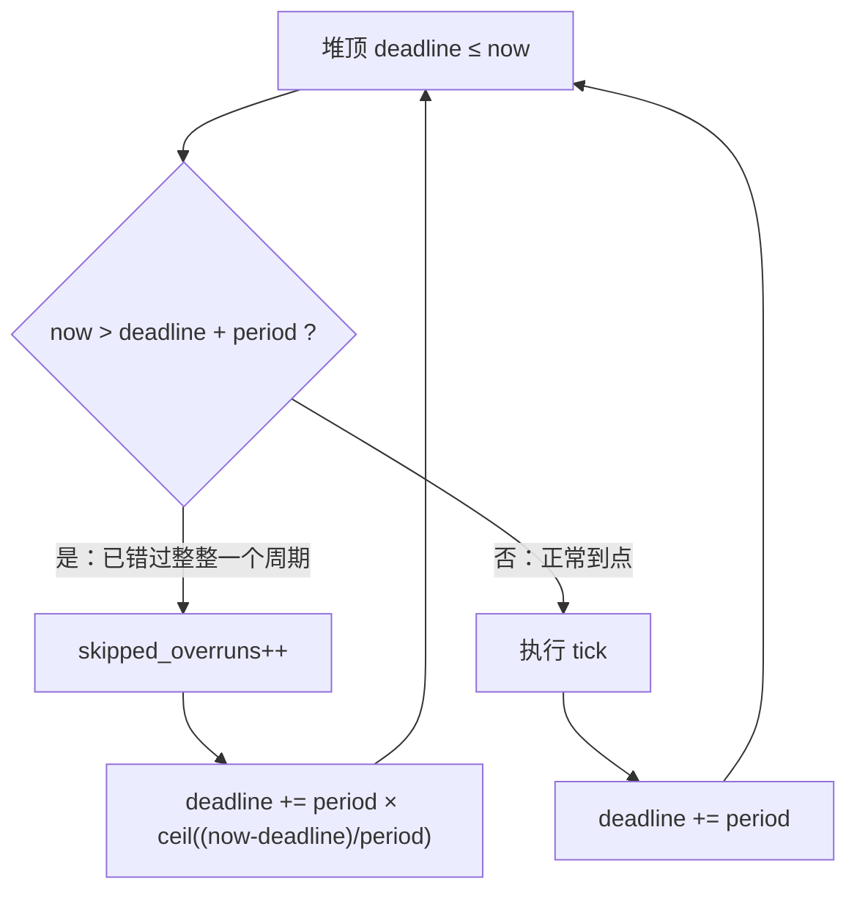

# Poll（主站主动轮询）多 Event 架构实施计划

> 状态：**分批实施中**。
> 进度：P0 ✅（`code-plan/P0_SHORT_UPLOAD上限修复记录.md`）、P1 ✅（`code-plan/P1_Poll会话骨架实施记录.md`）、
> P2 ⏭（技术判定并入 P3，最小堆不实现，理由见 P3 记录 §4-5）、P3 ✅（`code-plan/P3_Poll地址合并实施记录.md`）、
> P4 ✅（`code-plan/P4_Poll容量标定实施记录.md`；本机 loopback UDP 三次实测 71 / 63 / 65 个互不相邻变量，即约 60–70 量级；
> TCP 单次实测 92，只登记当次事实不作推广）、P5 ✅（`code-plan/P5_Poll遗漏项补齐记录.md`：4 个缺失用例、`steady_time_end`、
> clean 全量构建、TCP 标定、本计划 §3.5/§10/§11/§11.1 同步）。
> 全部批次已完成；P4 的判据由计划原写的"零超期"修正为"超期率 ≤ 1%"，理由见 P4 记录 §2。
> 前置文档：
> - `code-plan/Poll模式多Event架构分析.md`（现状与差距的只读分析）
> - `code-plan/多Event架构支持分析.md`（DAQ 语义下的多 event 分析，本文不重复）
> 依据：本仓库代码实测行号 + XCP V1.5 原始 PDF 章节。

---

## 1. 目标与已确认约束

### 1.1 目标

让主站能够同时承载**多个固定周期的采集任务（poll event）**，
每个任务有自己的周期与变量集合，互不干扰地读取 ECU 变量。

"一个 event" 的定义（与用户对齐）：

```
PollEvent = { 名称, 周期, 变量名列表, 回调 }
```

### 1.2 用户已确认的五条约束

| # | 决策 | 含义 |
|---|------|------|
| 1 | 最快周期 **20 ms** | 单 event 周期下限按 20 ms 设计；不做 1–10 ms 级别的抢占优化 |
| 2 | **不与 DAQ 并存** | 同一 `XcpMaster` 上不允许 poll 与 DAQ 同时采集；由调用方保证，库内做**互斥检测并报错** |
| 3 | **本地时间戳** | poll 样本时间戳取主机本地时钟，不做 ECU 时钟对齐（不引入 `GET_DAQ_CLOCK` 配对） |
| 4 | **超期跳过**（保实时性） | 某次 tick 已错过下一个触发点时，丢弃本次，不补读；大规模读取交 DAQ |
| 5 | **修复 SHORT_UPLOAD off-by-one** | `MaxShortUploadElements()` 从 `MAX_CTO/AG` 改为 `MAX_CTO/AG - 1` |

### 1.3 明确的非目标

- 不实现 DAQ 与 poll 的并发共存（约束 2 已否决）
- 不实现 ECU 时钟对齐 / 时间关联（约束 3）
- 不实现"大规模变量高速读取"（约束 4 已划归 DAQ）
- 不做 STIM（数据刺激）
- 不重构现有 `MeasurementSession` / `CommandExecutor`

---

## 2. 现状差距（结论引用自分析文档，附证据）

| 能力 | 现状 | 差距 |
|------|------|------|
| 单次同步读 | 有：`XcpMaster::ReadMemoryBytes`（`include/libxcp/xcp_master.hpp:325`）、`ReadMemory`（`:334`） | 无周期语义 |
| SHORT_UPLOAD 优先 | 有：`src/memory_access.cpp:135-155` | 上限多算 1（§7 修复项） |
| 采集调度 | **无** | 需新建 |
| 定时器/线程 | **无**（库内只有 transport RX 与 DAQ worker） | 需新建 |
| 时间戳 | **无**（poll 路径不产生时间元数据） | 需新建 |
| 变量元数据 | 有：`IMeasurementDatabase::Find/ToPhysical`（`include/libxcp/measurement/measurement_database.hpp:56,60`） | 可直接复用 |
| 并发发送 | 禁止：`src/command_executor.cpp:908-913` 抛 `InvalidState("已有待响应的命令，拒绝并发发送")` | 调度必须串行 |

**关键结论**：不需要改 `CommandExecutor`。新组件只要保证"同一时刻只有一个读取在途"即可，
这与既有单 Outstanding Command 模型天然一致。

---

## 3. 架构设计

### 3.1 组件划分

代码落点（已定稿）：头文件 `include/libxcp/poll/poll_types.hpp`、
`include/libxcp/poll/poll_session.hpp`；实现 `src/poll/poll_session.cpp`；
测试 `tests/poll_session_test.cpp`。`PollSession` 对外只依赖
`XcpMaster` 与 `IMeasurementDatabase` 两个既有公开接口。

```
PollSession                       ← 唯一公开入口，持有调度线程
├── PollEventRegistry             ← 事件注册表（名称 → 周期 + 符号列表）
│     └── 解析期用 IMeasurementDatabase::Find 取出 address/size
├── PollScheduler                 ← 最小堆，按"下次到点时刻"排序
│     ├── NextDeadline()
│     └── PopDue(now)
├── PollReader                    ← 串行执行一批读取（封装地址合并）
│     ├── ReadOne(symbol)         ← 单变量：ReadMemory
│     └── ReadGroup(symbols)      ← 连续地址合并：一次 ReadMemory + 切分
└── PollStatistics                ← 原子计数
```

### 3.2 线程模型（由约束决定，无可选余地）

```
调用方线程                    调度线程（PollSession 独有）        RX 线程（transport）
    │                                  │                              │
    │ Start(callback) ────────────────►│                              │
    │                                  │ sleep_until(下一个到点)        │
    │                                  │ 取 due events                  │
    │                                  │ ReadMemory(...) ──发送──►      │
    │                                  │                  ◄──RES──────┤
    │                                  │ 解码 + ToPhysical              │
    │  ◄────────── callback(sample) ───┤                              │
    │ Stop() ─────────────────────────►│ 退出循环，join               │
```

- **只有一个调度线程**，所有读取在它上面串行执行。
  这是 `src/command_executor.cpp:908-913` 单 Outstanding 约束的直接后果：
  并发读只会抛 `InvalidState`，所以并发度必须收敛为 1。
- 回调在**调度线程**上执行（与 `MeasurementSession` 的 worker 线程语义一致）。
  文档需明确声明：**回调内不得调用 `PollSession` 的阻塞接口，也不得做长时间处理**，
  否则会推迟后续 tick（这正是"跳过"策略要处理的场景）。

### 3.3 调度算法

最小堆保存每个 event 的 `next_deadline`（`steady_clock::time_point`）。

```
循环：
  now = steady_clock::now()
  若堆顶 deadline > now：sleep_until(deadline)，continue
  弹出所有 deadline <= now 的 event：
      若 now 已越过该 event 的 deadline + period（即已错过整整一个周期）：
          statistics.skipped_overruns++     ← 约束 4：跳过，不补读
          next_deadline += period × 跳过数   ← 对齐到当前时间之后
          continue
      执行该 event 的一次 tick
      next_deadline += period
```

**为什么不用 sleep(period) 累加**：`sleep_until` 以绝对时刻为准，不会累积漂移；
用 `sleep_for` 会在每周期叠加执行耗时。

### 3.4 一次 tick 的执行

```
tick(event)：
    t_begin = steady_clock::now()
    for 每个符号组（连续地址已合并）：
        读取该组原始字节
        按各符号偏移切分 → ToPhysical → 填入样本
        单变量失败：记录错误，跳过该变量，不中断本 tick   ← 见 §4.2
    t_end = steady_clock::now()
    callback(PollSample{event, t_begin, t_end, samples[]})
```

`t_begin` / `t_end` 都保留：单次读取的真实采样时刻在两者之间，
把 `t_begin` 作为样本时间戳是**保守但不精确**的做法，需在文档中声明不确定性。

### 3.5 与 DAQ 的互斥（约束 2）

不做"并存协调"，而是**检测并拒绝**：

- `PollSession::Start()` 时检查 `XcpMaster::DaqLedger()`（非空 = 主站已配置
  DAQ List）与 `GetStatus().daq_running`（从机侧确实在播 DTO），任一成立 →
  抛 `InvalidState`
- **实施说明（P3 定稿）**：本计划初稿写的是 `DaqConfigGeneration()`，实装改用
  `DaqLedger()`。原因是 generation 只增不减，"配置过又 CLEAR 掉"时它仍 >0，
  会把一个实际已无 DAQ 配置的会话误判为不可 poll；账本为空才真正表示主站侧
  没有生效的 DAQ 布局。两者互补：账本查主站视角，`GET_STATUS` 的 DAQ_RUNNING
  位查从机视角
- 反向：poll 运行中若调用 `XcpMaster::StartDaqSync()` / `StartDaqList()`，
  由调用方负责先 `PollSession::Stop()`

**为什么不做双向锁**：`XcpMaster` 不应反向依赖 `PollSession`（会形成循环依赖），
且用户已明确"不并存"，强加互斥只会增加耦合。库内只做**入口处的单向校验**，
并在文档中写清责任边界。

---

## 4. 关键设计决策

### 4.1 地址合并：唯一的性能杠杆

XCP 没有"多地址读"命令，N 个不连续变量就是 N 次往返。
唯一能减少往返的手段是把**地址连续**的变量合并为一次读取：

```
变量 A: addr=0x1000, size=2
变量 B: addr=0x1002, size=4      → 合并为一次读 [0x1000, 6 字节)
变量 C: addr=0x2000, size=2      → 另一次
```

合并规则：
- 按 `(extension, address)` 排序
- 相邻变量满足 `addr_next == addr_cur + size_cur` 且累计宽度 ≤ 单帧上限时合并
- 对齐要求：合并段的起始地址与总宽度必须满足 AG 约束，否则拆开

**约束 1（20 ms）下的容量估算**：

```
每 tick 可用预算 = 20 ms
每 tick 往返次数 ≈ 变量组数
可容纳变量数      ≈ 20 ms / 单次往返时间
```

单次往返时间取决于链路与从机处理，**本计划不写死数字**，
要求在目标链路上先做一次标定测量（验收项，见 §8）。

### 4.2 错误处理

| 场景 | 行为 |
|------|------|
| 单变量读取失败（协议错误/超时） | 记录 `read_errors`，该变量本 tick 无样本，**继续读其余变量** |
| 整个 event 全部失败 | 仍回调，但 `samples` 为空 + 错误计数递增（不静默） |
| 连续 N 次 tick 失败（通信断链） | 停止调度并置 `PollSession` 为故障态，回调一次 error 通知；不无限重试 |
| 超期（错过下一个触发点） | 跳过本次，`skipped_overruns++`（约束 4） |
| 回调抛异常 | 捕获并计为 `callback_errors`，调度线程继续（不能因用户回调崩掉采集） |

**为什么单变量失败不拖垮整 tick**：poll 的价值是"按需、柔性"，
一个变量读不到不应让同周期的其他变量也丢样。

### 4.3 时间戳

`PollSample` 携带：
- `steady_time`：`steady_clock` 的 tick 起始时刻（单调，用于计算间隔/抖动）
- `system_time`：对应的 `system_clock` 时刻（用于显示/日志）

两者在 tick 开始时同时取，保证可比。**不做 ECU 时钟对齐**（约束 3）。

### 4.4 对外语义：poll 不产生"丢样"概念

与 DAQ 不同，poll 由主机驱动，不存在"从机发了但主机没收到"的丢样。
只有：
- **超期**（主机没来得及读）→ `skipped_overruns`
- **读失败**（读了但失败）→ `read_errors`

统计口径必须区分这两者，不能合并成一个"丢失数"。

---

## 5. API 设计草案（拟议签名，未实现）

### 5.1 公开类型

```cpp
/// @brief 一个 poll 采集任务的定义
struct PollEventSpec {
    std::string name;                                  ///< 任务名（会话内唯一）
    std::chrono::milliseconds period{20};              ///< 周期，最小 20 ms
    std::vector<std::string> symbols;                  ///< 变量名（经数据库解析）
};

/// @brief 单个变量的采集结果
struct PollVariableSample {
    std::string symbol;                                ///< 变量名
    MeasurementValue value;                            ///< 物理值
    bool valid{false};                                 ///< false=本次读取失败
};

/// @brief 一次 tick 的采集结果
struct PollSample {
    std::string event_name;                            ///< 任务名
    std::chrono::steady_clock::time_point steady_time; ///< tick 起始（单调）
    std::chrono::system_clock::time_point system_time; ///< tick 起始（墙钟）
    std::vector<PollVariableSample> samples;           ///< 本 tick 的变量结果
};

/// @brief 采集统计
struct PollStatistics {
    std::uint64_t ticks{0};              ///< 执行的 tick 数
    std::uint64_t skipped_overruns{0};   ///< 因超期被跳过的 tick 数
    std::uint64_t read_errors{0};        ///< 单变量读取失败次数
    std::uint64_t callback_errors{0};    ///< 回调抛异常次数
};

/// @brief 采集回调
using PollCallback = std::function<void(const PollSample&)>;
```

### 5.2 `PollSession` 接口

```cpp
class PollSession {
public:
    /// @brief 绑定主站与变量数据库（均非拥有）
    /// @throws InvalidArgument 任一指针为空
    PollSession(XcpMaster& master, const IMeasurementDatabase& database);

    /// @brief 注册一个采集任务
    /// @throws InvalidArgument 周期 < 20ms、名字重复、符号列表为空
    /// @throws InvalidState 已在运行
    void AddEvent(PollEventSpec spec);

    /// @brief 移除采集任务
    /// @throws InvalidState 正在运行
    void RemoveEvent(std::string_view name);

    /// @brief 校验全部符号能否解析（在 Start 之前显式调用）
    /// @return 首个失败符号的错误；全部可解析时返回成功
    [[nodiscard]] PollResult<void> Validate() const;

    /// @brief 启动调度线程
    /// @throws InvalidState 已在运行 / DAQ 已配置或已启动 / 未注册任何 event
    /// @throws UnsupportedFeature 数据库不可用
    void Start(PollCallback callback);

    /// @brief 停止调度线程并 join
    void Stop();

    /// @brief 是否正在运行
    [[nodiscard]] bool IsRunning() const noexcept;

    /// @brief 统计快照
    [[nodiscard]] PollStatistics Statistics() const noexcept;
};
```

### 5.3 与既有接口的关系

- **复用** `IMeasurementDatabase::Find` 取地址/宽度、`ToPhysical` 做物理换算
- **复用** `XcpMaster::ReadMemory`（地址合并后一次读一段）
- **不改** `MemoryAccess` 的公开签名，只修 `MaxShortUploadElements` 的返回值（§7）
- 不新增 `XcpMaster` 成员（`PollSession` 通过公开 API 组合，避免循环依赖）

---

## 6. 流程图与时序图

### 6.1 总体架构



### 6.2 一次 tick 的时序



### 6.3 超期跳过决策



---

## 7. SHORT_UPLOAD off-by-one 修复方案（约束 5）

### 7.1 问题

`src/memory_access.cpp:21-29`：

```cpp
ElementCount MemoryAccess::MaxShortUploadElements() const {
    ...
    return max_cto / ag;       // 规范要求是 MAX_CTO/AG - 1
}
```

规范 §7.5.1.13 Table 72（`docs/Asam-Ae-Mcd-1-Xcp-Bs-Protocol-Layer-v1-5-0.md:3636-3650`）：
`n = Number of data elements [AG] [1..MAX_CTO/AG -1]`，
响应结构为 `[PID][n×AG]`，必须为 PID 留 1 字节。

**后果**：`MAX_CTO=8, AG=1` 时读 8 字节变量，响应需 9 字节 > 8，
真从机回 `ERR_OUT_OF_RANGE`；而 `ReadElements` 的回退只认 `CmdUnknown`
（`src/memory_access.cpp:144-152`），异常直接上抛。

### 7.2 修复要点（关键：不能只改一处）

`MaxUploadElements()` 当前实现为 `MaxShortUploadElements() - 1`（`src/memory_access.cpp:31-34`）。
若只把 `MaxShortUploadElements` 改成 `-1`，`MaxUploadElements` 会**连带变成 `-2`**，
把 UPLOAD 的能力也改错。

因此：**两个函数各自独立计算 `MAX_CTO/AG - 1`**，并各自注明规范出处
（§7.5.1.12 与 §7.5.1.13 的 n 上限相同，但语义独立）。

### 7.3 改动清单

| 文件 | 改动 |
|------|------|
| `src/memory_access.cpp:21-29` | `MaxShortUploadElements()` 返回 `MAX_CTO/AG - 1`（`limit==0` 时仍返回 0） |
| `src/memory_access.cpp:31-34` | `MaxUploadElements()` 改为独立计算，不再依赖前者 |
| `include/libxcp/memory_access.hpp:269-270` | 注释从 `= MAX_CTO/AG` 改为 `= MAX_CTO/AG - 1`，附规范出处 |
| `include/libxcp/memory_access.hpp` 文件头注释 | `SHORT_UPLOAD: 1 <= n <= MAX_CTO/AG` 改为 `MAX_CTO/AG - 1` |
| `tests/memory_access_test.cpp:521,616-621` | `AgCase::short_upload_max` 由 8/4/2/64/8/8 改为 7/3/1/63/7/7 |
| `tests/xcp_master_integration_test.cpp:849` | 注释中的 `MAX_CTO/AG(=8)` 改为 `MAX_CTO/AG-1(=7)` |

### 7.4 连锁影响分析

- `CanUseShortUpload`（`src/memory_access.cpp:66`）：判定阈值收紧 1，随后走 UPLOAD 分块 —— 行为**正确化**
- `ShortUpload` 显式校验（`:72`）：现在会拒绝 `n = MAX_CTO/AG`，与规范一致
- `ReadElements` 决策（`:139`）：`n = MAX_CTO/AG` 时改为走 `UploadChunked`（2 次往返），**代价是多一次往返，收益是可用**
- 下载侧 `MaxDownloadElements`（`:180` 起）：**不受影响**（另有 `(MAX_CTO-2-对齐)/AG` 公式，B1 已核实）

---

## 8. 测试矩阵

### 8.1 off-by-one 修复的测试

| 用例 | 断言 |
|------|------|
| `ShortUploadLimitFollowsSpec`（各 AG 参数化） | `MAX_CTO=8` 时 AG=1/2/4 的上限分别为 7/3/1 |
| `ExactMaxCtoElementsAvoidsShortUpload` | 请求 `n = MAX_CTO/AG` 时 `ShortUpload` 调用次数为 **0**，结果正确 |
| `MaxMinusOneUsesShortUpload` | 请求 `n = MAX_CTO/AG - 1` 时 `ShortUpload` 恰好 1 次 |
| `UploadLimitIsIndependentOfShortUploadLimit` | 构造 `MAX_CTO=16, AG=4`，两块 UPLOAD 各 3 元素，证明 `MaxUploadElements` 未被连带改错 |

### 8.2 PollSession 的测试

| 用例 | 断言 |
|------|------|
| `RejectsPeriodBelow20ms` | `period=19ms` 抛 `InvalidArgument` |
| `RejectsDuplicateEventName` | 重名抛 `InvalidArgument` |
| `ValidateReportsUnknownSymbol` | 不存在的符号返回可读错误，不启动线程 |
| `SingleEventFiresOnSchedule` | 模拟时钟/真实短周期，回调次数与周期匹配 |
| `MultipleEventsKeepIndependentPeriods` | 20ms 与 50ms 两个 event，各自 tick 数比例约 5:2 |
| `OverrunIsSkippedNotCatchUp` | 人为拖慢一次 tick，断言 `skipped_overruns > 0` 且没有补读 |
| `SingleVariableFailureDoesNotAbortTick` | 一个符号读失败，其余符号仍有样本；`read_errors` 递增 |
| `CallbackExceptionDoesNotKillScheduler` | 回调抛异常后调度继续，`callback_errors` 递增 |
| `StartRejectedWhenDaqRunning` | DAQ 已启动时 `Start()` 抛 `InvalidState` |
| `AdjacentSymbolsMergeIntoOneRead` | 连续地址的两个变量只产生 1 次 `ReadMemory` |
| `NonAdjacentSymbolsUseSeparateReads` | 不相邻则产生 2 次 |
| `TimestampIsMonotonicPerEvent` | 同一 event 的 `steady_time` 严格递增 |

### 8.3 链路与容量验收（P4，UDP/TCP 优先）

`PollSession` 的端到端用例同时覆盖 UDP 与 TCP 两种 transport（复用现有
`tests/` 里的 MockTransport 与真实 socket 用例骨架）。20 ms 容量标定只在
UDP/TCP 上执行，方法见 §11.1；CAN 500k 不在 P4 准入门槛内。

**P4 落地**：`tests/poll_capacity_calibration.cpp` 提供两个用例——
`XcpliteSlaveTest.PollCapacityAtTwentyMillisecondPeriod`（UDP）与
`PollCapacityTcpTest.PollCapacityAtTwentyMillisecondPeriodOverTcp`（TCP，
`TcpWireProfile::AsamV14`），共用 `CalibrateCapacity()` 流程与同一判据，
可直接对比两种 transport 的容量差异。

### 8.4 回归要求

- Release 构建前先 `cmake --build cmake-build-release --target clean`
- 全量 `libxcp_tests` 必须 0 失败（当前基线 966 例 / 965 通过 / 1 跳过）
- off-by-one 修复属**行为变更**，需逐条核对所有依赖 `MaxShortUploadElements` 的既有断言

---

## 9. 实施批次

| 批次 | 内容 | 依赖 | 风险 |
|------|------|------|------|
| **P0** | SHORT_UPLOAD off-by-one 修复 + 4 个边界用例 | 无 | 低（行为收紧，可能暴露既有测试的宽松假设） |
| **P1** | `PollEventSpec` / `PollSample` / `PollStatistics` 类型 + `PollSession` 骨架（`AddEvent`/`Validate`/`Start`/`Stop`）+ 单 event 调度 | P0 | 中（线程生命周期与停止时序） |
| **P2** | 多 event 调度（最小堆）+ 超期跳过 + 独立周期 | P1 | 中（超期判定边界） |
| **P3** | 地址合并 + 错误隔离 + 统计 + 与 DAQ 的互斥校验 | P2 | 中（合并的 AG 对齐边界） |
| **P4** | 20 ms 周期容量标定（目标链路实测）+ 文档 | P3 | 低 |

每批完成后在 `code-plan/` 写实施记录（范围 / 规范依据 / 变更行号 / 真实测试数字），
与 B0–B4 的记录口径一致。

---

## 10. 边界与已知限制（需在实施时写入文档）

1. **回调在调度线程执行**：回调耗时直接侵占周期预算，文档必须显式警告
2. **20 ms 是设计下限，不是承诺**：实际可达周期取决于变量数与链路往返时间
3. **地址合并只在同一 `AddressExtension` 内进行**：跨扩展不合并
4. **不做 ECU 时钟对齐**：`steady_time` 与 `system_time` 之间有取时刻的微小偏差
   - **采样时刻是区间不是点**：`PollSample` 同时保留 `steady_time`（t_begin）
     与 `steady_time_end`（t_end），真实采样时刻落在两者之间；把 t_begin 当作
     样本时间戳是保守但不精确的做法
5. **跳过策略不补读**：要求精确等间隔的场合应改用 DAQ
6. **DAQ 互斥靠入口校验**：`PollSession` 启动后若外部绕过它去启动 DAQ，库内不拦
7. **无变量动态增删**：运行中不允许 `AddEvent`/`RemoveEvent`（需先 `Stop`）

---

## 11. 已定稿的设计决策（2026-11-14 用户确认）

| # | 决策 | 落地方式 |
|---|------|----------|
| 1 | **目录位置：同意** | 新组件放 `include/libxcp/poll/`（`poll_session.hpp` / `poll_types.hpp`），与 `measurement/` 并列；实现放 `src/poll/` |
| 2 | **物理值直接复用 `MeasurementValue`** | 不另立轻量类型；`PollVariableSample::value` 类型即 `MeasurementValue`（`include/libxcp/measurement/measurement_types.hpp`） |
| 3 | **单变量失败走 `valid=false`** | 失败变量仍出现在 `samples` 中，`valid=false`、`value` 保持默认；`read_errors` 同步递增。**不**把它从列表里删掉——调用方能明确感知"这次没取到" |
| 4 | **保留显式 `Validate()`** | 调用方可在启动前单独调用以一次性拿到全部符号错误；`Start()` 内部对每个 event 调 `ResolveEvent`（与 `Validate()` 同一解析路径）做兜底，两者不会漏判，只是 `Start()` 失败时按异常上报 |
| 5 | **链路验收：先做 UDP/TCP** | 20 ms 容量标定先在 UDP/TCP 上做；CAN 500k 不作为 P4 的准入门槛（其往返开销显著更大，容量结论不可移植） |

### 11.1 UDP/TCP 验收口径（P4）

在这个链路族上，验收按以下可复现的方式执行，**不写死绝对数字**：

1. 构造 N 个变量，地址两两不相邻（关闭地址合并，测最坏情况）
2. 单 event、周期 20 ms、运行 ≥ 10 s
3. 记录 `ticks` / `skipped_overruns` / `read_errors`
4. **通过判据**：
   - 超期比例 `skipped_overruns / (ticks + skipped_overruns)` ≤ 1 %
   - `read_errors == 0` 且 `callback_errors == 0`
   - 实测平均周期与目标 20 ms 的偏差 ≤ 5 %
   - **P4 实测对判据的修正**：原写 `skipped_overruns == 0`，在非实时 Windows
     上不可达——即使只轮询 1 个变量，10 s 窗口内相邻 tick 的最大间隔也会偶发
     到约 32 ms（比 20 ms 多约 12 ms），必然产生零星超期，导致"容量 = 1"的
     荒谬结论。改用比例判据后仍对 N 保持单调区分力（实测 N=71 为 0.20 %、
     N=72 为 1.20 %）
5. 以二分法找出"仍满足上述判据的最大 N"，把该值作为**该环境下的容量结论**，
   与链路/从机型号一起记录（换环境必须重测）

> 之所以强调"不写死数字"：单次往返时间由链路带宽、从机处理能力和主进程调度
> 共同决定，本仓库不提供跨环境可移植的常数。P4 的交付物是**测量方法 + 当次结论**，
> 不是一个承诺值。