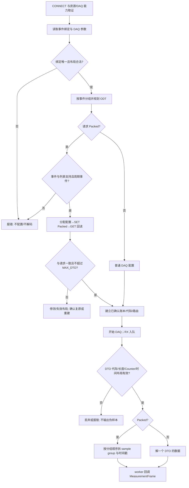
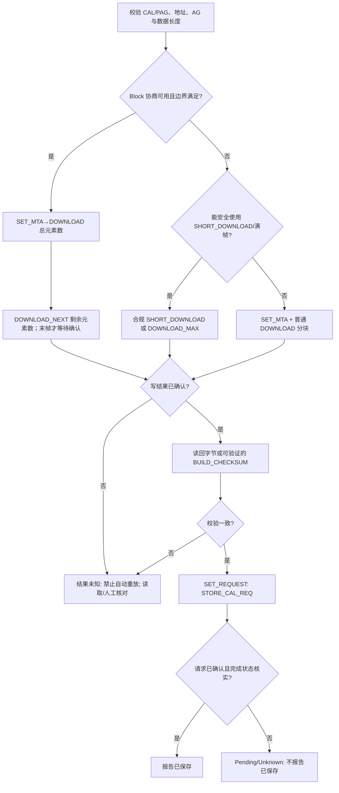
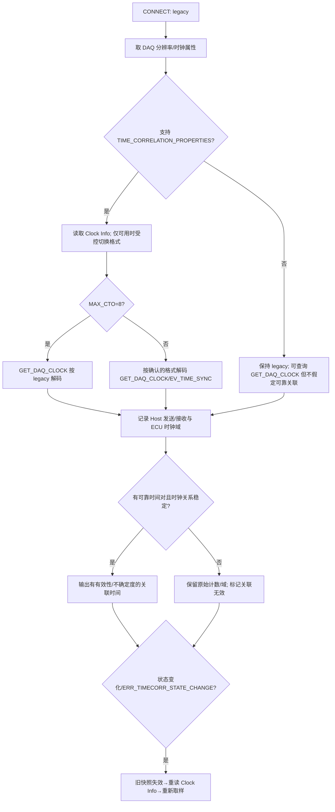
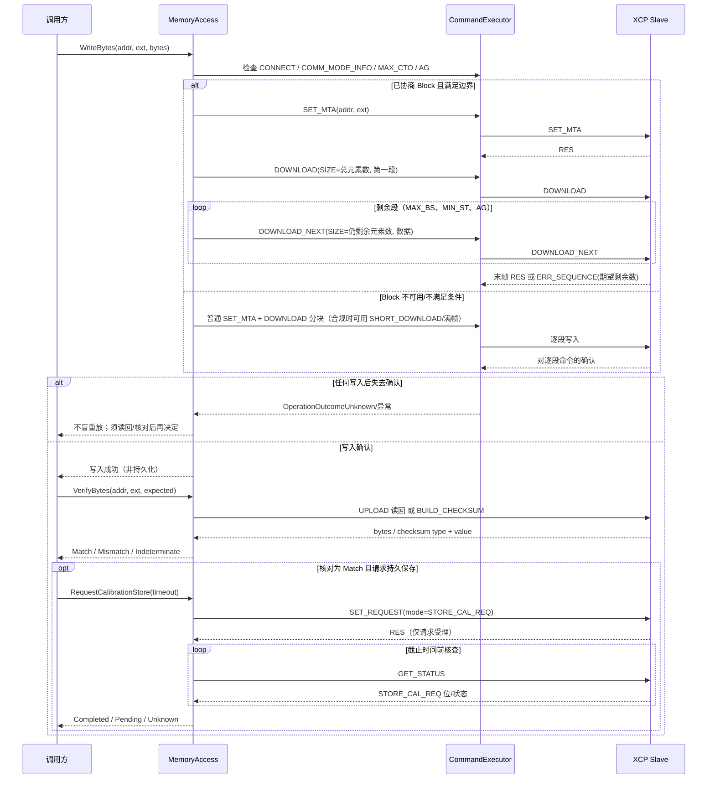
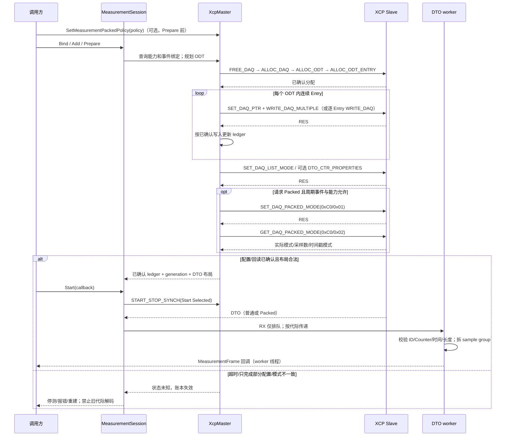
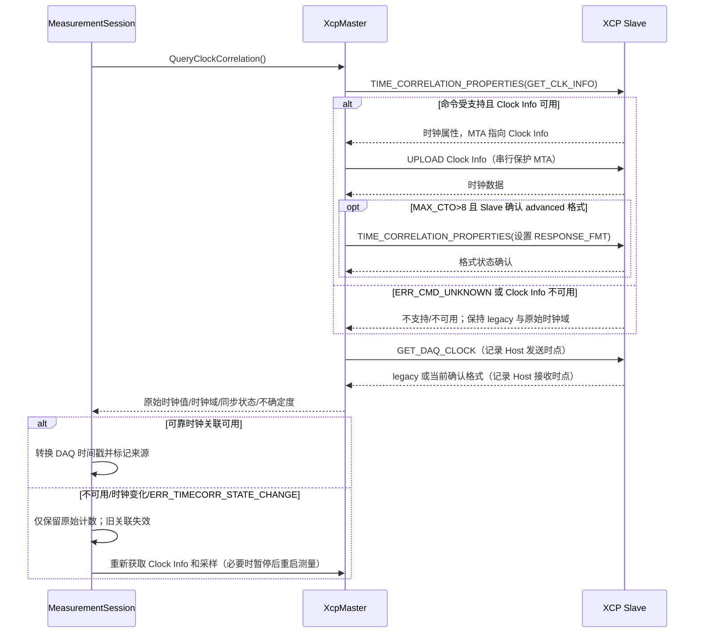

# XCP V1.5 测量与标定修复及测试实施计划

> 状态：设计方案已按架构、组件、数据流、错误处理、测试五节确认。**本文是实施计划，不是已完成记录**；每批的实际改动、偏差与真实测试数字一律写进同目录的 `B<n>_*_实施记录.md`，不回填本文冒充"计划即结果"。
>
> 实施进度（截至本文最后更新）：
>
> | 批次 | 内容 | 状态 | 实施记录 |
> | --- | --- | --- | --- |
> | B0 | 规范纠偏 + `GET_DAQ_LIST_MODE(0xDF)` 四层 | 已完成 | [B0_规范纠偏与GET_DAQ_LIST_MODE实施记录](B0_规范纠偏与GET_DAQ_LIST_MODE实施记录.md) |
> | B1 | 标定闭环：Block mode / `SET_REQUEST` / `BUILD_CHECKSUM` | 已完成 | [B1_标定闭环实施记录](B1_标定闭环实施记录.md) |
> | B2 | DAQ 控制面：`WRITE_DAQ_MULTIPLE` / `DTO_CTR_PROPERTIES` / 失败状态策略 / DTO 计数器贯通 | 已完成 | [B2_DAQ控制面实施记录](B2_DAQ控制面实施记录.md) |
> | B3 | 基础时间关联：`GET_DAQ_CLOCK` / `TIME_CORRELATION_PROPERTIES` / `EV_TIME_SYNC` 解析 / Clock Info 上传 | 已完成 | [B3_基础时间关联实施记录](B3_基础时间关联实施记录.md) |
> | B4 | Packed 模式全链路：`SET/GET_DAQ_PACKED_MODE(0xC0,0x01/0x02)` / 能力取证与回读确认 / 规划容量折算 / 一 DTO 拆 S 个采样帧 | 已完成 | [B4_Packed模式实施记录](B4_Packed模式实施记录.md) |
> | B5 | A2L 复杂标定对象 | 未开始（独立后续） | — |
>
> 各批的 §6 拟议签名在落地时按实际类型微调过（例如 `DtoCounterProperties` 是 `namespace` 级结构体而非嵌套类型），以实施记录与头文件为准。

## 1. 目标、证据与边界

- 目标：在现有 libxcp 主站结构中补齐本次约定的测量/DAQ 和标定能力，形成可自动化验证的端到端闭环；每批实施后独立验收，不以“命令已编码”等同高层功能完成。
- 输入：[原完整性分析](XCP_V1.5_测量标定功能完整性分析.md)仅作为待复核问题清单；同时参考[支持完成度检测报告](XCP_V1.5_测量与标定支持完成度检测报告.md)。规范以 [`docs/Asam-Ae-Mcd-1-Xcp-Bs-Protocol-Layer-v1-5-0.pdf`](../docs/Asam-Ae-Mcd-1-Xcp-Bs-Protocol-Layer-v1-5-0.pdf) 原件相应命令章节为准；[Markdown 转换版](../docs/Asam-Ae-Mcd-1-Xcp-Bs-Protocol-Layer-v1-5-0.md)仅供定位。PDF 表格文本提取有错列风险，遇疑义逐条按章节、原图核对。
- 必须先纠正原分析：`DOWNLOAD_NEXT=0xEF`，`DOWNLOAD_MAX=0xEE`；`0xCF`/`0xCE` 属编程命令，不得作为下载别名；`DOWNLOAD_MAX` 是固定满帧，不是任意变长下载。`SHORT_DOWNLOAD`、`MODIFY_BITS`、`READ_DAQ` 为 Optional 而非 Mandatory。原文 85%/90% 无确定分母，不作为验收指标。参照规范 §7.5.2、§7.5.4 命令条款与[原分析第 19–23、46 行](XCP_V1.5_测量标定功能完整性分析.md#L19-L23)。
- 包含：DAQ 模式查询与控制面、DTO counter 贯通、基础时间关联、Packed 模式全链路；标定写入、Block mode、保存至非易失存储请求、写后校验；A2L 测量事件通道绑定，以及复杂标定对象的独立后续阶段。
- 排除：STIM 数据刺激、Flash 编程、不相关传输层能力、跨物理传输多设备同步/桥接/Multicast 完整体系。本轮“完整”指**本计划明示范围的本地自动化覆盖**，不代表全部 XCP Optional 特性或跨厂商通用互操作。GET_DAQ_CLOCK 不等同精确 Host↔ECU 同步；无法得到可靠关联时保留 ECU 原时间戳与时钟域。
- 验证方式：单元测试、模拟 Slave、XCPlite **支持的子集**；不要求独立 V1.5 ECU/第三方标准对端。未能通过本地环境验证的特性应如实标为“仅模拟验证/待实机互操作”，不能标为“通用兼容”。

## 2. 保留的架构与实施原则

保持 `CommandCodec → ResponseParser/CommandExecutor → XcpMaster → MemoryAccess/MeasurementSession` 的现有分层。线格式编码与解码留在 Codec/Parser；会话状态、资源/能力检查及命令编排留在 Executor/Master；内存访问策略留在 MemoryAccess；测量布局、时钟元数据及多采样输出留在 MeasurementSession/DTO 解码链。利用现有 DAQ Ledger 作为已确认写入的布局真值，**不可**仅凭计划中的目标配置推导实际 DTO 格式。

新功能先验证 Slave 能力与运行时参数，Unsupported/ERR_CMD_UNKNOWN 只在该命令规范允许且存在明确等效保守路径时降级；其他协议错误和超时不伪装为“不支持”。写请求一旦发送而应答未知，不自动重放以避免重复副作用；先失效相关状态，明确提示重连/重新读取/人工核对。时间戳、Counter、Packed 布局缺少协商或校验失败时拒绝错误解码，不静默输出伪数据。

依赖链：**B0 → B1 → B2 → B3 → B4**；B5（A2L复杂对象）是独立后续，可在 B1 后以单独设计和验收推进。每批必须维护 Windows/Linux/macOS 的 C++20 可编译性；接口、成员、变量用中文 Doxygen 注释，代码段中文注释；不改动未授权第三方代码、不顺手重构已完成代码。

## 3. 分批实施与验收

### B0｜规范纠偏、能力基线、DAQ 列表模式回读

1. 修订原完整性分析中的错误命令码、Mandatory 分类、DOWNLOAD_MAX 描述及无依据百分比；区分“已有低层解析能力”“高层协商能力”“已支持端到端运行”。修改原文前重读原件，保留审计线索。
2. 加入 `GET_DAQ_LIST_MODE(0xDF)` 编码、响应解析与 Master 查询；按规范核对模式位、事件通道、prescaler、priority 等字段及端序。复核 `SET_DAQ_LIST_MODE` 写入后 Slave 的实际模式，并明确查询不支持时不能假装已回读。
3. 为后续批次记录可测能力门：COMM_MODE_BASIC、GET_COMM_MODE_INFO、DAQ processor/resolution/event/list 属性、CAL/PAG resource；不得由 `UnsupportedCapability::DaqPackedMode` 推断 Slave 不支持，那个标志仅代表**本库当前**尚未实现。
4. 验收：GET_DAQ_LIST_MODE 全字段正常/短帧/未知命令/边界值；写入→回读一致性；纠偏文本经原 PDF 命令章节复核。新增或更新 `tests/command_codec_test.cpp`、`tests/response_parser_test.cpp`、`tests/xcp_daq_test.cpp`。

### B1｜标定写入、保存与写后校验闭环

1. 保持现有普通 `SET_MTA + DOWNLOAD` 和 SHORT_DOWNLOAD 安全后备；新增 `DOWNLOAD_NEXT(0xEF)` 的标准 Block mode 编码与编排：只有 COMM_MODE_BASIC 宣告 `SLAVE_BLOCK_MODE` 且 `GET_COMM_MODE_INFO` 的 `MAX_BS`/`MIN_ST` 可用时启用；首帧 `DOWNLOAD.SIZE` 表示本次块**总元素数**，后续 `DOWNLOAD_NEXT.SIZE` 表示**剩余元素数**，依据地址粒度 AG、MAX_CTO 和 MAX_BS 切包；按规范处理末帧应答与 `ERR_SEQUENCE` 所携期望剩余数。失败/未知进度**不盲重放**，必须核对/重建 MTA 和目标数据状态后才能继续。
2. 新增 `DOWNLOAD_MAX(0xEE)` 严格满帧编码，满足对齐/填充规则和能力条件才选择；尾段及不满足条件时走既有普通 DOWNLOAD。保留普通分块逐段 SET_MTA 的安全策略，不把它误判为规范缺陷。普通写、Block 写及写后读取要在 `MemoryAccess` 提供一致的边界检查、错误传播与选择逻辑。
3. 新增 `SET_REQUEST(0xF9)` 的 **STORE_CAL_REQ(bit0=0x01)** 工作流，不能误触 STORE_DAQ_REQ/RESUME 等其他位；请求已被接收 ≠ 非易失写入完成，结合 GET_STATUS 中请求位清除/EV_STORE_CAL 或超时策略判断，保留不确定状态；在不支持此 Optional 命令时明确返回“不支持持久保存”。参照规范 §7.5.1.8。
4. 新增 `BUILD_CHECKSUM(0xF3)` 编码、解析与调用：block size 单位为 AG，处理 checksum type/端序、MTA 递增及 `ERR_OUT_OF_RANGE` 中对齐/最大块提示；“校验一致”仅限主从选择了可复现的同一算法。若 Slave 返回用户自定义算法或不能核对，不假称校验成功；结合读回字节比较提供明确后备。参照规范 §7.5.1.14。
5. 验收：Intel/Motorola，AG=1/2/4，MAX_CTO 最小/整块/尾块、MAX_BS 边界、MIN_ST、正/负应答/丢应答/断连；普通路径 fallback；读回一致/校验不匹配/未知算法；保存请求尚未完成、完成、拒绝、超时均可区分。更新 `tests/memory_access_test.cpp`、`tests/command_codec_test.cpp`、`tests/response_parser_test.cpp`，补模拟 Slave 标定工作流测试。**仅经确认的最终结果才能声明标定值已保存。**

### B2｜DAQ 控制面、Event 绑定与 Counter 贯通

1. `WRITE_DAQ_MULTIPLE(0xC7)` 严格按规范打包：一条命令仅写同一 ODT 的连续 Entry；每 Entry **8 字节含末尾 dummy**，每命令 Entry 数 `<= floor((MAX_CTO-2)/8)`，且遵守目标 Slave 的 Entry 上限、AG/地址扩展约束；若 MAX_CTO 不足或明确 ERR_CMD_UNKNOWN，按当前逐 Entry `SET_DAQ_PTR + WRITE_DAQ` 路径回退。成功确认后才写账本；失败/超时视整个相关 DAQ 配置为未知，不能简单“回滚本地账本”并继续按旧布局解码，需停测、失效账本并重新配置/核验。对静态与动态配置均给出可恢复策略。参照规范 §7.5.4 WRITE_DAQ_MULTIPLE。
2. `DTO_CTR_PROPERTIES(0xC5)` 加入查询与按需修改；事件通道属性若只读不得强改；仅配置 DAQ 方向所需 counter 策略，STIM 副作用位不纳入范围。用 GET_DAQ_EVENT_INFO、GET_DAQ_LIST_MODE 等交叉确认实际生效的 DTO_CTR 布局；打通 `MeasurementSession` 当前硬编码 `layout.counter_enabled = false` 的限制（[现状](../src/measurement/measurement_session.cpp#L382-L396)），使实际 DTO 的 counter 消费、断续计数与错误上报一致。
3. 将 A2L MEASUREMENT 的 Event Channel 绑定从默认通道 0 的假设改为已验证的对象绑定规则；当 A2L 不足/冲突时返回可操作的歧义信息，不静默使用通道 0。以事件属性与 DAQ List 支持范围校验规划结果；此项仅针对**测量 Event 绑定**，不是 B5 的复杂标定对象映射。
4. 验收：同一 ODT 内分包、跨 ODT 不合包、8 字节对齐/边界/端序、单 Entry 回退、成功账本和失败失效、模拟部分执行后超时；Counter 生效/只读/不支持/丢帧/溢出；多个事件通道/缺失/冲突。更新 `tests/xcp_daq_test.cpp`、`tests/measurement_planner_test.cpp`、`tests/measurement_session_test.cpp`、DTO 解码测试及相关 A2L 测试。

### B3｜基础时间关联（不宣称精确同步）

1. 支持 `GET_DAQ_CLOCK(0xDC)` legacy/extended 响应，解析模式由当前会话协商决定；支持 `TIME_CORRELATION_PROPERTIES(0xC6)` 查询/受控设置、响应格式切换、Clock Info `GET_CLK_INFO` 获取（其 MTA 指向数据需按协议上传）及必要的 `EV_TIME_SYNC` 状态/时间元组解析。初始按 legacy；只在对端确认格式切换后使用 extended；相应状态变化触发 Clock Info 重新获取。参照规范 §7.5.4 GET_DAQ_CLOCK、§7.5.6 TIME CORRELATION。
2. 建立 DAQ timestamp 的来源时钟、单位、宽度/回绕与同步状态模型；获取时间关联所需 Host 本地发送/接收采样，并标注测量不确定性/可用性。仅具备可靠时间对、时钟域关系和稳定状态时才输出相关时间，否则保留 ECU 原值及来源元数据；`ERR_RESOURCE_TEMPORARY_NOT_ACCESSIBLE`、时钟重置/状态变化、`ERR_TIMECORR_STATE_CHANGE` 明确降级或重新查询，不做“取一次 GET_DAQ_CLOCK 即精准对时”的声明。
3. 不做 `GET_DAQ_CLOCK_MULTICAST`、跨物理链路 bridge、多个 Slave 的完整 Cluster/Grandmaster 同步策略；上述缺口在验收报告中列为范围外，不把本批命名成完整 XCP 时间同步实现。
4. 验收：legacy/extended 正反应、切换前后格式、Clock Info 长度/解析/重新上传、不同时间戳宽度与回绕、Host 往返延迟、不稳定关系、异常/超时后保持原时间戳；更新 `tests/daq_timestamp_test.cpp`、`tests/measurement_session_test.cpp`，新增时间关联单元/模拟 Slave 测试。

### B4｜Packed Mode 全链路（独立架构验收点）

1. 实现 `SET_DAQ_PACKED_MODE(0xC0/0x01)` 与 `GET_DAQ_PACKED_MODE(0xC0/0x02)` 的命令子码、正/负响应及查询→设置→回读闭环。先依据 GET_DAQ_EVENT_INFO/GET_DAQ_LIST_INFO 的 Packed 支持与**周期事件**约束过滤能力；协商模式、sample count、timestamp mode；不支持/不一致时保持或回退非 Packed，不可一边按 Packed 配置一边按普通 DTO 解码。
2. 全链路重设 Planner 装箱容量、Master 的实际列表布局/代际、DTO envelope/payload 中 **element-grouped/event-grouped** 多样本拆分、样本顺序与时间戳重建，并将一帧中多采样输出为具有清晰时间/序号语义的测量结果。切换模式必须停止测量、重建账本与路由，旧代际帧隔离；会话/对端断连后重新协商。
3. Packed 模式引入新的数据面语义，开始编码前须单独复核前述布局与输出接口设计并取得确认；不能仅删除 `UnsupportedCapability::DaqPackedMode` 的标志。参照 [`include/libxcp/xcp_master.hpp`](../include/libxcp/xcp_master.hpp) 中该能力边界。
4. 验收：两种分组模式、sample count=0/1 非法拒绝、2/上限有效边界、首/末 ODT、时间戳多采样重建、短帧/超长帧、配置失败/断连/回退/旧代际丢弃；可重复跑模拟 Slave 端到端用例。XCPlite 不支持的 Packed 特性只报模拟验证，不得以 XCPlite 代替 V1.5 专用端验证。

### B5｜A2L 复杂标定对象（后续单独设计与验收，不阻塞 B0–B4）

按 A2L 对象模型逐类核对 CHARACTERISTIC/AXIS_PTS、RECORD_LAYOUT、COMPU_METHOD、维度、轴和地址扩展的读取→物理值→写回映射；先列出当前解析器实际支持集合及不支持的布局，不以原始地址写入能力替代“复杂标定对象已支持”。跨对象写入、写保护和非易失保存事务需要单独数据结构、错误语义及测试方案；无明确设计审批前不写相关代码。

## 4. 共通测试矩阵与执行步骤

| 维度 | 至少验证的情形 | 禁止的误判 |
|---|---|---|
| 协议线格式 | Intel/Motorola；AG=1/2/4；MAX_CTO、MIN_ST、MAX_BS、填充/对齐 | 将命令码复用或长度单位误读当兼容 |
| 能力分支 | 功能声明支持/明确不支持/只读/ERR_CMD_UNKNOWN/其他错误 | 无条件降级或将本库能力视为 Slave 能力 |
| 事务状态 | 正常应答、部分执行后丢应答、超时、断连、重连、重复请求 | 未确认写自动重发、DAQ 账本“本地回滚”即视为对端回滚 |
| 测量数据 | 多 ODT/多事件、Counter、PID、时间戳/时钟域、Packed 多样本、帧短缺/溢出 | 用猜测的布局解码并输出可信数值 |
| 标定闭环 | 写→读回/Checksum→请求保存→实际完成/未知状态 | 把“写入成功”直接等同“持久保存成功” |

每批步骤：①核对规范 PDF 和已存在接口/测试；②仅实施经确认的该批设计；③新增 `tests/` 用例并检查旧用例语义；④更新 `tests/CMakeLists.txt`（若有新测试文件）；⑤读取回改动处，再运行 Release 编译及关联测试；⑥在 `code-plan/` 生成**该批实际修改、命令、通过/失败/未运行结果、剩余风险**的 Markdown 记录。全量编译前先执行 Release 构建目录 `clean`，按 `AGENTS.md` 使用 Release，不运行 `install/Debug/bin` 下的所有测试。可参考 `cmake -B cmake-build-release -S . -DCMAKE_BUILD_TYPE=Release`、`cmake --build cmake-build-release --target clean`、`cmake --build cmake-build-release -j 4`、`ctest --test-dir cmake-build-release -C Release --output-on-failure`；具体测试命令以项目实际配置/构建产物校验后执行。**本计划编写时没有运行这些命令。**

## 5. 完成判据、自审和风险披露

- 每批均满足对应功能、状态恢复、负向场景及回归测试，记录可复现的结果；未实现/未验证功能列为“待办/范围外”，不以“所有 Mandatory 命令已编码”推断高层测量与标定完整。
- B0–B4 结束后，重新生成以“能力→协商→配置→数据→失败恢复→测试证据”为行的矩阵，标明本地模拟、XCPlite 支持子集及实机互操作未验证的边界；B5 单独批准、单独评估。
- 自审：无待填占位符；DOWNLOAD_NEXT/MAX 码位和语义无冲突；时间关联不等于精准同步；STORE_CAL_REQ 不等于完成事件；DAQ 账本与 Slave 状态不可偷换；Packed 不可只做控制面；A2L 测量事件绑定与复杂标定对象分开；所有本计划列出的“验收”均是**未来验收条件，不是当前测试结果**。

## 6. API 设计草案（已确认最小公开面；**以下新增声明均未实现**）

本节是后续逐批实现的**拟议 C++20 接口**，不是当前头文件内容；签名和结构仅作为实施契约，落地前逐项核对现有类型/ABI、原始 PDF 和测试。新增方法仅限必要的 `XcpMaster` 查询/配置与 `MemoryAccess` 标定业务入口；`CommandCodec`、`ResponseParser`、`CommandExecutor` 的新命令仅列内部职责，不扩散为新的业务公开面。保留现有 `WriteBytes`、`ConfigureDaqList(s)`、`MeasurementSession::Prepare/Start/Stop` 等签名。新类型/字段是返回值、参数或帧元数据的必要载体，不是新增业务入口。以下伪声明中类型与命名均为**提案**，不代表已有编译定义。

### 6.1 拟议公开接口与数据契约

```cpp
// B0：仅在 ERR_CMD_UNKNOWN 时返回 nullopt；字段来自规范 Table 150。
[[nodiscard]] std::optional<DaqListModeSnapshot>
XcpMaster::QueryDaqListMode(std::uint16_t daq_list);

// B1：WriteBytes 保持原签名，内部在能力已证实且可安全切包时选择 Block/满帧；
// 禁止新增会绕开安全校验的“裸块写”公开入口。
[[nodiscard]] CalibrationVerificationResult MemoryAccess::VerifyBytes(
    Address address, AddressExtension extension, BytesView expected);
[[nodiscard]] CalibrationStoreResult MemoryAccess::RequestCalibrationStore(
    std::chrono::milliseconds completion_timeout);

// B2：counter 属性按事件通道查询；仅修改 DAQ_MODE，不触及 STIM_MODE。
[[nodiscard]] std::optional<DtoCounterProperties>
XcpMaster::QueryDtoCounterProperties(std::uint16_t event_channel);
[[nodiscard]] DtoCounterProperties XcpMaster::ConfigureDaqCounterEvent(
    std::uint16_t event_channel, DaqCounterMode mode);

// B3：会话中获取时钟信息/关联观测；不存在可用时钟则 nullopt。
// QueryClockCorrelation 负责内部协议查询及 Host 发送/接收时点采样，
// 不把一次往返估算封装成“精确同步”结果。
[[nodiscard]] std::optional<ClockCorrelationSnapshot>
XcpMaster::QueryClockCorrelation();

// B4：必须在 MeasurementSession::Prepare() 前指定策略；默认 Disabled。
// 同一 Master 的底层手动配置也由此策略约束，避免两套 DTO 布局真值。
void XcpMaster::SetMeasurementPackedPolicy(PackedMeasurementPolicy policy);
[[nodiscard]] std::optional<DaqPackedModeSnapshot>
XcpMaster::QueryDaqPackedMode(std::uint16_t daq_list);
```

| 拟议类型/字段 | 最小语义、参数与返回规则 |
|---|---|
| `DaqListModeSnapshot` | 回读 `mode/event_channel/prescaler/priority`，保留原 mode 位（含 RUNNING/SELECTED/RESUME）；`daq_list` 为 0 基列表号。查询值是 Slave 当前值，不能以本地期望值补空。 |
| `CalibrationVerificationResult` | `status ∈ {Match, Mismatch, Indeterminate}`、`method ∈ {Readback, SlaveChecksum}`；仅同算法、同范围且可验证校验值时才允许 Checksum 判 Match；不支持/未知算法转读回，读回不可靠则 Indeterminate。`expected` 非空、长度为 AG 整数倍；只检查已写地址，不代替持久化证明。 |
| `CalibrationStoreResult` | `status ∈ {Completed, Pending, Unknown}`；`completion_timeout > 0`；SET_REQUEST(bit0=STORE_CAL_REQ) 已接收仅为 Pending，GET_STATUS 请求位清除才可判 Completed，EV_STORE_CAL 只作为状态变化提示并需核实；等待超时/断连/请求应答丢失为 Unknown，不可声称完成。明确 `ERR_CMD_UNKNOWN` 抛 `UnsupportedFeature`，无可等效的自动持久化后备。 |
| `DtoCounterProperties` / `DaqCounterMode` | 保留规范 `PROPERTIES` 原位、`related_event_channel` 与 `DAQ_MODE`，后者仅 `INSERT_COUNTER/INSERT_STIM_COUNTER_COPY` 两值；若 DAQ_MODE_FIXED 或 DAQ_MODE_PRESENT 不满足则拒绝修改，设置后以返回值确认；读取不修改相关事件或 STIM 位。 |
| `ClockCorrelationSnapshot` | 包含原始 ECU/Slave 时间计数、时钟域/源、时间戳位宽/单位、同步状态、Host 请求发送/接收时点与估计不确定度、`correlated` 有效标志；无法建立可靠关系时 `correlated=false`、无换算的 Host 时间，保留原计数。版本/时钟状态变化后旧快照失效。 |
| `PackedMeasurementPolicy` / `DaqPackedModeSnapshot` | 策略含 Disabled、ElementGrouped、EventGrouped、`sample_count`、首/末采样时间戳选择；仅启用模式时 `sample_count ∈ [2,65535]`，`0/1` 非法（规范 §7.5.4.7）。查询快照保存实际模式、采样数、时间戳模式与 DAQ List；未启用时不读取/臆造无意义采样数。 |
| `MeasurementFrame` 扩展（B3/B4） | 保留 `MeasurementCallback(const MeasurementFrame&)`；可加 `clock_domain`、关联时间可用性、`packed_sample_index` / `packed_sample_count` 与来源 DTO 标识等附加字段。Packed 一 DTO 的每个 sample group 各投递一个 Frame（旧非 Packed 为 1 DTO→1 Frame），同一 DTO 内保持样本序；原 `timestamp_raw` 不丢失。B4 单独审查实际字段布局、ABI 影响后再定稿。 |

参数与生命周期：所有查询须已 CONNECT；`MemoryAccess` 保持现有非拥有的 `CommandExecutor&`/`Session&` 生命周期；`BytesView expected` 只在同步调用期间有效；快照按值返回，不把易变内部缓存引用交给用户。上述 `std::optional` 仅用在无副作用查询的规范可选命令且**仅 ERR_CMD_UNKNOWN** 时表示不支持，其余协议错误/短帧按 `XcpException` 抛出；业务操作不能把超时吞成 `nullopt`。标定读回不匹配为 `Mismatch` 而非传输成功；无法判断为 `Indeterminate`，底层 I/O 错误仍抛异常。异常沿用现有 [`XcpException`](../include/libxcp/xcp_error.hpp#L26-L84) 的 `ErrorCategory`，不得凭新增错误文本推导可靠结果。

线程/状态：`CommandExecutor` 单 outstanding；SET_MTA→DOWNLOAD/UPLOAD、SET_DAQ_PTR→WRITE_DAQ[_MULTIPLE]、时钟格式切换→解析/Clock Info 上传必须整体串行，不能在同一 Master 的回调中重入命令；Host 时间样本取真实发送/接收边界，不用回调时间代替。`SetMeasurementPackedPolicy` 只能在 DAQ 未运行、`Prepare()` 前设置；运行中变更报 `InvalidState`。`MeasurementSession::Prepare()` 根据 Master 策略内部生成 Packed 配置，Slave 回读确认后才创建解码路由与新代际；`Start()` 验证账本/模式代际，worker 线程仍执行解码回调。停止/断连/重新连接使关联快照及 Packet 布局失效，重新 Prepare；不在本次设计中悄然改变既有回调线程。

### 6.2 各层内部设计（非新增公开 API 清单）

- **B0** Codec 编 `0xDF`/Parser 按 `RES` 长度及端序取模式字和通道，Executor 只对明确 `ERR_CMD_UNKNOWN` 产出无值；Master Query 返回。首次对照现有 SET 的请求字段，不能把响应的状态位当写入参数。
- **B1** Codec 的 `DOWNLOAD_NEXT=0xEF` 首/续帧及 `DOWNLOAD_MAX=0xEE` 满帧算法、`SET_REQUEST=0xF9`、`BUILD_CHECKSUM=0xF3`；Parser 处理 `ERR_SEQUENCE` 所携剩余数及 checksum 类型/负响应参数；Executor 隔离块发送期特殊末帧应答、保持 MTA 状态；MemoryAccess 决策与核对/保存。不把已发送而未确认的写降级后重发。
- **B2** Codec/Parser/Executor 内部支持 `WRITE_DAQ_MULTIPLE=0xC7`、`DTO_CTR_PROPERTIES=0xC5`；Master 统一分包、回读与 ledger 代际。Dto 解码布局由实际确认的模式及事件属性驱动，不沿用 [`MeasurementSession` 当前硬编码](../src/measurement/measurement_session.cpp#L382-L396)。Event Channel 绑定依据已证实 A2L/运行时对象映射，歧义即停。
- **B3** 内部 `GET_DAQ_CLOCK=0xDC` 与 `TIME_CORRELATION_PROPERTIES=0xC6`、Clock Info 内存块上传及 `EV_TIME_SYNC` 解析，关联快照维护时钟域/有效性。连接初态 legacy；MAX_CTO=8 即使启用 advanced 仍按 legacy 解码（规范 §7.5.4.10）；Clock Info 改变或 ERR_TIMECORR_STATE_CHANGE 后使旧关系失效并重新获取。
- **B4** `0xC0/0x01` SET 与 `0xC0/0x02` GET 仅是控制面；Planner 以实际回读配置计算 `MAX_DTO`/ID/Counter/Timestamp/分组开销，payload decoder 支持两种组序。任一控制面未确认则拒绝使用 Packed 数据路由；降级必须确认 Slave 回到普通模式、重新配置/建账本，不能只修改本地标志。

### 6.3 示例调用顺序（概念性伪代码，不可直接编译）

```text
Connect()
可选：QueryDaqListMode(list)；QueryDtoCounterProperties(event)
可选：SetMeasurementPackedPolicy(policy)       // 必须在 Prepare 前
MeasurementSession.Bind(master)
MeasurementSession.Add(symbol)
MeasurementSession.Prepare()                  // 动态分配→配置→协商/回读→账本+路由
可选：QueryClockCorrelation()                // 失败时仍可保留 ECU 原时间戳
MeasurementSession.Start(callback)
MeasurementSession.Stop()

MemoryAccess.WriteBytes(address, extension, bytes)
verify = MemoryAccess.VerifyBytes(address, extension, bytes)
if verify.status == Match: RequestCalibrationStore(timeout)
// 返回 Pending/Unknown 时须继续核实，不记录为“非易失保存成功”
```

## 7. 流程图（未来实施流程，非当前已运行路径）

### 7.1 测量准备、能力确认与数据输出



`WRITE_DAQ_MULTIPLE` 仅在**同一 ODT**的连续 Entry 范围内按 `min(剩余数, floor((MAX_CTO-2)/8))` 分包；MAX_CTO 不足与明确未知命令才走单 Entry 路径。任何可能部分生效的错误使相关列表配置标记未知、停止测量/失效账本，不可走图中的正常解码出口。DTO counter 与 timestamp 取布局真值，而不是看到 DTO 就猜字段。

### 7.2 标定写入、校验与非易失保存



该图的“写结果已确认”只代表 Slave 对写入结果的确认；`DOWNLOAD_MAX` 仅固定满帧，不能处理不完整尾块。`SET_REQUEST` 的 RES 也只确认收到请求，必须后续核实 GET_STATUS 中 STORE_CAL_REQ 清除；对端不支持时明确 UnsupportedFeature。纯字节读回验证属于当前标定范围，复杂 A2L 对象属于 B5。

### 7.3 基础时间关联与状态失效



## 8. 时序图（职责与失败分支）

### 8.1 Block 标定、读回与保存



`DOWNLOAD_NEXT.SIZE` 按规范“尚待传输总元素”定义，具体包头容量/末帧判定以 PDF §7.5.2.1–3 原表核对；Block 窗口内中间帧不可误当普通单帧应答流程。底层 `BUILD_CHECKSUM` 会推进 MTA，读回使用显式地址，不依赖先前 MTA。EV_STORE_CAL 可能提示完成，不能仅收到事件即推断对应请求已持久化。

### 8.2 DAQ 配置、批量写入、Packed 与 DTO



Counter 属性修改仅在对端支持可写时进行；控制面回读 `ERR_CMD_UNKNOWN` 与有副作用的 SET 超时不得混为一个安全回退条件。批量写在任何不确定副作用之后禁止简单切成逐条再写；成功后还须校验 `MAX_DTO` 与实际布局。

### 8.3 时间关联格式切换与失效



## 9. 设计自审与实施前决议

- **纠偏**：Packed 有效 sample count 为 `2..65535`，`0/1` 为拒绝测试；GET_DAQ_CLOCK 在 `MAX_CTO=8` 使用 legacy；REQUEST 的“受理”与“完成”分开，Checksum 返回类型必须能复现才能比较。上述细节来自原 PDF 对应章节；Markdown 导出版用于定位：[Packed §7.5.4.7–8](../docs/Asam-Ae-Mcd-1-Xcp-Bs-Protocol-Layer-v1-5-0.md#L4655-L4752)、[Clock §7.5.4.10](../docs/Asam-Ae-Mcd-1-Xcp-Bs-Protocol-Layer-v1-5-0.md#L4804-L4854)、[存储 §7.5.1.8](../docs/Asam-Ae-Mcd-1-Xcp-Bs-Protocol-Layer-v1-5-0.md#L3371-L3403)。
- **接口一致性**：现有 `MeasurementSession::Prepare()` 会重新分配 DAQ，因此 Packed 策略必须在 Prepare 前设置，由 Master/Planner 一次编排；不得让外部调用 SET Packed 后再 Prepare 清掉配置。现有每 DTO 一个 `MeasurementFrame`（[定义](../include/libxcp/measurement/measurement_sample.hpp#L43-L61)）仅在 Packed 下扩展为每样本组一个，不改回调线程。新增字段是否需要 ABI 升级，应在 B4 设计复核时明确。
- **已知不确定项**：B4 的 DTO 两种分组下逐字节偏移、事件间隔用于时间戳插值的权威来源、Clock Info 细分格式，须在各批编码前以 PDF 原表及真实回包逐项落表并审阅；若间隔或时钟关系无法证实则只输出原始时间及未知标志，不编造逐样本纳秒值。静态 DAQ 配置失败目前只回滚本地账本（[现状](../src/xcp_master.cpp#L782-L835)），B2 须修正失败状态策略；动态路径有 best-effort 清理但不能假定清理成功（[现状](../src/xcp_master.cpp#L1119-L1159)）。
- **测试状态**：本次仅修改计划文档和上述一处 Packed 验收描述；没有修改源码，没有运行编译或测试。各批落地仍按 §4 执行，不把 Mermaid 中的流程冒充已实现。
