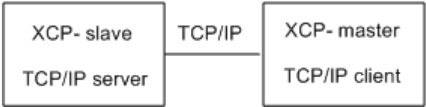
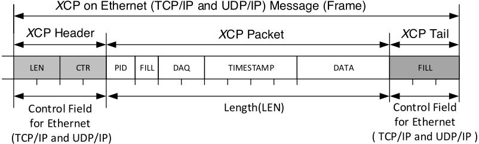
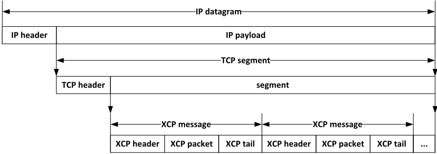
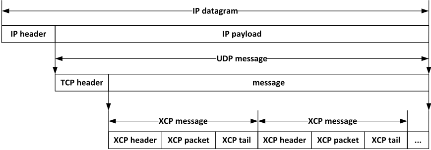

## ASAM MCD-1 (XCP on Ethernet)

Universal Measurement and Calibration Protocol

## Ethernet Transport Layer

Version 1.5.0

Date: 2017-11-30

## Associated Standard

## Disclaimer

This document is the copyrighted property of ASAM e.V. Any use is limited to the scope described in the license terms. The license terms can be viewed at www.asam.net/license

## Table of Contents

- [1 FOREWORD](#section-1)
- [2 INTRODUCTION](#section-2)
- [3 RELATIONS TO OTHER STANDARDS](#section-3)
  - [3.1 BACKWARD COMPATIBILITY TO EARLIER RELEASES](#section-3-1)
    - [3.1.1 ETHERNET TRANSPORT LAYER](#section-3-1-1)
    - [3.1.2 THE COMPATIBILITY MATRIX](#section-3-1-2)
  - [3.2 REFERENCES TO OTHER STANDARDS](#section-3-2)
- [4 THE XCP TRANSPORT LAYER FOR ETHERNET (TCP/IP AND UDP/IP)](#section-4)
  - [4.1 ADDRESSING](#section-4-1)
    - [4.1.1 TCP/IP](#section-4-1-1)
    - [4.1.2 UDP/IP](#section-4-1-2)
  - [4.2 COMMUNICATION MODEL](#section-4-2)
  - [4.3 HEADER AND TAIL](#section-4-3)
    - [4.3.1 HEADER](#section-4-3-1)
      - [4.3.1.1 LENGTH](#section-4-3-1-1)
      - [4.3.1.2 COUNTER](#section-4-3-1-2)
    - [4.3.2 TAIL](#section-4-3-2)
      - [4.3.2.1 SINGLE XCP MESSAGE IN ONE ETHERNET FRAME](#section-4-3-2-1)
      - [4.3.2.2 MULTIPLE XCP MESSAGES IN ONE ETHERNET FRAME](#section-4-3-2-2)
  - [4.4 THE LIMITS OF PERFORMANCE](#section-4-4)
- [5 SPECIFIC COMMANDS FOR XCP ON ETHERNET (TCP/IP AND UDP/IP)](#section-5)
  - [5.1 SLAVE DETECTION ON ETHERNET](#section-5-1)
  - [5.2 EXTENDED VERSION OF SLAVE DETECTION ON ETHERNET](#section-5-2)
  - [5.3 IP ADDRESS ASSIGNMENT](#section-5-3)
  - [5.4 DAQ CLOCK MULTICAST ON ETHERNET](#section-5-4)
  - [5.5 COMMUNICATION ERROR HANDLING](#section-5-5)
    - [5.5.1 ERROR CODE HANDLING](#section-5-5-1)
- [6 SPECIFIC EVENTS FOR XCP ON ETHERNET (TCP/IP AND UDP/IP)](#section-6)
- [7 DATA TRANSFER ON THE ETHERNET](#section-7)
  - [7.1 LIMIT OF BUS BANDWIDTH USED FOR DATA TRANSFER](#section-7-1)
- [8 INTERFACE TO ASAM MCD-2 MC DESCRIPTION FILE](#section-8)
  - [8.1 ASAM MCD-2 MC AML FOR XCP ON ETHERNET (TCP/IP AND UDP/IP)](#section-8-1)
  - [8.2 IF\_DATA EXAMPLE FOR XCP ON ETHERNET (TCP/IP AND UDP/IP)](#section-8-2)
- [9 SYMBOLS AND ABBREVIATED TERMS](#section-9)
- [10 BIBLIOGRAPHY](#section-10)
- [Figure Directory](#figure-directory)
- [Table Directory](#table-directory)

<a id="section-1"></a>

## 1 FOREWORD

XCP is short for Universal Measurement and Calibration Protocol. The main purpose is the data acquisition and calibration access from electronic control units. Therefore a generic protocol layer is defined. As transport medium different physical busses and networks can be used. For each authorized transport medium a separated transport layer is defined. This separation is reflected in standard document structure, which looks like follows:

- One Base Standard
- Associated Standards for each physical bus or network type

The Base Standard describes the following content:

- Protocol Layer
- Interface to ASAM MCD-2 MC
- Interface to an external SEED&amp;KEY function
- Interface to an external Checksum function
- Interface to an external A2L Decompression/Decrypting function
- Example Communication sequences

This associated standard describes the XCP on Ethernet Transport Layer.

The "X" inside the term XCP generalizes the "various" transportation layers that are used by the members of the protocol family. Because XCP is based on CCP the "X" shall also show that the XCP protocol functionality is extended in compare with CCP.

<a id="section-2"></a>

## 2 INTRODUCTION

This standard describes how XCP is transported on Ethernet as transport layer. It is shown how addressing shall be realized and the usage of the different communication models (see Chapter 4.2). Also the content of the control field of the XCP message frame format is described. For details about the frame format structure please refer the base standard [1]. The interface to the ASAM MCD-2 MC description file is described in chapter 7.

<a id="section-3"></a>

## 3 RELATIONS TO OTHER STANDARDS

<a id="section-3-1"></a>

## 3.1 BACKWARD COMPATIBILITY TO EARLIER RELEASES

<a id="section-3-1-1"></a>

## 3.1.1 ETHERNET TRANSPORT LAYER

This Transport layer uses the version number 1.5. This version number is represented as 16 bit value, where the high byte contains the major version (U) and low byte contains the minor version (V) number.

If this associated standard is modified in such a way that a functional modification in the slave's driver software is needed, the higher byte of its XCP Transport Layer Version Number will be incremented. This could be the case e.g. when modifying the parameters of an existing command or adding a new command to the specification.

If this associated standard is modified in such a way that it has no direct influence on the slave's driver software, the lower byte of its XCP Transport Layer Version Number will be incremented. This could be the case e.g. when rephrasing the explaining text or modifying the AML description.

The slave only returns the most significant byte of the XCP Transport Layer Version Number for the current Transport Layer in the response upon CONNECT.

<a id="section-3-1-2"></a>

## 3.1.2 THE COMPATIBILITY MATRIX

The Compatibility Matrix gives an overview of the allowed combinations of Protocol Layer and Transport Layer parts. For details about the Compatibility Matrix please refer the base standard [1].

<a id="section-3-2"></a>

## 3.2 REFERENCES TO OTHER STANDARDS

For details about the References to other standards please refer the base standard [1].

<a id="section-4"></a>

## 4 THE XCP TRANSPORT LAYER FOR ETHERNET (TCP/IP AND UDP/IP)

<a id="section-4-1"></a>

## 4.1 ADDRESSING

A slave device connected by Ethernet and TCP/IP or UDP/IP protocol is addressed by its IP (V4 or V6) Address and Port number.

<a id="section-4-1-1"></a>

## 4.1.1 TCP/IP

The slave device is the listener. It will only accept one connection at the time. If the socket is closed while in XCP connected state, the slave device will perform an XCP disconnect, which means that all data acquisition will be stopped.

Note for RESUME Mode:

Figure 1 RESUME mode with TCP/IP



For TCP/IP the XCP master always has to actively establish a connection to the XCP slave which is passively listening for incoming connections until then. The consequence for the RESUME mode is that the master has to permanently try to open a connection to the slave which itself has to buffer measurement data until the connection is established. Otherwise data will be lost.

<a id="section-4-1-2"></a>

## 4.1.2 UDP/IP

While not connected, the slave device will answer upon a CONNECT command by sending the response to the IP address and port of the sender of the command. It will continue to answer to this IP address and port for all subsequent responses. When connected, it will respond only to telegrams from the IP address which has sent the CONNECT command even if another port is used. All other command packets will not be responded.

<a id="section-4-2"></a>

## 4.2 COMMUNICATION MODEL

XCP on TCP/IP and UDP/IP makes use of the standard communication model.

The block transfer communication is optional.

The interleaved communication model is optional.

<a id="section-4-3"></a>

## 4.3 HEADER AND TAIL

Figure 2 Header and tail for XCP on Ethernet (TCP/IP and UDP/IP)



<a id="section-4-3-1"></a>

## 4.3.1 HEADER

For XCP on Ethernet (TCP/IP and UDP/IP) the header consists of a Control Field containing a LENgth (LEN) and a CounTeR (CTR).

Both LEN and CTR always are WORDs in Intel byte order

To make optimal use of UDP/IP, multiple XCP Frames may be combined into a single UDP/IP frame, but an XCP Frame may not cross a UDP/IP frame boundary.

The same XCP Frame format is used for the stream oriented protocol TCP/IP to simplify decoding the original XCP messages.

<a id="section-4-3-1-1"></a>

## 4.3.1.1 LENGTH

LEN is the number of bytes in the original XCP Packet.

<a id="section-4-3-1-2"></a>

## 4.3.1.2 COUNTER

The CTR value in the XCP Header allows detection of missing Packets.

For each point to point connection, the master has to generate a CTR value for all packets that are sent to the slave. This CTR value has to be increased for each packet regardless of the type (CMD, STIM).

For XCP Multicast messages based on IP multicast, the master has to set the CTR field to 0.

The slave has to generate a (second, independent) CTR value for all packets that are sent to the master. This CTR value is to be increased for each packet regardless of the type (RES, ERR, EV, SERV, DAQ).

<a id="section-4-3-2"></a>

## 4.3.2 TAIL

For XCP on Ethernet (TCP/IP and UDP/IP) the tail consists of a control field containing 0,1,2 or 3 FILL bytes.

<a id="section-4-3-2-1"></a>

## 4.3.2.1 SINGLE XCP MESSAGE IN ONE ETHERNET FRAME

The tail is optional.

<a id="section-4-3-2-2"></a>

## 4.3.2.2 MULTIPLE XCP MESSAGES IN ONE ETHERNET FRAME

The performance for accessing the contents of the XCP messages can be increased when an XCP packet starts on an aligned address.

PACKET\_ALIGNMENT\_x (x = 8, 16, 32) indicates the alignment that has to be used for XCP packets. If there is a concatenation of multiple XCP messages in one Ethernet frame, the aligning is performed by optional FILL bytes within the tail. The contents of the FILL bytes is "do not care".

The alignment indicated by PACKET\_ALIGNMENT\_x must be fulfilled for each XCP packet. The tail of a preceding XCP message is built in such a way that the required alignment of the XCP packet of the subsequent message is fulfilled. Depending on the length of its XCP packet and depending on the required alignment, the tail can consist of 0, 1, 2 or 3 FILL bytes.

<a id="section-4-4"></a>

## 4.4 THE LIMITS OF PERFORMANCE

The upper limit of MAX\_CTO and MAX\_DTO depends on protocol stack (TCP/IP and UDP/IP) of the host system.

Table 1 CTO and DTO range

| Name    | Type      | Representation   | Range of value   |
|---------|-----------|------------------|------------------|
| MAX_CTO | Parameter | BYTE             | 0x08 - 0xFF      |
| MAX_DTO | Parameter | WORD             | 0x0008 - 0xFFFF  |

<a id="section-5"></a>

## 5 SPECIFIC COMMANDS FOR XCP ON ETHERNET (TCP/IP AND UDP/IP)

Table 2 Command codes overview

| Command                 | Code       | Timeout       | Remark   |
|-------------------------|------------|---------------|----------|
| GET_SLAVE_ID            | 0xFF       | 300ms         | optional |
| GET_SLAVE_ID_EXTENDED   | 0xFD       | 300ms         | optional |
| SET_SLAVE_IP_ADDRESS    | 0xFC       | 300ms         | optional |
| GET_DAQ_CLOCK_MULTICAST | 0xFA       | irrelevant    | optional |
| User-defined            | 0x01- 0x0F | user-specific | optional |

Optional commands might not be implemented at all. This means that a slave might not even send a negative response to an unimplemented command.

<a id="section-5-1"></a>

## 5.1 SLAVE DETECTION ON ETHERNET

Category Ethernet only, Multicast (UDP/IP only), optional

Mnemonic GET\_SLAVE\_ID

Table 3 GET\_SLAVE\_ID command structure

| Position   | Type        | Description                                                                      |
|------------|-------------|----------------------------------------------------------------------------------|
| 0          | BYTE        | Command Code = TRANSPORT_LAYER_CMD = 0xF2                                        |
| 1          | BYTE        | Sub Command Code = 0xFF                                                          |
| 2          | WORD        | Port - used for response                                                         |
| 4          | BYTE        | IP multicast address - used for response most significant byte (1 st octet)      |
| 5… 6       | Multi- BYTE | IP multicast address - used for response (byte significance in descending order) |
| 7          | BYTE        | IP multicast address - used for response least significant byte (4 th octet)     |
| 8…19       | Multi- BYTE | Reserved (e.g. for IPv6)                                                         |
| 20         | BYTE        | IP_VERSION 0 = IPv4 Others = reserved                                            |

The master can use GET\_SLAVE\_ID command to detect XCP slaves on Ethernet. Therefore, the master sends an IPv4 multicast message using IPv4 address 239.255.0.0 and port 5556. The counter field in the transport layer Ethernet specific XCP header type shall not be processed by the slave. Independent of the connection state, a slave has to process the command and send a response to the master.

To establish a simple way of communication between a slave and the master, i.e. to simplify slave side subnetting when a slave does not have a valid IP address, the slave sends the response using IP multicast as well. The IP version that has to be used for the response is given by the IP\_VERSION field. The IP multicast address and port the slave has to use are given as part of the command sent by the master.

For each port, to which one or more XCP instances are bound, the slave sends a positive response carrying the payload as given in Table 10. In case that a slave does not have a valid IPv4 address, the IPv4 address has to be invalidated using IPv4 address "0.0.0.0". Similarly, if the slave does not support GET\_ID with parameter "requested identification type" = 0, the identification field has to be filled up with "0".

All values of the command and positive response structure are encoded in Intel byte order.

Table 4 GET\_SLAVE\_ID positive response structure

| Position        | Type        | Description                                                                                                               |
|-----------------|-------------|---------------------------------------------------------------------------------------------------------------------------|
| 0               | BYTE        | Slave's IP address - most significant byte (1 st octet)                                                                   |
| 1… 2            | BYTE        | Slave's IP address (byte significance in descending order)                                                                |
| 3               | BYTE        | Slave's IP address - least significant byte (4 th octet)                                                                  |
| 4… 15           | Multi- BYTE | Reserved                                                                                                                  |
| 16              | WORD        | Slave's port                                                                                                              |
| 18              | BYTE        | STATUS                                                                                                                    |
| 19              | BYTE        | RESOURCE (must match RESOURCE parameter bit mask coding as send as part of positive response to command CONNECT)          |
| 20              | DWORD       | Length [BYTE]                                                                                                             |
| 24… 24+Length-1 | Multi- BYTE | Identification, as sent as part of positive response on command GET_ID with parameter "requested identification type" = 0 |

Table 5 STATUS parameter bit mask structure

| Bit 7   | Bit 6   | Bit 5   | Bit 4                | Bit 3            | Bit 2      | Bit 1                    | Bit 0                   |
|---------|---------|---------|----------------------|------------------|------------|--------------------------|-------------------------|
| X       | X       | X       | SLV_ID_EXT_SUPPORTED | SLV_AVAILABILITY | IP_VERSION | IP_TRANSPORT_PROTOCOL_II | IP_TRANSPORT_PROTOCOL_I |

Table 6 STATUS parameter bit mask coding

| Flag                  | Description                                                                 |
|-----------------------|-----------------------------------------------------------------------------|
| IP_TRANSPORT_PROTOCOL | 0 = TCP only 1 = UDP only 2 = both 3 = reserved                             |
| IP_VERSION            | 0 = IPv4 1 = Reserved                                                       |
| SLV_AVAILABILITY      | 0 = XCP slave free 1 = XCP slave already in use                             |
| SLV_ID_EXT_SUPPORTED  | 0 = GET_SLAVE_ID_EXTENDED not supported 1 = GET_SLAVE_ID_EXTENDED supported |

<a id="section-5-2"></a>

## 5.2 EXTENDED VERSION OF SLAVE DETECTION ON ETHERNET

Category Ethernet only, Multicast (UDP/IP only), optional Mnemonic GET\_SLAVE\_ID\_EXTENDED

Table 7 GET\_SLAVE\_ID\_EXTENDED command structure

| Position   | Type        | Description                                                                      |
|------------|-------------|----------------------------------------------------------------------------------|
| 0          | BYTE        | Command Code = TRANSPORT_LAYER_CMD = 0xF2                                        |
| 1          | BYTE        | Sub Command Code = 0xFD                                                          |
| 2          | WORD        | Port - used for response                                                         |
| 4          | BYTE        | IP multicast address - used for response most significant byte (1 st octet)      |
| 5… 6       | Multi- BYTE | IP multicast address - used for response (byte significance in descending order) |
| 7          | BYTE        | IP multicast address - used for response least significant byte (4 th octet)     |
| 8…19       | Multi- BYTE | Reserved                                                                         |
| 20         | BYTE        | Mode                                                                             |

Table 8 Mode parameter bit mask structure

| Bit 7   | Bit 6   | Bit 5   | Bit 4   | Bit 3   | Bit 2   | Bit 1   | Bit 0      |
|---------|---------|---------|---------|---------|---------|---------|------------|
| X       | X       | X       | X       | X       | X       | X       | IP_VERSION |

Table 9 Mode parameter bit mask coding

| Flag       | Description                                                        |
|------------|--------------------------------------------------------------------|
| IP_VERSION | IP Version of command's IP multicast address 0 = IPv4 1 = Reserved |

The GET\_SLAVE\_ID\_EXTENDED command is similar to the GET\_SLAVE\_ID command. In contrast to the GET\_SLAVE\_ID command the slave is requested to send more of its locally available information to the master by this command. Also, the structure of the response is aligned to those of the protocol layer to simplify the processing on the master side.

The master can use GET\_SLAVE\_ID\_EXTENDED command to detect XCP slaves on Ethernet. Therefore, the master sends an IPv4 multicast message using IPv4 address 239.255.0.0 and port 5556. The counter field in the transport layer Ethernet specific XCP header type shall not be processed by the slave. Independent of the connection state, a slave has to process the command and send a response to the master.

To establish a simple way of communication between a slave and the master, i.e. to simplify slave side subnetting when a slave does not have a valid IP address, the slave sends the response using IP multicast as well. The IP version that has to be used for the response is given by the IP\_VERSION field. The IP multicast address and port the slave has to use are given as part of the command sent by the master.

For each port, to which one or more XCP instances are bound, the slave sends a positive response carrying the payload as given in Table 10. In case that a slave does not have a valid IPv4 address, the IPv4 address has to be invalidated using IPv4 address "0.0.0.0". Similarly, if the slave does not support GET\_ID with parameter "requested identification type" = 0, the identification field has to be filled up with "0".

The slave shall append its MAC address to the response. Furthermore, for each implemented identification type the slave shall append the GET\_ID identification type. It is recommended to implement the types 5, 6 and 7.

All values of the command and response structures are encoded in Intel byte order.

**Positive Response::**

Table 10 GET\_SLAVE\_ID\_EXTENDED positive response structure

| Position        | Type        | Description                                                                                                               |
|-----------------|-------------|---------------------------------------------------------------------------------------------------------------------------|
| 0               | BYTE        | 0xFF (positive response)                                                                                                  |
| 1               | BYTE        | 0xFD (subcommand code)                                                                                                    |
| 2               | BYTE        | Slave's IP address - most significant byte (1 st octet)                                                                   |
| 3… 4            | BYTE        | Slave's IP address (byte significance in descending order)                                                                |
| 5               | BYTE        | Slave's IP address - least significant byte (4 th octet)                                                                  |
| 6… 17           | Multi- BYTE | Reserved                                                                                                                  |
| 18              | WORD        | Slave's port                                                                                                              |
| 20              | BYTE        | STATUS                                                                                                                    |
| 21              | BYTE        | RESOURCE (must match RESOURCE parameter bit mask coding as send as part of positive response to command CONNECT)          |
| 22              | DWORD       | Length [BYTE]                                                                                                             |
| 26… 26+Length-1 | Multi- BYTE | Identification, as sent as part of positive response on command GET_ID with parameter "requested identification type" = 0 |
| 26+Length       | BYTE        | Slave's MAC address - most significant byte                                                                               |
| …               | Multi- BYTE | Slave's MAC address                                                                                                       |
| 26+Length+5     | BYTE        | Slave's MAC address - least significant byte                                                                              |
|                 |             | The subsequent information structure might be append several times                                                        |
|                 | BYTE        | Optional padding to ensure WORD alignment of successive Length_IDT information                                            |
|                 | WORD        | Length_IDT [BYTE]                                                                                                         |
|                 | BYTE        | Identification type [5,6,7]                                                                                               |
|                 | BYTE        | First byte of identification                                                                                              |
|                 | Multi- BYTE | Further bytes of identification                                                                                           |
|                 | BYTE        | [Length_IDT]th byte of identification                                                                                     |

Table 11 STATUS parameter bit mask structure

| Bit 7   | Bit 6   | Bit 5   | Bit 4   | Bit 3            | Bit 2      | Bit 1                    | Bit 0                   |
|---------|---------|---------|---------|------------------|------------|--------------------------|-------------------------|
| X       | X       | X       | X       | SLV_AVAILABILITY | IP_VERSION | IP_TRANSPORT_PROTOCOL_II | IP_TRANSPORT_PROTOCOL_I |

Table 12 STATUS parameter bit mask coding

| Flag                  | Description                                     |
|-----------------------|-------------------------------------------------|
| IP_TRANSPORT_PROTOCOL | 0 = TCP only 1 = UDP only 2 = both 3 = reserved |
| IP_VERSION            | 0 = IPv4 1 = Reserved                           |
| SLV_AVAILABILITY      | 0 = XCP slave free 1 = XCP slave already in use |

<a id="section-5-3"></a>

## 5.3 IP ADDRESS ASSIGNMENT

Category Ethernet only, Multicast (UDP/IP only), optional

Mnemonic SET\_SLAVE\_IP\_ADDRESS

The command may be used by the master to assign an IP address to a slave. The method of deriving an IP address on master side is vendor specific and not standardized within the scope of this standard.

Table 13 SET\_SLAVE\_IP\_ADDRESS command structure

|   Position | Type   | Description                               |
|------------|--------|-------------------------------------------|
|          0 | BYTE   | Command Code = TRANSPORT_LAYER_CMD = 0xF2 |
|          1 | BYTE   | Sub Command Code = 0xFC                   |
|          2 | WORD   | Port - used for response                  |
|          4 | BYTE   | IP multicast address - used for response  |

|        |             | most significant byte (1 st octet)                                               |
|--------|-------------|----------------------------------------------------------------------------------|
| 5… 6   | Multi- BYTE | IP multicast address - used for response (byte significance in descending order) |
| 7      | BYTE        | IP multicast address - used for response least significant byte (4 th octet)     |
| 8…19   | Multi- BYTE | Reserved                                                                         |
| 20     | BYTE        | Mode                                                                             |
| 21     | BYTE        | MAC address of selected slave - most significant byte                            |
| 22…25  | Multi- BYTE | MAC address of selected slave                                                    |
| 26     | BYTE        | MAC address of selected slave - least significant byte                           |
| 27     | BYTE        | IP address assigned to selected slave most significant byte (1 st octet)         |
| 28… 29 | Multi- BYTE | IP address assigned to selected slave (byte significance in descending order)    |
| 30     | BYTE        | IP address assigned to selected slave least significant byte (4 th octet)        |

Table 14 Mode parameter bit mask structure

| Bit 7   | Bit 6   | Bit 5   | Bit 4   | Bit 3   | Bit 2   | Bit 1   | Bit 0      |
|---------|---------|---------|---------|---------|---------|---------|------------|
| X       | X       | X       | X       | X       | X       | X       | IP_VERSION |

Table 15 Mode parameter bit mask coding

| Flag       | Description                                                        |
|------------|--------------------------------------------------------------------|
| IP_VERSION | IP Version of command's IP multicast address 0 = IPv4 1 = Reserved |

Positive Response:

Table 16 SET\_SLAVE\_IP\_ADDRESS positive response structure

| Position   | Type        | Description                                  |
|------------|-------------|----------------------------------------------|
| 0          | BYTE        | 0xFF (positive response)                     |
| 1          | BYTE        | 0xFC (subcommand code)                       |
| 2          | BYTE        | Status                                       |
| 3          | BYTE        | Slave's MAC address - most significant byte  |
| 4… 7       | Multi- BYTE | Slave's MAC address                          |
| 8          | BYTE        | Slave's MAC address - least significant byte |

Table 17 STATUS parameter coding

|   Value | Description                                                             |
|---------|-------------------------------------------------------------------------|
|       0 | IP address is valid for communication                                   |
|       1 | IP address is taken over and will be activated by the slave in due time |
|       2 | manual action necessary to activate IP address                          |

**Negative Response::**

In case of an error, the slave should respond with a negative response as given in Table 18.

Table 18 SET\_SLAVE\_IP\_ADDRESS negative response structure

| Position   | Type        | Description                                  |
|------------|-------------|----------------------------------------------|
| 0          | BYTE        | 0xFE (negative response)                     |
| 1          | BYTE        | 0xFC (subcommand code)                       |
| 2          | BYTE        | Error Code (see Table 20)                    |
| 3          | BYTE        | Slave's MAC address - most significant byte  |
| 4… 7       | Multi- BYTE | Slave's MAC address                          |
| 8          | BYTE        | Slave's MAC address - least significant byte |

**Note**

Other mechanism for obtaining an IP address might be supported by the slave. In case that the slave uses Automatic Private IP Addressing (APIPA), the slave shall implement the method according to requirements defined in ISO 13400-2.

<a id="section-5-4"></a>

## 5.4 DAQ CLOCK MULTICAST ON ETHERNET

Category Ethernet only, Multicast (UDP/IP only), optional Mnemonic GET\_DAQ\_CLOCK\_MULTICAST

Table 19 GET\_DAQ\_CLOCK\_MULTICAST command structure

|   Position | Type   | Description                                           |
|------------|--------|-------------------------------------------------------|
|          0 | BYTE   | Command Code = TRANSPORT_LAYER_CMD = 0xF2             |
|          1 | BYTE   | Sub Command Code = 0xFA                               |
|          2 | WORD   | Cluster Identifier (Intel byte order)                 |
|          4 | BYTE   | Counter (allows for consistency checks at XCP master) |

Transmission of XCP multicast commands on Ethernet relies on the IP multicast technique. Within the IPv4 multicast address scope, the site-local scope address range is used for XCP multicast command transmission, i.e. IP addresses 239.255.0.0 to 239.255.255.255.

The address an XCP slave observes for XCP multicast reception is derived from the CLUSTER\_AFFILIATION parameter, which is part of TIME\_SYNCHRONIZATION\_PROPERTIES command. The mapping from the CLUSTER\_AFFILIATION parameter to an IPv4 multicast address is based on Intel byte order interpretation of the CLUSTER\_AFFILIATION parameter (depicted by index LE) and is given as follows:

IPv4-Multicast-Addr. = 239.255.UPPER\_BYTE\_OF\_CLUSTER\_AFFILIATIONLE. LOWER\_BYTE\_OF\_CLUSTER\_AFFILIATIONLE

The port an XCP slave observes is 5557. The counter field of the transport layer Ethernet specific XCP header (see chapter 4.3.1) shall not be processed by the slave.

When an XCP master makes use of GET\_DAQ\_CLOCK\_MULTICAST command on transport layer Ethernet, a GET\_DAQ\_CLOCK\_MULTICAST command must be sent every two seconds at the latest.

Upon reception of a GET\_DAQ\_CLOCK\_MULTICAST command, the XCP slave will respond an EV\_TIME\_SYNC event packet as defined in XCP Protocol Layer.

All values of the command structure are encoded in Intel byte order.

<a id="section-5-5"></a>

## 5.5 COMMUNICATION ERROR HANDLING

This chapter describes transport layer specific error handling. It extends the error handling concepts specified in the chapter "Communication Error Handling" of the base standard [1]. Please refer to the base standard for obtaining fundamentals on XCP error handling.

<a id="section-5-5-1"></a>

## 5.5.1 ERROR CODE HANDLING

Table 20 Transport Layer Ethernet subcommands error handling

| Command                 | Error          | Pre- Action   | Action         |
|-------------------------|----------------|---------------|----------------|
| GET_SLAVE_ID            | -              | -             | -              |
| GET_SLAVE_ID_EXTENDED   | -              | -             | -              |
| SET_SLAVE_IP_ADDRESS    | ERR_CMD_BUSY   | -             | repeat ∞ times |
| SET_SLAVE_IP_ADDRESS    | ERR_CMD_SYNTAX | -             | -              |
| GET_DAQ_CLOCK_MULTICAST | -              | -             | -              |

<a id="section-6"></a>

## 6 SPECIFIC EVENTS FOR XCP ON ETHERNET (TCP/IP AND UDP/IP)

There are no specific events for XCP on Ethernet (TCP/IP and UDP/IP) at the moment.

<a id="section-7"></a>

## 7 DATA TRANSFER ON THE ETHERNET

<a id="section-7-1"></a>

## 7.1 LIMIT OF BUS BANDWIDTH USED FOR DATA TRANSFER

The bandwidth of a TCP/IP or UDP/IP connection is limited by the Ethernet controller but this information is not available in the transport layer description because this limit can vary.

The calculation of the used bandwidth is different to the calculation for the CAN transport layer because it is possible to have multiple XCP frames within one UDP/IP or TCP/IP frame. For the Ethernet transport layer, it is only possible to limit the bandwidth based on the net data transfer (XCP header, packet and tail). It cannot be calculated, how much overhead is needed for UDP/IP or TCP/IP.

Figure 3 XCP frames with TCP/IP



Figure 4 XCP frames with UDP/IP



With the MAX\_BUS\_LOAD limit, it is possible to limit the data transfer in general for XCP.

MAX\_BIT\_RATE defines the base bandwidth of the Ethernet network which is used in Mbit.

With these parameters it is possible for the XCP master to calculate the reserved bandwidth (100% - MAX\_BUS\_LOAD) * MAX\_BIT\_RATE.

The network interface card can have an impact on the available bandwidth therefore the XCP master has to check if the available network bandwidth is identical to the A2l file configuration MAX\_BIT\_RATE. If the available bandwidth is lower than MAX\_BIT\_RATE the XCP master has to check if it will be possible to start a measurement without disturbing the Ethernet communication.

For the offline check without a connected network the XCP master has to use the parameters from the A2L file.

The XCP master can monitor this limit while configuring the data transfer. For this the master has to use the current DAQ configuration in combination with the cycle time of the assigned EVENTs. With this information the XCP master can calculate the resulting TOTAL\_BUSLOAD for the current configuration. For certain EVENTS a minimum cycle time (MIN\_CYCLE\_TIME) has to be defined in the a2l file additionally. For all EVENT which have no defined cycle time e.g. configuration with 0-0 in the EVENT description it is possible to add a minimum cycle time for this EVENT so that the XCP master can make a worst case calculation.

The calculation is the sum of all configured EVENTs. And in detail the update rate of an EVENT will be multiplied with the needed space for all ODTs in the related EVENT.

<
!
-
-
 
D
R
O
P
 
-
-
>

Example: A measurement configuration with 2 ODT`s running in a 2 ms EVENT XCP packet length 40 and 17 bytes and a 100ms EVENT with 6 ODT`s with the length of 40, 40, 40, 40, 40 and 2 bytes. The MAX\_BUS\_LOAD is set to 12 % and MAX\_BIT\_RATE is 10 Mbit. No tail is assumed in this example.

```
Total_Busload Consumption =

     n
  Σ    ( 1/MIN_CYCLE_TIME(k)  *

          k,m
          Σ      frame_length[header + packet + tail](k,i)
          k,i=0

  k=0
)
```
(k = EVENT_CHANNEL_NUMBER, n = MAX_EVENT_CHANNEL)

```
Total_Busload Consumption =
  1/(2 ms) * (2*4 byte header + 40 byte packet + 17 byte packet) +
  1/(100 ms) * (6*4 byte header + 5*40 byte packet + 2 byte packet)
                                      = 34780 byte/s

Total_Busload Consumption / (MAX_BITRATE * MAX_BUS_LOAD)
  = 34780 byte/s / 1,2 Mbit = 23,18 %
```

MAX\_BUS\_LOAD limits only the traffic for DAQ and STIM but not for command, response, error or event messages.

<a id="section-8"></a>

## 8 INTERFACE TO ASAM MCD-2 MC DESCRIPTION FILE

The following chapter describes the parameters that are specific for XCP on Ethernet.

<a id="section-8-1"></a>

## 8.1 ASAM MCD-2 MC AML FOR XCP ON ETHERNET (TCP/IP AND UDP/IP)

The AML for the XCP on UDP IP transport layer specific properties is defined in the file named XCP\_vX\_Y\_on\_UDP\_IP.aml where vX\_Y is the current protocol layer version. The AML for the XCP on TCP IP transport layer specific properties is defined in the file named XCP\_vX\_Y\_on\_TCP\_IP.aml where vX\_Y is the current protocol layer version.

<a id="section-8-2"></a>

## 8.2 IF\_DATA EXAMPLE FOR XCP ON ETHERNET (TCP/IP AND UDP/IP)

The file XCP\_vX\_Y\_IF\_DATA\_example.a2l where vX\_Y is the current protocol layer version gives an IF\_DATA example for a XCP on TCP IP and XCP on UDP IP transport layer (see section beginning with "/begin XCP\_ON\_TCP\_IP" or "/begin XCP\_ON\_UDP\_IP).

<a id="section-9"></a>

## 9 SYMBOLS AND ABBREVIATED TERMS

A2L

CAN

ASAM MCD-2 MC Language File

Controller Area Network

CCP

CAN Calibration Protocol

CMD

Command

CTO

Command Transfer Object

CTR

Counter

DAQ

Data Acquisition

DLC

Data Length Code

DTO

Data Transfer Objects

ECU

Electronic Control Unit

ERR

Error

EV

Event

IP

Internet Protocol

LEN

Length

RES

Responses

SERV

Service

STIM

Synchronous Data Stimulation

TCP

Transfer Control Protocol

TS

Time Stamp

UDP

User Datagram Protocol

USB

Universal Serial Bus

XCP

Universal Measurement and Calibration Protocol

<a id="section-10"></a>

## 10 BIBLIOGRAPHY

| [1]   | ASAM AE MCD-1 XCP BS Protocol-Layer BS Version V1.4.0        |
|-------|--------------------------------------------------------------|
| [2]   | ISO 13400-2 Road vehicles - Diagnostic communication over IP |

<a id="figure-directory"></a>

## Figure Directory

| Figure 1   | RESUME mode with TCP/IP                                 |   8 |
|------------|---------------------------------------------------------|-----|
| Figure 2   | Header and tail for XCP on Ethernet (TCP/IP and UDP/IP) |   9 |
| Figure 3   | XCP frames with TCP/IP                                  |  25 |
| Figure 4   | XCP frames with UDP/IP                                  |  25 |

<a id="table-directory"></a>

## Table Directory

| Table 1   | CTO and DTO range                                   |   11 |
|-----------|-----------------------------------------------------|------|
| Table 2   | Command codes overview                              |   12 |
| Table 3   | GET_SLAVE_ID command structure                      |   12 |
| Table 4   | GET_SLAVE_ID positive response structure            |   13 |
| Table 5   | STATUS parameter bit mask structure                 |   14 |
| Table 6   | STATUS parameter bit mask coding                    |   14 |
| Table 7   | GET_SLAVE_ID_EXTENDED command structure             |   15 |
| Table 8   | Mode parameter bit mask structure                   |   15 |
| Table 9   | Mode parameter bit mask coding                      |   15 |
| Table 10  | GET_SLAVE_ID_EXTENDED positive response structure   |   17 |
| Table 11  | STATUS parameter bit mask structure                 |   18 |
| Table 12  | STATUS parameter bit mask coding                    |   18 |
| Table 13  | SET_SLAVE_IP_ADDRESS command structure              |   18 |
| Table 14  | Mode parameter bit mask structure                   |   20 |
| Table 15  | Mode parameter bit mask coding                      |   20 |
| Table 16  | SET_SLAVE_IP_ADDRESS positive response structure    |   20 |
| Table 17  | STATUS parameter coding                             |   20 |
| Table 18  | SET_SLAVE_IP_ADDRESS negative response structure    |   21 |
| Table 19  | GET_DAQ_CLOCK_MULTICAST command structure           |   22 |
| Table 20  | Transport Layer Ethernet subcommands error handling |   23 |


[E-mail: support@asam.net](mailto:support@asam.net)

[Web: www.asam.net](http://www.asam.net/)

© by ASAM e.V., 2017
