## ASAM MCD-1 (XCP)

Universal Measurement and Calibration Protocol

## Protocol Layer Specification

Version 1.5.0

Date: 2017-11-30

## Base Standard

## Disclaimer

This document is the copyrighted property of ASAM e.V. Any use is limited to the scope described in the license terms. The license terms can be viewed at www.asam.net/license

## Table of Contents

- [1 FOREWORD](#section-1)
- [2 INTRODUCTION](#section-2)
- [3 RELATIONS TO OTHER STANDARDS](#section-3)
  - [3.1 BACKWARD COMPATIBILITY TO EARLIER RELEASES](#section-3-1)
    - [3.1.1 THE XCP PROTOCOL LAYER VERSION NUMBER](#section-3-1-1)
    - [3.1.2 THE COMPATIBILITY MATRIX](#section-3-1-2)
  - [3.2 REFERENCES TO OTHER STANDARDS](#section-3-2)
    - [3.2.1 CCP AND XCP](#section-3-2-1)
- [4 XCP FEATURES AND CONCEPTS](#section-4)
  - [4.1 SYNCHRONOUS DATA TRANSFER](#section-4-1)
    - [4.1.1 DAQ, STIM AND ODT](#section-4-1-1)
    - [4.1.2 ODT ENTRY](#section-4-1-2)
    - [4.1.3 OBJECT DESCRIPTOR TABLE](#section-4-1-3)
    - [4.1.4 DAQ LIST](#section-4-1-4)
    - [4.1.5 EVENT CHANNELS](#section-4-1-5)
    - [4.1.6 DYNAMIC DAQ CONFIGURATION](#section-4-1-6)
    - [4.1.7 DAQ CONFIGURATION STORING AND POWER-UP DATA TRANSFER](#section-4-1-7)
      - [4.1.7.1 DAQ CONFIGURATION STORING WITHOUT POWER-UP DATA TRANSFER](#section-4-1-7-1)
      - [4.1.7.2 DAQ CONFIGURATION STORING WITH POWER-UP DATA TRANSFER (RESUME MODE)](#section-4-1-7-2)
    - [4.1.8 DAQ LIST PRIORITIZATION](#section-4-1-8)
    - [4.1.9 ODT OPTIMIZATION](#section-4-1-9)
    - [4.1.10 DAQ PACKED MODE](#section-4-1-10)
      - [4.1.10.1 DAQ LIST BEHAVIOR](#section-4-1-10-1)
      - [4.1.10.2 EVENT CHANNEL](#section-4-1-10-2)
      - [4.1.10.3 TIMESTAMPS](#section-4-1-10-3)
      - [4.1.10.4 ERROR HANDLING](#section-4-1-10-4)
    - [4.1.11 BITWISE STIMULATION](#section-4-1-11)
    - [4.1.12 SYNCHRONOUS DATA ACQUISITION](#section-4-1-12)
    - [4.1.13 SYNCHRONOUS DATA STIMULATION](#section-4-1-13)
  - [4.2 MEASUREMENT MODES](#section-4-2)
    - [4.2.1 POLLING](#section-4-2-1)
    - [4.2.2 SYNCHRONOUS DATA TRANSFER, DAQ DIRECTION, BURST, STANDARD](#section-4-2-2)
    - [4.2.3 SYNCHRONOUS DATA TRANSFER, DAQ DIRECTION, BURST, IMPROVED](#section-4-2-3)
    - [4.2.4 SYNCHRONOUS DATA TRANSFER, DAQ DIRECTION, ALTERNATING](#section-4-2-4)
  - [4.3 BYPASSING](#section-4-3)
    - [4.3.1 DELAYED BYPASSING](#section-4-3-1)
    - [4.3.2 BYPASS ACTIVATION](#section-4-3-2)
    - [4.3.3 BYPASSING STARTUP](#section-4-3-3)
    - [4.3.4 PLAUSIBILITY CHECKS](#section-4-3-4)
    - [4.3.5 BYPASSING CONSISTENCY](#section-4-3-5)
      - [4.3.5.1 EVENT CHANNEL RELATIONS](#section-4-3-5-1)
      - [4.3.5.2 DTO CTR EVENT CHANNEL PROPERTIES](#section-4-3-5-2)
      - [4.3.5.3 DTO CTR FIELD](#section-4-3-5-3)
      - [4.3.5.4 DTO CTR CHECK](#section-4-3-5-4)
      - [4.3.5.5 EXAMPLES](#section-4-3-5-5)
    - [4.3.6 MINIMUM SEPARATION TIME](#section-4-3-6)
  - [4.4 ONLINE CALIBRATION](#section-4-4)
    - [4.4.1 SECTOR, SEGMENT AND PAGE](#section-4-4-1)
    - [4.4.2 LOGICAL LAYOUT: SEGMENT](#section-4-4-2)
    - [4.4.3 ACCESSIBILITY - PAGE](#section-4-4-3)
    - [4.4.4 CALIBRATION DATA PAGE SWITCHING](#section-4-4-4)
    - [4.4.5 CALIBRATION DATA PAGE FREEZING](#section-4-4-5)
    - [4.4.6 ADDRESSING ACTION](#section-4-4-6)
    - [4.4.7 MASTER-SLAVE ACTION](#section-4-4-7)
    - [4.4.8 PAGE-PAGE ACTION](#section-4-4-8)
  - [4.5 FLASH PROGRAMMING](#section-4-5)
    - [4.5.1 PHYSICAL LAYOUT: SECTOR](#section-4-5-1)
    - [4.5.2 GENERAL](#section-4-5-2)
    - [4.5.3 ABSOLUTE ACCESS MODE - ACCESS BY ADDRESS](#section-4-5-3)
    - [4.5.4 FUNCTIONAL ACCESS MODE - ACCESS BY FLASH AREA](#section-4-5-4)
    - [4.5.5 CHECKSUM CONTROL AND PROGRAM VERIFY](#section-4-5-5)
    - [4.5.6 END OF FLASH SESSION](#section-4-5-6)
  - [4.6 TIME CORRELATION](#section-4-6)
    - [4.6.1 INTRODUCTION](#section-4-6-1)
    - [4.6.2 XCP SLAVE'S CLOCK SUBSYSTEM](#section-4-6-2)
      - [4.6.2.1 SCENARIO 1: ONE OBSERVABLE CLOCK - FREE RUNNING XCP SLAVE CLOCK](#section-4-6-2-1)
      - [4.6.2.5 SCENARIO 5: TWO OBSERVABLE CLOCKS - FREE RUNNING XCP SLAVE CLOCK COMBINED WITH AN ECU CLOCK](#section-4-6-2-5)
      - [4.6.2.6 SCENARIO 6: THREE OBSERVABLE CLOCKS](#section-4-6-2-6)
      - [4.6.2.7 SCENARIO 7: ECU CLOCK ONLY](#section-4-6-2-7)
  - [4.7 ECU STATES](#section-4-7)
    - [4.7.1 INTRODUCTION](#section-4-7-1)
    - [4.7.2 TRANSFERRING THE STATE INFORMATION TO THE XCP MASTER](#section-4-7-2)
    - [4.7.3 A2L SEMANTIC CONSISTENCY](#section-4-7-3)
  - [4.8 SOFTWARE DEBUGGING](#section-4-8)
- [5 THE XCP PROTOCOL](#section-5)
  - [5.1 TOPOLOGY](#section-5-1)
  - [5.2 THE XCP COMMUNICATION MODELS](#section-5-2)
    - [5.2.1 THE STANDARD COMMUNICATION MODEL](#section-5-2-1)
    - [5.2.2 THE BLOCK TRANSFER COMMUNICATION MODEL](#section-5-2-2)
    - [5.2.3 THE INTERLEAVED COMMUNICATION MODEL](#section-5-2-3)
  - [5.3 STATE MACHINE](#section-5-3)
  - [5.4 PROTECTION HANDLING](#section-5-4)
  - [5.5 THE XCP MESSAGE (FRAME) FORMAT](#section-5-5)
- [6 THE LIMITS OF PERFORMANCE](#section-6)
  - [6.1 GENERIC PERFORMANCE PARAMETERS](#section-6-1)
  - [6.2 DAQ/STIM SPECIFIC PERFORMANCE PARAMETERS](#section-6-2)
    - [6.2.1 DAQ SPECIFIC PARAMETERS](#section-6-2-1)
    - [6.2.2 STIM SPECIFIC PARAMETERS](#section-6-2-2)
    - [6.2.3 ECU RESOURCE CONSUMPTIONS](#section-6-2-3)
      - [6.2.3.1 ECU RAM CONSUMPTION](#section-6-2-3-1)
      - [6.2.3.2 CPU EXECUTION TIME](#section-6-2-3-2)
- [7 THE XCP PROTOCOL LAYER](#section-7)
  - [7.1 THE XCP PACKET](#section-7-1)
    - [7.1.1 THE XCP PACKET TYPES](#section-7-1-1)
    - [7.1.2 THE XCP PACKET FORMAT](#section-7-1-2)
      - [7.1.2.1 THE IDENTIFICATION FIELD](#section-7-1-2-1)
      - [7.1.2.2 THE COUNTER FIELD](#section-7-1-2-2)
      - [7.1.2.3 THE TIMESTAMP FIELD](#section-7-1-2-3)
      - [7.1.2.4 THE DATA FIELD](#section-7-1-2-4)
    - [7.1.3 THE CTO PACKETS](#section-7-1-3)
      - [7.1.3.1 COMMAND PACKET](#section-7-1-3-1)
      - [7.1.3.2 COMMAND RESPONSE PACKET](#section-7-1-3-2)
      - [7.1.3.3 ERROR PACKET](#section-7-1-3-3)
      - [7.1.3.4 EVENT PACKET](#section-7-1-3-4)
    - [7.1.4 THE DTO PACKETS](#section-7-1-4)
      - [7.1.4.1 DATA ACQUISITION PACKET](#section-7-1-4-1)
      - [7.1.4.2 SYNCHRONOUS DATA STIMULATION PACKET](#section-7-1-4-2)
    - [7.1.5 THE XCP PACKET IDENTIFIERS](#section-7-1-5)
      - [7.1.5.1 MASTER -&gt; SLAVE](#section-7-1-5-1)
      - [7.1.5.2 SLAVE -&gt; MASTER](#section-7-1-5-2)
  - [7.2 EVENT CODES](#section-7-2)
  - [7.3 SERVICE REQUEST CODES](#section-7-3)
  - [7.4 COMMAND CODES](#section-7-4)
  - [7.5 DESCRIPTION OF COMMANDS](#section-7-5)
    - [7.5.1 STANDARD COMMANDS](#section-7-5-1)
      - [7.5.1.2 GET VERSION INFORMATION](#section-7-5-1-2)
      - [7.5.1.3 DISCONNECT FROM SLAVE](#section-7-5-1-3)
      - [7.5.1.4 GET CURRENT SESSION STATUS FROM SLAVE](#section-7-5-1-4)
      - [7.5.1.5 SYNCHRONIZE COMMAND EXECUTION AFTER TIMEOUT](#section-7-5-1-5)
      - [7.5.1.6 GET COMMUNICATION MODE INFO](#section-7-5-1-6)
      - [7.5.1.7 GET IDENTIFICATION FROM SLAVE](#section-7-5-1-7)
      - [7.5.1.8 REQUEST TO SAVE TO NON-VOLATILE MEMORY](#section-7-5-1-8)
      - [7.5.1.9 GET SEED FOR UNLOCKING A PROTECTED RESOURCE](#section-7-5-1-9)
      - [7.5.1.10 SEND KEY FOR UNLOCKING A PROTECTED RESOURCE](#section-7-5-1-10)
      - [7.5.1.11 SET MEMORY TRANSFER ADDRESS IN SLAVE](#section-7-5-1-11)
      - [7.5.1.12 UPLOAD FROM SLAVE TO MASTER](#section-7-5-1-12)
      - [7.5.1.13 UPLOAD FROM SLAVE TO MASTER (SHORT VERSION)](#section-7-5-1-13)
      - [7.5.1.14 BUILD CHECKSUM OVER MEMORY RANGE](#section-7-5-1-14)
      - [7.5.1.15 REFER TO TRANSPORT LAYER SPECIFIC COMMAND](#section-7-5-1-15)
      - [7.5.1.16 REFER TO USER-DEFINED COMMAND](#section-7-5-1-16)
    - [7.5.2 CALIBRATION COMMANDS](#section-7-5-2)
      - [7.5.2.1 DOWNLOAD FROM MASTER TO SLAVE](#section-7-5-2-1)
      - [7.5.2.2 DOWNLOAD FROM MASTER TO SLAVE (BLOCK MODE)](#section-7-5-2-2)
      - [7.5.2.3 DOWNLOAD FROM MASTER TO SLAVE (FIXED SIZE)](#section-7-5-2-3)
      - [7.5.2.4 DOWNLOAD FROM MASTER TO SLAVE (SHORT VERSION)](#section-7-5-2-4)
      - [7.5.2.5 MODIFY BITS](#section-7-5-2-5)
    - [7.5.3 PAGE SWITCHING COMMANDS](#section-7-5-3)
      - [7.5.3.2 GET CALIBRATION PAGE](#section-7-5-3-2)
      - [7.5.3.3 GET GENERAL INFORMATION ON PAG PROCESSOR](#section-7-5-3-3)
      - [7.5.3.4 GET SPECIFIC INFORMATION FOR A SEGMENT](#section-7-5-3-4)
      - [7.5.3.5 GET SPECIFIC INFORMATION FOR A PAGE](#section-7-5-3-5)
      - [7.5.3.6 SET MODE FOR A SEGMENT](#section-7-5-3-6)
      - [7.5.3.7 GET MODE FOR A SEGMENT](#section-7-5-3-7)
      - [7.5.3.8 COPY PAGE](#section-7-5-3-8)
    - [7.5.4 DATA ACQUISITION AND STIMULATION COMMANDS](#section-7-5-4)
      - [7.5.4.1 SET POINTER TO ODT ENTRY](#section-7-5-4-1)
      - [7.5.4.2 WRITE ELEMENT IN ODT ENTRY](#section-7-5-4-2)
      - [7.5.4.3 SET MODE FOR DAQ LIST](#section-7-5-4-3)
      - [7.5.4.4 START/STOP/SELECT DAQ LIST](#section-7-5-4-4)
      - [7.5.4.5 START/STOP DAQ LISTS (SYNCHRONOUSLY)](#section-7-5-4-5)
      - [7.5.4.6 WRITE MULTIPLE ELEMENTS IN ODT](#section-7-5-4-6)
      - [7.5.4.7 SET DAQ LIST PACKED MODE](#section-7-5-4-7)
      - [7.5.4.8 GET DAQ LIST PACKED MODE](#section-7-5-4-8)
      - [7.5.4.9 READ ELEMENT FROM ODT ENTRY](#section-7-5-4-9)
      - [7.5.4.10 GET DAQ CLOCK FROM SLAVE](#section-7-5-4-10)
      - [7.5.4.11 GET GENERAL INFORMATION ON DAQ PROCESSOR](#section-7-5-4-11)
      - [7.5.4.12 GET GENERAL INFORMATION ON DAQ PROCESSING RESOLUTION](#section-7-5-4-12)
      - [7.5.4.13 GET MODE FROM DAQ LIST](#section-7-5-4-13)
      - [7.5.4.14 GET SPECIFIC INFORMATION FOR AN EVENT CHANNEL](#section-7-5-4-14)
      - [7.5.4.15 DTO CTR PROPERTIES](#section-7-5-4-15)
      - [7.5.4.16 CLEAR DAQ LIST CONFIGURATION](#section-7-5-4-16)
      - [7.5.4.17 GET SPECIFIC INFORMATION FOR A DAQ LIST](#section-7-5-4-17)
      - [7.5.4.18 CLEAR DYNAMIC DAQ CONFIGURATION](#section-7-5-4-18)
      - [7.5.4.19 ALLOCATE DAQ LISTS](#section-7-5-4-19)
      - [7.5.4.20 ALLOCATE ODTS TO A DAQ LIST](#section-7-5-4-20)
      - [7.5.4.21 ALLOCATE ODT ENTRIES TO AN ODT](#section-7-5-4-21)
    - [7.5.5 NON-VOLATILE MEMORY PROGRAMMING](#section-7-5-5)
      - [7.5.5.2 CLEAR A PART OF NON-VOLATILE MEMORY](#section-7-5-5-2)
      - [7.5.5.3 PROGRAM A NON-VOLATILE MEMORY SEGMENT](#section-7-5-5-3)
      - [7.5.5.4 INDICATE THE END OF A PROGRAMMING SEQUENCE](#section-7-5-5-4)
      - [7.5.5.5 GET GENERAL INFORMATION ON PGM PROCESSOR](#section-7-5-5-5)
      - [7.5.5.6 GET SPECIFIC INFORMATION FOR A SECTOR](#section-7-5-5-6)
      - [7.5.5.7 PREPARE NON-VOLATILE MEMORY PROGRAMMING](#section-7-5-5-7)
      - [7.5.5.8 SET DATA FORMAT BEFORE PROGRAMMING](#section-7-5-5-8)
      - [7.5.5.10 PROGRAM A NON-VOLATILE MEMORY SEGMENT (FIXED SIZE)](#section-7-5-5-10)
      - [7.5.5.11 PROGRAM VERIFY](#section-7-5-5-11)
    - [7.5.6 TIME CORRELATION](#section-7-5-6)
  - [7.6 COMMUNICATION ERROR HANDLING](#section-7-6)
    - [7.6.1 DEFINITIONS](#section-7-6-1)
      - [7.6.1.1 ERROR](#section-7-6-1-1)
      - [7.6.1.2 PRE-ACTION](#section-7-6-1-2)
      - [7.6.1.3 ACTION](#section-7-6-1-3)
      - [7.6.1.4 ERROR SEVERITY](#section-7-6-1-4)
    - [7.6.2 TIMEOUT HANDLING](#section-7-6-2)
      - [7.6.2.1 STANDARD COMMUNICATION MODEL](#section-7-6-2-1)
      - [7.6.2.2 BLOCK COMMUNICATION MODEL](#section-7-6-2-2)
      - [7.6.2.3 INTERLEAVED COMMUNICATION MODEL](#section-7-6-2-3)
      - [7.6.2.4 TIME-OUT MANIPULATION](#section-7-6-2-4)
    - [7.6.3 ERROR CODE HANDLING](#section-7-6-3)
  - [7.7 DESCRIPTION OF EVENTS](#section-7-7)
    - [7.7.1 START IN RESUME MODE](#section-7-7-1)
    - [7.7.2 END OF DAQ CLEARING](#section-7-7-2)
    - [7.7.3 END OF DAQ STORING](#section-7-7-3)
    - [7.7.4 END OF CAL STORING](#section-7-7-4)
    - [7.7.5 REQUEST TO RESTART TIME-OUT DETECTION](#section-7-7-5)
    - [7.7.6 INDICATION OF DAQ OVERLOAD](#section-7-7-6)
    - [7.7.7 INDICATION OF AUTONOMOUS DISCONNECT](#section-7-7-7)
    - [7.7.8 TRANSFER OF TIMESTAMP AND SYNCHRONIZATION](#section-7-7-8)
    - [7.7.9 INDICATION OF TIMEOUT AT STIM](#section-7-7-9)
    - [7.7.10 ENTERING SLEEP MODE](#section-7-7-10)
    - [7.7.11 LEAVING SLEEP MODE](#section-7-7-11)
    - [7.7.12 ECU STATE CHANGED](#section-7-7-12)
    - [7.7.13 USER-DEFINED EVENT](#section-7-7-13)
    - [7.7.14 TRANSPORT LAYER SPECIFIC EVENT](#section-7-7-14)
- [8 INTERFACE TO ASAM MCD-2 MC DESCRIPTION FILE](#section-8)
  - [8.1 OVERVIEW](#section-8-1)
  - [8.2 ASAM MCD-2 MC AML FOR XCP (COMMON\_PARAMETERS)](#section-8-2)
    - [8.2.1 PROTOCOL LAYER AND TRANSPORT LAYER PARTS (XCP\_DEFINITIONS.AML)](#section-8-2-1)
    - [8.2.2 COMBINING THE PARTS TO AN XCP COMMUNICATION STACK (XCP\_VX\_Y.AML)](#section-8-2-2)
      - [8.2.2.1 STRUCTURE OF AN IF\_DATA "XCP"](#section-8-2-2-1)
      - [8.2.2.2 STRUCTURE OF AN IF\_DATA "XCPPLUS"](#section-8-2-2-2)
  - [8.3 EXAMPLE ASAM MCD-2 MC](#section-8-3)
    - [8.3.1 EXAMPLE OF IF\_DATA XCPPLUS](#section-8-3-1)
    - [8.3.2 EXAMPLE A2L FILE](#section-8-3-2)
  - [8.4 CONSISTENCY BETWEEN ASAM MCD-2 MC AND SLAVE](#section-8-4)
- [9 INTERFACE TO AN EXTERNAL SEED&amp;KEY FUNCTION](#section-9)
  - [9.1 FUNCTION XCP\_GETAVAILABLEPRIVILEGES](#section-9-1)
  - [9.2 FUNCTION XCP\_COMPUTEKEYFROMSEED](#section-9-2)
- [10 INTERFACE TO AN EXTERNAL CHECKSUM FUNCTION](#section-10)
- [11 INTERFACE TO AN EXTERNAL A2L DECOMPRESSION/DECRYPTING FUNCTION](#section-11)
- [12 EXAMPLES](#section-12)
  - [12.1 CONFIGURATION EXAMPLES](#section-12-1)
  - [12.2 EXAMPLES FOR GET\_ID IDENTIFICATION STRINGS](#section-12-2)
  - [12.3 EXAMPLE COMMUNICATION SEQUENCES](#section-12-3)
    - [12.3.1 SETTING UP A SESSION](#section-12-3-1)
    - [12.3.2 CALIBRATING](#section-12-3-2)
    - [12.3.3 SYNCHRONOUS DATA TRANSFER](#section-12-3-3)
      - [12.3.3.1 GETTING INFORMATION ABOUT THE SLAVE'S DAQ LIST PROCESSOR](#section-12-3-3-1)
      - [12.3.3.2 PREPARING THE DAQ LISTS](#section-12-3-3-2)
      - [12.3.3.3 CONFIGURING THE DAQ LISTS](#section-12-3-3-3)
      - [12.3.3.4 STARTING THE DATA TRANSFER](#section-12-3-3-4)
      - [12.3.3.5 STOPPING THE DATA TRANSFER](#section-12-3-3-5)
      - [12.3.3.6 PREPARING A DAQ LIST FOR PACKED MODE](#section-12-3-3-6)
    - [12.3.4 REPROGRAMMING THE SLAVE](#section-12-3-4)
    - [12.3.5 CLOSING A SESSION](#section-12-3-5)
    - [12.3.6 TIME CORRELATION](#section-12-3-6)
- [13 SYMBOLS AND ABBREVIATED TERMS](#section-13)
- [14 BIBLIOGRAPHY](#section-14)
- [Figure Directory](#figure-directory)
- [Table Directory](#table-directory)


<a id="section-1"></a>

## 1 FOREWORD

XCP is short for Universal Measurement and Calibration Protocol. The main purpose is the data acquisition and calibration access from electronic control units. Therefore a generic protocol layer is defined. As transport medium different physical busses and networks can be used. For each authorized transport medium a separate transport layer is defined. This separation is reflected in standard document structure, which looks like follows:

- One Base Standard
- Associated Standards for each physical bus or network type
- Associated Standard for Software Debugging over XCP

The Base standard describes the following content:

- Protocol Layer
- Interface to ASAM MCD-2 MC
- Interface to an external SEED&amp;KEY function
- Interface to an external Checksum function
- Interface to an external A2L Decompression/Decrypting function
- Example Communication sequences

For each transport layer exist an own associated standard. For the version in hand the following transport layers are defined

- XCP on CAN
- XCP on Ethernet (TCP/IP, UDP/IP)
- XCP on SxI (SPI, SCI)
- XCP on USB
- XCP on FlexRay

The "X" inside the term XCP generalizes the "various" transportation layers that are used by the members of the protocol family. Because XCP is based on CCP the "X" shall also show that the XCP protocol functionality is extended compared to CCP.

<a id="section-2"></a>

## 2 INTRODUCTION

XCP can be used in all stages of ECU development, like

- ECU development
- ECU testing
- Bypass usage for Rapid Control Prototyping systems (function development)

Beside measurement data acquisition and calibration use cases XCP is also used for flashing and inside the hardware in the loop simulation. For each ECU there is a description file, which includes all necessary elementary data about measurements and characteristics, and includes all descriptive data like addresses, data types, dimensions [1].

XCP was designed according to the following principles:

- Minimal slave resource consumption (RAM, ROM, runtime)
- Efficient communication
- Simple slave implementation

XCP is designed as single master multi slave concept, and supports the following basic and optional features:

Basic features:

- Synchronous data acquisition
- Synchronous data stimulation
- Online memory calibration (read/write access)
- Calibration data page initialization and switching
- Flash Programming for ECU development purposes

Optional features:

- Various transportation layers (CAN, Ethernet, USB,…)
- Block communication mode
- Interleaved communication mode
- Dynamic data transfer configuration
- Timestamped data transfer
- Synchronization of data transfer
- Prioritization of data transfer
- Atomic bit modification
- Bitwise data stimulation
- Software debugging

XCP uses no ASAM data types, because the transport of memory segments takes place via the different transport layers. ASAM data types are used in the respective interfaces, which uses the data like described in the A2L description files. On this level the native data convert into ASAM data types.

This base standard starts with a description of XCP Features And Concepts. Also The Limits of Performance are shown. The XCP protocol consists of an XCP packet, an XCP

Header and an XCP Tail. Header and Tail are dependent from used transport layer and therefore not described inside this base standard.

<a id="section-3"></a>

## 3 RELATIONS TO OTHER STANDARDS

<a id="section-3-1"></a>

## 3.1 BACKWARD COMPATIBILITY TO EARLIER RELEASES

<a id="section-3-1-1"></a>

## 3.1.1 THE XCP PROTOCOL LAYER VERSION NUMBER

This base standard describes the contents of an XCP packet. The XCP packet is the generic part of the protocol that is independent from the Transport Layer used.

The XCP Protocol Layer Version Number is a 16-bit value, where the high byte contains the major version (X) and low byte contains the minor version (Y) number.

If the Protocol Layer is modified in such a way that a functional modification in the slave's driver software is needed, the higher byte of the XCP Protocol Layer Version Number will be incremented. This could be the case e.g. when modifying the parameters of an existing command or adding a new mandatory command to the specification.

If the Protocol Layer is modified in such a way that it has no direct influence on the slave's driver software, the lower byte of the XCP Protocol Layer Version Number will be incremented. This could be the case e.g. when rephrasing the explaining text or modifying the AML description.

The slave only returns the most significant byte of the XCP Protocol Layer Version Number in the response upon CONNECT.

<a id="section-3-1-2"></a>

## 3.1.2 THE COMPATIBILITY MATRIX

The main A2L file is able to describe a slave that supports XCP on different Transport Layers, including an XCP\_definitions.aml that contains a reference to a certain version of Protocol Layer Specification and (a) reference(s) to (a) certain version(s) of Transport Layer Specification(s). For details of the references see chapter Interface to ASAM MCD2 MC Description File.

If a certain version of the Protocol Layer Specification needs a certain version of a Transport Layer Specification, this will be mentioned as prerequisite in the Protocol Layer Specification.

If a certain version of a Transport Layer Specification needs a certain version of Protocol Layer Specification, this will be mentioned as prerequisite in the Transport Layer Specification.

The Compatibility Matrix is documented by the linked table and gives an overview of the allowed combinations of XCP Protocol Layer Version Number and XCP Transport Layer Version Number.

<a id="section-3-2"></a>

## 3.2 REFERENCES TO OTHER STANDARDS

<a id="section-3-2-1"></a>

## 3.2.1 CCP AND XCP

XCP is not backwards compatible to an existing CCP implementation.

XCP improves the following features compared to CCP 2.1

- compatibility and specification
- efficiency and throughput
- power-up data transfer
- data page freezing
- auto configuration
- flash programming

<a id="section-4"></a>

## 4 XCP FEATURES AND CONCEPTS

<a id="section-4-1"></a>

## 4.1 SYNCHRONOUS DATA TRANSFER

<a id="section-4-1-1"></a>

## 4.1.1 DAQ, STIM AND ODT

Figure 1 ODT list organization

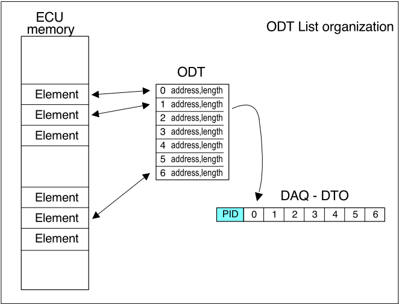

Data elements located in the slave's memory are transmitted in Data Transfer Objects DAQ from slave to master and STIM from master to slave. The Object Descriptor Table (ODT) describes the mapping between the synchronous data transfer objects and the slave's memory.

A synchronous data transfer object is identified by its Packet IDentifier (PID) that identifies the ODT that describes the contents of this synchronous data transfer object.

<a id="section-4-1-2"></a>

## 4.1.2 ODT ENTRY

An entry in an ODT references a data element by its address, the address extension, the size of the element in ADDRESS\_GRANULARITY (AG) and for a data element that represents a bit, the bit offset.

GRANULARITY\_ODT\_ENTRY\_SIZE\_x determines the smallest size of a data element referenced by an ODT entry.

GRANULARITY\_ODT\_ENTRY\_SIZE\_x must not be smaller than AG.

GRANULARITY\_ODT\_ENTRY\_SIZE\_x[BYTE] &gt;= AG[BYTE]

Address and size of the ODT entry must meet alignment requirements regarding GRANULARITY\_ODT\_ENTRY\_SIZE\_x.

For the address of the element described by an ODT entry, the following has to be fulfilled:

```
Address[AG] mod (GRANULARITY_ODT_ENTRY_SIZE_x[BYTE] / AG[BYTE]) = 0
```

For every size of the element described by an ODT entry, the following has to be fulfilled:

```
SizeOf(element described by ODT entry)[AG] mod (GRANULARITY_ODT_ENTRY_SIZE_x[BYTE] / AG[BYTE]) = 0
```

The possible values for GRANULARITY\_ODT\_ENTRY\_SIZE\_x are {1,2,4,8}.

The possible values for ADDRESS\_GRANULARITY are {1,2,4}.

The following relation must be fulfilled:

```
GRANULARITY_ODT_ENTRY_SIZE_x[BYTE] mod (ADDRESS_GRANULARITY[BYTE]) = 0
```

The MAX\_ODT\_ENTRY\_SIZE\_x parameters indicate the upper limits for the size of the element described by an ODT entry in ADDRESS\_GRANULARITY.

For every size of the element described by an ODT entry the following has to be fulfilled:

```
SizeOf(element described by ODT entry)[AG] <= MAX_ODT_ENTRY_SIZE_x[AG]
```

If a slave only supports elements with size = BYTE, the master has to split up multi-byte data elements into single bytes.

An ODT entry is referenced by an ODT\_ENTRY\_NUMBER.

<a id="section-4-1-3"></a>

## 4.1.3 OBJECT DESCRIPTOR TABLE

ODT entries are grouped in ODTs.

If DAQ lists are configured statically, MAX\_ODT\_ENTRIES specifies the maximum number of ODT entries in each ODT of this DAQ list.

If DAQ lists are configured dynamically, MAX\_ODT\_ENTRIES is not fixed and will be 0.

For every ODT the numbering of the ODT entries through ODT\_ENTRY\_NUMBER restarts from 0

```
ODT_ENTRY_NUMBER [0,1,..MAX_ODT_ENTRIES(DAQ list)-1]
```

<a id="section-4-1-4"></a>

## 4.1.4 DAQ LIST

Several ODTs can be grouped to a DAQ List. XCP allows for several DAQ lists, which may be simultaneously active. The sampling and transfer of each DAQ list is triggered by individual events in the slave (see SET\_DAQ\_LIST\_MODE).

Figure 2 DAQ list organization

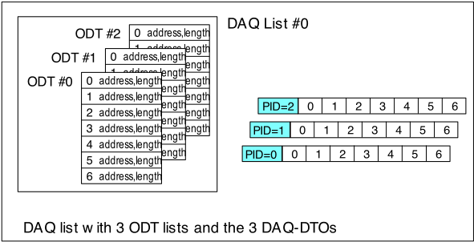

If DAQ lists are configured statically, MAX\_ODT specifies the number of ODTs for this DAQ list.

If DAQ lists are configured dynamically, MAX\_ODT is not fixed and will be 0.

MAX\_DAQ is the total number of DAQ lists available in the slave device. It includes the predefined DAQ lists that are not configurable (indicated with PREDEFINED at GET\_DAQ\_LIST\_INFO) and the ones that are configurable. If DAQ\_CONFIG\_TYPE = dynamic, MAX\_DAQ equals MIN\_DAQ+DAQ\_COUNT.

MIN\_DAQ is the number of predefined DAQ lists. For predefined DAQ lists, DAQ\_LIST\_NUMBER is in the range [0,1,..MIN\_DAQ-1].

DAQ\_COUNT is the number of dynamically allocated DAQ lists.

MAX\_DAQ-MIN\_DAQ is the number of configurable DAQ lists. For configurable DAQ lists, DAQ\_LIST\_NUMBER is in the range [MIN\_DAQ,MIN\_DAQ+1,..MAX\_DAQ-1].

For every DAQ list the numbering of the ODTs through ODT\_NUMBER restarts from 0 and has to be continuous.

```
ODT_NUMBER [0,1,..MAX_ODT(DAQ list)-1]
```

Within one and the same XCP slave device, the range for the DAQ list number starts from 0 and has to be continuous.

```
DAQ_LIST_NUMBER [0,1,..MIN_DAQ-1] + [MIN_DAQ,MIN_DAQ+1,..MAX_DAQ-1]
```

To allow reduction of the desired transfer rate, a transfer rate prescaler may be applied to the DAQ lists (ref. PRESCALER\_SUPPORTED flag in DAQ\_PROPERTIES at GET\_DAQ\_PROCESSOR\_INFO). Without reduction, the prescaler value must equal 1. For reduction, the prescaler has to be greater than 1. The use of a prescaler is only allowed for DAQ lists with DAQ direction.

It is allowed to define "dummy" DAQ lists that contain no entries at all.

<a id="section-4-1-5"></a>

## 4.1.5 EVENT CHANNELS

XCP allows for several DAQ lists, which may be simultaneously active. The sampling and transfer of each DAQ list is triggered by individual events in the slave (see SET\_DAQ\_LIST\_MODE).

An event channel builds the generic signal source that effectively determines the data transfer timing.

For event channels which have no constant cycle time, e.g. sporadic or crank synchronous events, it is possible to add a minimum cycle time (MIN\_CYCLE\_TIME), so that the XCP master can make a worst case calculation for e.g. CPU load or required transport layer bandwidth.

MAX\_EVENT\_CHANNEL is the number of available event channels.

For each event channel, MAX\_DAQ\_LIST indicates the maximum number of DAQ lists that can be allocated to this event channel. MAX\_DAQ\_LIST = 0x00 means this event is available but currently cannot be used. MAX\_DAQ\_LIST = 0xFF means there is no limitation.

XCP allows for the prioritization of event channels. This prioritization is a fixed attribute of the slave and therefore read-only. The event channel with event channel priority = FF has the highest priority.

The assignment of MEASUREMENT variables to event channels can optionally be controlled in the section DAQ\_EVENT locally at each definition of the MEASUREMENT variable.

The assignment can either be fixed or variable.

If the assignment shall be fixed, a list with all event channels to be used (FIXED\_EVENT\_LIST) must be defined at any MEASUREMENT variable where the fixed assignment is required. The tool cannot change the assignment of the event channels for a MEASUREMENT variable with a fixed list.

If the assignment shall not be fixed but variable, a list with all valid events channels for this MEASUREMENT (AVAILABLE\_EVENT\_LIST) can be provided locally at the MEASUREMENT. In case this list does not exist, all event channels provided by the ECU can be assigned by the tool.

A default assignment of the event channels to the MEASUREMENT variables can be supported by providing a list with the default event channels (DEFAULT\_EVENT\_LIST). This default assignment can be changed by the tool to a different assignment.

A list of consistency events can be provided locally at MEASUREMENT (CONSISTENCY\_EVENT\_LIST). All MEASUREMENT variables, that are assigned to the same Event Channel defined in a CONSISTENCY\_EVENT\_LIST, are sampled consistently itself and to each other in this Event Channel.

IF no DEFAULT\_EVENT\_LIST is defined locally at MEASUREMENT, the CONSISTENCY\_EVENT\_LIST shall be used as default Event Channel assignment.

In case an AVAILABLE\_EVENT\_LIST is defined, the event channels in the DEFAULT\_EVENT\_LIST and in the CONSISTENCY\_EVENT\_LIST must be the same or a sub-set of the event channels in the AVAILABLE\_EVENT\_LIST for this MEASUREMENT variable.

Lists are possible as some MCD tools allow measurement in multiple events.

Lists provide the user of a tool a simplified measurement configuration.

<a id="section-4-1-6"></a>

## 4.1.6 DYNAMIC DAQ CONFIGURATION

For the DAQ lists that are configurable, the slave can have certain fixed limits concerning the number of DAQ lists, the number of ODTs for each DAQ list and the number of ODT entries for each ODT.

The slave also can have the possibility to configure DAQ lists completely dynamically. Whether the configurable DAQ lists are configurable statically or dynamically is indicated by the DAQ\_CONFIG\_TYPE flag in DAQ\_PROPERTIES at GET\_DAQ\_PROCESSOR\_INFO.

Figure 3 Static DAQ list configuration

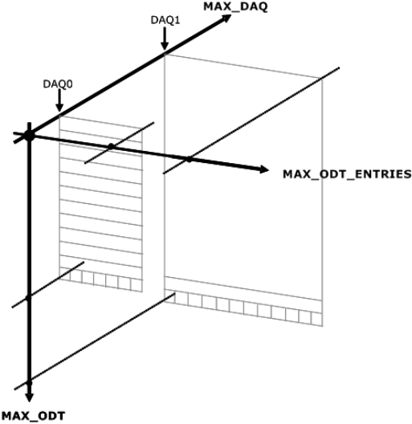

Figure 4 Dynamic DAQ list configuration

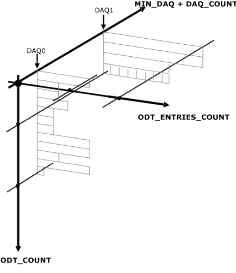

If DAQ lists are configured dynamically, other limits apply:

Table 1 DAQ configuration limits of IF\_DATA XCP

| Static          | Dynamic                    |
|-----------------|----------------------------|
| MAX_DAQ         | MIN_DAQ+DAQ_COUNT          |
| MAX_DAQ         | MAX_DAQ_TOTAL              |
| MAX_ODT         | MAX_ODT_DAQ_TOTAL          |
| MAX_ODT         | MAX_ODT_STIM_TOTAL         |
| MAX_ODT_ENTRIES | MAX_ODT_ENTRIES_TOTAL      |
| MAX_ODT_ENTRIES | MAX_ODT_ENTRIES_DAQ_TOTAL  |
| MAX_ODT_ENTRIES | MAX_ODT_ENTRIES_STIM_TOTAL |

If DAQ lists are configured dynamically, MIN\_DAQ still indicates the lower limit of the DAQ list number range.

DAQ\_COUNT indicates the number of configurable DAQ lists.

If a parameter is not defined in the IF\_DATA XCP, this means that the maximum limit of the appropriate protocol constant applies, see Table 7.

MAX\_DAQ\_TOTAL specifies the maximum number of dynamic DAQ lists for all DAQ events.

MAX\_ODT\_DAQ\_TOTAL specifies the maximum number of all ODTs having direction DAQ. MAX\_ODT\_STIM\_TOTAL specifies the maximum number of all ODTs having direction STIM.

MAX\_ODT\_ENTRIES\_TOTAL must be the sum of MAX\_ODT\_ENTRIES\_DAQ\_TOTAL and MAX\_ODT\_ENTRIES\_STIM\_TOTAL, if these parameters are specified.

For the size of an element described by an ODT entry, still the same rules concerning GRANULARITY\_ODT\_ENTRY\_SIZE\_x and MAX\_ODT\_ENTRY\_SIZE\_x have to be fulfilled.

For the allocation of FIRST\_PID, still the same rules apply.

The scope of ODT\_NUMBER still is local within a DAQ list.

The scope of ODT\_ENTRY\_NUMBER still is local within an ODT.

For the continuous numbering of DAQ list, still the same rule applies.

Dynamic DAQ list configuration is done with the commands FREE\_DAQ, ALLOC\_DAQ, ALLOC\_ODT and ALLOC\_ODT\_ENTRY. These commands allow to allocate dynamically but within the above mentioned limits, a number of DAQ list, a number of ODTs to a DAQ list and a number of ODT entries to an ODT.

These commands get an ERR\_MEMORY\_OVERFLOW as negative response if there is not enough memory available to allocate the requested objects. If an ERR\_MEMORY\_OVERFLOW occurs, the complete DAQ list configuration is invalid.

During a dynamic DAQ list configuration, the master has to respect a special sequence for the use of FREE\_DAQ, ALLOC\_DAQ, ALLOC\_ODT and ALLOC\_ODT\_ENTRY.

At the start of a dynamic DAQ list configuration sequence, the master always first has to send a FREE\_DAQ. Secondly, with ALLOC\_DAQ the master has to allocate the number of configurable DAQ lists. Then, the master has to allocate all ODTs to all DAQ lists with ALLOC\_ODT commands. Finally, the master has to allocate all ODT entries to all ODTs for all DAQ lists with ALLOC\_ODT\_ENTRY commands.

If the master sends an ALLOC\_DAQ directly after an ALLOC\_ODT without a FREE\_DAQ in between, the slave returns an ERR\_SEQUENCE as negative response.

If the master sends an ALLOC\_DAQ directly after an ALLOC\_ODT\_ENTRY without a FREE\_DAQ in between, the slave returns an ERR\_SEQUENCE as negative response.

If the master sends an ALLOC\_ODT directly after a FREE\_DAQ without an ALLOC\_DAQ in between, the slave returns an ERR\_SEQUENCE as negative response.

If the master sends an ALLOC\_ODT directly after an ALLOC\_ODT\_ENTRY without a FREE\_DAQ in between, the slave returns an ERR\_SEQUENCE as negative response.

If the master sends an ALLOC\_ODT\_ENTRY directly after a FREE\_DAQ without an ALLOC\_DAQ in between, the slave returns an ERR\_SEQUENCE as negative response.

If the master sends an ALLOC\_ODT\_ENTRY directly after an ALLOC\_DAQ without an ALLOC\_ODT in between, the slave returns an ERR\_SEQUENCE as negative response.

These rules make sure that the slave can allocate the different objects in a continuous way to the available memory which optimizes its use and simplifies its management.

Table 2 DAQ allocation command sequence

|                              | Second Command - FREE_DAQ   | Second Command - ALLOC_DAQ   | Second Command - ALLOC_ODT   | Second Command - ALLOC_ODT_ ENTRY   |
|------------------------------|-----------------------------|------------------------------|------------------------------|-------------------------------------|
| First Command FREE_DAQ ENTRY | ✓                          | ✓                           | ERR                          | ERR                                 |
| ALLOC_DAQ                    | ✓                          | ✓                           | ✓                           | ERR                                 |
| ALLOC_ODT                    | ✓                          | ERR                          | ✓                           | ✓                                  |
| ALLOC_ODT_                   | ✓                          | ERR                          | ERR                          | ✓                                  |

This rule implies that a new DAQ list cannot be added to an already existing configuration. The master has to completely reconfigure the whole DAQ list configuration to include the additional DAQ list.

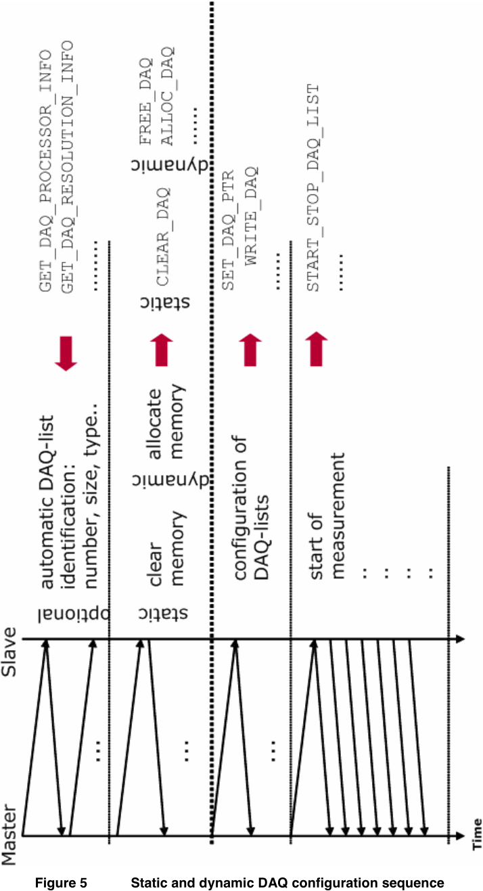

<a id="section-4-1-7"></a>

## 4.1.7 DAQ CONFIGURATION STORING AND POWER-UP DATA TRANSFER

Storing a DAQ configuration into non-volatile memory is beneficial in the following cases:

- to save measurement configuration time in repetitively used, unchanged measurement configurations
- to enable power-up data transfer (RESUME mode)

The XCP power-up data transfer (RESUME mode) is available since XCP version 1.0. Starting with XCP version 1.1.0, storing a DAQ configuration without automatically starting the data transfer when powering up the slave, is also possible.

With START\_STOP\_DAQ\_LIST(Select), the master can select a DAQ list to be part of a DAQ list configuration the slave stores into non-volatile memory.

The master has to calculate a Session Configuration Id based upon the current configuration of the DAQ lists selected for storing.

The master has to store this Session Configuration Id internally for further use.

The master also has to send the Session Configuration Id to the slave with SET\_REQUEST.

If STORE\_DAQ\_REQ\_RESUME or STORE\_DAQ\_REQ\_NO\_RESUME is set and the appropriate conditions are met, the slave then has to save all DAQ lists which have been selected, into non-volatile memory.

If STORE\_DAQ\_REQ\_RESUME or STORE\_DAQ\_REQ\_NO\_RESUME is set, the slave also has to store the Session Configuration Id in non-volatile memory. It will be returned in the response of GET\_STATUS.

This allows the master device to verify that automatically started DAQ lists contain the expected data transfer configuration.

Upon saving, the slave first has to clear any DAQ list configuration that might already be stored in non-volatile memory.

The STORE\_DAQ\_REQ bit obtained by GET\_STATUS will be reset by the slave, when the request is fulfilled. The slave device may indicate this by transmitting an EV\_STORE\_DAQ event packet.

In principle the slave needs to take care of the status dependent on the requests and their progress and must report the status with GET\_STATUS accordingly.

<a id="section-4-1-7-1"></a>

## 4.1.7.1 DAQ CONFIGURATION STORING WITHOUT POWER-UP DATA TRANSFER

The purpose of DAQ configuration storing without power-up data transfer is to enable faster start of not changed DAQ configurations (DAQ/STIM).

The STORE\_DAQ\_SUPPORTED entry in the IF\_DATA indicates that the slave can store DAQ configurations.

Figure 6 DAQ configuration storing without power-up data transfer

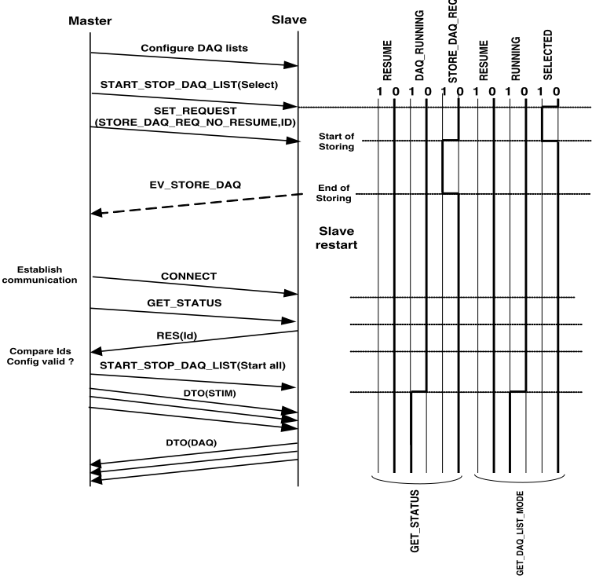

A configured DAQ setup can be stored via a SET\_REQUEST (STORE\_DAQ\_REQ\_NO\_RESUME).

The master can detect if a DAQ configuration was stored to the slave by checking the Session Configuration Id which is returned by GET\_STATUS. If it does not equal zero a configuration is present.

<a id="section-4-1-7-2"></a>

## 4.1.7.2 DAQ CONFIGURATION STORING WITH POWER-UP DATA TRANSFER (RESUME MODE)

The resume mode is one state of the state machine (see Figure 43).

The purpose of the resume mode is to enable automatic data transfer (DAQ,STIM) directly after the power up of the slave.

The RESUME\_SUPPORTED flag in DAQ\_PROPERTIES at GET\_DAQ\_PROCESSOR\_INFO indicates that the slave can be set into RESUME mode.

Figure 7 DAQ configuration storing with power-up data transfer (RESUME mode)

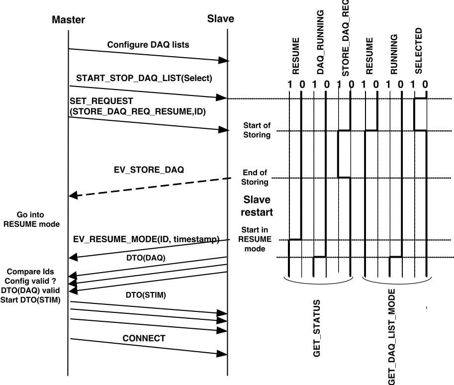

With GET\_STATUS, the master can identify whether a slave is in RESUME mode.

With GET\_DAQ\_LIST\_MODE the master can identify whether a DAQ list is part of a DAQ list configuration the slave uses when in RESUME mode.

If STORE\_DAQ\_REQ\_RESUME is set, the slave internally has to set the RESUME bit of those DAQ lists that previously have been selected with START\_STOP\_DAQ\_LIST(select).

RESUME mode is allowed for both directions, DAQ and STIM.

On each power up, the slave has to restore the DAQ lists and send an EV\_RESUME\_MODE to the master The EV\_RESUME\_MODE has to contain the Session Configuration Id.

Table 3 Description of the RESUME mode event

| Position   | Type   | Description                         |
|------------|--------|-------------------------------------|
| 0          | BYTE   | Packet ID: Event 0xFD               |
| 1          | BYTE   | EV_RESUME_MODE: 0x00                |
| 2, 3       | WORD   | Session Configuration Id from slave |
| 4..7       | DWORD  | Current slave timestamp (optional)  |

If the slave has the TIMESTAMP\_SUPPORTED flag set in GET\_DAQ\_PROCESSOR\_INFO, in Current slave timestamp the EV\_RESUME\_MODE also has to contain the current value of the data acquisition clock. The current slave timestamp has the format specified by the GET\_DAQ\_RESOLUTION\_INFO command.

For DAQ list with DAQ direction, the slave automatically will start transferring DAQ packets to the master, even before any XCP command was sent by the master.

For DAQ list with STIM direction, the slave automatically will be ready for receiving STIM packets from the master, even before any XCP command was sent by the master.

For DAQ lists automatically started at power up, the Current Mode of GET\_DAQ\_LIST\_MODE will be RESUME and RUNNING.

RESUME mode implies that any data transfer will only start after the physical communication channel is up and running.

The master and the slave have to remember all the necessary communication parameters that were used when a SET\_REQUEST(STORE\_DAQ\_REQ\_RESUME) was sent. At powerup, both the master and the slave have to use these same parameters for the automatic data transfer.

At power-up the slave's unlock state can be different from its unlock state at the moment that the SET\_REQUEST(STORE\_DAQ\_REQ) was sent.

<a id="section-4-1-8"></a>

## 4.1.8 DAQ LIST PRIORITIZATION

XCP allows the prioritization of DAQ lists. The limited length of the DTOs together with the prioritization mechanism makes sure that with an acceptable delay a DAQ list with higher priority can interrupt the transfer of a DAQ list with lower priority.

<a id="section-4-1-9"></a>

## 4.1.9 ODT OPTIMIZATION

XCP allows DTO optimization on ODT level.

To support this feature the slave implementation may use one or more specific copy routines in order to make full use of the CPUs architecture for copying data. Optimization can be done in a way to minimize runtime, or to maximize the effective data transfer rate, or even both.

However, these copy routines may need specific ODT structures. To get the advantage of DAQ optimization, the master should configure the ODTs in a way to fit the requirements of the copy routines.

The Optimization\_Method property indicates the kind of optimization method, used by the slave implementation. It should be used by the master to determine the method, used for configuring the ODTs.

Optimization\_Method is a global DAQ property, valid for all ODTs and DAQ lists. The Optimization\_Method flags are located in DAQ\_KEY\_BYTE at

GET\_DAQ\_PROCESSOR\_INFO.

The following optimization methods are defined:

OM\_DEFAULT:

No special requirements.

GRANULARITY\_ODT\_ENTRY\_SIZE\_DAQ, GRANULARITY\_ODT\_ENTRY\_SIZE\_STIM, MAX\_ODT\_ENTRY\_SIZE\_DAQ and MAX\_ODT\_ENTRY\_SIZE\_STIM must be considered.

OM\_ODT\_TYPE\_[16,32,64]: Type specific copy routines are used on ODT level. The largest data type supported by the copy routine is indicated by the numeral suffix:

OM\_ODT\_TYPE\_16 supports WORD (16 Bit), OM\_ODT\_TYPE\_32 DWORD (32 Bit) and OM\_ODT\_TYPE\_64 DLONG (64 Bit) as largest data

## type.

GRANULARITY\_ODT\_ENTRY\_SIZE\_DAQ and GRANULARITY\_ODT\_ENTRY\_SIZE\_STIM define the smallest type. MAX\_ODT\_ENTRY\_SIZE\_DAQ and MAX\_ODT\_ENTRY\_SIZE\_STIM define the upper limit for the size of an element described by an ODT entry. All entries within the same ODT should be of the same type. Length and address of each ODT entry must meet the alignment requirements of the ODT type.

OM\_ODT\_TYPE\_[16,32,64] in combination with attribute OPTIMISATION\_TYPE\_ODT\_STRICT:

All entries within the same ODT shall map to the same type of copy routine. The copy routine used for an ODT shall be derived from the first ODT entry. Considering the length, address and alignment requirements of the first ODT entry, the largest possible copy routine shall be used.

If a master does not obey these requirements, the slave shall respond the error ERR\_DAQ\_CONFIG.

OM\_ODT\_ALIGNMENT: Within one ODT all kind of data types are allowed. However they must be arranged in alignment order. Large data types first and small data types last. Length and address of each ODT entry must meet the alignment requirements.

GRANULARITY\_ODT\_ENTRY\_SIZE\_DAQ, GRANULARITY\_ODT\_ENTRY\_SIZE\_STIM, MAX\_ODT\_ENTRY\_SIZE\_DAQ and MAX\_ODT\_ENTRY\_SIZE\_STIM must be considered.

OM\_MAX\_ENTRY\_SIZE: Only ODT entries of a fixed length are supported (for example data blocks of 16 bytes).

The Length is defined by MAX\_ODT\_ENTRY\_SIZE\_DAQ and MAX\_ODT\_ENTRY\_SIZE\_STIM.

Length and address of each ODT entry must meet the alignment requirements determined by

GRANULARITY\_ODT\_ENTRY\_SIZE\_DAQ and GRANULARITY\_ODT\_ENTRY\_SIZE\_STIM.

If the configuration of an ODT does not correspond to the requested optimization method, the slave can answer with an ERR\_DAQ\_CONFIG message to show that this configuration cannot be handled. The configuration of all DAQ lists is not valid.

<a id="section-4-1-10"></a>

## 4.1.10 DAQ PACKED MODE

The PACKED flag in DAQ\_LIST\_PROPERTIES in response of GET\_DAQ\_LIST\_INFO indicates that this DAQ list supports packed data transmission.

In the conventional mode, i.e. non-packed mode, each DTO of a DAQ list contains one sample of every data element defined in the corresponding ODT.

Using a DAQ list in DAQ packed mode improves the efficiency for DAQ list transmission. Multiple values of data elements (typically sampled at high sample rates, e.g. 100 kHz) are packed into one DTO. Each data element is described with one ODT entry as usual, but multiple values of the data element are placed in one DTO as specified by a sample count. With this method, DAQ packed mode reduces the transmission frequency of the DAQ list.

The DAQ packed mode is described with the three parameters DAQ\_PACKED\_MODE, DPM\_SAMPLE\_COUNT and DPM\_TIMESTAMP\_MODE. These parameters are used in the commands SET\_DAQ\_PACKED\_MODE and GET\_DAQ\_PACKED\_MODE.

As an example, the following DTOs are sent:

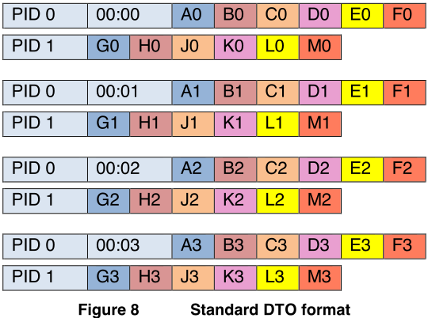

For the packed mode two methods of re-arranging (grouping) the measurement data are defined, called 'element-grouped' and 'event-grouped'.

When the parameter DAQ\_PACKED\_MODE is configured to element-grouped packed mode, then all consecutive samples of one data element are grouped together. The following DTOs are transmitted (DPM\_SAMPLE\_COUNT = 4, DPM\_TIMESTAMP\_MODE = timestamp of last sample):

Figure 9 DTO format in element-grouped packed mode. 1

| PID 0   | 00:03   | 00:03   | A0   | A1   | A2   | A3   | B0   | B1   | B2   | B3   | C0   | C1   | C2   | C3   | D0   |
|---------|---------|---------|------|------|------|------|------|------|------|------|------|------|------|------|------|
|         |         | C3      | D0   | D1   | D2   | D3   | E0   | E1   | E2   | E3   | F0   | F1   | F2   | F3   |      |
| PID 1   | G0      | G1      | G2   | G3   | H0   | H1   | H2   | H3   | J0   | J1   | J2   | J3   | K0   |      |      |
| J3      | K0      | K1      | K2   | K3   | L0   | L1   | L2   | L3   | M0   | M1   | M2   | M3   |      |      |      |

When the parameter DAQ\_PACKED\_MODE is configured to event-grouped packed mode, then the data of all data elements which are sampled at the same event are grouped together. The following DTOs are transmitted:

Figure 10 DTO format in event-grouped packed mode. 1

| PID 0   | 00:03   | 00:03   | A0   | B0   | C0   | D0   | E0   | F0   | A1   | B1   | C1   | D1   | E1   | F1   | A2   |
|---------|---------|---------|------|------|------|------|------|------|------|------|------|------|------|------|------|
|         |         | F1      | A2   | B2   | C2   | D2   | E2   | F2   | A3   | B3   | C3   | D3   | E3   | F3   |      |
| PID 1   | G0      | H0      | J0   | K0   | L0   | M0   | G1   | H1   | J1   | K1   | L1   | M1   | G2   |      |      |
|         | M1 G2   | H2      | J2   | K2   | L2   | M2   | G3   | H3   | J3   | K3   | L3   | M3   |      |      |      |

In event-grouped packed mode it must be regarded, that only samples of data elements defined in the associated ODT are arranged in the above mentioned scheme within the same DTO. Data elements of different ODTs are not mixed. This maintains the direct relation between ODT and DTO also for packed mode.

<a id="section-4-1-10-1"></a>

## 4.1.10.1 DAQ LIST BEHAVIOR

The event assigned to a DAQ list controls the sampling of the values for the data elements of the DAQ list. DAQ packed mode has to be activated using the command SET\_DAQ\_PACKED\_MODE. When activated, the values are collected for later transmission. If a prescaler p &gt; 1 is used, then the sampling is done every p-th event. When the configured sample count is reached, then the DAQ list with all collected data is sent. When the parameter DPM\_SAMPLE\_COUNT is set to n, then the DAQ list is sent with every n*p-th occurrence of the event, containing n consecutive samples of every configured data element.

After issuing a CLEAR\_DAQ\_LIST command, the DAQ list is set to non-packed mode.

<a id="section-4-1-10-2"></a>

## 4.1.10.2 EVENT CHANNEL

A DAQ list which is configured to packed mode must be associated with an event channel, which has the PACKED flag set in the DAQ\_EVENT\_PROPERTIES parameter bit mask.

DAQ packed mode shall only be used with event channels with a periodic timing.

<a id="section-4-1-10-3"></a>

## 4.1.10.3 TIMESTAMPS

The field DPM\_TIMESTAMP\_MODE defines the meaning of the timestamp in the first DTO of the DAQ list.

1 Long DTO frames are wrapped for better readability.

Table 4 DAQ packed mode timestamp modes

|   DPM_TIMESTAMP_MODE | Description                      |
|----------------------|----------------------------------|
|                    0 | sample time of the last sample.  |
|                    1 | sample time of the first sample. |

DAQ lists in packed mode shall be configured for timestamps with command SET\_DAQ\_LIST\_MODE, parameter TIMESTAMP.

In packed mode the receiver of the DAQ list must recover the timestamps (being omitted for transmission) for all data elements. The timestamp of the transmitted DAQ list and the recovered timestamps are in the time domain of the slave clock.

For DPM\_TIMESTAMP\_MODE = 0 (TimeStampDAQ is timestamp of last sample):

```
TimeStamp(k) = TimeStampDAQ − (n − k − 1) * EventPeriod * Prescaler
```

For DPM\_TIMESTAMP\_MODE = 1 (TimeStampDAQ is timestamp of first sample):

```
TimeStamp(k) = TimeStampDAQ + k * EventPeriod * Prescaler
```

The TimeStamp(k) denotes the timestamp of the sample with index k in the DAQ list, with k = 0..DPM\_SAMPLE\_COUNT-1. The TimeStampDAQ denotes the timestamp in the transmitted DAQ list. The parameter n is the sample count DPM\_SAMPLE\_COUNT. The EventPeriod denotes the period time of the associated event. The Prescaler is the value of the transmission rate prescaler.

All timestamps shall be strictly monotonically increasing. This especially addresses the timestamps for the last/first samples of two consecutive DAQ lists when the nominal period time of the event (specified in A2L, used for calculating the timestamps) deviates from the real event timing of the slave (used for the timestamp in the transmitted DAQ list). The value of DPM\_SAMPLE\_COUNT should be chosen with respect to the timing accuracy of the associated event.

<a id="section-4-1-10-4"></a>

## 4.1.10.4 ERROR HANDLING

If by any reason it is not possible to acquire a certain sample of a data element, then all sample data of this DAQ list acquired up to this event are dropped and the collecting of the packed data for the DAQ list starts anew.

If the data acquisition is stopped through START\_STOP\_DAQ\_LIST before the sample count is reached, then the incomplete data are dropped.

This ensures that the data transmission from a DAQ list with packed mode is always complete and consists of consecutive sample data.

<a id="section-4-1-11"></a>

## 4.1.11 BITWISE STIMULATION

The BIT\_STIM\_SUPPORTED flag in DAQ\_PROPERTIES at GET\_DAQ\_PROCESSOR\_INFO indicates that the slave supports bit wise data stimulation.

The BIT\_OFFSET field at WRITE\_DAQ allows the transfer of data stimulation elements that represent the status of a bit. For a MEASUREMENT that's in a DAQ list with DAQ direction, the key word BIT\_MASK describes the mask to be applied to the measured data to find out the status of a single bit. For a MEASUREMENT that's in a DAQ list with STIM

direction, the key word BIT\_MASK describes the position of the bit that has to be stimulated. The master has to transform the BIT\_MASK to the BIT\_OFFSET

```
e.g.: Bit7 -> BIT_MASK = 0x80 -> BIT_OFFSET = 0x07
```

When BIT\_OFFSET = FF, the field can be ignored and the WRITE\_DAQ applies to a normal data element with size expressed in bytes. If the BIT\_OFFSET is from 0x00 to 0x1F, the ODT entry describes an element that represents the status of a bit. In this case, the Size of DAQ element always has to be equal to the GRANULARITY\_ODT\_ENTRY\_SIZE\_x. If the value of this element = 0, the value for the bit = 0. If the value of the element &gt; 0, the value for the bit = 1.

<a id="section-4-1-12"></a>

## 4.1.12 SYNCHRONOUS DATA ACQUISITION

By means of the DIRECTION flag, a DAQ list can be put in Synchronous Data Acquisition mode.

By means of DAQ with 0x00 &lt;= PID &lt;= 0xFB the slave has to transfer the contents of the elements defined in each ODT of the DAQ list to the master.

When processing an ODT, the slave can go to the next ODT as soon as it finds an element with size = 0 in the current ODT or if all ODT entries of this ODT have been processed.

When processing a DAQ list, the slave can go to the next DAQ list as soon as it finds an element with size = 0 at the first ODT entry of the first ODT of this DAQ list or if all ODTs of this DAQ list have been processed.

When a new event cycle is triggered before the transfer of the previous cycle has been finished, the slave is said to have an "OVERLOAD situation". An overflow indication therefore is a temporary state. All sample values which were sent before the first overflow indication, are not affected

The slave device may indicate this OVERLOAD situation to the master. The kind of OVERLOAD indication is indicated by the OVERLOAD\_x flags in DAQ\_PROPERTIES at GET\_DAQ\_PROCESSOR\_INFO. The slave's reaction on an OVERLOAD situation is implementation dependent.

The slave shall sample elements according to the defined consistency:

## CONSISTENCY OF ODT ENTRIES

ODT entries, whose address and size match a scalar datatype (BYTE, WORD, …) considering ALIGNMENT\_&lt;datatype&gt; and whose size[Bit] is smaller or equal the defined DATA\_SIZE[Bit], shall always be sampled consistently. DATA\_SIZE and ALIGNMENT\_&lt;datatype&gt; are optional parameters of the ECU specific MOD\_COMMON block in the ASAM MCD-2 MC description file.

## CONSISTENCY DEFINED AT EVENT

With CONSISTENCY NONE at the definition of an Event Channel in the ASAM MCD-2 MC description file, the slave can indicate that there is no consistency at Event level.

With CONSISTENCY ODT or if no consistency is defined at the definition of an Event Channel in the ASAM MCD-2 MC description file, the slave can indicate that for this Event all data that belong to the same ODT list are sampled consistently.

With CONSISTENCY DAQ at the definition of an Event Channel in the ASAM MCD-2 MC description file, the slave can indicate that for this Event all data that belong to the same DAQ list are sampled consistently.

With CONSISTENCY EVENT at the definition of an Event Channel in the ASAM MCD-2 MC description file, the slave can indicate that for this Event all data are sampled consistently.

If there is only one DAQ list associated with this Event, CONSISTENCY DAQ has the same meaning as CONSISTENCY EVENT.

If more than one DAQ list is associated with this Event, CONSISTENCY DAQ implies that the data of every specific DAQ list in this Event are sampled consistently within the DAQ list. However there is no data consistency between data that are processed in different DAQ lists.

If more than one DAQ list is associated with this Event, CONSISTENCY EVENT implies that all data of all DAQ lists in this Event are sampled consistently.

## CONSISTENCY DEFINED AT MEASUREMENT

With CONSISTENCY\_EVENT\_LIST at the definition of a MEASUREMENT in the ASAM MCD-2 MC description file, the slave can indicate that this MEASUREMENT is sampled consistently in the listed event channels.

All MEASUREMENT variables, that are assigned to the same Event Channel defined in a CONSISTENCY\_EVENT\_LIST, are sampled consistently itself and to each other in this Event Channel.

<a id="section-4-1-13"></a>

## 4.1.13 SYNCHRONOUS DATA STIMULATION

Synchronous Data Stimulation is the inverse mode of Synchronous Data Acquisition.

By means of the DIRECTION flag, a DAQ list can be put in Synchronous Data Stimulation mode. Data for stimulation is transmitted in DTO packets. An ODT describes the mapping between the DTO and the slave's memory. By means of STIM with 0x00 &lt;= PID &lt;= 0xBF the master has to transfer the contents of the elements defined in each ODT of the DAQ list to the slave.

The STIM processor buffers incoming data stimulation packets. When an event occurs which triggers a DAQ list in data stimulation mode, the buffered data is transferred to the slave device's memory.

## CONSISTENCY DEFINED AT EVENT

With CONSISTENCY NONE at the definition of an Event Channel in the ASAM MCD-2 MC description file, the slave can indicate that there is no consistency at Event level.

With CONSISTENCY ODT or if CONSISTENCY is not defined at the definition of an Event Channel in the ASAM MCD-2 MC description file, the slave can indicate that for this Event all data that belong to the same ODT list are transferred consistently to the slave device's memory.

With CONSISTENCY DAQ at the definition of an Event Channel in the ASAM MCD-2 MC description file, the slave can indicate that for this Event all data that belong to the same DAQ list with direction STIM are transferred consistently to the slave device's memory.

With CONSISTENCY EVENT at the definition of an Event Channel in the ASAM MCD-2 MC description file, the slave can indicate that for this Event all data, i.e. all data of all DAQ lists with direction STIM which are bound to this Event, are transferred consistently to the slave device's memory.

## CONSISTENCY DEFINED AT MEASUREMENT

With CONSISTENCY\_EVENT\_LIST at the definition of a MEASUREMENT in the ASAM MCD-2 MC description file, the slave can indicate that this MEASUREMENT is transferred consistently with the listed Event Channels to the slave device's memory. All MEASUREMENT variables, that are assigned to the same Event Channel defined in a CONSISTENCY\_EVENT\_LIST, are transferred consistently itself and to each other with this channel to the slave device's memory.

or

<a id="section-4-2"></a>

## 4.2 MEASUREMENT MODES

<a id="section-4-2-1"></a>

## 4.2.1 POLLING

Figure 11 Measurement mode: polling

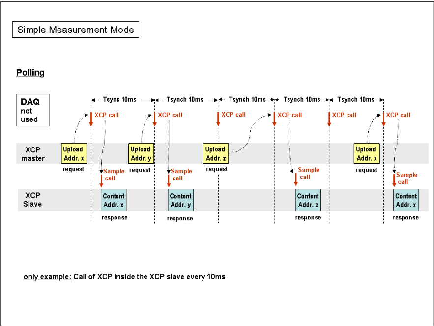

The easiest way for measurement uses the polling method. The characteristic of this method is that every measurement value is requested by the XCP master in principle with an extra XCP command. The effective sample rate is based on the performance of the XCP slave and of the performance of the XCP master.

An XCP timestamp mechanism cannot be used.

There is no consistency between the different measurement values.

There is no need to set up a measurement configuration (configuring DAQ lists) for the XCP slave.

The following XCP commands can be used for polled measurement:

- SHORT\_UPLOAD (recommended)
- SET\_MTA
- UPLOAD

<a id="section-4-2-2"></a>

## 4.2.2 SYNCHRONOUS DATA TRANSFER, DAQ DIRECTION, BURST, STANDARD

Figure 12 Measurement mode: standard burst

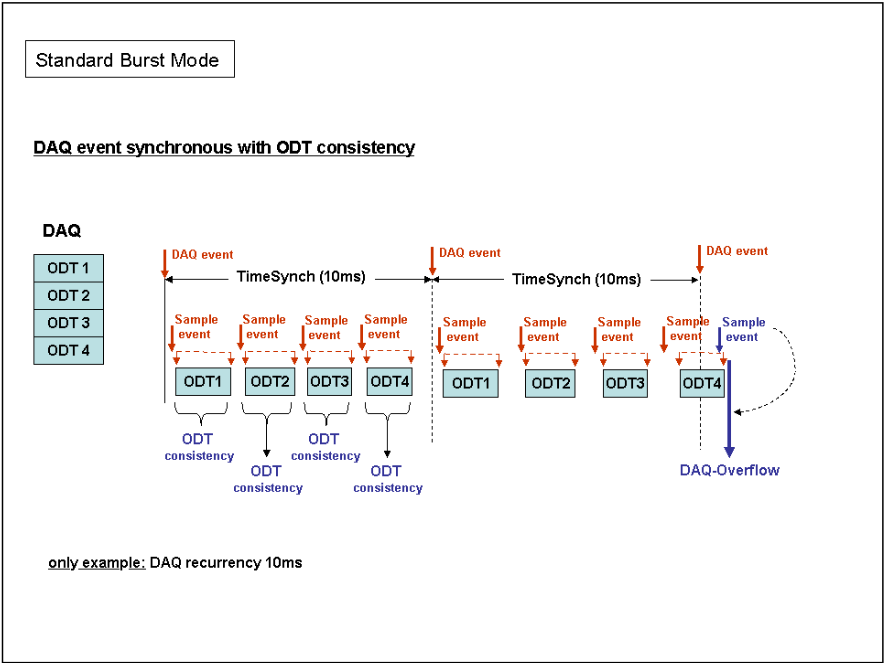

The standard measurement mode of XCP uses an optimized method for reading ECUinternal values. During a configuration phase in advance the master can specify all data of interest via definition of ODTs which are assigned to a DAQ event. After starting the measurement the XCP slave will send the ODTs independently of the XCP master and only based on an internal DAQ trigger event.

The characteristic of the measurement data is ODT consistency. ODT consistency means that the complete content of an ODT is sampled at the same time. The observance of the requested sample rate is based on the performance of the XCP slave and the transmission time of a complete DAQ message.

As an optional feature the XCP timestamp mechanism can be used.

ODT consistency is a minimum requirement of XCP for measurement data.

A DAQ overflow is an event, i.e. a message generated from the XCP slave, to inform the XCP master that the measurement requirements were violated.

In order to configure this mode, the following command is necessary:

- SET\_DAQ\_LIST\_MODE

<a id="section-4-2-3"></a>

## 4.2.3 SYNCHRONOUS DATA TRANSFER, DAQ DIRECTION, BURST, IMPROVED

Figure 13 Measurement mode: improved burst

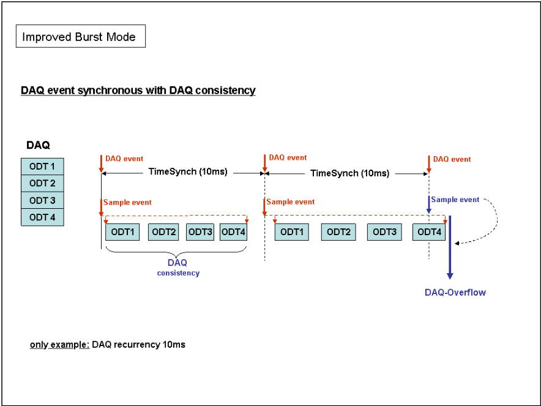

The improved measurement mode is based on the standard measurement mode, but uses a single event driven method for data sampling. The characteristic of the measurement data is DAQ consistency. DAQ consistency means that all ODTs of one DAQ are sampled at the same time. The observance of the requested sample rate is based on the performance of the XCP slave and the transmission time of a complete DAQ message.

As an optional feature the XCP timestamp mechanism can be used.

A DAQ overflow is an event, i.e. a message generated from the XCP slave, to inform the XCP master that the measurement requirements were violated.

In order to configure this mode, the following command is necessary:

- SET\_DAQ\_LIST\_MODE

With CONSISTENCY DAQ or CONSISTENCY EVENT at the definition of an Event Channel in the ASAM MCD-2 MC description file, the slave can indicate what kind of data consistency exists when data are processed within this Event.

<a id="section-4-2-4"></a>

## 4.2.4 SYNCHRONOUS DATA TRANSFER, DAQ DIRECTION, ALTERNATING

Figure 14 Measurement mode: alternating

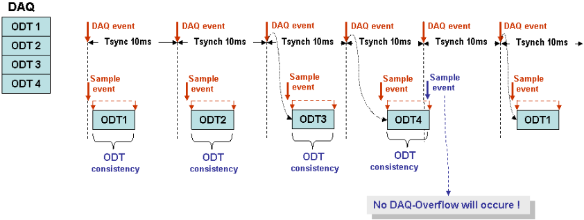

XCP offers a lean measurement mode with a very low performance. Goal of this mode is only to display ECU internal data with limited consumption of ECU resources or XCP slave resources. Although all ODTs are formally assigned to one DAQ list, sample gaps are allowed and will not be reported. Therefore these data are not qualified for measurement.

The XCP mechanism for timestamps is not allowed.

There is a reuse of the configuration structure of the standard XCP measurement mode, but the alternating mode itself works differently. Every DAQ event will cause the sample of one ODT, but internal delays will not cause a DAQ overflow event. Therefore, the master does not know how long the real refresh cycle of the complete DAQ lasts. Only the ODT sequence itself is stable.

In order to configure this mode, the following command is necessary:

- SET\_DAQ\_LIST\_MODE

The ALTERNATING flag selects the alternating display mode.

The master is not allowed to set the ALTERNATING flag and the TIMESTAMP flag at the same time. Therefore a slave in its ASAM MCD-2 MC description file is not allowed to use TIMESTMAP\_FIXED and DAQ\_ALTERNATING\_SUPPORTED at the same time.

The master can set the ALTERNATING flag only when setting DAQ direction at the same time.

<a id="section-4-3"></a>

## 4.3 BYPASSING

Bypassing can be implemented by simultaneously making use of Synchronous Data Acquisition and Synchronous Data Stimulation.

For this, at least two DAQ lists are required for transferring data between the ECU and the bypassing tool, i.e. one DAQ list with direction DAQ and one DAQ list with direction STIM. Furthermore, specific event channels are required, which are intended for bypassing purposes.

Figure 15 Bypassing

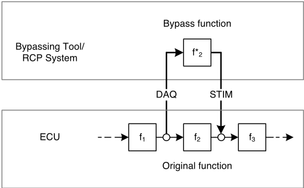

Figure 15 exemplarily shows a simple bypass formed by a DAQ event channel and a STIM event channel. In the ECU, the inputs of the bypass function are sampled and sent to the bypassing tool as DAQ data before the original function is executed. Typically, the inputs of the bypass function are identical to the inputs of the original function. In the bypassing tool, receiving the DAQ data triggers execution of the bypass function. The output of the bypassing tool is then returned to the ECU as STIM data. In the ECU, after execution of the original function, the STIM data is stimulated, typically overwriting the outputs of the original function.

<a id="section-4-3-1"></a>

## 4.3.1 DELAYED BYPASSING

Delayed bypassing means that the DAQ data of a bypass cycle is used to generate STIM data for a later bypass cycle. In this case STIM data for one or more bypass cycles has to be buffered either in the Bypassing tool or in the XCP slave.

The time to transfer the DAQ data and STIM data and to calculate the bypassing function is called the bypassing turnaround time. Delayed bypassing can be used to allow more time for bypass execution if the bypassing turnaround time is too high.

<a id="section-4-3-2"></a>

## 4.3.2 BYPASS ACTIVATION

The adaption of the ECU code to support a bypass is called a bypass hook. For safety reasons, a bypass hook may need to be activated before it is functional. The mechanism to enable a bypass hook is implementation specific and not part of this specification. If required, bypass hooks can be activated using means of XCP, e.g. by calibrating a specific calibration parameter.

<a id="section-4-3-3"></a>

## 4.3.3 BYPASSING STARTUP

Since a bypass can directly affect the ECU behaviour, it must be ensured that the ECU does not use uninitialized or inconsistent values. It is up to the ECU software implementation how this is achieved.

<a id="section-4-3-4"></a>

## 4.3.4 PLAUSIBILITY CHECKS

The XCP slave can perform plausibility checks on the data it receives through data stimulation. The borders (e.g. minimum and maximum values) and actions of these checks may be set by standard calibration methods. No special XCP commands are needed for this.

<a id="section-4-3-5"></a>

## 4.3.5 BYPASSING CONSISTENCY

Bypassing consistency means the consistency between DAQ data and STIM data, i.e. that the STIM data belongs to the correct event cycle of the DAQ data.

Checking bypassing consistency is possible for a bypass if the following conditions are met for the event channels forming this bypass:

## All event channels

- are triggered exactly once per bypass cycle
- are always triggered in the same order
- with direction DAQ have a 1:1, 1:n or n:1 relation to the event channels with direction STIM.

<a id="section-4-3-5-1"></a>

## 4.3.5.1 EVENT CHANNEL RELATIONS

The relationship between DAQ and STIM event channels of a bypass can either be fixed or configurable by the XCP master.

The following figure shows exemplarily how configurable relationships of three DAQ and STIM event channels can be used to form different bypasses.

Figure 16 Dynamic relationship of DAQ and STIM event channels

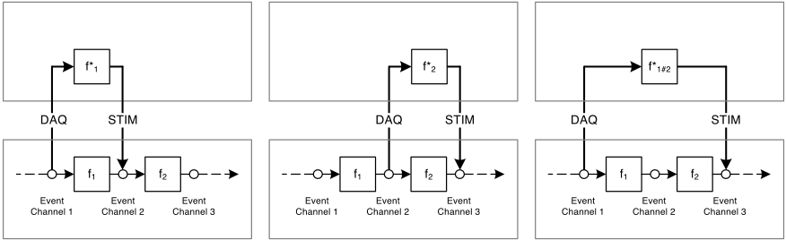

<a id="section-4-3-5-2"></a>

## 4.3.5.2 DTO CTR EVENT CHANNEL PROPERTIES

The DTO CTR event channel properties are event channel specific properties controlling how the DTO CTR field is handled. They are essential for bypassing consistency checking.

For each event channel each DTO CTR event channel property is optional.

## RELATED EVENT CHANNEL NUMBER

An event channel can be related to another event channel or to itself.

The relation is defined by the related event channel number which is an event channel property that is either fixed or can be configured by the XCP command DTO\_CTR\_PROPERTIES.

To obtain information about the related event channel number or to find out if it is fixed or configurable, the bypassing tool can either use the XCP command DTO\_CTR\_PROPERTIES or check the ASAM MCD-2 MC description file for the keywords RELATED\_EVENT\_CHANNEL\_NUMBER and RELATED\_EVENT\_CHANNEL\_NUMBER\_FIXED.

## EVENT COUNTER

An event channel can have a free running counter which is incremented by one for each cycle of this event channel regardless if a DAQ measurement is running or not. If present, the event counter has BYTE size and rolls over at 0xFF.

To find out if the event counter is available for a specific event channel, the bypassing tool can either use the XCP command DTO\_CTR\_PROPERTIES or check the ASAM MCD-2 MC description file for the keyword EVENT\_COUNTER\_PRESENT.

## DTO CTR DAQ MODE

The DTO CTR DAQ mode is an event channel property that is either fixed or can be configured by the XCP command DTO\_CTR\_PROPERTIES.

This property defines how the DTO CTR will be handled for DAQ lists with direction DAQ. If the DTO CTR field is to be inserted for a DAQ list bound to an event channel, the following counter of the related event channel will be used:

- the free running counter, if DTO CTR DAQ mode is set to INSERT\_COUNTER
- the DTO CTR of the last successful STIM cycle, if DTO CTR DAQ mode is set to INSERT\_STIM\_COUNTER\_COPY

If the free running counter is to be inserted and the event channel is related to itself, the new value of the free running counter has to be used, i.e. the incremented value. The same applies for the STIM counter copy.

To obtain information about the DTO CTR DAQ mode for a specific event channel the bypassing tool can either use the XCP command DTO\_CTR\_PROPERTIES or check the ASAM MCD-2 MC description file for the keywords DTO\_CTR\_DAQ\_MODE\_FIXED and

DTO\_CTR\_DAQ\_MODE.

## DTO CTR STIM MODE

The DTO CTR STIM mode is an event channel property that is either fixed or can be configured by the XCP command DTO\_CTR\_PROPERTIES.

This property defines how the DTO CTR will be handled for DAQ lists with direction STIM. If the DTO CTR field is to be expected for a DAQ list bound to an event channel:

- if DTO CTR STIM mode is set to CHECK\_COUNTER, the DTO CTR will be checked against the free running counter of the related event channel
- if STO CTR STIM mode is set to DO\_NOT\_CHECK\_COUNTER, the DTO CTR field will not be checked

If the DTO CTR is to be checked and the event channel is related to itself, the DTO CTR has to be compared to the old value of the free running counter, i.e. before the latter is incremented.

To obtain information about the DTO CTR STIM mode for a specific event channel the bypassing tool can either use the XCP command DTO\_CTR\_PROPERTIES or check the ASAM MCD-2 MC description file for the keywords DTO\_CTR\_STIM\_MODE and DTO\_CTR\_STIM\_MODE\_FIXED.

## STIM DTO CTR COPY

An event channel which supports the DAQ list direction STIM can save the DTO CTR for each successful stimulation. This counter copy then can be referenced by event channels for DAQ lists with direction DAQ.

To find out if the STIM DTO CTR copy property is available for a specific event channel, the bypassing tool can either use the XCP command DTO\_CTR\_PROPERTIES or check the ASAM MCD-2 MC description file for the keyword STIM\_DTO\_CTR\_COPY\_PRESENT.

<a id="section-4-3-5-3"></a>

## 4.3.5.3 DTO CTR FIELD

For bypassing consistency checking, both the DAQ processor and the STIM processor have to be able to handle the DTO CTR field.

The bypassing tool can find out if this feature is available by checking the ASAM MCD-2 MC description file for the keyword DTO\_CTR\_FIELD\_SUPPORTED.

If a bypass is to be checked for consistency, for all DAQ lists which are configured for this bypass, the DTO\_CTR DAQ list mode parameter bit has to be set using the XCP command SET\_DAQ\_LIST\_MODE. With this parameter bit set, the DTO CTR field will be handled according to the properties of the event channel this DAQ list is bound to:

- for DAQ list direction DAQ either the free running counter or the STIM copy counter of the related event channel is inserted
- for DAQ list direction STIM the DTO CTR field is checked against the free running counter of the related event channel or the DTO CTR field is not checked

<a id="section-4-3-5-4"></a>

## 4.3.5.4 DTO CTR CHECK

The DTO CTR check for an event channel succeeds, if for all DAQ lists with direction STIM which are started and bound to this event channel the following holds true:

- all DTOs of those DAQ lists have been received
- all first DTOs of those DAQ lists have a DTO CTR value that matches the value of the related event channel

How to proceed if the check fails is not specified, this means it is up to the implementation to e.g. do nothing, notify the application, send an XCP event EV\_STIM\_TIMEOUT to the XCP master or stimulate old data.

How to proceed if the check succeeds is also not specified, i.e. it is up to the implementation to e.g. stimulate the data or perform additional checks.

<a id="section-4-3-5-5"></a>

## 4.3.5.5 EXAMPLES

This chapter shows typical bypassing configurations and explains how the event channel properties have to be set to check them for bypassing consistency.

In all examples the bypassing tool has to set the DTO\_CTR bit of the related DAQ lists using the XCP command SET\_DAQ\_LIST\_MODE.

The captions in the figures shown in the examples have been abbreviated for clarity. DAQx means event channel number x used for direction DAQ, the same goes for STIMx. Also, there is always only one DTO per event channel shown, representing one or more DTOs of one or more DAQ lists bound to this event channel.

## BYPASS WITH ONE DAQ AND ONE STIM EVENT CHANNEL

The most common bypassing configuration is the combination of one DAQ event channel and one STIM event channel.

For bypassing consistency checking the event channel used for direction DAQ needs the following property configuration:

- the event counter must be present
- the DTO CTR DAQ mode must be set to INSERT\_COUNTER
- the related event channel number must be set to its own event channel number

The event channel used for direction STIM needs the following property configuration:

- the DTO CTR STIM mode must be set to CHECK\_COUNTER
- the related event channel number must be set to the DAQ event channel number

Figure 17 Bypass with one DAQ and one STIM event channel

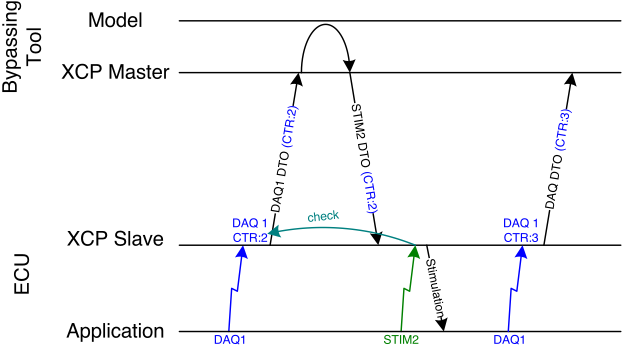

The figure shows one bypassing cycle and the DAQ event of the next cycle. The DAQ processor inserts the free running counter of the DAQ event channel into its DTO. This counter is then returned by the bypassing tool in the STIM DTO. Finally, the STIM processor checks the STIM DTO CTR against the free running counter of the DAQ event channel.

This scenario is also possible with the free running counter located in the STIM event channel. The event channel properties have to be set accordingly, then.

## BYPASS WITH ONE DAQ AND N STIM EVENT CHANNELS

In a bypass with one DAQ event channel and n STIM event channels the DAQ data of one event channel is used to stimulate several other event channels.

For bypassing consistency checking the event channel used for direction DAQ needs the following property configuration:

- the event counter must be present
- the DTO CTR DAQ mode must be set to INSERT\_COUNTER
- the related event channel number must be set to its own event channel number

The event channels used for direction STIM need the following property configuration:

- the DTO CTR STIM mode must be set to CHECK\_COUNTER
- the related event channel number must be set to the DAQ event channel number

Figure 18 Bypass with one DAQ and n STIM event channels

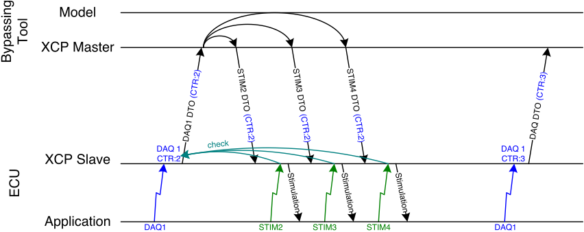

The figure shows one bypassing cycle and the DAQ event of the next cycle. The DAQ processor inserts the free running counter of the DAQ event channel into its DTO. This counter is then returned by the bypassing tool in the STIM DTOs. Finally, for each STIM event channel the STIM processor checks the STIM DTO CTR against the free running counter of the DAQ event channel.

## BYPASS WITH N DAQ AND ONE STIM EVENT CHANNELS

In a bypass with n DAQ and one STIM events the DAQ data sampled by several event channels is used to stimulate a single event channel.

For bypassing consistency checking the event channels used for direction DAQ need the following property configuration:

- the DTO CTR DAQ mode must be set to INSERT\_COUNTER
- the related event channel number must be set to the STIM event channel number

The event channel used for direction STIM needs the following property configuration:

- the event counter must be present
- the DTO CTR STIM mode must be set to CHECK\_COUNTER
- the related event channel number must be set to its own event channel number

Figure 19 Bypass with n DAQ and one STIM event channels

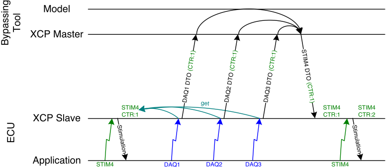

The figure shows the STIM event of the previous bypassing cycle and one complete cycle. For each DAQ event channel the DAQ processor inserts the free running counter of the STIM event channel into the DTO. This counter is then returned by the bypassing tool in the STIM DTO. Finally, the STIM processor checks the STIM DTO CTR against the free running counter of the STIM event channel which is incremented afterwards.

## BYPASS WITH A SINGLE EVENT CHANNEL

A bypass can also be formed using only a single event channel. This event channel then triggers both the DAQ processor to sample the inputs for the next cycle and the STIM processor to stimulate the data based on the inputs of the previous cycle. This means that at least two DAQ lists, one with direction DAQ, the other with direction STIM have to be bound to this event channel.

The following event channel property configuration is needed:

- the event coutner must be present
- the DTO CTR DAQ mode must be set to INSERT\_COUNTER
- the DTO CTR STIM mode must be set to CHECK\_COUNTER
- the related event channel number must be set to its own event channel number

Figure 20 Bypass with a single event channel

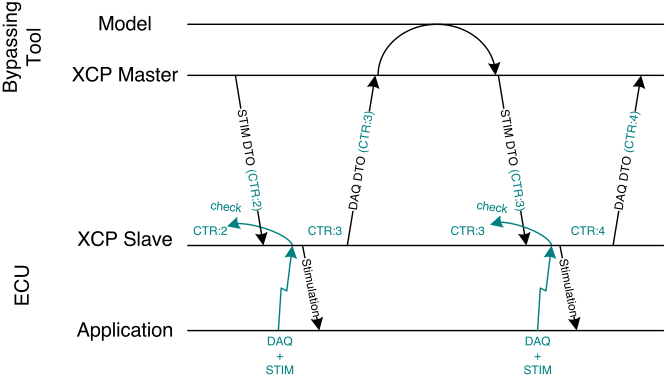

The figure shows the STIM of the previous bypassing cycle, one complete cycle and the DAQ of the next cycle. For Stimulation the STIM DTO CTR is always compared with the old value of the Free Running Counter, whereas for DAQ the incremented value of the Free Running Counter is inserted.

## SOFTWARE IN THE LOOP

Another use case of simultaneous DAQ and STIM is Software in the Loop (SiL) where a SiL tool stimulates the inputs of a function in the ECU and samples the outputs after the function has been executed. In this scenario the tool has to perform the consistency check.

The event channel used for direction DAQ needs the following property configuration:

- the DTO CTR DAQ mode must be set INSERT\_STIM\_COUNTER\_COPY
- the related event channel number must be set to the STIM event channel number

The event channel used for direction STIM needs the following property configuration:

- the STIM DTO CTR copy must be present
- the DTO CTR STIM mode must be set to DO\_NOT\_CHECK\_COUNTER

Figure 21 Software in the Loop with one STIM and one DAQ event

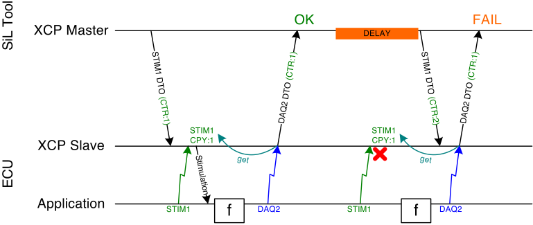

The figure shows two complete SiL cycles with a consistency fault in the second cycle. Each cycle starts with the SiL tool sending a STIM DTO with a DTO CTR value given by the tool. In the ECU the cycle starts with the STIM processor being triggered by the STIM event channel. If the stimulation of the function inputs succeeds, the STIM DTO CTR is latched for later reference. After execution of the function, the DAQ event channel triggers the DAQ processor to sample the outputs and send them to the SiL tool inserting the STIM DTO CTR copy of the STIM event channel. The SiL tool then checks if the outputs belong to the stimulated inputs.

<a id="section-4-3-6"></a>

## 4.3.6 MINIMUM SEPARATION TIME

The slave should be able to receive stimulation data in several DTOs from the bypassing tool. If the slave needs time from one to the next DTO, this must be indicated to the bypassing tool. The parameter MIN\_ST\_STIM is designed for this purpose.

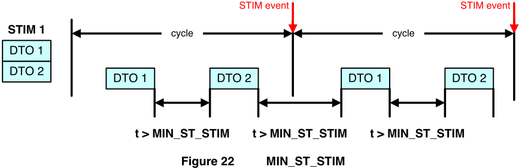

<a id="section-4-4"></a>

## 4.4 ONLINE CALIBRATION

<a id="section-4-4-1"></a>

## 4.4.1 SECTOR, SEGMENT AND PAGE

Figure 23 Calibration data organization

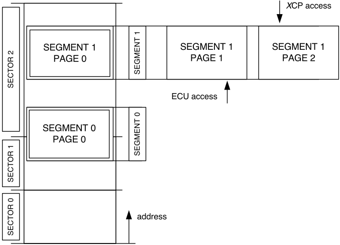

The slave's memory layout is described as one continuous physical space. Elements are referenced with a 40 bit address (32 bit XCP address + 8 bit XCP address extension).

The physical layout is described with objects called SECTORS.

SECTOR limits and sizes are important when reprogramming (Flashing) the slave device.

The logical layout is described with objects called SEGMENTS.

SEGMENTS describe WHERE the calibratable data objects are located in the slave's memory.

The start address and size of a SEGMENT does not have to respect the limitations given by the start addresses and sizes of the SECTOR layout.

Every SEGMENT can have multiple PAGES.

The PAGES of a SEGMENT describe the same data on the same addresses, but with different properties e.g. different values or read/write access.

When searching for data to be used by the control algorithms in the slave, at any moment (for every SEGMENT) the slave can access only one PAGE. This PAGE is called the "active PAGE for ECU access for this SEGMENT".

When referencing data with XCP commands, at any moment (for every SEGMENT) the XCP master can access only one PAGE. This PAGE is called the "active PAGE for XCP access for this SEGMENT".

The active PAGE for ECU access and XCP access can be switched independently.

The active PAGE can be switched independently for every SEGMENT.

<a id="section-4-4-2"></a>

## 4.4.2 LOGICAL LAYOUT: SEGMENT

The logical layout of the slave's memory is described with objects called SEGMENTS. SEGMENTS describe WHERE the calibratable data objects are located in the slave's memory.

The start address and size of a SEGMENT does not have to respect the limitations given by the start addresses and sizes of the SECTOR layout (ref. Flashing).

A SEGMENT is described with the normal ASAM MCD-2 MC keyword MEMORY\_SEGMENT which contains information like Name, Address, Size and Offsets for Mirrored Segments.

The XCP specific information is inside an IF\_DATA section.

For having a 40 bit address space, every SEGMENT is having an address extension which is valid for all calibratable objects that are located within this SEGMENT. XCP references a SEGMENT by its SEGMENT\_NUMBER.

Within one and the same XCP slave device, the range for the SEGMENT\_NUMBER starts from 0 and has to be continuous.

SEGMENT\_NUMBER [0,1,..255]

<a id="section-4-4-3"></a>

## 4.4.3 ACCESSIBILITY - PAGE

Every SEGMENT can have multiple PAGES.

The PAGEs of a SEGMENT describe the same data on the same addresses, but with different properties e.g. different values or read/write access.

Every SEGMENT always at least has to have 1 PAGE, called PAGE 0.

The slave always has to initialize all its PAGEs for all its SEGMENTs. PAGE 0 of the INIT\_SEGMENT of a PAGE contains the initial data for a PAGE.

With GET\_CAL\_PAGE, the master can get the current active PAGEs for XCP and ECU access of the slave.

The ECU\_ACCESS\_x flags indicate whether and how the ECU can access this page. If the ECU can access this PAGE, the ECU\_ACCESS\_x flags indicate whether the ECU can access this PAGE only if the XCP master does NOT access this PAGE at the same time, only if the XCP master accesses this page at the same time, or the ECU does not care whether the XCP master accesses this page at the same time or not.

The XCP\_x\_ACCESS\_y flags indicate whether and how the XCP master can access this page. The flags make a distinction for the XCP\_ACCESS\_TYPE depending on the kind of access the XCP master can have on this page (READABLE and/or WRITEABLE).

If the XCP master can access this PAGE, the XCP\_READ\_ACCESS\_x flags indicate whether the XCP master can read from this PAGE only if the ECU does NOT access this PAGE at the same time, only if the ECU accesses this page at the same time, or the XCP master does not need to care whether the ECU accesses this page at the same time or not.

If the XCP master can access this PAGE, the XCP\_WRITE\_ACCESS\_x flags indicate whether the XCP master can write to this PAGE only if the ECU does NOT access this PAGE at the same time, only if the ECU accesses this page at the same time, or the XCP master does not need to care whether the ECU accesses this page at the same time or not.

For every SEGMENT the numbering of the PAGEs through PAGE\_NUMBER restarts from 0

PAGE\_NUMBER(Segment j) [0,1,..255]

<a id="section-4-4-4"></a>

## 4.4.4 CALIBRATION DATA PAGE SWITCHING

If the slave supports the optional commands GET\_CAL\_PAGE and SET\_CAL\_PAGE, page switching is supported.

When searching for data to be used by the control algorithms in the slave, at any moment (for every SEGMENT) the slave can access only one PAGE. This PAGE is called the "active PAGE for ECU access for this SEGMENT".

When referencing data with XCP commands, at any moment (for every SEGMENT) the XCP master can access only one PAGE. This PAGE is called the "active PAGE for XCP access for this SEGMENT".

With GET\_CAL\_PAGE, the master can request the slave to answer the current active PAGE for ECU or XCP access for this SEGMENT.

With SET\_CAL\_PAGE, the master can set the current active PAGE for ECU or XCP access for this SEGMENT.

The active PAGE for ECU access and XCP access can be switched independently.

The active PAGE can be switched independently for every SEGMENT.

The master also can switch all SEGMENTS synchronously to the same PAGE.

The master has to respect the constraints given by the XCP\_ACCESS\_TYPE and ECU\_ACCESS\_TYPE.

In normal operation, only the master controls the switching of pages. However, there might be situations where the ECU enforces switching to predefined pages. These predefined pages shall be specified by the tag DEFAULT\_PAGE\_NUMBER in each SEGMENT section of the A2L file.

The slave shall use the ECU states mechanism to inform the master upon the event of an enforced page switch. Only ECU states related to such an event shall include the tag ECU\_SWITCHED\_TO\_DEFAULT\_PAGE in the STATE sections.

Based on this tag in the A2L file the master can derive the active pages for ECU access by using the DEFAULT\_PAGE\_NUMBER within each memory segment section.

In situations where the ECU enforces switching to predefined pages the master still might be allowed to obtain information about the current configuration of the pages. However, the master might no longer be allowed to make changes to the configuration of the pages. In this case, the CAL and PAG related setter-methods shall not be executed by the master. This can be defined by the GETTER\_ONLY enumerator of the CAL/PAG resource within the STATE section of the A2L file.

<a id="section-4-4-5"></a>

## 4.4.5 CALIBRATION DATA PAGE FREEZING

The FREEZE\_SUPPORTED flag in PAG\_PROPERTIES at GET\_PAG\_PROCESSOR\_INFO indicates that all SEGMENTS can be put in FREEZE mode.

With SET\_SEGMENT\_MODE the master can select a SEGMENT for freezing. With GET\_SEGMENT\_MODE the master can identify whether a SEGMENT has been selected for FREEZING.

With STORE\_CAL\_REQ in SET\_REQUEST, the master requests the slave to save calibration data into non-volatile memory.

For each SEGMENT that is in FREEZE mode, the slave has to save the current active XCP PAGE for this SEGMENT into PAGE 0 of the INIT\_SEGMENT of this PAGE.

The STORE\_CAL\_REQ bit obtained by GET\_STATUS will be reset by the slave, when the request is fulfilled. The slave device may indicate this by transmitting an EV\_STORE\_CAL event packet.

<a id="section-4-4-6"></a>

## 4.4.6 ADDRESSING ACTION

The slave's memory layout is described as one continuous physical space. Elements are referenced with a 40 bit address (32 bit XCP address + 8 bit XCP address extension).

The address extension is taken from the SEGMENT to which the currently referenced address belongs.

The address range at MEMORY\_SEGMENT describes the addresses from which the master can generate a file that can be programmed into the slave and then will result in a normal operating slave.

For checking whether a CHARACTERISTIC belongs to a MEMORY\_SEGMENT, the master has to take the address written at CHARACTERISTIC, if applicable apply the ECU\_CALIBRATION\_OFFSET and if applicable the dereferencing of the NearPointer and then check this resulting address to be part of the MEMORY\_SEGMENT.

For the (destination) address used in SET\_MTA , SHORT\_UPLOAD and SHORT\_DOWNLOAD, the master has to take the address as calculated above (take address at CHARACTERISTIC, apply ECU\_CALIBRATION\_OFFSET, dereference) and if applicable apply an ADDRESS\_MAPPING from the calculated (source) address to a mapped (destination) address.

ADDRESS\_MAPPING can be different for different parts of a SEGMENT.

Figure 24 Address calculation

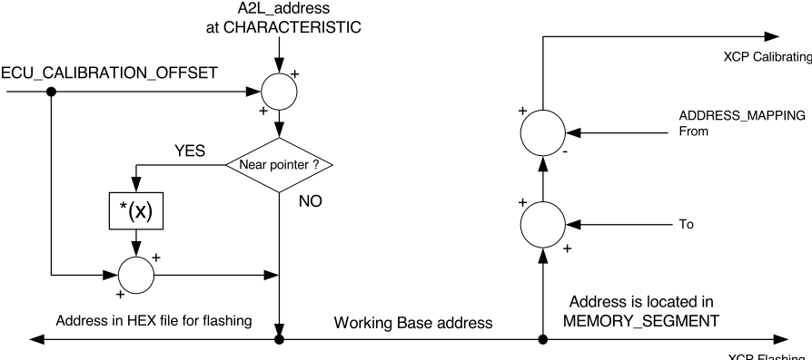

<a id="section-4-4-7"></a>

## 4.4.7 MASTER-SLAVE ACTION

The slave has to support checksum calculation on all address ranges that are described with SECTORS or SEGMENTS.

Checksum calculation has to be possible for all PAGEs that have XCP\_ACCESS\_ALLOWED.

If a PAGE is READABLE by the XCP master, the master can access this PAGE with the commands UPLOAD and SHORT\_UPLOAD, in standard mode and if supported in block mode.

If a PAGE is WRITEABLE by the XCP master, the master can access this PAGE with the commands SHORT\_DOWNLOAD and DOWNLOAD\_MAX in standard mode.

If a PAGE is WRITEABLE by the XCP master, the master can access this PAGE with the commands DOWNLOAD and if block mode supported with DOWNLOAD\_NEXT.

If a PAGE is WRITEABLE by the XCP master, the master can access this PAGE with the command MODIFY\_BITS which allows to modify bits in an atomic way.

<a id="section-4-4-8"></a>

## 4.4.8 PAGE-PAGE ACTION

If the XCP slave device has more than one PAGE, the master can copy the data from one PAGE to another with COPY\_CAL\_PAGE.

In principal any PAGE of any SEGMENT can be copied to any PAGE of any SEGMENT. However, restrictions might be possible. The slave indicates this by ERR\_PAGE\_NOT\_VALID, ERR\_SEGMENT\_NOT\_VALID or ERR\_WRITE\_PROTECTED.

<a id="section-4-5"></a>

## 4.5 FLASH PROGRAMMING

<a id="section-4-5-1"></a>

## 4.5.1 PHYSICAL LAYOUT: SECTOR

The physical layout of the slave's memory is described with objects called SECTORS. SECTOR start addresses and sizes are important when reprogramming (Flashing) the slave device.

XCP Flashing

## A SECTOR is referenced by a SECTOR\_NUMBER.

Within one and the same XCP slave device, the range for the SECTOR\_NUMBER starts from 0 and has to be continuous.

SECTOR\_NUMBER [0,1,..255]

<a id="section-4-5-2"></a>

## 4.5.2 GENERAL

In principle the complete flash process can be divided into three steps. It depends on the point of view, whether the individual use case needs all of them:

- administration before (for example version control)
- original flash process ('only' the programming actions)
- administration below (for example version or checksum control)

The XCP protocol deals with these steps in different ways. The commands for the original flash process are the focus of XCP.

XCP offers special programming commands. The project specific use of all the commands must be specified in a project specific "programming flow control". This document specifies no standard for this additional description file. In practice every project needs a project specific agreement between the ECU and the tool supplier.

List without any sequence definition:

- PROGRAM\_START
- PROGRAM\_CLEAR
- PROGRAM\_FORMAT
- PROGRAM (Loop) (It is also possible to use a block transfer mode optionally.)
- PROGRAM\_VERIFY
- PROGRAM\_RESET

Usually administration before means version control before the original flash process has been started. This examination checks inside the tool whether the new flash content fits to the ECU. Therefore the tools need identification information of the ECU and of the new flash content. XCP does not support special version control commands for the flash process. In practice the administration actions are very project specific and it depends on the ECU, which services are necessary.

The ECU functional description can specify with which standard XCP commands a version control before could be done.

The actions of the version control below can be done inside the ECU. XCP supports some flexible commands.

The original flash process can be done with different concepts. The XCP protocol supports two different flash access methods. They are called the "absolute" and the "functional" access modes. Both methods use the same commands with sometimes different parameters. It is possible to mix, i.e. to use a different access method for the delete phase in comparison to the programming phase.

The recommended concept is based on the available address and memory information and specified in the project specific programming flow control.

<a id="section-4-5-3"></a>

## 4.5.3 ABSOLUTE ACCESS MODE - ACCESS BY ADDRESS

This mode bases on some conditions and is used as default. The physical layout of the flash device is well-known to the tool and the flash content to be programmed is available and also the address information of the data.

It depends on the project, whether the physical layout information are supported by a description file or can be read out of the ECU. There exist different optional XCP commands for different information.

Moreover the tool needs all the necessary sequence information, which must be specified in a project specific programming flow control.

The data block of the specified length (size) contained in the CTO will be programmed into non-volatile memory, starting at the MTA. The MTA will be post-incremented by the number of data bytes.

Figure 25 Absolute access mode

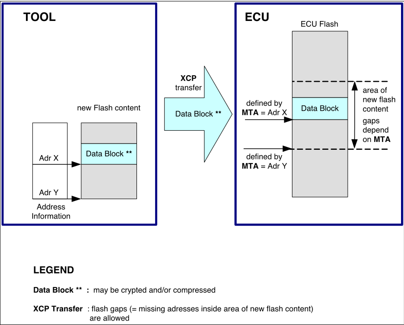

<a id="section-4-5-4"></a>

## 4.5.4 FUNCTIONAL ACCESS MODE - ACCESS BY FLASH AREA

This mode is suitable for two different use-cases. The tool needs no memory mapping information and no address information of the flash content to be programmed

The tool needs only the information about the flash area and uses the address information in a different way. The address information represents a relative pointer related to the download software and starts with zero. This mode is useful in connection with compressed or encrypted download software. In this use-case there is no direct relationship between a physical address and the content behind.

The data block of the specified length (size) contained in the CTO will be programmed into non-volatile memory. The ECU software knows the start address for the new flash content automatically. It depends on the PROGRAM\_CLEAR command. The ECU expects the new flash content in one data stream and the assignment is done by the ECU automatically.

The MTA works as a Block Sequence Counter and it is counted inside the master and the server. The Block Sequence Counter allows an improved error handling in case a programming service fails during a sequence of multiple programming requests. The Block Sequence Counter of the server shall be initialized to one (1) when receiving a PROGRAM\_FORMAT request message. This means that the first PROGRAM request message following the PROGRAM\_FORMAT request message starts with a Block Sequence Counter of one (1). Its value is incremented by 1 for each subsequent data transfer request. At the maximum value the Block Sequence Counter rolls over and starts at 0x00 with the next data transfer request message.

Figure 26 Functional access mode

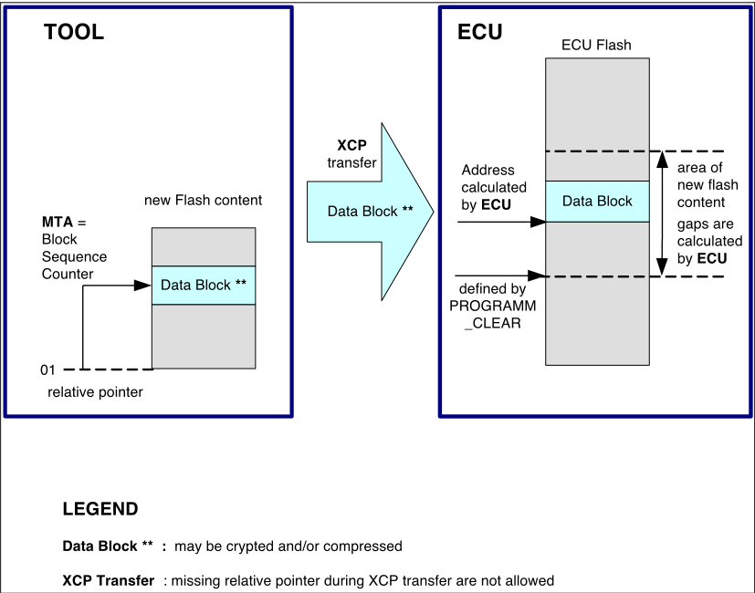

The behaviour is similar to ISO 14229-1 [2] and ISO 15765-3 [3] .

If a PROGRAM request is correctly received and processed in the slave, but the positive response message does not reach the master, then the master would determine an application layer timeout and would repeat the same request (including the same Block Sequence Counter). The slave would receive the repeated PROGRAM request and could determine based on the included Block Sequence Counter, that this PROGRAM request is repeated. The slave would send the positive response message immediately without writing the data once again into its memory.

If the PROGRAM request is not received correctly in the slave, then the slave would not send a positive response message. The master would determine an application layer timeout and would repeat the same request (including the same Block Sequence Counter). The slave would receive the repeated PROGRAM request and could determine based on the included Block Sequence Counter that this is a new PROGRAM request. The slave would process the service and would send the positive response message.

It is optionally possible to change to the absolute access mode at the end of the flash session.

## Affected Commands

PROGRAM\_CLEAR, PROGRAM\_FORMAT, PROGRAM, SET\_MTA

<a id="section-4-5-5"></a>

## 4.5.5 CHECKSUM CONTROL AND PROGRAM VERIFY

After the original flash process a version control is helpful. This action checks whether the new flash content fits to the rest of the flash. In practice exists different methods, but XCP supports only a checksum control and the start of internal test routines.

The checksum method can be done with the standard checksum command (examination inside the tool). On the other hand XCP supports an examination inside the slave. The tool can start slave internal test routines and send verification values to the slave.

## Affected Commands

BUILD\_CHECKSUM, PROGRAM\_VERIFY

<a id="section-4-5-6"></a>

## 4.5.6 END OF FLASH SESSION

The end of the overall programming sequence is indicated by a PROGRAM\_RESET command. The slave device will go to disconnected state. Usually a hardware reset of the slave device is executed.

## Affected Commands

PROGRAM\_RESET

<a id="section-4-6"></a>

## 4.6 TIME CORRELATION

<a id="section-4-6-1"></a>

## 4.6.1 INTRODUCTION

For a long time, time correlation performed in the XCP master was based on pairwise reference timestamp sampling between an XCP master and an XCP slave using the GET\_DAQ\_CLOCK command. In the scope of this specification, this will be referred to as the legacy time correlation technique.

Due to limitations in the implementation of the XCP master and XCP slaves as well as limitations of the communication infrastructure, the achievable accuracy using the legacy time correlation technique is limited. Nowadays, there is a strong need for reliable synchronization accuracy in the single-digit microsecond range or even below that.

As a consequence, the protocol and transport layer specifications have been extended thoroughly with the advanced time correlation technique. As a central improvement, an XCP master is now able to obtain a detailed view of the clock system related to an XCP slave, i.e. the number of different clocks and their characteristics. Along with three basic techniques, advanced time correlation offers all the features, needed to improve time synchronization significantly.

The first technique uses XCP native methods to improve time synchronization. The basic idea of this technique is to generate an XCP master initiated event (GET\_DAQ\_CLOCK\_MULTICAST command) that simultaneously occurs at the XCP slaves connected to one transport layer. Each XCP slave has to sample its timestamps at the moment when this event occurs. The initiation of the event is thereby carried out periodically by an XCP master. This approach allows correlating the XCP slave's timestamps among each other, eliminating the need of knowing the XCP master time as the global reference time. To obtain best accuracy, two requirements have to be satisfied:

- Participating slaves have to sample their timestamps instantaneously with the occurrence of the event.
- The latency between the XCP master and the participating XCP slaves should be uniform to ensure a simultaneous occurrence of the XCP master initiated event at each XCP slave.

The generation of the XCP master initiated event that has to occur simultaneously at the XCP slaves requires broadcast-like mechanism. The method of generating such a broadcast message might be specific for each transport layer and is consequently part of a transport layer specification.

Due to the broadcast characteristic of the GET\_DAQ\_CLOCK\_MULTICAST command and the fact that the command has to be understood as an XCP master initiated event, the processing of this command differs to classical commands. Instead of sending a positive response as the counterpart to the XCP master initiated command, an XCP slave supporting this feature reacts on a GET\_DAQ\_CLOCK\_MULTICAST command by sending information relevant for time correlation as part of an EV\_TIME\_SYNC event packet to its XCP master. Therefore, the EV\_TIME\_SYNC event packet has been significantly extended.

To ensure backward compatibility, the legacy formats for EV\_TIME\_SYNC events as well as the response to GET\_DAQ\_CLOCK command have to be used after connect. An XCP master supporting the advanced time correlation technique may enable the needed features in an XCP slave using the response format (RESPONSE\_FMT) flag in SET\_PROPERTIES of the TIME\_CORRELATION\_PROPERTIES command. Once the advanced time correlation features have been enabled, the XCP slave shall use the extended response formats for these messages.

The use of the second technique presumes the availability of an XCP unrelated time synchronization technique, e.g. the Precision Time Protocol (PTP) as defined in the IEEE 1588 standard (IEEE Standard for a precision clock synchronization protocol for networked measurement and control systems, Feb. 2009). In this use case it is assumed that the XCP slave's clock is either synchronized 2 or syntonized 3 to a grandmaster clock.

2 Two clocks are synchronized to a specified uncertainty if they have the same epoch and their measurements of the time of a single event at an arbitrary time differ by no more than that uncertainty. (IEEE Standard for a precision clock synchronization protocol for networked measurement and control systems, Feb. 2009, S. 7)

3 Two clocks are syntonized if the duration of the second is the same on both. They may or may not share the same timestamp unit/timestamp size tuple. They may or may not share the same epoch. Modified from (IEEE Standard for a precision clock synchronization protocol for networked measurement and control systems, Feb. 2009, S. 7)

In such a use case, the XCP master firstly needs to know that the timestamps sent by an XCP slave are synchronized to a grandmaster clock at all. Secondly it is necessary to also obtain the information, to which grandmaster clock the XCP slave is synchronized/syntonized to. This is required to handle systems with more than one grandmaster clock. With introduction of the advanced time correlation technique, awareness for time synchronization carried out through well-established, XCP unrelated standards is added.

Therefore, each clock known to the XCP slave features a unique identifier. When a clock is synchronized/syntonized to a grandmaster clock, the slave's clocks' attributes have to be updated to reflect this state change. Based on the information of the XCP slave's synchronization state and the information to which grandmaster clock the clock is synchronized to - by evaluating the unique clock identifiers - the XCP master is able to determine hierarchies of synchronized clocks.

The third technique addresses the requirements of resource limited XCP slaves that do not offer the possibility to synchronize clocks. In such a use case, the XCP slave can offer timestamp tuples to the XCP master, i.e. its local timestamp and the timestamp of the globally synchronized clock that was valid when the local timestamp was read. Based on this technique, the XCP master is aware of the relation between clocks of the XCP slave, and finally is able to perform precise clock correlation within the XCP master.

The advanced time correlation mechanisms make use of the commands/events:

- Protocol layer command TIME\_CORRELATION\_PROPERTIES
- Extended format of the positive response of GET\_DAQ\_CLOCK command.
- Extended format of the EV\_TIME\_SYNC event packet.
- Transport layer sub command GET\_DAQ\_CLOCK\_MULTICAST for transport layers CAN, FlexRay and Ethernet.

<a id="section-4-6-2"></a>

## 4.6.2 XCP SLAVE'S CLOCK SUBSYSTEM

When an XCP slave supports advanced time synchronization features, different clocks might be observable by the XCP slave, at least one. The absolute amount of observable clocks thereby depends on the architecture of an XCP slave as well as run-time dynamic events, e.g. synchronization of clocks to a grandmaster clock or loss of synchronization. Before introducing the details of the TIME\_CORRELATION\_PROPERTIES command, different implementation alternatives of the XCP slave's clock infrastructure are shown and briefly discussed, to better understand the requirements that result therefrom.

<a id="section-4-6-2-1"></a>

## 4.6.2.1 SCENARIO 1: ONE OBSERVABLE CLOCK - FREE RUNNING XCP SLAVE CLOCK

In its simplest form, an XCP slave might have a single, free running clock that can be read randomly. DAQ timestamps transmitted by the XCP slave are related to this clock.

Upon reception of a GET\_DAQ\_CLOCK\_MULTICAST message, the clock is read and the obtained timestamp is sent back to the XCP master. In principle, the same sequence also holds for the GET\_DAQ\_CLOCK command. The only difference is that the responded timestamp would be sent as part of the positive response of the GET\_DAQ\_CLOCK command.

Figure 27 XCP slave clock free running

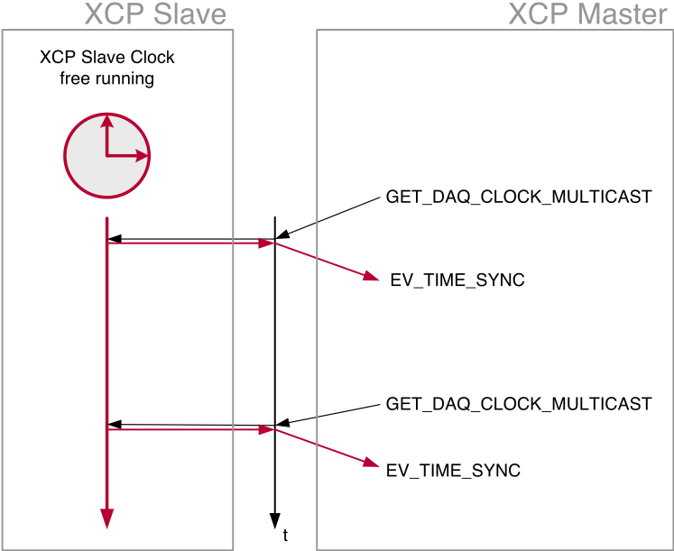

4.6.2.2 SCENARIO 2: ONE OBSERVABLE CLOCK - SINGLE XCP SLAVE CLOCK, SYNCHRONIZED TO A GRANDMASTER CLOCK

In a different implementation, the XCP slave clock itself might be synchronized to an external grandmaster clock, e.g. using the IEEE 1588 protocol. Simply speaking, synchronized clocks deliver the same time when read simultaneously.

For handling GET\_DAQ\_CLOCK\_MULTICAST and GET\_DAQ\_CLOCK commands, there is no difference to the scenario described before. The only additional information the XCP master needs to know is that the XCP slave's clock is synchronized to an external grandmaster clock as well as the unique identifier of the grandmaster's clock. With this information available, the XCP master is able to put all XCP slaves that are synchronized to the same grandmaster clock into one logical domain. For correlating DAQ timestamps among XCP slaves of this domain, the XCP master does not need to perform any time correlation. Even the GET\_DAQ\_CLOCK\_MULTICAST commands shown in Figure 28 could be skipped.

Figure 28 XCP slave clock synchronized to grandmaster clock

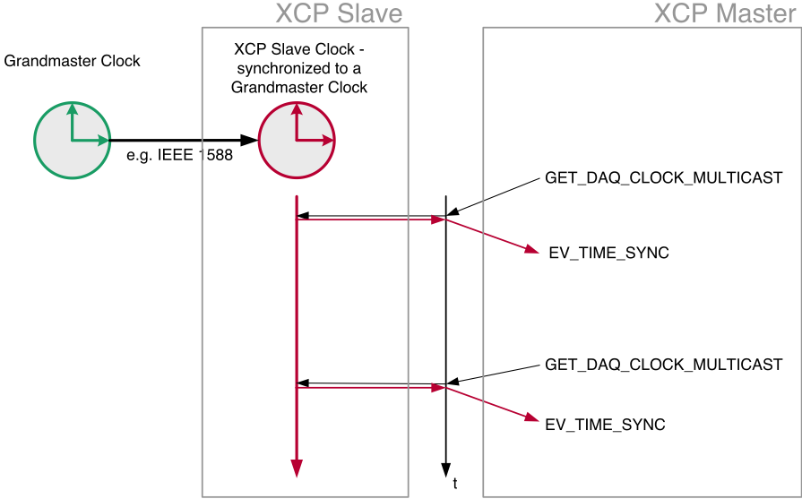

4.6.2.3 SCENARIO 3: ONE OBSERVABLE CLOCK - SINGLE XCP SLAVE CLOCK, SYNTONIZED TO A GRANDMASTER CLOCK

This scenario is almost the same as the one described before. It differs in thus far that there is an offset between the clocks when read at the same time while the rate change of the XCP slave's clock is aligned to the rate change of the grandmaster clock. In order to correlate timestamps, the XCP master needs to know the offset between both clocks in reference to a specific XCP slave's clock timestamp and the basic clock rate of both clocks. This information is obtained by first sending the TIME\_CORRELATION\_PROPERTIES command requesting details of slave's clock information. In the positive response to the command the slave tells the master that details of the clocks and their relation are made available by setting CLOCK\_INFO = 0x7. The details are finally obtained by issuing an UPLOAD command.

Figure 29 XCP slave clock syntonized to grandmaster clock

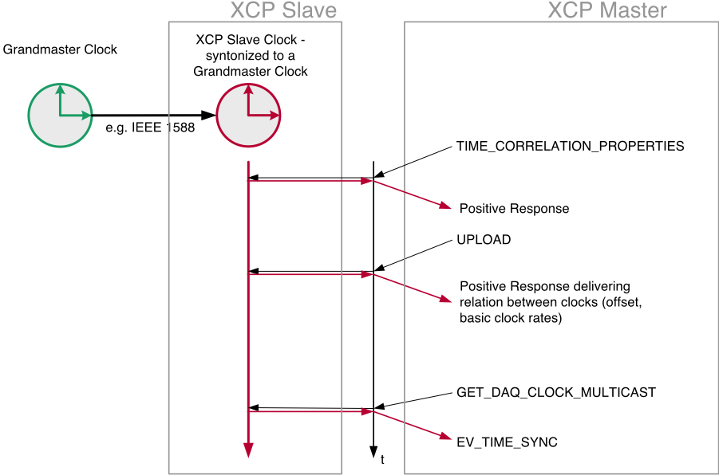

- 4.6.2.4 SCENARIO 4: TWO OBSERVABLE CLOCKS - FREE RUNNING XCP SLAVE CLOCK COMBINED WITH A GLOBALLY SYNCHRONIZED CLOCK
- a) In case that an XCP slave is not able to synchronize its own, free running clock to a grandmaster clock, there still might be an observable clock that is synchronized to a grandmaster clock, e.g. a synchronized clock within the XCP slave's Ethernet PHY. Obtaining timestamps from both clocks, necessarily captured at the same moment, allows the XCP master to perform correlation between both clocks. By converting the timestamps of the free running clock into the grandmaster's time domain the XCP master is able to finally correlate these DAQ timestamps to DAQ timestamps of other XCP slaves that allow tracking their timestamps by the same grandmaster clock. Different to the GET\_DAQ\_CLOCK command, the aim of the GET\_DAQ\_CLOCK\_MULTICAST command is to trigger a simultaneous capturing of both clocks. Another benefit of using GET\_DAQ\_CLOCK\_MULTICAST instead of GET\_DAQ\_CLOCK command is reduction of bus load. When using the GET\_DAQ\_CLOCK\_MULTICAST command, only one bus timeslot is consumed for sending out the command instead of n compared when using GET\_DAQ\_CLOCK command - where n is the amount of XCP slaves.

Figure 30 XCP slave with two clocks: XCP slave clock and randomly readable clock synchronized to a grandmaster clock

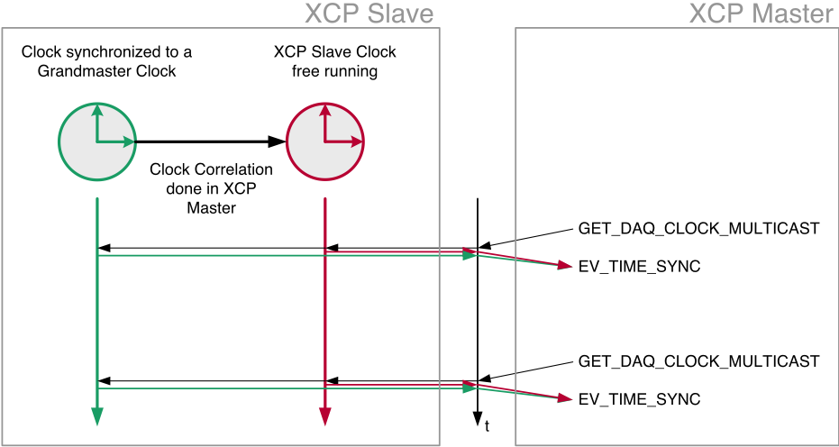

- b) The above described scenario presumes, that both clocks can be read randomly. This however might not be given, e.g. when the synchronized clock is maintained in the XCP slave's Ethernet PHY where access to the Ethernet PHY might be shared with other resources. Most often however, these devices offer the possibility to periodically generate a trigger, e.g. one pulse per second. This trigger could be used to capture the XCP slave's clock. Since the time of the synchronized clock at the occurrence of the trigger is well known, the XCP slave is able to generate and transmit an EV\_TIME\_SYNC event, containing both timestamps.

Figure 31 Slave with two clocks: XCP slave clock and another clock synchronized to a grandmaster clock which cannot be read randomly

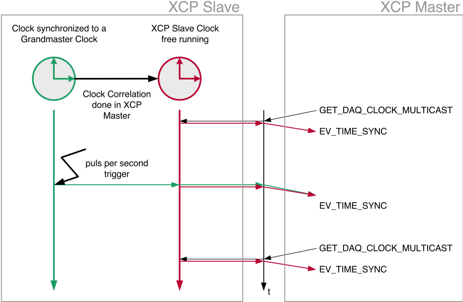

<a id="section-4-6-2-5"></a>

## 4.6.2.5 SCENARIO 5: TWO OBSERVABLE CLOCKS - FREE RUNNING XCP SLAVE CLOCK COMBINED WITH AN ECU CLOCK

A different scenario targets the situation where the free running XCP slave clock may be observed along with the ECU clock whereas the DAQ timestamps transmitted by the XCP slave are related to the ECU clock. This is a use case for an external XCP slave.

- a) In case that the ECU native clock can be read randomly it could be argued that there is no need to expose these two clocks to the XCP master; in principle it would be sufficient to report the ECU clock as the XCP slave clock. However, thinking of the fact that sporadic resets might occur at the ECU clock, the scenario becomes of good use. The XCP slave might generate an EV\_TIME\_SYNC event upon release of ECU reset, thereby informing the XCP master upon this event along with a pair of XCP slave clock and ECU clock timestamps. This might be useful for the time correlation algorithm in the XCP master.

Figure 32 XCP slave with two clocks: XCP slave clock and ECU clock which can be read randomly

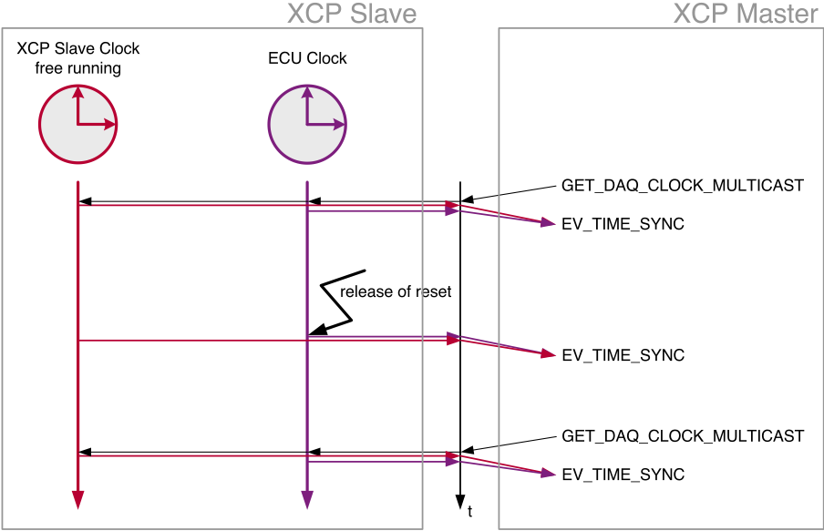

- b) In case that the ECU native clock cannot be read randomly it is mandatory that the XCP slave periodically generates EV\_TIME\_SYNC events, sending pairs of XCP slave clock and ECU clock timestamps to the XCP master. At best, both timestamps have to be captured simultaneously to obtain good correlation accuracy in the XCP master. As described before, the XCP slave also might generate an EV\_TIME\_SYNC event upon release of ECU reset.

Figure 33 XCP slave with two clocks: XCP slave clock and ECU clock which cannot be read randomly

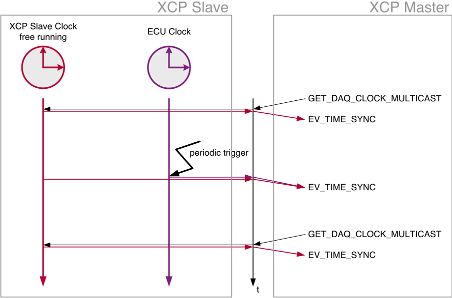

<a id="section-4-6-2-6"></a>

## 4.6.2.6 SCENARIO 6: THREE OBSERVABLE CLOCKS

This scenario actually describes a combination of any of the previously described dual clock scenarios, with DAQ timestamps related to the ECU clock. In the most relevant implementation scenario, neither the ECU clock nor the clock which is synchronized to a grandmaster clock can be read randomly. The clock synchronized to a grandmaster clock is part of the system to obtain best synchronization accuracy in the XCP master while the free running XCP slave clock is necessary to relate the ECU clock to the grandmaster clock. This might be a typical use case for a small-sized, external XCP slave.

Figure 34 XCP slave with three clocks

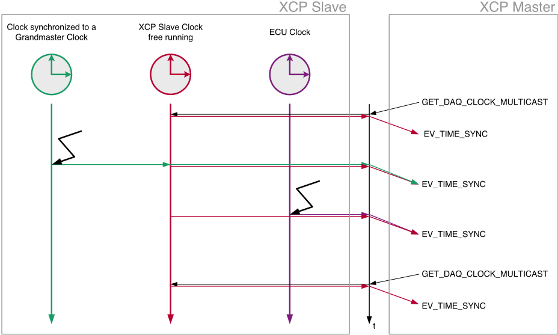

<a id="section-4-6-2-7"></a>

## 4.6.2.7 SCENARIO 7: ECU CLOCK ONLY

This scenario describes an XCP slave that does not offer an internal clock. However, it is known that the DAQ timestamps are related to the ECU clock. The ECU itself is synchronized to another clock. Due to the missing XCP slave internal clock and since the XCP slave cannot read the ECU clock, GET\_DAQ\_CLOCK\_MULTICAST commands cannot be answered.

Information about clocks' information is requested by first sending the TIME\_CORRELATION\_PROPERTIES. In the positive response to the command the slave tells the master that details of the ECU clock and the grandmaster clock the ECU is synchronized to are made available by setting CLOCK\_INFO = 0x18. The details are finally obtained by issuing an UPLOAD command.

Figure 35 XCP slave with no internal clock connected to a synchronized ECU clock

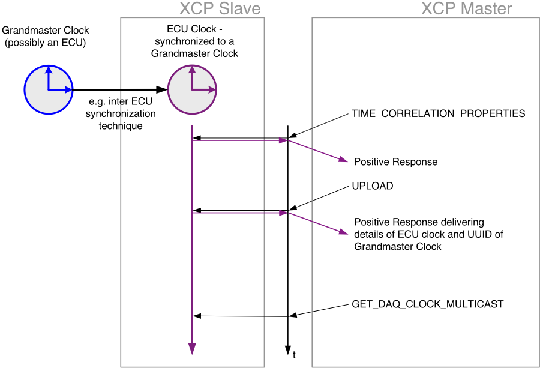

<a id="section-4-7"></a>

## 4.7 ECU STATES

<a id="section-4-7-1"></a>

## 4.7.1 INTRODUCTION

The idea of the ECU States concept in XCP is to make the XCP slave status more transparent for the XCP master during the XCP session. With this concept it is possible that the slave informs the XCP master about changes of the ECU state in the XCP slave. It is possible that certain resources can have an active or inactive state. An ECU state describes the status of all resources and in consequence the status can be more dynamically and transparent for the XCP master.

This is very important for the use case that the ECU and XCP slave are different instances and the XCP slave can run without an active ECU. In this use case a specific connection between protocol handler and ECU exists.

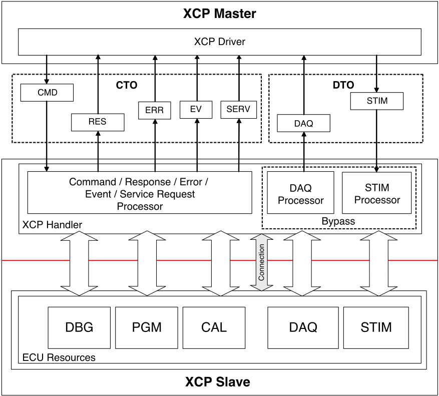

Figure 36 XCP Handler and XCP Resources

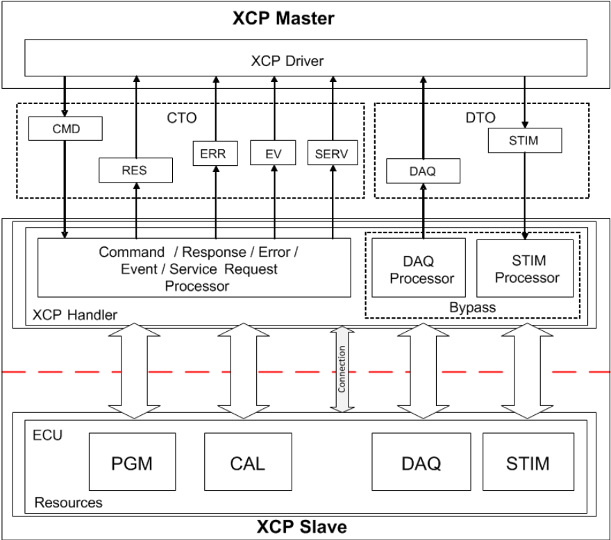

<a id="section-4-7-2"></a>

## 4.7.2 TRANSFERRING THE STATE INFORMATION TO THE XCP MASTER

For a better overview about the resources of the XCP slave in the XCP master the ECU states concept can be used. With a better transparency about the resources the XCP master can communicate much more efficient with the XCP slave.

This concept is based on the already existing resource definition of the XCP specification with five different resource categories CAL/PAG, DAQ, STIM, PGM and DBG which are represented in the resource information (see chapter 7.5.1.1) and can be read out of the ECU by the CONNECT command. The RESOURCE parameter bit mask structure defines which resources are available in general, and the ECU state defines which resources are currently active.

XCP offers two mechanisms to provide the current ECU state to the XCP master:

- 1) Mandatory: The XCP slave reports the current state to the XCP master in the response to the GET\_STATUS command (see chapter 7.5.1.4).

- 2) Optional: If the XCP slave supports asynchronous event messages, it sends the event EV\_ECU\_STATE\_CHANGE to the XCP master with the current STATE\_NUMBER (see chapter 7.7.12). The XCP slave sends the event message to the XCP master once. With the next GET\_STATUS request the XCP master receives the STATE\_NUMBER again.

Figure 37 STATE\_NUMBER Communication

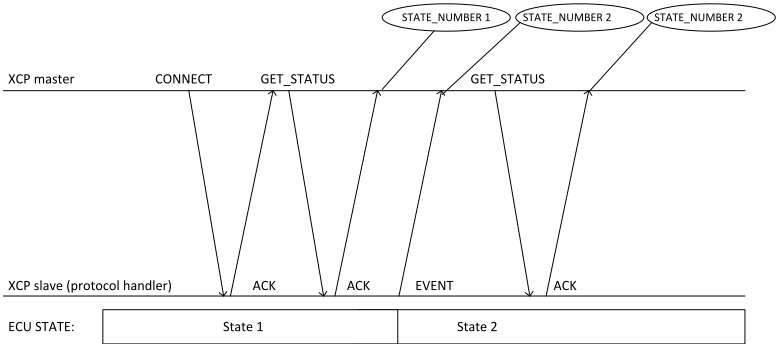

With both mechanisms the XCP master receives the current STATE\_NUMBER. The meaning of the specific state is defined in the A2L file.

For the resource DAQ, STIM, PGM and DBG it is possible to define if these resources are active or not. The CAL/PAG resource can be described with a higher granularity within MEMORY\_ACCESS sections. The reason for this is that it could happen that the memory which is the base for the calibration is not completely located in the ECU or in the XCP slave. It could happen that only parts of the memory are accessible for certain states. Therefore it is possible to define which segment / page of the memory is read- and/or writeable in a specific state.

The MEMORY\_ACCESS definition is not needed if in a state the resource CAL/PAG is not available.

The already existing page access definition of a memory segment is the base for the concept. An ECU\_STATE keeps or restricts this access for the given page.

The restrictions concerning switching XCP and/or ECU are still coming from the information of the MEMORY\_SEGMENT.

<a id="section-4-7-3"></a>

## 4.7.3 A2L SEMANTIC CONSISTENCY

The file XCP\_vX\_Y\_IF\_DATA\_example.a2l where vX\_Y is the current protocol layer version gives an IF\_DATA example for ECU states (see section beginning with "/begin ECU\_STATES").

<a id="section-4-8"></a>

## 4.8 SOFTWARE DEBUGGING

The XCP standard extension for software debugging [13] allows to access the ECU for software debugging using either internal or external XCP slaves (plug on devices - PODs). In consequence, it eliminates repeatedly switching between debug hardware and a POD which may require a high amount of effort and may lead to electrical or mechanical problems. Further more, it improves the simultaneous use of measurement, calibration and debugging.

<a id="section-5"></a>

## 5 THE XCP PROTOCOL

<a id="section-5-1"></a>

## 5.1 TOPOLOGY

The XCP protocol basically is a single-master/single-slave type of communication.

Any communication always is initiated by the master. The slave has to respond upon requests from the master with an appropriate response.

The XCP Protocol uses a "soft" master/slave principle. Once the master established a communication channel with the slave, the slave is allowed to send certain messages (Events, Service Requests and Data Acquisition messages) autonomously. Also the master sends Data stimulation messages without expecting a direct response from the slave.

Figure 38 The XCP topology

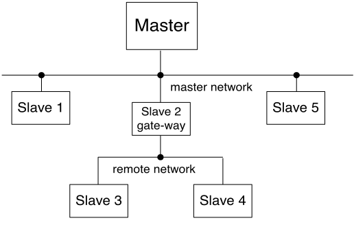

The master when establishing a communication channel, builds a continuous, logical, unambiguous point-to-point connection with 1 specific slave. A slave device driver cannot handle multiple connections.

The XCP Protocol does not allow a "single-master/multi-slave" topology.

The master is not allowed to broadcast XCP messages to multiple slaves at the same time.

The only exceptions are GET\_SLAVE\_ID on CAN or Ethernet and GET\_DAQ\_CLOCK\_MULTICAST messages that can be broadcast.

The XCP Protocol however, allows a "multiple single-master/single-slave" topology.

Several "single-master/single-slave" communication channels can be active in the same network at the same time. The identification parameters of the Transport Layer (e.g. CAN identifiers on CAN) have to be chosen in such a way that they build independent and unambiguously distinguishable communication channels.

The XCP Protocol allows gate-ways to be part of the topology.

The network the master directly is connected to is called the Master Network.

The network the master indirectly, through a gate-way is connected to, is called the Remote Network.

When transferring XCP messages, a gate-way has to be able to adapt the XCP Header and Tail depending upon the Transport Layer used in Master Network and Remote Network.

The XCP gate-way has to logically represent the nodes of its Remote Network in the Master Network.

## Example:

Master Network = CAN 500000 bps

Remote Network = CAN 250000 bps

## Master with Slave 1

Master sends with CAN-Id = 0x100 on Master Network Slave 1 sends with CAN-Id = 0x110 on Master Network

## Master with Slave 2 (Slave 2 directly)

Master sends with CAN-Id = 0x200 on Master Network Slave 2 sends with CAN-Id = 0x210 on Master Network

## Master with Slave 3 (Slave 2 as gate-way)

Master sends with CAN-Id = 0x300 to Slave 2 on Master Network

Slave 2 sends with CAN-Id = 0x100 to Slave 3 on Remote Network

Slave 3 sends with CAN-Id = 0x110 to Slave 2 on Remote Network

Slave 2 sends with CAN-Id = 0x310 on Master Network

<a id="section-5-2"></a>

## 5.2 THE XCP COMMUNICATION MODELS

<a id="section-5-2-1"></a>

## 5.2.1 THE STANDARD COMMUNICATION MODEL

In the connected state, each request packet will be responded by a corresponding response packet or an error packet. Exceptions are defined at the command description.

Figure 39 Standard communication model

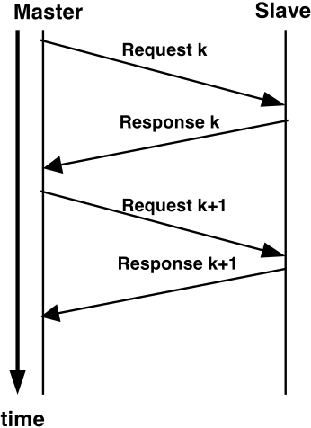

In the standard communication model, the master device may not send a new request until the response to the previous request has been received.

<a id="section-5-2-2"></a>

## 5.2.2 THE BLOCK TRANSFER COMMUNICATION MODEL

In XCP Standard Communication mode, each request packet will be responded by a single response packet or an error packet. Exceptions are defined at the command description.

To speed up memory uploads, downloads and flash programming, the XCP commands UPLOAD, DOWNLOAD and PROGRAM may support a block transfer mode similar to ISO/DIS 15765-2 [4].

The block transfer communication mode excludes interleaved communication mode.

Figure 40 Master block transfer

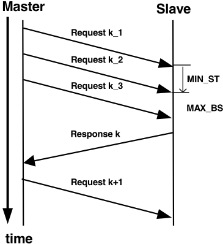

MASTER\_BLOCK\_MODE\_SUPPORTED in COMM\_MODE\_OPTIONAL at GET\_COMM\_MODE\_INFO indicates whether the master may use Master Block Transfer Mode.

The slave device may have limitations for the maximum block size and the minimum separation time. The communication parameters MIN\_ST and MAX\_BS are obtained by the GET\_COMM\_MODE\_INFO command. It's in the responsibility of the master device to care for the limitations. For details, refer to the description of the DOWNLOAD command.

Figure 41 Slave block transfer

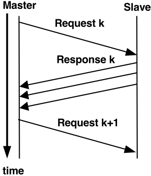

SLAVE\_BLOCK\_MODE\_SUPPORTED in COMM\_MODE\_BASIC at CONNECT indicates whether the slave supports Slave Block Transfer Mode.

There are no limitations allowed for the master device. The separation time for the subsequent responses may be 0. The master device has to support the maximum possible block size. For details, refer to the description of the UPLOAD command.

<a id="section-5-2-3"></a>

## 5.2.3 THE INTERLEAVED COMMUNICATION MODEL

In the standard communication model, the XCP master shall not send a new request until the response to the previous request has been received.

To speed up data transfer, in interleaved communication mode the master may already send the next request before having received the response on the previous request.

The interleaved communication mode excludes block transfer communication mode.

Figure 42 Interleaved communication model

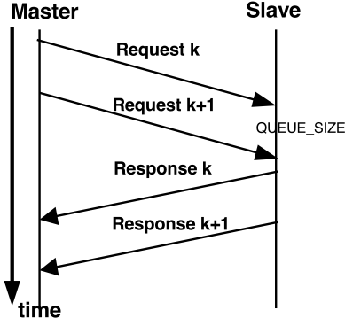

INTERLEAVED\_MODE\_SUPPORTED at GET\_COMM\_MODE\_INFO indicates whether the master may use Interleaved Mode.

The slave device may have limitations for the maximum number of consecutive requests it can buffer. The communication parameter QUEUE\_SIZE is obtained by the GET\_COMM\_MODE\_INFO command. It's in the responsibility of the master device to care for this limitation.

<a id="section-5-3"></a>

## 5.3 STATE MACHINE

Figure 43 The XCP slave state machine

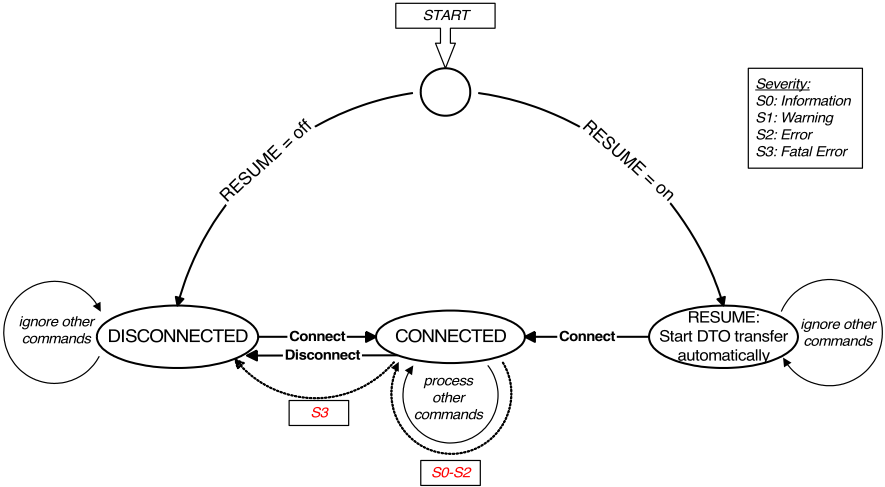

As soon as the XCP slave device starts its operation, it has to check whether there is a DAQ list configuration, to be used for RESUME mode, available in non-volatile memory. If there is no such a configuration available, the slave has to go to DISCONNECTED state.

In DISCONNECTED state, there is no XCP communication. The session status, all DAQ lists and the protection status bits are reset, which means that DAQ list transfer is inactive and the seed and key procedure is necessary for all protected functions.

In DISCONNECTED state, the slave processes no XCP commands except for CONNECT.

When the XCP communication is based on transport layer CAN or Ethernet, exceptions exist. Here, the slave will also accept a GET\_SLAVE\_ID command in addition to the CONNECT command.

The CONNECT command establishes a continuous, logical, point-to-point connection with the slave and brings the slave in a CONNECTED state.

In CONNECTED state, the slave processes any XCP command packet by responding with a corresponding response packet or an error packet.

With a CONNECT(Mode = USER\_DEFINED), the master can start an XCP communication with the slave and at the same time tell the slave that it should go into a special (user-defined) mode, which has no influence on the behaviour of the XCP driver of the slave.

For a CONNECT(USER\_DEFINED) command, the normal timeout handling rules do not apply. The master continuously has to send a CONNECT(USER\_DEFINED) to the slave until he receives an acknowledgment. The master has to use the timeout value t6 (see chapter 7.6.2) between the commands. The master just has to repeat the CONNECT(USER\_DEFINED) without any SYNCH, Pre-action or Action.

Figure 44 Typical use of CONNECT modes USER\_DEFINED and NORMAL

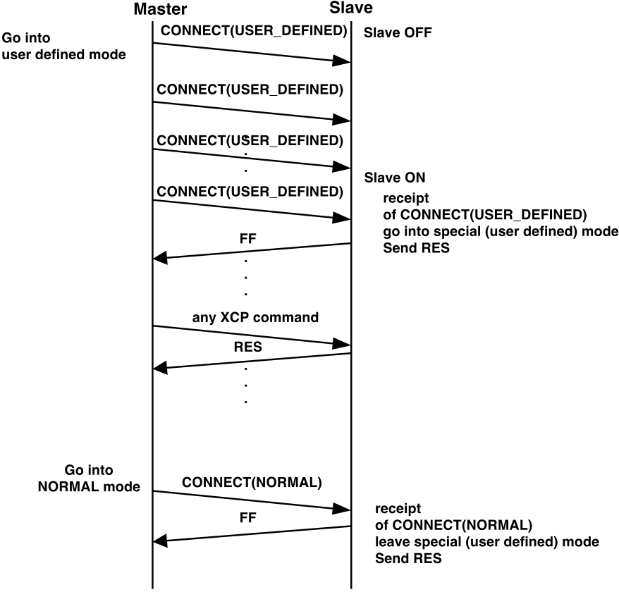

With a CONNECT(Mode = NORMAL), the master can start an XCP communication with the slave.

In "CONNECTED" state, the slave has to acknowledge a new CONNECT.

If the slave when starting its operation detects that there is a DAQ list configuration, to be used for RESUME mode, available in non-volatile memory , the slave has to go to the "RESUME" state.

In "RESUME", the slave automatically has to start those DAQ lists that are stored in nonvolatile memory and that are to be used for RESUME mode (ref. Description of RESUME mode).

In "RESUME", the slave processes no XCP commands except for CONNECT.

In "RESUME" state, the slave has to acknowledge a CONNECT and handle it like a CONNECT command to a disconnected device, but keep the current DTO transfer running.

In "CONNECTED" state, if the master sends a DISCONNECT command, the slave goes to "DISCONNECTED" state.

If an error occurs with severity S0-S2, the slave will not change its state. If an error occurs with severity S3 "Fatal error", this will bring the slave to the "DISCONNECTED" state.

<a id="section-5-4"></a>

## 5.4 PROTECTION HANDLING

XCP provides protection handling for the features:

- measurement / stimulation
- calibration
- flashing

The concept is to use in advance a command to exchange a seed and a key value. The key length is big enough to support also asymmetrical algorithms. If the corresponding security access algorithm was successfully computed by the XCP master, the XCP slave allows access to the requested XCP commands. For more details please look at the following commands:

- GET\_STATUS
- GET\_SEED
- UNLOCK

Moreover, it could be necessary to protect the software itself regarding reading. The need for information hiding can be different depending on the project phase (development or after-sales) and is implementation specific.

The following commands are suitable to read memory contents:

- UPLOAD
- SHORT\_UPLOAD
- BUILD\_CHECKSUM

Due to the fact that these commands cannot be protected with the standard security mechanism, a different method is specified. If the XCP slave decides internally to hide information, it will answer with the negative response ERR\_ACCESS\_DENIED. This response indicates (in contrast to ERR\_ACCESS\_LOCKED) that the XCP master cannot unlock the requested command.

## Remark:

In any case it must be possible to read out ID information of the XCP slave (requested with GET\_ID) if an XCP master needs this information for continuation.

<a id="section-5-5"></a>

## 5.5 THE XCP MESSAGE (FRAME) FORMAT

## XCP on "Transport Layer" Frame

Figure 45 The XCP message (frame) format

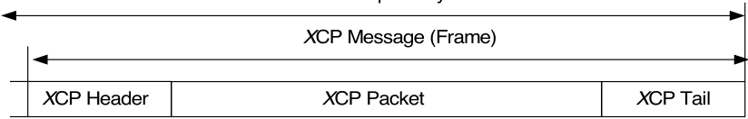

XCP messages always are transported in the data field of a particular transport layer e.g. CAN, TCP/IP and UDP/IP. In general, the transport layer has to fulfill the requirements

- below: · the length and the contents of a message may not change
- the sequence of the messages may not change
- messages may not be duplicated

An XCP Message (= Frame) consists of an XCP Header, an XCP packet and an XCP Tail.

The XCP packet contains the generic part of the protocol, which is independent from the transport layer used.

An XCP packet consists of an identification field, an optional timestamp field and a data field.

Chapter 7.1 describes the contents of an XCP packet.

The XCP Header and XCP Tail depend upon the transport layer used.

Both XCP Header and XCP Tail consist of a control field.

The content of the control fields is described in the associated standard of the respective transport layer ([6] [7] [8] [9] [10]).

<a id="section-6"></a>

## 6 THE LIMITS OF PERFORMANCE

<a id="section-6-1"></a>

## 6.1 GENERIC PERFORMANCE PARAMETERS

MAX\_CTO shows the maximum length of a CTO packet in bytes.

MAX\_DTO shows the maximum length of a DTO packet in bytes.

Table 5 Overview of generic DAQ performance parameters

| Name         | Type      | Representation   | Range of value   |
|--------------|-----------|------------------|------------------|
| MAX_CTO      | Parameter | BYTE             | 0x08 - 0xFF      |
| MAX_DTO      | Parameter | WORD             | 0x0008 - 0xFFFF  |
| MAX_DTO_STIM | Parameter | WORD             | 0x0008 - 0xFFFF  |

The range of these protocol parameters can be smaller, depending on the used transport layer.

If MAX\_DTO\_STIM is defined, MAX\_DTO applies only for DTOs having direction DAQ .

If MAX\_DTO\_STIM is not defined, MAX\_DTO applies for both directions.

<a id="section-6-2"></a>

## 6.2 DAQ/STIM SPECIFIC PERFORMANCE PARAMETERS

MAX\_EVENT\_CHANNEL indicates the number of event channels on the XCP slave.

An event channel is identified by a number called EVENT\_CHANNEL\_NUMBER.

Table 6 Overview of EVENT specific performance parameters

| Name                          | Type      | Represen- tation   | Range of value        |
|-------------------------------|-----------|--------------------|-----------------------|
| MAX_EVENT_CHANNEL             | Parameter | WORD               | 0x0000 - 0xFFFF       |
| MAX_EVENT_CHANNEL_ABS         | Constant  | WORD               | 0xFFFF                |
| EVENT_CHANNEL_NUMBER          | Parameter | WORD               | 0x0000 - 0xFFFE       |
| EVENT_CHANNEL_NUMBER_ MAX     | Parameter | WORD               | MAX_EVENT_CHANNEL - 1 |
| EVENT_CHANNEL_NUMBER_ MAX_ABS | Constant  | WORD               | 0xFFFE                |

MAX\_DAQ indicates the number of DAQ lists on the XCP slave.

A DAQ list is identified by a number called DAQ\_LIST\_NUMBER.

Counting starts at zero.

MIN\_DAQ indicates the number of predefined, read only DAQ lists on the XCP slave.

DAQ\_COUNT indicates the number of DAQ lists for dynamic configuration.

Table 7 Overview of DAQ list specific performance parameters

| Name            | Type      | Representation   | Range of value   |
|-----------------|-----------|------------------|------------------|
| MAX_DAQ         | Parameter | WORD             | 0x0000 - 0xFFFF  |
| MAX_DAQ_TOTAL   | Constant  | WORD             | 0x0000 - 0xFFFF  |
| DAQ_COUNT       | Parameter | WORD             | 0x0000 - 0xFFFF  |
| MIN_DAQ         | Parameter | BYTE             | 0x00 - 0xFF      |
| DAQ_LIST_NUMBER | Parameter | WORD             | 0x0000 - 0xFFFE  |

MAX\_ODT\_ENTRIES indicates the maximum amount of entries into an ODT of the XCP slave.

ODT\_ENTRIES\_COUNT indicates the amount of entries into an ODT using dynamic DAQ list configuration.

An entry is identified by a number called ODT\_ENTRY\_NUMBER. Counting starts at zero.

Table 8 Overview of ODT specific performance parameters

| Name              | Type      | Representation   | Range of value   |
|-------------------|-----------|------------------|------------------|
| MAX_ODT_ENTRIES   | Parameter | BYTE             | 0x00 - 0xFF      |
| ODT_ENTRIES_COUNT | Parameter | BYTE             | 0x00 - 0xFF      |
| ODT_ENTRY_NUMBER  | Parameter | BYTE             | 0x00 - 0xFE      |

<a id="section-6-2-1"></a>

## 6.2.1 DAQ SPECIFIC PARAMETERS

MAX\_ODT indicates the maximum amount of ODTs of the XCP slave.

MAX\_ODT\_ENTRY\_SIZE\_DAQ indicates the upper limit for the size of the element described by an ODT entry.

ODT\_COUNT indicates the amount of ODTs of a DAQ list using dynamic DAQ list configuration.

An ODT is identified by a number called ODT\_NUMBER. Counting starts at zero.

Table 9 ODT parameters of a specific DAQ list of direction DAQ

| Name                   | Type      | Representation   | Range of value   |
|------------------------|-----------|------------------|------------------|
| MAX_ODT                | Parameter | BYTE             | 0x00 - 0xFC      |
| MAX_ODT_ENTRY_SIZE_DAQ | Parameter | BYTE             | 0x00 - 0xFF      |
| ODT_COUNT              | Parameter | BYTE             | 0x00 - 0xFC      |
| ODT_NUMBER             | Parameter | BYTE             | 0x00 - 0xFB      |

<a id="section-6-2-2"></a>

## 6.2.2 STIM SPECIFIC PARAMETERS

MAX\_ODT indicates the maximum amount of ODTs of the XCP slave.

MAX\_ODT\_ENTRY\_SIZE\_STIM indicates the upper limit for the size of the element described by an ODT entry.

ODT\_COUNT indicates the amount of ODTs of a DAQ list using dynamic DAQ list configuration.

An ODT is identified by a number called ODT\_NUMBER.

Counting starts at zero.

Table 10 ODT parameters of a DAQ list of direction STIM

| Name                    | Type      | Representation   | Range of value   |
|-------------------------|-----------|------------------|------------------|
| MAX_ODT                 | Parameter | BYTE             | 0x00 - 0xC0      |
| MAX_ODT_ENTRY_SIZE_STIM | Parameter | BYTE             | 0x00 - 0xFF      |
| ODT_COUNT               | Parameter | BYTE             | 0x00 - 0xC0      |
| ODT_NUMBER              | Parameter | BYTE             | 0x00 - 0xBF      |

<a id="section-6-2-3"></a>

## 6.2.3 ECU RESOURCE CONSUMPTIONS

This section covers the aspect of calculating the ECU resource consumption caused by DAQ/STIM measurement configuration. These resources are ECU RAM consumption and CPU execution time. The measurement configuration is basically a list of measurement variables and their corresponding XCP events.

In order to calculate the specific resource consumption, a set of mathematical formulas is defined. These have parameters which are specific to an XCP protocol implementation of an ECU.

Furthermore, parameters for the limits of these resources are defined.

A calibration tool can use this information to inform the calibration engineer, particularly if the defined limits are exceeded, to avoid e.g. physical damage of the controlled device.

<a id="section-6-2-3-1"></a>

## 6.2.3.1 ECU RAM CONSUMPTION

The DAQ processor of the XCP slave stores the measurement configuration in the RAM of the ECU.

The RAM consumption for the XCP DAQ measurement configuration is calculated by the following formulas.

```
RAM(DAQList_DAQ(j)) = DAQ_SIZE + Σ_k^ODTs(DAQList_DAQ(j)) RAM(ODT_DAQ(k))

RAM(DAQList_STIM(j)) = DAQ_SIZE + Σ_k^ODTs(DAQList_STIM(j)) RAM(ODT_STIM(k))

RAM(ODT_DAQ(k), Event(i)) = ODT_SIZE
+ ODT_ENTRY_SIZE * Σ_l^ODT_entries(ODT_DAQ(k,i)) 1
+ ODTPayload(k, i) * ODT_Daq_Buffer_Element_Size * (1 + ODT_Daq_Buffer_Element_Reserve(Event(i)) / 100)

RAM(ODT_STIM(k), Event(i)) = ODT_SIZE
+ ODT_ENTRY_SIZE * Σ_l^ODT_entries(ODT_STIM(k,i)) 1
+ ODTPayload(k, i) * ODT_Stim_Buffer_Element_Size * (1 + ODT_Stim_Buffer_Element_Reserve(Event(i)) / 100)
```

ODTPayload(k), the ODT payload size for a given ODT(k), has to be calculated by the XCP master and is determined by the measurement signal configuration. The same applies for the limits of the sums over events, DAQ lists and ODTs.

ODTPayload(k) is the sum of Identification Field (PID and DAQ), Counter Field, Timestamp and Data for a given ODT(k)

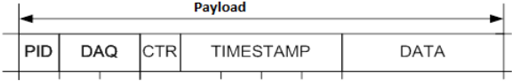

For the calculation of the data size, the DAQ packed mode shall be considered. Example: if the DATA field requires X bytes of measurement signals for one sample, it would be X bytes * DPM\_SAMPLE\_COUNT in total.

Table 11 Parameters for the calculation of RAM consumption of an XCP DAQ measurement configuration (definition located at IF\_DATA XCP)

| Name                             | Representation   | Description                                                                                                                                                                         |
|----------------------------------|------------------|-------------------------------------------------------------------------------------------------------------------------------------------------------------------------------------|
| ODT_SIZE                         | uint             | Number of memory elements needed for storage of one ODT configuration                                                                                                               |
| ODT_ENTRY_SIZE                   | uint             | Number of memory elements needed for storage of one ODT entry                                                                                                                       |
| ODT_DAQ_BUFFER_ELEMENT_ SIZE     | uint             | Number of memory elements to be reserved in the send queue, direction DAQ. The parameter may be 0 for the case that the XCP slave does not buffer the data for transmission in RAM. |
| ODT_STIM_BUFFER_ELEMENT _SIZE    | uint             | Number of memory elements to be reserved in the receive queue, direction STIM                                                                                                       |
| ODT_DAQ_BUFFER_ELEMENT_ RESERVE  | uchar            | Factor in % to increase the memory to be reserved in the send queue, direction DAQ. The parameter may be considered for each EVENT to support jitter                                |
| ODT_STIM_BUFFER_ELEMENT _RESERVE | uchar            | Factor in % to increase the memory to be reserved in the send queue, direction STIM. The parameter may be considered for each EVENT.                                                |
| DAQ_SIZE                         | uint             | Number of memory elements needed for storage of one DAQ list configuration                                                                                                          |
| DAQ_MEMORY_LIMIT                 | ulong            | The total size of available DAQ configuration memory. In case of DAQ packed mode this also includes the memory for the transmission buffer.                                         |

All element sizes and factors are multiples of the address granularity factor AG, e.g. for AG = 1, a memory element is one byte.

<a id="section-6-2-3-2"></a>

## 6.2.3.2 CPU EXECUTION TIME

The XCP data acquisition inside an ECU normally causes CPU load, because the configured measurement data must be transferred from its original memory locations to a send queue and transmitted by the transport layer and lower layers.

```
Total CPU Load = Σ_i^Events CPULoad(Event(i))

CPULoad(Event(i)) = Σ_j^DAQ_Lists(Event(i)) CPULoad(DAQList(j)) / CycleTime(Event(i))[s]
```

In the case, that the event is not periodic, CycleTime must be replaced with the minimal cycle time specified by the IF\_DATA block "MIN\_CYCLE\_TIME".

```
CPULoad(DAQList_DAQ/STIM(j)) = DAQ_FACTOR
+ Σ_k^ODTs(DAQList(j)) (CPULoad(ODT_QUEUE(k)) + CPULoad(ODT(k)))

CPULoad(ODT_QUEUE(k)) = ODT_FACTOR_Queue
+ ODT_ELEMENT_LOAD * ODTPayload(k)

CPULoad(ODT_DAQ/STIM(k)) = ODT_FACTOR
+ ODT_ENTRY_FACTOR * Σ_i^ODT_entries(ODT(k)) 1
+ Σ_n^OESFT (SIZE_FACTOR[n]) * Σ_i^ODTentries(ODT(k),size=SIZE[n]) SIZE[n]
```

In a multicore system, parts of EVENTs may be executed on different Cores. EVENT parts that are assigned to an individual core are not included in the calculation of the CPU load. The Core load consumption is calculated separately. Load Limits have to be considered for EVENT parts, for the load of a single CORE and for the load sum of all CORE Loads.

In this example, the EVENT part sampling of DAQLists(1) is assigned to CORE(1), sampling of DAQLists(2) is assigned to CORE(3) and the EVENT parts receiving of QUEUE(1) and QUEUE(2) are assigned to CORE(2):

Table 12 Example for a multicore CPU use case: assignment of EVENT part sampling processes to different cores

|          | CORE(1)     | CORE(2)   | CORE(3)     |
|----------|-------------|-----------|-------------|
| EVENT(1) | DAQLists(1) | QUEUE(1)  |             |
| EVENT(2) |             | QUEUE(2)  | DAQLists(2) |

The Total CORE Load is the sum of all CORE Loads:

```
TotalCORELoad = Σ_n^Cores CORELoad(Core(n)
```

The Load of CORE(n) is the sum of all CORELoadEP assigned to Core(n) :

```
CORELoad(Core(n)) = Σ_j^EventPartsCore(i) CORELoadDAQ(j) + CORELoadQueue(j)
```

Load of a EventPart of type DAQ and STIM:

```
CORELoadDAQ(Event(i)) = Σ_j^DAQ_Lists(Event(i)) CORELoadDAQ(DAQList_DAQ/STIM(j)) / CycleTime(Event(i))[s]

CORELoadDAQ(DAQList_DAQ/STIM(j)) = DAQ_FACTOR
+ Σ_k^ODTs(DAQList(j)) (CORELoadDAQ(ODT_DAQ/STIM(k)))

CORELoadDAQ(ODT_DAQ/STIM(k)) = ODT_FACTOR
+ ODT_ENTRY_FACTOR * Σ_j^ODT_entries(ODT(k)) 1
+ Σ_n^OESFT (SIZE_FACTOR[n]) * Σ_j^ODTentries(ODT(k),size=SIZE[n]) SIZE[n]
```

Load of a EventPart of type QUEUE and QUEUE\_STIM:

```
CORELoadQueue(Event(i))
= Σ_j^DAQ_Lists(Event(i)) CORELoadQueue(DAQList_QUEUE/QUEUE_STIM(j)) / CycleTime(Event(i))[s]

CORELoadQueue(DAQList_QUEUE/QUEUE_STIM(j))
= Σ_k^ODTs(DAQList(j)) (CORELoadQueue(ODT_QUEUE/QUEUE_STIM(k))

CORELoadQueue(ODT_QUEUE/QUEUE_STIM(k)) = ODT_FACTOR_Queue
+ ODT_ELEMENT_LOAD * ODTPayload(k)
```

The abbreviation OESFT is short for ODT entry size factor table. The sum over this table iterates over all table entries and sums up all ODT entries with the corresponding size. A more detailed explanation follows below the next table.

Table 13 Parameters for the CPU load calculation of an XCP DAQ measurement configuration (definition located at IF\_DATA)

| Name             | Representation   | Description                                                                                                            |
|------------------|------------------|------------------------------------------------------------------------------------------------------------------------|
| DAQ_FACTOR       | float            | Basic CPU load to be considered for each DAQ list. Part of CPU_LOAD_CONSUMPTION_DAQ CPU_LOAD_CONSUMPTION_STIM          |
| ODT_FACTOR       | float            | Basic CPU load to be considered for processing each ODT. Part of CPU_LOAD_CONSUMPTION_DAQ CPU_LOAD_CONSUMPTION_STIM    |
| ODT_FACTORQueue  | float            | Basic CPU load to be considered for buffering each ODT into the transmission queue. Part of CPU_LOAD_CONSUMPTION_QUEUE |
| ODT_ELEMENT_LOAD | float            | CPU load caused by copying one single element                                                                          |
| ODT_ENTRY_FACTOR | float            | CPU load caused by the handling of one single ODT entry                                                                |

| Name                    | Representation   | Description                                                                                                                                                                           |
|-------------------------|------------------|---------------------------------------------------------------------------------------------------------------------------------------------------------------------------------------|
| SIZE[n]                 | uint             | Part of ODT_ENTRY_SIZE_FACTOR_TABLE of blocks CPU_LOAD_CONSUMPTION_DAQ CPU_LOAD_CONSUMPTION_STIM                                                                                      |
| SIZE_FACTOR[n]          | float            | Part of ODT_ENTRY_SIZE_FACTOR_TABLE of blocks CPU_LOAD_CONSUMPTION_DAQ CPU_LOAD_CONSUMPTION_STIM                                                                                      |
| CORE_NR                 | uint             | Core reference number. Part of CORE_LOAD_MAX CORE_LOAD_MAX_TOTAL                                                                                                                      |
| CORE_LOAD_MAX_TOTAL     | float            | TotalCORELoad limit regarding all cores                                                                                                                                               |
| CORE_LOAD_MAX (CORE_NR) | float            | CORELoad limit regarding all CPU_LOAD_CONSUMPTION_* parts assigned to Core(CORE_NR)                                                                                                   |
| CORE_LOAD_EP_MAX        | float            | CORELoadDAQ or CORELoadQUEUE limit regarding one of the event parts: CPU_LOAD_CONSUMPTION_DAQ CPU_LOAD_CONSUMPTION_STIM or CPU_LOAD_CONSUMPTION_QUEUE CPU_LOAD_CONSUMPTION_QUEUE_STIM |
| CPU_LOAD_MAX_TOTAL      | float            | Total CPU load limit regarding the DAQ measurement, part of IF_DATA block "DAQ"                                                                                                       |
| CPU_LOAD_MAXEvent       | float            | CPU load limit for one single event, part of IF_DATA block "EVENT"                                                                                                                    |

The XCP master can use the calculated results to report the percentage of CPU load with regard to the limits CPU\_LOAD\_MAX\_TOTAL resp. CPU\_LOAD\_MAX on the event level. If CORE limits are defined, the XCP master can use the calculated results to report the percentage of CORE loads with regard to the limits CORE\_LOAD\_MAX\_TOTAL, CORE\_LOAD\_MAX resp. CORE\_LOAD\_EP\_MAX on the event level. This is the reason why no CPU load or CORE load unit is defined, because for the percentage, a unit which applies for both numerator and denominator is reduced.

The IF\_DATA block CPU\_LOAD\_CONSUMPTION\_DAQ describes the load consumption for the memory copy routine. If this is defined, the table ODT\_ENTRY\_SIZE\_FACTOR\_TABLE must be defined mandatorily and must contain at least one record. Each record consists of a size and a corresponding load factor which is applied to all ODT entries having the specific size or a multiple of it.

If an ODT entry has a size which is not described by any of the table records, the next smaller size entry shall be applied. If no smaller size is defined, the next larger size shall be applied.

The selected size must be considered multiple times until the result is greater than or equal to the size of the ODT entry.

## Example:

```
/begin CPU_LOAD_CONSUMPTION_DAQ 1 // "DAQ_FACTOR" 2 // "ODT_FACTOR" 3 // "ODT_ENTRY_FACTOR" /begin ODT_ENTRY_SIZE_FACTOR_TABLE 1 //"SIZE" 150 // "SIZE_FACTOR", e.g. CPU cycles /end ODT_ENTRY_SIZE_FACTOR_TABLE /begin ODT_ENTRY_SIZE_FACTOR_TABLE 4 //"SIZE" 420 // "SIZE_FACTOR" /end ODT_ENTRY_SIZE_FACTOR_TABLE /end CPU_LOAD_CONSUMPTION_DAQ
```

If an ODT entry has the size 13, i.e. 3 * 4 + 1, the resulting load for the ODT entry is 4 * 420 = 1680.

Note that additional load is generated from the containing ODT and DAQ list. More examples are available in Table 257.

<a id="section-7"></a>

## 7 THE XCP PROTOCOL LAYER

<a id="section-7-1"></a>

## 7.1 THE XCP PACKET

<a id="section-7-1-1"></a>

## 7.1.1 THE XCP PACKET TYPES

All XCP communication is transferred as data objects called XCP packets.

There are 2 basic packet types:

| •   | packet for transferring generic control commands:   | CTO   |
|-----|-----------------------------------------------------|-------|
| •   | packet for transferring synchronous data:           | DTO   |

The CTO (Command Transfer Object) is used for transferring generic control commands. It is used for carrying out protocol commands (CMD), transferring command responses (RES), error (ERR) packets, event (EV) packets and for service request packets (SERV).

The DTO (Data Transfer Object) is used for transmitting synchronous data acquisition data (DAQ) and for transmitting synchronous data stimulation data (STIM).

Figure 46 Communication flow between master and slave devices

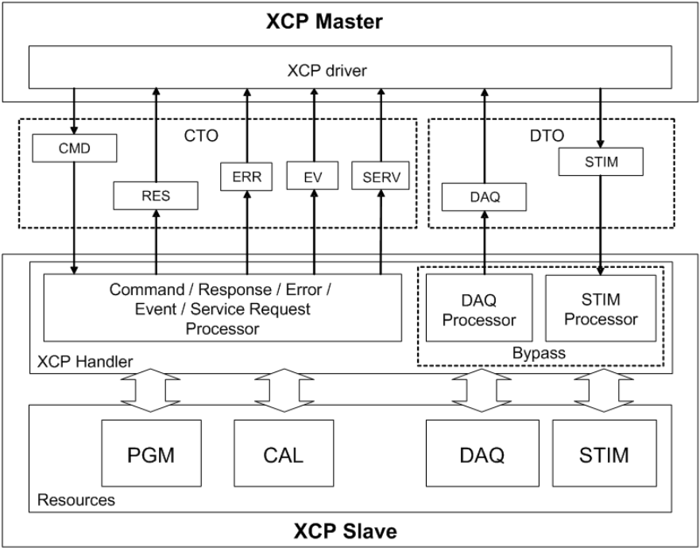

A command packet must be answered by a command response packet or an error packet. Exceptions are defined at the command description.

Event, Service Request and Data Acquisition Packets are send asynchronously, therefore it may not be guaranteed that the master device will receive them when using a nonacknowledged transportation link like e.g. UDP/IP.

The XCP Handler may not always have access to the resources of the XCP slave. With ERR\_RESOURCE\_TEMPORARY\_NOT\_ACCESSIBLE the XCP Handler can indicate this situation to the master.

<a id="section-7-1-2"></a>

## 7.1.2 THE XCP PACKET FORMAT

Figure 47 The XCP packet format

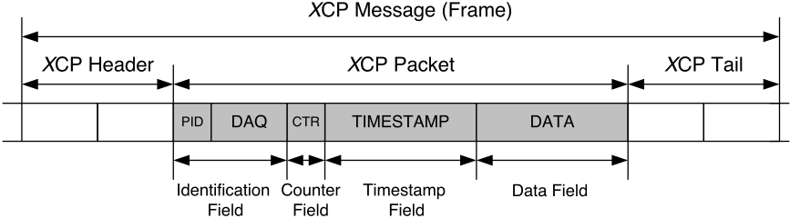

The XCP packet contains the generic part of the protocol, which is independent from the transport layer used.

An XCP packet consists of an identification field, an optional counter field, an optional timestamp field and a data field.

MAX\_CTO indicates the maximum length of a CTO packet in bytes.

MAX\_DTO indicates the maximum length of a DTO packet in bytes.

<a id="section-7-1-2-1"></a>

## 7.1.2.1 THE IDENTIFICATION FIELD

Figure 48 The XCP packet identification field

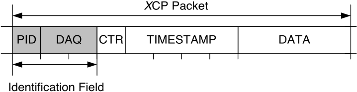

When exchanging XCP packets, both master and slave always have to be able to unambiguously identify any transferred XCP packet concerning its type and the contents of its data field.

For this purpose, an XCP packet basically always starts with an identification field which as first byte contains the Packet IDentifier (PID).

## Identification Field Type "CTO Packet Code"

For CTO packets, the identification field should be able to identify the packets concerning their type, distinguishing between protocol commands (CMD), command responses (RES), error packets (ERR), event packets (EV) and service request packets (SERV).

For CTO packets, the identification field just consists of the PID, containing the CTO packet code.

Figure 49 Identification field type "CTO packet code"

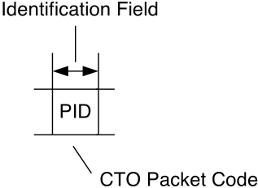

For DTO packets, the identification field should be able to identify the packets concerning their type, distinguishing between DTO packets for Synchronous Data Acquisition or for Synchronous Data Stimulation

For DTO packets, the identification field should be able to identify unambiguously the DAQ list and the ODT within this DAQ list that describe the contents of the data field.

For every DAQ list the numbering of the ODTs through ODT\_NUMBER restarts from 0:

Table 14 Relative ODT numbering for DAQ lists

| DAQ list 0   | DAQ list 1   | …   |
|--------------|--------------|-----|
| ODT 0        | ODT 0        | ... |
| ODT 1        | ...          |     |

so the scope for ODT\_NUMBER is local for a DAQ list and ODT numbers are not unique within one and the same slave device.

## Identification Field Type "absolute ODT number"

One possibility to map the relative and not unique ODT numbers to unambiguously identifiable DTO packets, is to map the relative ODT numbers to absolute ODT numbers by means of a "FIRST\_PID for this DAQ list", and then transfer the absolute ODT numbers within the DTO packet.

The following mapping from relative\_ODT\_NUMBER to absolute\_ODT\_NUMBER applies:

```
absolute_ODT_NUMBER(ODT i in DAQ list j) = FIRST_PID(DAQ list j) + relative_ODT_NUMBER(ODT i)
```

FIRST\_PID is the PID in the DTO packet of the first ODT transferred by this DAQ list. All following ODTs of a DAQ list transmission cycle need not be in ascending order but of course complete.

FIRST\_PID is determined by the slave device and sent to the master upon START\_STOP\_DAQ\_LIST(DAQ list j).

When allocating the FIRST\_PID, the slave has to make sure that for every ODT there is a unique absolute ODT number.

All PIDs also have to be in the available ranges for PID(DAQ) and PID(STIM).

For DTO packets with identification field type "absolute ODT number", the identification field just consists of the PID, containing the absolute ODT number.

Figure 50 Identification field type "absolute ODT number"

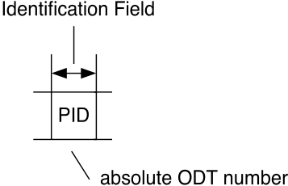

## Identification Field Type "relative ODT number and absolute DAQ list number"

Another possibility to map the relative and not unique ODT numbers to unambiguously identifiable DTO packets, is to transfer the absolute DAQ list number together with the relative ODT number within the DTO packet.

For DTO packets with identification field types "relative ODT number and absolute DAQ list number", the identification field consists of the PID, containing the relative ODT number, DAQ bits, containing the absolute DAQ list number, and an optional FILL byte.

One possibility is to transfer the DAQ list number as BYTE, which reduces the number of theoretically possible packets since the DAQ\_LIST\_NUMBER parameter is coded as WORD.

Figure 51 Identification field type "relative ODT number and absolute DAQ list number (BYTE)"


For fully exploring the limits of performance, there is the possibility to transfer the DAQ list number as WORD

Figure 52 Identification field type "relative ODT number and absolute DAQ list number (WORD)"


If for the XCP packet certain alignment conditions have to be met, there is the possibility to transfer an extra FILL byte.

Figure 53 Identification field type "relative ODT number and absolute DAQ list number (WORD, aligned)"


With the DAQ\_KEY\_BYTE at GET\_DAQ\_PROCESSOR\_INFO, the slave informs the master about the type of identification field the slave will use when transferring DAQ packets to the master. The master has to use the same type of identification field when transferring STIM packets to the slave.

## Empty Identification Field

A DAQ list can have the property that it can transmit DTO packets without identification

field (ref. PID\_OFF\_SUPPORTED flag in DAQ\_PROPERTIES at GET\_DAQ\_PROCESSOR\_INFO).

Turning off the transmission of the identification field is only allowed if the identification field type is "absolute ODT number". If the identification field is not transferred in the XCP packet, the unambiguous identification has to be done on the level of the Transport Layer. This can be done e.g. on CAN with separate CAN-Ids for each DAQ list and only one ODT for each DAQ list. In this case turning off the identification field would allow the transmission of 8 byte signals on CAN.

<a id="section-7-1-2-2"></a>

## 7.1.2.2 THE COUNTER FIELD

Figure 54 The XCP packet counter field


A DTO packet optionally may contain a counter field.

If present, the counter field is located directly after the identification field and has the size BYTE.

The DTO\_CTR\_FIELD\_SUPPORTED AML keyword in the A2L file indicates whether the slave supports DTO counters for DAQ and STIM or not.

By setting the DTO\_CTR flag using SET\_DAQ\_LIST\_MODE, the master can enable the DTO CTR mode for a specific DAQ list.

For DAQ direction, DTO CTR mode means that the slave inserts a counter into the DTO packet for the first ODT of a DAQ list. Which counter is inserted is a property of the event channel this DAQ list is configured for.


Figure 55 CTR only in first DTO packet of sample

| Identification Field First ODT of this DAQ list   | CTR   | DATA   |
|---------------------------------------------------|-------|--------|
| Identification Field Next ODT of this DAQ list    | DATA  |        |

For STIM direction, DTO CTR mode means that the slave expects a counter in the DTO packet for the first ODT of a DAQ list. Which counter is expected and what the counter is used for is a property of the event channel this DAQ list is configured for.

## Identification Field Type (WORD, aligned)

For the identification field type "relative ODT number and absolute DAQ list number (WORD, aligned)", the DTO CTR is inserted in a different way to keep the alignment without introducing additional fill bytes. This is achieved by replacing the fill byte of the identification field with the counter field in the first DTO of the DAQ list, effectively merging counter field and identification field.

Figure 56 CTR replaces FILL byte for Identification Field Type (WORD, aligned)


<a id="section-7-1-2-3"></a>

## 7.1.2.3 THE TIMESTAMP FIELD

Figure 57 The XCP packet timestamp field


A DTO packet optionally may contain a timestamp field.

If present, the timestamp field (TS) is located directly after the counter field or, if there is no counter field, directly after the identification field.

The TIMESTAMP\_SUPPORTED flag at GET\_DAQ\_PROCESSOR\_INFO indicates whether the slave supports time-stamped data acquisition and stimulation.

With the TIMESTAMP flag at SET\_DAQ\_LIST\_MODE, the master can set a DAQ list into time-stamped mode.

The TIMESTAMP\_FIXED flag in TIMESTAMP\_MODE at GET\_DAQ\_RESOLUTION\_INFO indicates that the slave always will send DTO packets in time-stamped mode. The master cannot switch off the timestamp with SET\_DAQ\_LIST\_MODE.

For DAQ direction, time-stamped mode means that the slave device transmits the current value of its clock in the DTO packet for the first ODT of a DAQ cycle.

For STIM direction, time-stamped mode means that the XCP master transmits a TIMESTAMP field in the DTO packet for the first ODT of a DAQ cycle. However in this case the content of the TIMESTAMP field is not defined.

| Identification Field First ODT of this DAQ list   | TIMESTAMP   | DATA   |
|---------------------------------------------------|-------------|--------|
| Identification Field Next ODT of this DAQ list    |             | DATA   |

| Identification Field First ODT of this DAQ list   | incremented TIMESTAMP   | DATA   |
|---------------------------------------------------|-------------------------|--------|
| Identification Field Next ODT of this DAQ list    |                         | DATA   |

First sample of this DAQ list

Next sample of this DAQ list

Figure 58 TS only in first DTO packet of sample

The TIMESTAMP flag can be used both for DAQ direction and for STIM direction.

## Timestamp Field Types

The timestamp field always consists of the TS, containing the current value of the synchronous data transfer clock

The synchronous data transfer clock is a free running counter in the slave, which is never reset or modified.

Depending on the timestamp field type, the TS is transferred as BYTE, WORD or DWORD value.


With TIMESTAMP\_MODE and TIMESTAMP\_TICKS at GET\_DAQ\_RESOLUTION\_INFO, the slave informs the master about the type of timestamp field the slave will use when transferring DAQ packets to the master. The master has to use the same type of timestamp field when transferring STIM packets to the slave. TIMESTAMP\_MODE and TIMESTAMP\_TICKS contain information on the resolution of the data transfer clock.

<a id="section-7-1-2-4"></a>

## 7.1.2.4 THE DATA FIELD

Figure 60 The XCP packet data field


An XCP packet finally contains a data field.

For CTO packets, the data field contains the specific parameters for the different types of CTO packet.

For DTO packets, the data field contains the data for synchronous acquisition and stimulation.

<a id="section-7-1-3"></a>

## 7.1.3 THE CTO PACKETS

The CTO is used for transferring generic control commands.

Figure 61 The CTO packet


The identification field just consists of the PID, containing the CTO packet code.

The timestamp field is not available.

The data field contains the specific parameters for the different types of CTO packet.

<a id="section-7-1-3-1"></a>

## 7.1.3.1 COMMAND PACKET

Table 15 Command packet structure

| Position     | Type   | Description                         |
|--------------|--------|-------------------------------------|
| 0            | BYTE   | Packet Identifier = CMD 0xC0...0xFF |
| 1..MAX_CTO-1 | BYTE   | Command Data                        |

The PID contains the ComManD packet code in the range 0xC0 &lt;= CMD &lt;= 0xFF.

All possible command codes are defined in chapter 7.4. The structure of all possible commands is defined in chapter 7.5.

<a id="section-7-1-3-2"></a>

## 7.1.3.2 COMMAND RESPONSE PACKET

Table 16 Command response packet structure

| Position     | Type   | Description                    |
|--------------|--------|--------------------------------|
| 0            | BYTE   | Packet Identifier = RES 0xFF   |
| 1..MAX_CTO-1 | BYTE   | Optional Command response data |

The PID contains the Command Positive RESponse packet code RES = 0xFF.

The RES is sent as an answer to a CMD if the command has been successfully executed.

<a id="section-7-1-3-3"></a>

## 7.1.3.3 ERROR PACKET

Table 17 Error packet structure

| Position     | Type   | Description                     |
|--------------|--------|---------------------------------|
| 0            | BYTE   | Packet Identifier = ERR 0xFE    |
| 1            | BYTE   | Error code                      |
| 2..MAX_CTO-1 | BYTE   | Optional error information data |

The PID contains the ERRor packet code ERR = 0xFE.

The ERR is sent as an answer to a CMD if the command has not been successfully executed. The second byte contains the error code. Error codes are defined in the section "Table of Error codes (ERR\_*)" in this document.

The error code 0x00 is used for synchronization purposes (ref. description of command SYNCH).

An error code ERR\_* &gt;= 0x01 is used for error packets.

Error packets normally only contain an error code.

However, in some cases the error packet contains additional information.

At BUILD\_CHECKSUM the error packet with error code 0x22 = ERR\_OUT\_OF\_RANGE contains the maximum allowed block size as DWORD as additional information.

If the error code is 0x31 = ERR\_GENERIC, the error packet contains an implementation specific slave device error code as WORD as additional information.

<a id="section-7-1-3-4"></a>

## 7.1.3.4 EVENT PACKET

Table 18 Event packet structure

| Position     | Type   | Description                     |
|--------------|--------|---------------------------------|
| 0            | BYTE   | Packet Identifier = EV 0xFD     |
| 1            | BYTE   | Event code                      |
| 2..MAX_CTO-1 | BYTE   | Optional event information data |

The PID contains the EVent packet code EV = 0xFD.

The EV is sent if the slave wants to report an asynchronous event packet. The second byte contains the Event code.

All possible event codes are defined in the section "Table of Event Codes (EV)" in this paper. The structure of all possible events is defined in the "Description of Events" section of this paper.

The implementation is optional. Event packets sent from the slave device to the master device are not acknowledged, therefore the transmission is not guaranteed.

7.1.3.5 SERVICE REQUEST PACKET

Table 19 Service request packet structure

| Position     | Type   | Description                   |
|--------------|--------|-------------------------------|
| 0            | BYTE   | Packet Identifier = SERV 0xFC |
| 1            | BYTE   | Service request code          |
| 2..MAX_CTO-1 | BYTE   | Optional service request data |

The PID contains the SERVice Request packet code SERV = 0xFC.

The SERV requests some action to be performed by the master device. The second byte contains the service request code. Possible service request codes are defined in the section "Table of Service Request codes" in this paper.

<a id="section-7-1-4"></a>

## 7.1.4 THE DTO PACKETS

The DTO is used for transmitting DAQ as well as STIM data.


The content of the identification field varies depending upon the Identification field type. The counter field can be used for consistency checks. The contents of the timestamp field vary depending upon the timestamp field type. Any combination of identification field type and timestamp field type is possible. The data field contains the data for synchronous acquisition and stimulation.

<a id="section-7-1-4-1"></a>

## 7.1.4.1 DATA ACQUISITION PACKET

Table 20 Data acquisition packet structure

| Position       | Type   | Description                            |
|----------------|--------|----------------------------------------|
| 0              | BYTE   | Packet Identifier = DAQ 0x00...0xFB    |
| 1..n           | BYTE   | Remaining part of identification field |
| n+1..MAX_DTO-1 | BYTE   | Data                                   |

- n = f(Identification Field Type, Timestamp Field Type)

The PID contains the (absolute or relative) ODT number in the range 0x00 &lt;= DAQ &lt;= 0xFB. The ODT number refers to an Object Descriptor Table (ODT) that describes which data acquisition elements are contained in the remaining data bytes.

<a id="section-7-1-4-2"></a>

## 7.1.4.2 SYNCHRONOUS DATA STIMULATION PACKET

Table 21 Synchronous data stimulation packet structure

| Position       | Type   | Description                            |
|----------------|--------|----------------------------------------|
| 0              | BYTE   | Packet Identifier = STIM 0x00...0xBF   |
| 1..n           | BYTE   | Remaining part of identification field |
| n+1..MAX_DTO-1 | BYTE   | Data                                   |

n = f(identification field type, timestamp field type)

The PID contains the (absolute or relative) ODT number in the range 0x00 &lt;= STIM &lt;= 0xBF.

The ODT number refers to a corresponding Object Descriptor Table (ODT) that describes which data stimulation elements are contained in the remaining data bytes.

<a id="section-7-1-5"></a>

## 7.1.5 THE XCP PACKET IDENTIFIERS

The following tables give an overview of all possible Packet IDentifiers for transferring packets from master to slave and from slave to master.

<a id="section-7-1-5-1"></a>

## 7.1.5.1 MASTER -&gt; SLAVE

Figure 63 The XCP packet IDentifiers from master to slave


<a id="section-7-1-5-2"></a>

## 7.1.5.2 SLAVE -&gt; MASTER

Figure 64 The XCP packet IDentifiers from slave to master


<a id="section-7-2"></a>

## 7.2 EVENT CODES

The event packet codes in the table below may be sent as an asynchronous packet with PID 0xFD.

The implementation is optional. Event packets sent from the slave device to the master device are not acknowledged, therefore the transmission is not guaranteed.

Table 22 Event code overview

| Event                 | Code   | Description                                                     | Severity                                      |
|-----------------------|--------|-----------------------------------------------------------------|-----------------------------------------------|
| EV_RESUME_MODE        | 0x00   | Slave starting in RESUME mode                                   | S0                                            |
| EV_CLEAR_DAQ          | 0x01   | The DAQ configuration in non-volatile memory has been cleared.  | S0                                            |
| EV_STORE_DAQ          | 0x02   | The DAQ configuration has been stored into non-volatile memory. | S0                                            |
| EV_STORE_CAL          | 0x03   | The calibration data has been stored into non-volatile memory.  | S0                                            |
| EV_CMD_PENDING        | 0x05   | Slave requesting to restart timeout                             | S1                                            |
| EV_DAQ_OVERLOAD       | 0x06   | DAQ processor overload.                                         | S1                                            |
| EV_SESSION_TERMINATED | 0x07   | Session terminated by slave device.                             | S3                                            |
| EV_TIME_SYNC          | 0x08   | Transfer of externally triggered timestamp                      | S0                                            |
| EV_STIM_TIMEOUT       | 0x09   | Indication of a STIM timeout                                    | S0                                            |
| EV_SLEEP              | 0x0A   | Slave entering SLEEP mode                                       | S1                                            |
| EV_WAKE_UP            | 0x0B   | Slave leaving SLEEP mode                                        | S1                                            |
| EV_ECU_STATE_CHANGE   | 0x0C   | ECU state changed                                               | S0                                            |
| EV_DBG                | 0xFC   | ASAM MCD-1-XCP AS SW-DBG-over-XCP related events                | See related standard [13]                     |
| EV_POD                | 0xFD   | ASAM MCD-1 POD related events                                   | See related standard [12]                     |
| EV_USER               | 0xFE   | User-defined event                                              | user-specific                                 |
| EV_TRANSPORT          | 0xFF   | Transport layer specific event                                  | See associated standards [6] [7] [8] [9] [10] |

<a id="section-7-3"></a>

## 7.3 SERVICE REQUEST CODES

The service request packet codes in the table below may be sent as an asynchronous packet with PID 0xFC.

The implementation is optional for the slave device, but mandatory for the master device. Service request packets sent from the slave device to the master device are not acknowledged, therefore the transmission is not guaranteed.

Table 23 Service request codes

| Service Request   | Code   | Description                                                                                      |
|-------------------|--------|--------------------------------------------------------------------------------------------------|
| SERV_RESET        | 0x00   | Slave requesting to be reset                                                                     |
| SERV_TEXT         | 0x01   | Slave transferring a byte stream of plain ASCII text.                                            |
| SERV_TEXT         | 0x01   | The line separator is LF or CR/LF.                                                               |
| SERV_TEXT         | 0x01   | The text can be transferred in consecutive packets.                                              |
| SERV_TEXT         | 0x01   | The end of the overall text is indicated by the last packet containing a Null terminated string. |

<a id="section-7-4"></a>

## 7.4 COMMAND CODES

Commands are defined as "Level 0" commands and "Level 1" commands; the first defined by a one byte command code (0xC1..0xFF), the latter defined by a two byte command code starting with 0xC0. The command level has no further significance.

An attempt to execute a not implemented optional command will return ERR\_CMD\_UNKNOWN and does not have any effect. Mandatory commands (except in the group of standard commands) are regarded optional if the related resource (CAL/PAG, DAQ/STIM, PGM, DBG) is not supported.

This lets the master device detect not implemented optional commands easily.

If GET\_SEED is implemented, UNLOCK is required.

If SET\_CAL\_PAGE is implemented, GET\_CAL\_PAGE is required.

Table 24 Standard commands

| Command             | Code       | Support   |
|---------------------|------------|-----------|
| CONNECT             | 0xFF       | mandatory |
| DISCONNECT          | 0xFE       | mandatory |
| GET_STATUS          | 0xFD       | mandatory |
| SYNCH               | 0xFC       | mandatory |
| GET_COMM_MODE_INFO  | 0xFB       | optional  |
| GET_ID              | 0xFA       | optional  |
| SET_REQUEST         | 0xF9       | optional  |
| GET_SEED            | 0xF8       | optional  |
| UNLOCK              | 0xF7       | optional  |
| SET_MTA             | 0xF6       | optional  |
| UPLOAD              | 0xF5       | optional  |
| SHORT_UPLOAD        | 0xF4       | optional  |
| BUILD_CHECKSUM      | 0xF3       | optional  |
| TRANSPORT_LAYER_CMD | 0xF2       | optional  |
| USER_CMD            | 0xF1       | optional  |
| GET_VERSION         | 0xC0, 0x00 | optional  |

## Table 25 Calibration commands

| Command        | Code   | Support               |
|----------------|--------|-----------------------|
| DOWNLOAD       | 0xF0   | mandatory for CAL/PAG |
| DOWNLOAD_NEXT  | 0xEF   | optional              |
| DOWNLOAD_MAX   | 0xEE   | optional              |
| SHORT_DOWNLOAD | 0xED   | optional              |
| MODIFY_BITS    | 0xEC   | optional              |

## Table 26 Page switching commands

| Command                | Code   | Support   |
|------------------------|--------|-----------|
| SET_CAL_PAGE           | 0xEB   | optional  |
| GET_CAL_PAGE           | 0xEA   | optional  |
| GET_PAG_PROCESSOR_INFO | 0xE9   | optional  |
| GET_SEGMENT_INFO       | 0xE8   | optional  |
| GET_PAGE_INFO          | 0xE7   | optional  |
| SET_SEGMENT_MODE       | 0xE6   | optional  |
| GET_SEGMENT_MODE       | 0xE5   | optional  |
| COPY_CAL_PAGE          | 0xE4   | optional  |

## Table 27 Basic data acquisition and stimulation commands

| Command                 | Code       | Support                |
|-------------------------|------------|------------------------|
| SET_DAQ_PTR             | 0xE2       | mandatory for DAQ/STIM |
| WRITE_DAQ               | 0xE1       | mandatory for DAQ/STIM |
| SET_DAQ_LIST_MODE       | 0xE0       | mandatory for DAQ/STIM |
| START_STOP_DAQ_LIST     | 0xDE       | mandatory for DAQ/STIM |
| START_STOP_SYNCH        | 0xDD       | mandatory for DAQ/STIM |
| WRITE_DAQ_MULTIPLE      | 0xC7       | optional               |
| READ_DAQ                | 0xDB       | optional               |
| GET_DAQ_CLOCK           | 0xDC       | optional               |
| GET_DAQ_PROCESSOR_INFO  | 0xDA       | optional               |
| GET_DAQ_RESOLUTION_INFO | 0xD9       | optional               |
| GET_DAQ_LIST_MODE       | 0xDF       | optional               |
| GET_DAQ_EVENT_INFO      | 0xD7       | optional               |
| DTO_CTR_PROPERTIES      | 0xC5       | optional               |
| SET_DAQ_PACKED_MODE     | 0xC0, 0x01 | optional               |
| GET_DAQ_PACKED_MODE     | 0xC0, 0x02 | optional               |

Table 28 Static data acquisition and stimulation commands

| Command           | Code   | Support                |
|-------------------|--------|------------------------|
| CLEAR_DAQ_LIST    | 0xE3   | mandatory for DAQ/STIM |
| GET_DAQ_LIST_INFO | 0xD8   | optional               |

## Table 29 Dynamic data acquisition and stimulation commands

| Command         | Code   | Support                |
|-----------------|--------|------------------------|
| FREE_DAQ        | 0xD6   | mandatory for DAQ/STIM |
| ALLOC_DAQ       | 0xD5   | mandatory for DAQ/STIM |
| ALLOC_ODT       | 0xD4   | mandatory for DAQ/STIM |
| ALLOC_ODT_ENTRY | 0xD3   | mandatory for DAQ/STIM |

## Table 30 Non-volatile memory programming commands

| Command                | Code   | Support           |
|------------------------|--------|-------------------|
| PROGRAM_START          | 0xD2   | mandatory for PGM |
| PROGRAM_CLEAR          | 0xD1   | mandatory for PGM |
| PROGRAM                | 0xD0   | mandatory for PGM |
| PROGRAM_RESET          | 0xCF   | mandatory for PGM |
| GET_PGM_PROCESSOR_INFO | 0xCE   | optional          |
| GET_SECTOR_INFO        | 0xCD   | optional          |
| PROGRAM_PREPARE        | 0xCC   | optional          |
| PROGRAM_FORMAT         | 0xCB   | optional          |
| PROGRAM_NEXT           | 0xCA   | optional          |
| PROGRAM_MAX            | 0xC9   | optional          |
| PROGRAM_VERIFY         | 0xC8   | optional          |

## Table 31 Time synchronization commands

| Command   | Command                     | Code   | Support   |
|-----------|-----------------------------|--------|-----------|
|           | TIME_CORRELATION_PROPERTIES | 0xC6   | optional  |

Table 32 Command spaces for related ASAM standards 4

| Command space name                     | Code       | Support                                          |
|----------------------------------------|------------|--------------------------------------------------|
| ASAM AE MCD-1-XCP AS SW-DBG-over-XCP 4 | 0xC0, 0xFC | optional - for details see related standard [13] |
| ASAM AE MCD-1 POD BS 4                 | 0xC0, 0xFD | optional - for details see related standard [12] |

<a id="section-7-5"></a>

## 7.5 DESCRIPTION OF COMMANDS

The following chapters are a description of all possible XCP command packets and their responses.

Unused data bytes, marked as "reserved", must be set to 0.

Command parameters in WORD (2 Byte) format, are always aligned to a position that can be divided by 2. Command parameters in DWORD (4 Bytes) format, are always aligned to a position that can be divided by 4.

The byte format (MOTOROLA, INTEL) of multi byte parameters is slave device dependent.

The structure of the command description is always as follows:

Table 33 Command structure (level 0 command)

| Position     | Type   | Description                          |
|--------------|--------|--------------------------------------|
| 0            | BYTE   | Command Packet Code CMD = 0xC1..0xFF |
| 1..MAX_CTO-1 | BYTE   | Command specific Parameters          |

Table 34 Command structure (level 1 command)

| Position     | Type   | Description                    |
|--------------|--------|--------------------------------|
| 0            | BYTE   | Command Packet Code CMD = 0xC0 |
| 1            | BYTE   | Level 1 Command Code           |
| 2..MAX_CTO-1 | BYTE   | Command specific Parameters    |

Table 35 Command positive response structure

| Position     | Type   | Description                                      |
|--------------|--------|--------------------------------------------------|
| 0            | BYTE   | Command Positive Response Packet Code = RES 0xFF |
| 1..MAX_CTO-1 | BYTE   | Command specific Parameters                      |

Table 36 Command negative response structure

| Position     | Type   | Description                 |
|--------------|--------|-----------------------------|
| 0            | BYTE   | Error Packet Code = 0xFE    |
| 1            | BYTE   | Error code                  |
| 2..MAX_CTO-1 | BYTE   | Command specific Parameters |

To simplify this documentation, in the following sections of this document, positive and negative responses are not explicitly described unless they have parameters.

<a id="section-7-5-1"></a>

## 7.5.1 STANDARD COMMANDS

7.5.1.1 SET UP CONNECTION WITH SLAVE

Category Standard, mandatory

Mnemonic CONNECT

Table 37 CONNECT command structure

|   Position | Type   | Description         |
|------------|--------|---------------------|
|          0 | BYTE   | Command Code = 0xFF |
|          1 | BYTE   | Mode                |
|          1 | BYTE   | 00 = Normal         |
|          1 | BYTE   | 01 = user-defined   |

This command establishes a continuous, logical, point-to-point connection with a slave device.

During a running XCP session (CONNECTED) this command has no influence on any configuration of the XCP slave driver.

A slave device does not respond to any other commands (except auto detection) unless it is in the state CONNECTED.

With a CONNECT(Mode = Normal), the master can start an XCP communication with the slave.

With a CONNECT(Mode = user-defined), the master can start an XCP communication with the slave and at the same time tell the slave that it should go into a special (user-defined) mode.

## Positive Response:

Table 38 CONNECT positive response structure

|   Position | Type   | Description                                                     |
|------------|--------|-----------------------------------------------------------------|
|          0 | BYTE   | Packet ID: 0xFF                                                 |
|          1 | BYTE   | RESOURCE                                                        |
|          2 | BYTE   | COMM_MODE_BASIC                                                 |
|          3 | BYTE   | MAX_CTO, Maximum CTO size [BYTE]                                |
|          4 | WORD   | MAX_DTO, Maximum DTO size [BYTE]                                |
|          6 | BYTE   | XCP Protocol Layer Version Number (most significant byte only)  |
|          7 | BYTE   | XCP Transport Layer Version Number (most significant byte only) |

Table 39 RESOURCE parameter bit mask structure

| Bit 7   | Bit 6   | Bit 5   | Bit 4   | Bit 3   | Bit 2   | Bit 1   | Bit 0   |
|---------|---------|---------|---------|---------|---------|---------|---------|
| X       | x       | DBG     | PGM     | STIM    | DAQ     | x       | CAL/PAG |

Table 40 RESOURCE parameter bit mask coding

| Flag    | Description                                                                                                       |
|---------|-------------------------------------------------------------------------------------------------------------------|
| CAL/PAG | CALibration and PAGing 0 = calibration/ paging not available 1 = calibration/ paging available                    |
| DAQ     | DAQ lists supported 0 = DAQ lists not available 1 = DAQ lists available                                           |
| STIM    | STIMulation 0 = stimulation not available 1 = stimulation available data stimulation mode of a DAQ list available |
| PGM     | ProGraMming 0 = Flash programming not available 1 = Flash programming available                                   |
| DBG     | Software DeBuGging 0 = software debugging not available 1 = software debugging available                          |

If a resource is available, the mandatory commands of this resource must be supported. For the allocation of commands to resources please refer chapter 7.4.

Regardless of the resource flag set, it may happen that the XCP handler cannot access the requested resource.

An error packet with ERR\_RESOURCE\_TEMPORARY\_NOT\_ACCESSIBLE then will be sent to the master to indicate this situation.

Table 41 COMM\_MODE\_BASIC parameter bit mask structure

| Bit 7    | Bit 6            | Bit 5   | Bit 4   | Bit 3   | Bit 2                 | Bit 1                 | Bit 0      |
|----------|------------------|---------|---------|---------|-----------------------|-----------------------|------------|
| OPTIONAL | SLAVE_BLOCK_MODE | x       | x       | x       | ADDRESS_GRANULARITY_1 | ADDRESS_GRANULARITY_0 | BYTE_ORDER |

BYTE\_ORDER indicates the byte order used for transferring multi-byte parameters in an XCP packet. BYTE\_ORDER = 0 means Intel format, BYTE\_ORDER = 1 means Motorola format. Motorola format means MSB on lower address/position.

Table 42 COMM\_MODE\_BASIC parameter bit mask coding

| Bit 2                 | Bit 1                 |                     |      |
|-----------------------|-----------------------|---------------------|------|
| ADDRESS_GRANULARITY_1 | ADDRESS_GRANULARITY_0 | ADDRESS_GRANULARITY | BYTE |
| 0                     | 0                     | BYTE                | 1    |
| 0                     | 1                     | WORD                | 2    |
| 1                     | 0                     | DWORD               | 4    |
| 1                     | 1                     | reserved            |      |

The address granularity indicates the size of an element contained at a single address. It is needed if the master has to do address calculation.

## Table 43 Data size dependency related to address granularity

| Granularity   | BYTE    | WORD    | WORD    |
|---------------|---------|---------|---------|
| Address n     | Byte 00 | Byte 00 | Byte 01 |
| Address n+1   | Byte 01 | Byte 02 | Byte 03 |

The SLAVE\_BLOCK\_MODE flag indicates whether the Slave Block Mode is available. The OPTIONAL flag indicates whether additional information on supported types of Communication mode is available. The master can get that additional information with GET\_COMM\_MODE\_INFO.

MAX\_CTO is the maximum CTO packet size in bytes.

MAX\_DTO is the maximum DTO packet size in bytes.

The following relations must always be fulfilled

MAX\_CTO mod AG = 0

MAX\_DTO mod AG = 0

All length information which refers to the address range of the slave itself is based on the AG (ELEMENTS). If the length information refers to the data stream ( XCP Protocol ), it is based on bytes.

The XCP Protocol Layer Version Number indicates the major version of this Specification.

The XCP Transport Layer Version Number indicates the major version of the associated Transport Layer standard.

<a id="section-7-5-1-2"></a>

## 7.5.1.2 GET VERSION INFORMATION

Category Standard, optional

Mnemonic GET\_VERSION

Table 44 GET\_VERSION command structure

|   Position | Type   | Description                 |
|------------|--------|-----------------------------|
|          0 | BYTE   | Command Code = 0xC0         |
|          1 | BYTE   | Level 1 Command Code = 0x00 |

This command returns detailed information about the implemented protocol layer version of the XCP slave and the transport layer currently in use.

## Positive Response:

Table 45 GET\_VERSION response structure

|   Position | Type   | Description                                       |
|------------|--------|---------------------------------------------------|
|          0 | BYTE   | Packet ID = 0xFF                                  |
|          1 | BYTE   | Reserved                                          |
|          2 | BYTE   | Major version of protocol layer                   |
|          3 | BYTE   | Minor version of protocol layer                   |
|          4 | BYTE   | Major version of currently active transport layer |
|          5 | BYTE   | Minor version of currently active transport layer |

<a id="section-7-5-1-3"></a>

## 7.5.1.3 DISCONNECT FROM SLAVE

Category Standard, mandatory

Mnemonic DISCONNECT

## Table 46 DISCONNECT command structure

|   Position | Type   | Description         |
|------------|--------|---------------------|
|          0 | BYTE   | Command Code = 0xFE |

Brings the slave to the "DISCONNECTED" state.

The "DISCONNECTED" state is described in chapter State Machine.

## Negative Response:

If DISCONNECT is currently not possible, ERR\_CMD\_BUSY will be returned.

<a id="section-7-5-1-4"></a>

## 7.5.1.4 GET CURRENT SESSION STATUS FROM SLAVE

Category Standard, mandatory

Mnemonic GET\_STATUS

Table 47 GET STATUS command structure

|   Position | Type   | Description         |
|------------|--------|---------------------|
|          0 | BYTE   | Command Code = 0xFD |

This command returns all current status information of the slave device. This includes the status of the resource protection, pending store requests and the general status of data acquisition and stimulation.

Positive Response:

Table 48 GET STATUS response structure

|   Position | Type   | Description                        |
|------------|--------|------------------------------------|
|          0 | BYTE   | Packet ID = 0xFF                   |
|          1 | BYTE   | Current session status             |
|          2 | BYTE   | Current resource protection status |
|          3 | BYTE   | STATE_NUMBER                       |
|          4 | WORD   | Session configuration id           |

Table 49 Current session status parameter bit mask structure

| Bit 7   | Bit 6       | Bit 5   | Bit 4        | Bit 3         | Bit 2         | Bit 1             | Bit 0         |
|---------|-------------|---------|--------------|---------------|---------------|-------------------|---------------|
| RESUME  | DAQ_RUNNING | x       | DAQ_CFG_LOST | CLEAR_DAQ_REQ | STORE_DAQ_REQ | CAL_PAG_CFG_ LOST | STORE_CAL_REQ |

Table 50 Current session status parameter bit mask coding

| Flag             | Description                                                                                      |
|------------------|--------------------------------------------------------------------------------------------------|
| STORE_CAL_REQ    | REQuest to STORE CALibration data 0 = STORE_CAL_REQ mode is reset. 1 = STORE_CAL_REQ mode is set |
| CAL_PAG_CFG_LOST | Configuration of resource CAL and PAG 0 = unchanged by the slave 1 = changed by the slave        |
| STORE_DAQ_REQ    | REQuest to STORE DAQ list 0 = STORE_DAQ_REQ mode is reset. 1 = STORE_DAQ_REQ mode is set         |
| CLEAR_DAQ_REQ    | REQuest to CLEAR DAQ configuration 0 = CLEAR_DAQ_REQ is reset. 1 = CLEAR_DAQ_REQ is set          |
| DAQ_CFG_LOST     | Configuration of resource DAQ 0 = unchanged by the slave 1 = changed by the slave                |
| DAQ_RUNNING      | Data Transfer 0 = Data transfer is not running 1 = Data transfer is running.                     |
| RESUME           | RESUME Mode 0 = Slave is not in RESUME mode 1 = Slave is in RESUME mode                          |

The STORE\_CAL\_REQ flag indicates a pending request to save the calibration data into non-volatile memory. As soon as the request has been fulfilled, the slave will reset the appropriate bit. The slave device may indicate this by transmitting an EV\_STORE\_CAL event packet.

The CAL\_PAG\_CFG\_LOST might be set upon an ECU state change. The flag indicates that any changes to calibration and/or page handling done since CONNECT are no longer valid. This means that the master has to perform reinitialization of these features prior to using them.

Prior to feature reinitialization the master shall actively clear the flag by setting the CLEAR\_CAL\_PAG\_CFG\_LOST flag of command SET\_REQUEST.

If the configuration has been changed by the slave and the master uses an affected feature without prior reinitialization, the slave shall disconnect from the master.

The STORE\_DAQ\_REQ flag indicates a pending request to save the DAQ list setup into non-volatile memory. As soon as the request has been fulfilled, the slave will reset the appropriate bit. The slave device may indicate this by transmitting an EV\_STORE\_DAQ event packet.

The CLEAR\_DAQ\_REQ flag indicates a pending request to clear all DAQ lists in non-volatile memory. All ODT entries reset to address = 0, extension = 0, size = 0 and bit\_offset = FF. Session configuration ID reset to 0. As soon as the request has been fulfilled, the slave will reset the appropriate bit. The slave device may indicate this by transmitting an EV\_CLEAR\_DAQ event packet.

The DAQ\_CFG\_LOST might be set upon an ECU state change. The flag indicates that the previously established DAQ configuration is no longer valid. This means that the master has to perform reinitialization of this feature prior to using it.

Prior to feature reinitialization the master shall actively clear the flag by setting the CLEAR\_DAQ\_CFG\_LOST flag of command SET\_REQUEST.

If the configuration has been changed by the slave and the master uses the DAQ feature without prior reinitialization, the slave shall disconnect from the master.

If the slave device does not support the requested mode, an ERR\_OUT\_OF\_RANGE will be returned.

The DAQ\_RUNNING flag indicates that at least one DAQ list has been started and is in RUNNING mode.

The RESUME flag indicates that the slave is in RESUME mode.

Table 51 Current resource protection status parameter bit mask structure

| Bit 7   | Bit 6   | Bit 5   | Bit 4   | Bit 3   | Bit 2   | Bit 1   | Bit 0   |
|---------|---------|---------|---------|---------|---------|---------|---------|
| x       | x       | DBG     | PGM     | STIM    | DAQ     | x       | CAL/PAG |

Table 52 Current resource protection status parameter bit mask coding

| Flag    | Protected commands                                                                                                                                                              |
|---------|---------------------------------------------------------------------------------------------------------------------------------------------------------------------------------|
| CAL/PAG | CALibration/PAGing commands 0 = CALibration/PAGing commands are not protected with SEED & Key mechanism 1 = CALibration/PAGing commands are protected with SEED & Key mechanism |
| DAQ     | DAQ list commands (DAQ direction) 0 = DAQ list commands are not protected with SEED & Key mechanism 1 = DAQ list commands are protected with SEED & Key mechanism               |
| STIM    | DAQ list commands (STIM direction) 0 = DAQ list commands are not protected with SEED & Key mechanism 1 = DAQ list commands are protected with SEED & Key mechanism              |
| PGM     | ProGraMming commands 0 = ProGraMming commands are not protected with SEED & Key mechanism 1 = ProGraMming commands are protected with SEED & Key mechanism                      |
| DBG     | Software DeBuGging commands 0 = Software DeBuGging commands are not protected with SEED & Key mechanism 1 = Software DeBuGging commands are protected with SEED & Key mechanism |

The commands of the standard group are NEVER protected.

The Resource protection flags indicate that all commands allocated to the respective resource are protected and will return an ERR\_ACCESS\_LOCKED upon an attempt to execute the command without a previous successful GET\_SEED/UNLOCK sequence. For the allocation of commands to resources please refer to chapter 7.4.

## STATE\_NUMBER:

If the XCP slave supports ECU\_STATES the current STATE\_NUMBER will be given to the XCP master in the response of GET\_STATUS.

## Session configuration id:

The session configuration id has to be set by a prior SET\_REQUEST command with STORE\_DAQ\_REQ set. This allows the master device to verify that automatically started DAQ lists contain the expected data transfer configuration.

<a id="section-7-5-1-5"></a>

## 7.5.1.5 SYNCHRONIZE COMMAND EXECUTION AFTER TIMEOUT

Category Standard, mandatory

Mnemonic SYNCH

## Table 53 SYNCH command structure

|   Position | Type   | Description         |
|------------|--------|---------------------|
|          0 | BYTE   | Command Code = 0xFC |

This command is used to synchronize command execution after timeout conditions. The SYNCH command will always have a negative response with the error code ERR\_CMD\_SYNCH. There is no other command using this error code, therefore the response to a SYNCH command may be distinguished from the response to any other command.

For a detailed explanation of the purpose of the SYNCH command, please refer to the chapter Timeout Handling.

## Negative Response:

Table 54 SYNCH negative response structure

|   Position | Type   | Description                |
|------------|--------|----------------------------|
|          0 | BYTE   | Packet ID: 0xFE            |
|          1 | BYTE   | Error Code = ERR_CMD_SYNCH |

<a id="section-7-5-1-6"></a>

## 7.5.1.6 GET COMMUNICATION MODE INFO

Category Standard, optional

Mnemonic GET\_COMM\_MODE\_INFO

Table 55 GET COMM MODE INFO command structure

|   Position | Type   | Description         |
|------------|--------|---------------------|
|          0 | BYTE   | Command Code = 0xFB |

This command returns optional information on different Communication Modes supported by the slave.

## Positive Response:

Table 56 GET COMM MODE INFO positive response structure

|   Position | Type   | Description               |
|------------|--------|---------------------------|
|          0 | BYTE   | Packet ID: 0xFF           |
|          1 | BYTE   | Reserved                  |
|          2 | BYTE   | COMM_MODE_OPTIONAL        |
|          3 | BYTE   | Reserved                  |
|          4 | BYTE   | MAX_BS                    |
|          5 | BYTE   | MIN_ST                    |
|          6 | BYTE   | QUEUE_SIZE                |
|          7 | BYTE   | XCP Driver Version Number |

Table 57 COMM\_MODE\_OPTIONAL parameter bit mask structure

| Bit 7   | Bit 6   | Bit 5   | Bit 4   | Bit 3   | Bit 2   | Bit 1            | Bit 0             |
|---------|---------|---------|---------|---------|---------|------------------|-------------------|
| x       | x       | x       | x       | x       | x       | INTERLEAVED_MODE | MASTER_BLOCK_MODE |

The MASTER\_BLOCK\_MODE flag indicates whether the Master Block Mode is available. If the master device block mode is supported, MAX\_BS indicates the maximum allowed block size as the number of consecutive command packets (DOWNLOAD\_NEXT) in a block sequence. MIN\_ST indicates the required minimum separation time between the packets of a block transfer from the master device to the slave device in units of 100 microseconds.

The INTERLEAVED\_MODE flag indicates whether the Interleaved Mode is available.

If interleaved mode is available, QUEUE\_SIZE indicates the maximum number of consecutive command packets the master can send to the receipt queue of the slave.

The XCP Driver Version Number indicates the version number of the XCP driver in the slave.

The major driver version is the high nibble of the version number, the minor driver version is the low nibble.

<a id="section-7-5-1-7"></a>

## 7.5.1.7 GET IDENTIFICATION FROM SLAVE

Category Standard, optional

Mnemonic GET\_ID

Table 58 GET ID command structure

|   Position | Type   | Description                   |
|------------|--------|-------------------------------|
|          0 | BYTE   | Command Code = 0xFA           |
|          1 | BYTE   | Requested Identification Type |

This command is used for automatic session configuration and for slave device identification.

Table 59 Identification types

| Type     | Description                                  |
|----------|----------------------------------------------|
| 0        | ASCII text                                   |
| 1        | ASAM-MC2 filename without path and extension |
| 2        | ASAM-MC2 filename with path and extension    |
| 3        | URL where the ASAM-MC2 file can be found     |
| 4        | ASAM-MC2 file to upload                      |
| 5        | ASAM-MC2 EPK                                 |
| 6        | ASAM-MC2 ECU                                 |
| 7        | ASAM POD SystemID                            |
| 128..255 | User defined                                 |

Which types are supported by the slave device is implementation specific.

Positive Response:

Table 60 GET ID positive response structure

| Position   | Type   | Description                                |
|------------|--------|--------------------------------------------|
| 0          | BYTE   | Packet ID: 0xFF                            |
| 1          | BYTE   | Mode                                       |
| 2          | WORD   | Reserved                                   |
| 4          | DWORD  | Length [BYTE]                              |
| 8          | BYTE 1 | first byte of Identification (if mode = 1) |
| ..         | ..     | ..                                         |
| 8+Length-1 | BYTE n | n th byte of identification                |

The parameter Length specifies the number of bytes in the identification. If length is 0, the requested identification type is not available. The following rule applies: Length mod AG = 0

Table 61 GET\_ID mode parameter bit mask structure

| Bit 7   | Bit 6   | Bit 5   | Bit 4   | Bit 3   | Bit 2   | Bit 1                | Bit 0         |
|---------|---------|---------|---------|---------|---------|----------------------|---------------|
| x       | x       | x       | x       | x       | x       | COMPRESSED_ENCRYPTED | TRANSFER_MODE |

If TRANSFER\_MODE is 1, the identification is transferred in the remaining bytes of the response.

If TRANSFER\_MODE is 0, the slave device sets the Memory Transfer Address (MTA) to the location from which the master device may upload the requested identification using one or more UPLOAD commands. For the initial UPLOAD command, the following rule applies:

Number of Data Elements UPLOAD [AG] = (Length GET\_ID [BYTE]) / AG

If COMPRESSED\_ENCRYPTED is 1, the transferred data are compressed and/or encrypted. This is only allowed for identification type 4, i.e. "ASAM-MC2 file to upload". The XCP master must decompress and/or decrypt the data using an implementation specific algorithm, implemented in an externally calculated function. The interface is described in chapter Interface to an External A2L Decompression/Decrypting Function.

The identification string is a byte stream of plain ASCII text, it does not have 0 termination. See table Table 258 GET\_ID identification types for examples.

<a id="section-7-5-1-8"></a>

## 7.5.1.8 REQUEST TO SAVE TO NON-VOLATILE MEMORY

Category Standard, optional

Mnemonic SET\_REQUEST

Table 62 SET REQUEST command structure

|   Position | Type   | Description              |
|------------|--------|--------------------------|
|          0 | BYTE   | Command Code = 0xF9      |
|          1 | BYTE   | Mode                     |
|          2 | WORD   | Session configuration id |

Table 63 SET\_REQUEST mode parameter bit mask structure

| Bit 7   | Bit 6   | Bit 5              | Bit 4                  | Bit 3         | Bit 2                | Bit 1                   | Bit 0         |
|---------|---------|--------------------|------------------------|---------------|----------------------|-------------------------|---------------|
| x       | x       | CLEAR_DAQ_CFG_LOST | CLEAR_CAL_PAG_CFG_LOST | CLEAR_DAQ_REQ | STORE_DAQ_REQ_RESUME | STORE_DAQ_REQ_NO_RESUME | STORE_CAL_REQ |

Table 64 SET\_REQUEST mode parameter bit mask coding

| Flag                    | Description                                                                                                         |
|-------------------------|---------------------------------------------------------------------------------------------------------------------|
| STORE_CAL_REQ           | REQuest to STORE CALibration data 0 = STORE_CAL_REQ is not set 1 = STORE_CAL_REQ is set                             |
| STORE_DAQ_REQ_NO_RESUME | REQuest to STORE DAQ list, no RESUME 0 = STORE_DAQ_REQ_NO_RESUME is not set 1 = STORE_DAQ_REQ_NO_RESUME is set      |
| STORE_DAQ_REQ_RESUME    | REQuest to STORE DAQ list, RESUME enabled 0 = STORE_DAQ_REQ_RESUME is not set 1 = STORE_DAQ_REQ_RESUME is set       |
| CLEAR_DAQ_REQ           | REQuest to CLEAR DAQ configuration 0 = CLEAR_DAQ_REQ is not set 1 = CLEAR_DAQ_REQ is set                            |
| CLEAR_CAL_PAG_CFG_LOST  | Request to CLEAR CAL_PAG_CFG_LOST flag 0 = CAL_PAG_CFG_LOST remains unchanged 1 = CAL_PAG_CFG_LOST shall be cleared |
| CLEAR_DAQ_CFG_LOST      | Request to CLEAR DAQ_CFG_LOST flag 0 = DAQ_CFG_LOST remains unchanged 1 = DAQ_CFG_LOST shall be cleared             |

STORE\_CAL\_REQ sets a request to save calibration data into non-volatile memory. The STORE\_CAL\_REQ bit obtained by GET\_STATUS will be reset by the slave, when the request is fulfilled. The slave device may indicate this by transmitting an EV\_STORE\_CAL event packet.

STORE\_DAQ\_REQ\_x sets a request to save all DAQ lists, which have been selected with START\_STOP\_DAQ\_LIST(Select) into non-volatile memory. The slave also has to store the session configuration id in non-volatile memory.

Upon saving, the slave first has to clear any DAQ list configuration that might already be stored in non-volatile memory.

The STORE\_DAQ\_REQ bit obtained by GET\_STATUS will be reset by the slave, when the request is fulfilled. The slave device may indicate this by transmitting an EV\_STORE\_DAQ event packet.

The STORE\_DAQ\_REQ\_NO\_RESUME does not set the slave into RESUME mode. The DAQ lists later on can be started by the XCP master at any time within an established XCP session.

The STORE\_DAQ\_REQ\_RESUME sets a request to save all selected DAQ lists to memory, but at the same time implicitly sets the slave into RESUME mode.

CLEAR\_DAQ\_REQ is used to clear all DAQ lists in non-volatile memory. All ODT entries reset to address = 0, extension = 0, size = 0 and bit\_offset = FF. Session configuration ID reset to 0.

The CLEAR\_DAQ\_REQ bit obtained by GET\_STATUS will be reset by the slave, when the request is fulfilled. The slave device may indicate this by transmitting an EV\_CLEAR\_DAQ event packet.

The slave will clear the CAL\_PAG\_CFG\_LOST flag reported by GET\_STATUS once the CLEAR\_CAL\_PAG\_CFG\_LOST flag is set and this request is fulfilled.

The slave will clear the DAQ\_CFG\_LOST flag reported by GET\_STATUS once the CLEAR\_DAQ\_CFG\_LOST flag is set and this request is fulfilled.

If the slave device does not support the requested mode, an ERR\_OUT\_OF\_RANGE will be returned.

<a id="section-7-5-1-9"></a>

## 7.5.1.9 GET SEED FOR UNLOCKING A PROTECTED RESOURCE

Category Standard, optional (ref. UNLOCK)

Mnemonic GET\_SEED

Table 65 GET SEED command structure

|   Position | Type   | Description                                              |
|------------|--------|----------------------------------------------------------|
|          0 | BYTE   | Command Code = 0xF8                                      |
|          1 | BYTE   | Mode 0 = (first part of) seed 1 = remaining part of seed |
|          2 | BYTE   | Mode=0: Resource Mode=1: Do not care                     |

With Mode = 0, the master requests the slave to transmit (the first part of) the seed. The slave answers with (the first part of) the seed and the total length of the seed.

With Mode = 1, the master has to request the remaining part(s) of the seed from the slave if the total length of the seed is bigger than MAX\_CTO-2.

The master has to use GET\_SEED(Mode=1) in a defined sequence together with GET\_SEED(Mode=0). If the master sends a GET\_SEED(Mode=1) directly without a previous GET\_SEED(Mode=0), the slave returns an ERR\_SEQUENCE as negative response.

See command GET\_STATUS (resource protection status) for a description for the values of the resource parameter (CAL/PAG, DAQ, STIM, PGM, DBG) and the related commands.

Only one resource may be requested with one GET\_SEED command. If more than one resource has to be unlocked, the (GET\_SEED+UNLOCK) sequence has to be performed multiple times. If the master does not request any resource or requests multiple resources at the same time, the slave will respond with an ERR\_OUT\_OF\_RANGE.

## Positive Response:

Table 66 GET SEED positive response structure

| Position     | Type   | Description                                                                                                               |
|--------------|--------|---------------------------------------------------------------------------------------------------------------------------|
| 0            | BYTE   | Packet ID: 0xFF                                                                                                           |
| 1            | BYTE   | Length of seed [BYTE] Length = 0 resource unprotected Mode = 0 : total length of seed Mode = 1 : remaining length of seed |
| 2..MAX_CTO-1 | BYTE   | Seed                                                                                                                      |

Length indicates the (remaining) number of seed bytes. If Length = 0, the resource is unprotected and no UNLOCK command is necessary.

A GET\_SEED sequence returns the ´seed´ data for a Seed&amp;Key algorithm computing the ´key´ to unlock the requested resource category for authorized access (see the UNLOCK command).

The master has to calculate the key by calling an external function file. There is only 1 external function file which might contain from 1 up to 5 different algorithms, one algorithm for each of the resources CAL/PAG, DAQ, STIM ,PGM or DBG.

The external function file supplier can enable/disable the use of each of these 5 algorithms. The master can get the information about the ability of the algorithms directly from the external function file.

The external function file supplier can compile different versions of the external function file by making different combinations of enabled algorithms.

The master gets the name of the external function file to be used for this slave, from the ASAM MCD-2 MC description file. The API for communicating with the external function file is specified in chapter Interface to an External Seed&amp;Key Function.

<a id="section-7-5-1-10"></a>

## 7.5.1.10 SEND KEY FOR UNLOCKING A PROTECTED RESOURCE

Category Standard, optional (ref. GET\_SEED)

Mnemonic UNLOCK

Table 67 UNLOCK command structure

| Position     | Type   | Description                        |
|--------------|--------|------------------------------------|
| 0            | BYTE   | Command Code = 0xF7                |
| 1            | BYTE   | (remaining) Length of key in bytes |
| 2..MAX_CTO-1 | BYTE   | Key                                |

Unlocks the slave device's security protection using a ´key´ computed from the ´seed´ obtained by a previous GET\_SEED sequence. See the description of the GET\_SEED command.

Length indicates the (remaining) number of key bytes.

The master has to use UNLOCK in a defined sequence together with GET\_SEED.

The master only can send an UNLOCK sequence if previously there was a GET\_SEED sequence.

The master has to send the first UNLOCK after a GET\_SEED sequence with a Length containing the total length of the key.

If the total length of the key is bigger than MAX\_CTO-2, the master has to send the remaining key bytes with (a) consecutive UNLOCK command(s) containing the remaining length of the key.

If the master does not respect this sequence, the slave returns an ERR\_SEQUENCE as negative response.

The key is checked after completion of the UNLOCK sequence. If the key is not accepted, ERR\_ACCESS\_LOCKED will be returned. The slave device will then go to disconnected state. A repetition of an UNLOCK sequence with a correct key will have a positive response and no other effect.

## Positive Response:

Table 68 UNLOCK positive response structure

|   Position | Type   | Description                        |
|------------|--------|------------------------------------|
|          0 | BYTE   | Packet ID: 0xFF                    |
|          1 | BYTE   | Current resource protection status |

The answer upon UNLOCK contains the Current Resource Protection Mask as described at GET\_STATUS.

## Example 1:

MAX\_CTO = 8 bytes (CAN) TotalLengthOf(seed) = 4 bytes TotalLengthOf(key) = 2 bytes Seed = 11 22 33 44 Key = 43 21

## Example 2:

| MAX_CTO             | = 8 bytes (CAN)                                            |
|---------------------|------------------------------------------------------------|
| TotalLengthOf(seed) | = 19 bytes                                                 |
| TotalLengthOf(key)  | = 10 bytes                                                 |
| Seed                | = 99 88 77 66 55 44 33 22 11 00 11 22 33 44 55 66 77 88 99 |
| Key                 | = 98 76 54 32 10 01 23 45 67 89                            |

Figure 65 Short GET\_SEED+UNLOCK sequence


Figure 66 Long GET\_SEED+UNLOCK sequence


<a id="section-7-5-1-11"></a>

## 7.5.1.11 SET MEMORY TRANSFER ADDRESS IN SLAVE

Category Standard, optional

Mnemonic SET\_MTA

## Table 69 SET\_MTA command structure

|   Position | Type   | Description         |
|------------|--------|---------------------|
|          0 | BYTE   | Command Code = 0xF6 |
|          1 | WORD   | Reserved            |
|          3 | BYTE   | Address extension   |
|          4 | DWORD  | Address             |

This command will initialize a pointer (32Bit address + 8Bit extension) for following memory transfer commands.

The MTA is used by the commands BUILD\_CHECKSUM, UPLOAD, DOWNLOAD, DOWNLOAD\_NEXT, DOWNLOAD\_MAX, MODIFY\_BITS, PROGRAM\_CLEAR, PROGRAM, PROGRAM\_NEXT and PROGRAM\_MAX.

<a id="section-7-5-1-12"></a>

## 7.5.1.12 UPLOAD FROM SLAVE TO MASTER

Category Standard, optional

Mnemonic UPLOAD

Table 70 UPLOAD command structure

|   Position | Type   | Description                                                                           |
|------------|--------|---------------------------------------------------------------------------------------|
|          0 | BYTE   | Command Code = 0xF5                                                                   |
|          1 | BYTE   | n = Number of data elements [AG] [1..MAX_CTO/AG -1] Standard mode [1..255] Block mode |

A data block of the specified length, starting at the current MTA, will be returned. The MTA will be post-incremented by the given number of data elements.

Positive Response:

Table 71 UPLOAD positive response structure

| Position   | Type      | Description                       |
|------------|-----------|-----------------------------------|
| 0          | BYTE      | Packet ID: 0xFF                   |
| ..         | BYTEs     | Used for alignment only if AG > 1 |
| AG         | ELEMENT 1 | 1 st data element                 |
| ..         | ..        | ..                                |
| n*AG       | ELEMENT n | n th data element                 |

Depending on AG 1, 2 or 3 alignment bytes must be used in order to meet alignment requirements.

ELEMENT is BYTE, WORD or DWORD, depending upon AG.

If the slave device does not support block transfer mode, all uploaded data are transferred in a single response packet. Therefore the number of data elements parameter in the request has to be in the range [1..MAX\_CTO/AG-1]. An ERR\_OUT\_OF\_RANGE will be returned, if the number of data elements is more than MAX\_CTO/AG-1.

If block transfer mode is supported, the uploaded data are transferred in multiple responses on the same request packet. For the master there are no limitations allowed concerning the maximum block size. Therefore the number of data elements (n) can be in the range [1..255]. The slave device will transmit ((n*AG)-1) / (MAX\_CTO-AG) +1 response packets. The separation time between the response packets is depending on the slave device implementation. It's the responsibility of the master device to keep track of all packets and to check for lost packets. It is slave device implementation specific if the data in different response packets are consistent. For instance, this has to be considered, when block upload mode is used to obtain 8 byte floating point objects.

Examples:

```
MAX_CTO=8
AG=1
```


```
UPLOAD(0x03) Master Slave
FF d[0] d[1] d[2]
```

Figure 67 UPLOAD 3 bytes

```
UPLOAD(0x07) Master Slave
FF d[0] d[1] d[2] d[3] d[4] d[5] d[6]
```

Figure 68 UPLOAD 7 bytes

```
UPLOAD(0x10) Master Slave
FF d[0] d[1] d[2] d[3] d[4] d[5] d[6]
FF d[7] d[8] d[9] d[10] d[11] d[12] d[13]
FF d[14] d[15]
```


<a id="section-7-5-1-13"></a>

## 7.5.1.13 UPLOAD FROM SLAVE TO MASTER (SHORT VERSION)

Category Standard, optional

Mnemonic SHORT\_UPLOAD

Table 72 SHORT UPLOAD command structure

|   Position | Type   | Description                                         |
|------------|--------|-----------------------------------------------------|
|          0 | BYTE   | Command Code = 0xF4                                 |
|          1 | BYTE   | n = Number of data elements [AG] [1..MAX_CTO/AG -1] |
|          2 | BYTE   | Reserved                                            |
|          3 | BYTE   | Address extension                                   |
|          4 | DWORD  | Address                                             |

A data block of the specified length, starting at address will be returned. The MTA pointer is set to the first data byte behind the uploaded data block. The error handling and the response structure is identical to the UPLOAD command.

ELEMENT is BYTE, WORD or DWORD, depending upon AG.

This command does not support block transfer and it must not be used within a block transfer sequence.

<a id="section-7-5-1-14"></a>

## 7.5.1.14 BUILD CHECKSUM OVER MEMORY RANGE

Category Standard, optional

Mnemonic BUILD\_CHECKSUM

Table 73 BUILD CHECKSUM command structure

|   Position | Type   | Description         |
|------------|--------|---------------------|
|          0 | BYTE   | Command Code = 0xF3 |
|          1 | BYTE   | reserved            |
|          2 | WORD   | reserved            |
|          4 | DWORD  | Block size [AG]     |

Returns a checksum result of the memory block that is defined by the MTA and block size. The MTA will be post-incremented by the block size. The slave device may have limitations for the maximum block size and for the alignment of the MTA and block size.

## Positive Response:

Table 74 BUILD CHECKSUM positive response structure

|   Position | Type   | Description     |
|------------|--------|-----------------|
|          0 | BYTE   | Packet ID: 0xFF |
|          1 | BYTE   | Checksum type   |
|          2 | WORD   | Reserved        |
|          4 | DWORD  | Checksum        |

Table 75 Checksum types

| Type   | Name             | Description                                                                   |
|--------|------------------|-------------------------------------------------------------------------------|
| 0x01   | XCP_ADD_11       | Add BYTE into a BYTE checksum, ignore overflows                               |
| 0x02   | XCP_ADD_12       | Add BYTE into a WORD checksum, ignore overflows                               |
| 0x03   | XCP_ADD_14       | Add BYTE into a DWORD checksum, ignore overflows                              |
| 0x04   | XCP_ADD_22       | Add WORD into a WORD checksum, ignore overflows, block size must be modulo 2  |
| 0x05   | XCP_ADD_24       | Add WORD into a DWORD checksum, ignore overflows, block size must be modulo 2 |
| 0x06   | XCP_ADD_44       | Add DWORD into DWORD, ignore overflows, block size must be modulo 4           |
| 0x07   | XCP_CRC_16       | See CRC error detection algorithms                                            |
| 0x08   | XCP_CRC_16_CITT  | See CRC error detection algorithms                                            |
| 0x09   | XCP_CRC_32       | See CRC error detection algorithms                                            |
| 0xFF   | XCP_USER_DEFINED | User defined algorithm, in externally calculated function                     |

The result is always given as a DWORD, regardless of the checksum type.

With the checksum type "XCP\_USER\_DEFINED", the slave can indicate that the master for calculating the checksum has to use a user-defined algorithm implemented in an externally calculated function (e.g. Win32 DLL, UNIX ® shared object file)

The master gets the name of the external function file to be used for this slave, from the ASAM MCD-2 MC description file.

The API for communicating with the external function file is specified in chapter Interface to an External Checksum Function.

## Negative Response:

Table 76 BUILD CHECKSUM negative response structure

|   Position | Type   | Description             |
|------------|--------|-------------------------|
|          0 | BYTE   | Packet ID: 0xFE         |
|          1 | BYTE   | Error code              |
|          2 | WORD   | MTA_BLOCK_SIZE_ALIGN    |
|          4 | DWORD  | Maximum block size [AG] |

If MTA and block size does not meet alignment requirements, an ERR\_OUT\_OF\_RANGE with the required MTA\_BLOCK\_SIZE\_ALIGN will be returned. If the block size exceeds the allowed maximum value, an ERR\_OUT\_OF\_RANGE will be returned. The maximum block size will be returned in the checksum field.

Table 77 CRC algorithm parameter overview

| Name           |   Width | Poly       | Init       | Refin   | Refout   | XORout     |
|----------------|---------|------------|------------|---------|----------|------------|
| XCP_CRC_16     |      16 | 0x8005     | 0x0000     | TRUE    | TRUE     | 0x0000     |
| XCP_CRC16_CITT |      16 | 0x1021     | 0xFFFF     | FALSE   | FALSE    | 0x0000     |
| XCP_CRC_32     |      32 | 0x04C11DB7 | 0xFFFFFFFF | TRUE    | TRUE     | 0xFFFFFFFF |

## Name:

This is the name given to the algorithm. A string value starting with "XCP\_".

## Width:

This is the width of the algorithm expressed in bits. This is one less than the width of the poly.

## Poly:

This parameter is the polynomial. This is a binary value that should be specified as a hexadecimal number. The top bit of the poly should be omitted. For example, if the poly is 10110, you should specify 0x06. An important aspect of this parameter is that it represents the unreflected poly; the bottom of this parameter is always the LSB of the divisor during the division, regardless of whether the algorithm is reflected.

## Init:

This parameter specifies the initial value of the register when the algorithm starts. This is the value that is to be assigned to the register in the direct table algorithm. In the table algorithm, we may think of the register always commencing with the value zero, and this value being XORed into the register after the N'th bit iteration. This parameter should be specified as a hexadecimal number.

## Refin:

This is a Boolean parameter. If it is FALSE, input bytes are processed with bit 7 being treated as the most significant bit (MSB) and bit 0 being treated as the least significant bit. If this parameter is TRUE, each byte is reflected before being processed.

## Refout:

This is a Boolean parameter. If it is set to FALSE, the final value in the register is fed into the XORout stage directly. If this parameter is TRUE, the final register value is reflected first.

## XORout:

This is a width-bit value that should be specified as hexadecimal number. It is XORed to the final register value (after the Refout stage) before the value is returned as the official checksum.

For more detailed information about CRC algorithms, please refer to: [5]

The following tables provide information for validating the checksum calculation algorithms.

The test pattern is the hexadecimal representation of the contents of a 32-byte binary file/data stream, starting with the lowest address, ending with the highest address.

## Table 78 Test pattern

| Test pattern                                                                                                                                                    |
|-----------------------------------------------------------------------------------------------------------------------------------------------------------------|
| 0x01 0x02 0x03 0x04 0x05 0x06 0x07 0x08 0x09 0x0A 0x0B 0x0C 0x0D 0x0E 0x0F 0x10 0xF1 0xF2 0xF3 0xF4 0xF5 0xF6 0xF7 0xF8 0xF9 0xFA 0xFB 0xFC 0xFD 0xFE 0xFF 0x00 |

Table 79 Checksum results for different checksum types

| Name            | Expected checksum Intel   | Expected checksum Motorola   |
|-----------------|---------------------------|------------------------------|
| XCP_ADD_11      | 0x10                      | 0x10                         |
| XCP_ADD_12      | 0x0F10                    | 0x0F10                       |
| XCP_ADD_14      | 0x00000F10                | 0x00000F10                   |
| XCP_ADD_22      | 0x1800                    | 0x0710                       |
| XCP_ADD_24      | 0x00071800                | 0x00080710                   |
| XCP_ADD_44      | 0x140C03F8                | 0xFC040B10                   |
| XCP_CRC_16      | 0xC76A                    | 0xC76A                       |
| XCP_CRC_16_CITT | 0x9D50                    | 0x9D50                       |
| XCP_CRC_32      | 0x89CD97CE                | 0x89CD97CE                   |

<a id="section-7-5-1-15"></a>

## 7.5.1.15 REFER TO TRANSPORT LAYER SPECIFIC COMMAND

Category Standard, auxiliary

Mnemonic TRANSPORT\_LAYER\_CMD

Table 80 TRANSPORT LAYER CMD structure

| Position   | Type   | Description         |
|------------|--------|---------------------|
| 0          | BYTE   | Command Code = 0xF2 |
| 1          | BYTE   | Sub command code    |
| 2...       | BYTE   | Parameters          |

This command is defined in the associated Transport Layer standard. It is used to perform Transport Layer specific actions.

## Example:

Category CAN or Ethernet, optional

Mnemonic GET\_SLAVE\_ID

<a id="section-7-5-1-16"></a>

## 7.5.1.16 REFER TO USER-DEFINED COMMAND

Category Standard, auxiliary

Mnemonic USER\_CMD

## Table 81 USER CMD structure

| Position   | Type   | Description         |
|------------|--------|---------------------|
| 0          | BYTE   | Command Code = 0xF1 |
| 1          | BYTE   | Sub command code    |
| 2...       | BYTE   | Parameters          |

This command is user-defined. It must not be used to implement functionalities done by other services.

<a id="section-7-5-2"></a>

## 7.5.2 CALIBRATION COMMANDS

<a id="section-7-5-2-1"></a>

## 7.5.2.1 DOWNLOAD FROM MASTER TO SLAVE

Category Calibration, mandatory

Mnemonic DOWNLOAD

Table 82 DOWNLOAD command structure

| Position             | Type      | Description                                                                                                       |
|----------------------|-----------|-------------------------------------------------------------------------------------------------------------------|
| 0                    | BYTE      | Command Code = 0xF0                                                                                               |
| 1                    | BYTE      | n = Number of data elements [AG] [1..(MAX_CTO-2)/AG] Standard mode [1..min(MAX_BS*(MAX_CTO-2)/AG,255)] Block mode |
| ..                   | BYTEs     | Used for alignment, only if AG >2                                                                                 |
| AG=1: 2              | ELEMENT 1 | 1 st data element                                                                                                 |
| AG>1: AG             | ELEMENT 1 | 1 st data element                                                                                                 |
| ..                   | ..        | ..                                                                                                                |
| AG=1: n+1 AG>1: n*AG | ELEMENT n | n th data element                                                                                                 |

If AG = DWORD, 2 alignment bytes must be used in order to meet alignment requirements. ELEMENT is BYTE, WORD or DWORD depending upon AG.

The data block of the specified length (size) contained in the CMD will be copied into memory, starting at the MTA. The MTA will be post-incremented by the number of data elements.

If the slave device does not support block transfer mode, all downloaded data are transferred in a single command packet. Therefore the number of data elements parameter in the request has to be in the range [1..MAX\_CTO/AG-2]. An ERR\_OUT\_OF\_RANGE will be returned, if the number of data elements is more than MAX\_CTO/AG-2.

After receiving a DOWNLOAD command the XCP slave first has to check whether there are enough resources available in order to cover the complete download request. If the XCP slave does not have enough resources, it has to send ERR\_MEMORY\_OVERFLOW and does not execute any single download request. If a DOWNLOAD request will be rejected, there have been no changes to the slave's memory contents at all.

If block transfer mode is supported, the downloaded data are transferred in multiple command packets. For the slave however, there might be limitations concerning the maximum number of consecutive command packets (block size MAX\_BS). Therefore the number of data elements (n) can be in the range [1..min(MAX\_BS*(MAX\_CTO-2)/AG,255)].

If AG=1 the master device has to transmit ((n*AG)-1) / (MAX\_CTO-2)) additional consecutive DOWNLOAD\_NEXT command packets.

If AG&gt;1 the master device has to transmit ((n*AG)-1) / (MAX\_CTO-AG)) additional consecutive DOWNLOAD\_NEXT command packets.

Without any error, the slave device will acknowledge only the last DOWNLOAD\_NEXT command packet. The separation time between the command packets and the maximum number of packets are specified in the response for the GET\_COMM\_MODE\_INFO command (MAX\_BS, MIN\_ST).

If the XCP slave detects an internal problem during a block mode transfer, it can send a negative response at once. If block transfer mode is requested and not enough resources are available, the XCP slave can send the negative response code already after the initial DOWNLOAD command of the XCP master.

## Example:


<a id="section-7-5-2-2"></a>

## 7.5.2.2 DOWNLOAD FROM MASTER TO SLAVE (BLOCK MODE)

Category Calibration, optional

Mnemonic DOWNLOAD\_NEXT

Table 83 DOWNLOAD NEXT command structure

| Position             | Type      | Description                                                                          |
|----------------------|-----------|--------------------------------------------------------------------------------------|
| 0                    | BYTE      | Command Code = 0xEF                                                                  |
| 1                    | BYTE      | n = Number of data elements [AG] [1..min(MAX_BS*(MAX_CTO-2)/AG,255)- (MAX_CTO-2)/AG] |
| ..                   | BYTEs     | Used for alignment, only if AG >2                                                    |
| AG=1: 2 AG>1: AG     | ELEMENT 1 | 1 st data element                                                                    |
| ..                   | ..        | ..                                                                                   |
| AG=1: n+1 AG>1: n*AG | ELEMENT n | n th data element                                                                    |

If AG = 4, 2 alignment bytes must be used in order to meet alignment requirements.

ELEMENT is BYTE, WORD or DWORD, depending upon AG.

This command is used to transmit consecutive data elements for the DOWNLOAD command in block transfer mode.

The DOWNLOAD\_NEXT command has exactly the same structure as the DOWNLOAD command. It contains the remaining number of data elements to transmit. The slave device will use this information to detect lost packets. If a sequence error has been detected, the error code ERR\_SEQUENCE will be returned.

## Negative Response:

If the number of data elements does not match the expected value, the error code ERR\_SEQUENCE will be returned. The negative response will contain the expected number of data elements.

Table 84 DOWNLOAD NEXT negative response structure

|   Position | Type   | Description                      |
|------------|--------|----------------------------------|
|          0 | BYTE   | Packet ID: 0xFE                  |
|          1 | BYTE   | ERR_SEQUENCE                     |
|          2 | BYTE   | Number of expected data elements |

## Example:

MAX\_CTO=8

Figure 71 DOWNLOAD 14 bytes in block mode


<a id="section-7-5-2-3"></a>

## 7.5.2.3 DOWNLOAD FROM MASTER TO SLAVE (FIXED SIZE)

Category Calibration, optional

Mnemonic DOWNLOAD\_MAX

## Table 85 DOWNLOAD MAX command structure

| Position   | Type      | Description                       |
|------------|-----------|-----------------------------------|
| 0          | BYTE      | Command Code = 0xEE               |
| ..         | BYTEs     | Used for alignment, only if AG >1 |
| AG         | ELEMENT 1 | 1 st data element                 |
| ..         | ..        | ..                                |
| MAX_CTO-AG | ELEMENT n | n th data element                 |

Depending upon AG, 1 or 3 alignment bytes must be used in order to meet alignment requirements.

ELEMENT is BYTE, WORD or DWORD, depending upon AG.

The data block with the fixed length n of MAX\_CTO/AG-1 elements contained in the CMD will be copied into memory, starting at the MTA. The MTA will be post-incremented by MAX\_CTO/AG-1.

After receiving a DOWNLOAD\_MAX command the XCP slave first has to check whether there are enough resources available in order to cover the complete download request. If the XCP slave does not have enough resources, it has to send ERR\_MEMORY\_OVERFLOW and does not execute any single download request. If a DOWNLOAD\_MAX request will be rejected, there have been no changes to the slave's memory contents at all.

This command does not support block transfer and it must not be used within a block transfer sequence.

<a id="section-7-5-2-4"></a>

## 7.5.2.4 DOWNLOAD FROM MASTER TO SLAVE (SHORT VERSION)

Category Calibration, optional

Mnemonic SHORT\_DOWNLOAD

## Table 86 SHORT DOWNLOAD command structure

|   Position | Type    | Description                                 |
|------------|---------|---------------------------------------------|
|          0 | BYTE    | Command Code = 0xED                         |
|          1 | BYTE    | Number of data elements [0..(MAX_CTO-8)/AG] |
|          2 | BYTE    | Reserved                                    |
|          3 | BYTE    | Address extension                           |
|          4 | DWORD   | Address                                     |
|          8 | ELEMENT | Data elements                               |

## ELEMENT is BYTE, WORD or DWORD, depending upon AG.

A data block of the specified length, starting at address will be written. The MTA pointer is set to the first data element behind the downloaded data block. If the number of elements exceeds (MAX\_CTO-8)/AG, the error code ERR\_OUT\_OF\_RANGE will be returned.

After receiving a SHORT\_DOWNLOAD command the XCP slave first has to check whether there are enough resources available in order to cover the complete download request. If the XCP slave does not have enough resources, it has to send ERR\_MEMORY\_OVERFLOW and does not execute any single download request. If a SHORT\_DOWNLOAD request will be rejected, there have been no changes to the slave's memory contents at all.

This command does not support block transfer and it must not be used within a block transfer sequence.

Please note that this command will have no effect (no data bytes can be transferred) if MAX\_CTO = 8 (e.g. XCP on CAN).

<a id="section-7-5-2-5"></a>

## 7.5.2.5 MODIFY BITS

Category Calibration, optional

Mnemonic MODIFY\_BITS

Table 87 MODIFY BITS command structure

|   Position | Type   | Description         |
|------------|--------|---------------------|
|          0 | BYTE   | Command Code = 0xEC |
|          1 | BYTE   | Shift Value (S)     |
|          2 | WORD   | AND Mask (MA)       |
|          4 | WORD   | XOR Mask (MX)       |

The 32 Bit memory location A referred by the MTA will be modified using the formula below:

```
A = ( (A) & ((~((dword)(((word)~MA)<<S))) )^((dword)(MX<<S)) )
```

The AND Mask (MA) specifies all the bits of A which have to be set to "0" by setting the corresponding bit in MA to "0" and all untouched bits to "1".

The XOR Mask (MX) specifies all bits of A which has to be toggled by setting the corresponding bit in MX to "1" and all untouched bits to "0".

To set bit 0 to "0", use MA = 0xFFFE and MX = 0x0000.

To set bit 0 to "1" first set it to "0" and then toggle it, so MA = 0xFFFE and MX = 0x0001.

Via the masks MA and MX it is only possible to access a 16 bit wide memory location. Thus the shift parameter S is used to move both masks together with the specified number of bits into the more significant direction.

## Example:

```
MSB LSB
A = 1111 1111 1111 0 1111 1111 1111 1111
```

To set bit 30 to "0" and bit 16 to "1" the parameters are:

```
S = 16
A = 1111 1111 1111 0000 1111 1111 1111 1111
MA = 1011 1111 1111 1110
MX = 0000 0000 0000 0001
```

Result:

```
A = 1011 1111 1111 0001 1111 1111 1111 1111
```

The MTA will not be affected.

<a id="section-7-5-3"></a>

## 7.5.3 PAGE SWITCHING COMMANDS

7.5.3.1 SET CALIBRATION PAGE

Category Page switching, optional

Mnemonic SET\_CAL\_PAGE

This command sets the access mode for a calibration data segment, if the slave device supports calibration data page switching (PAG flag in the resource availability mask).

Table 88 SET CAL PAGE command structure

|   Position | Type   | Description                 |
|------------|--------|-----------------------------|
|          0 | BYTE   | Command Code = 0xEB         |
|          1 | BYTE   | Mode                        |
|          2 | BYTE   | Logical data segment number |
|          3 | BYTE   | Logical data page number    |

A calibration data segment and its pages are specified by logical numbers.

Table 89 SET CAL PAGE mode parameter bit mask structure

| Bit 7   | Bit 6   | Bit 5   | Bit 4   | Bit 3   | Bit 2   | Bit 1   | Bit 0   |
|---------|---------|---------|---------|---------|---------|---------|---------|
| All     | x       | x       | x       | x       | x       | XCP     | ECU     |

Table 90 Mode parameter bit explanation

| Flag   | Description                                                                 |
|--------|-----------------------------------------------------------------------------|
| ECU    | The given page will be used by the slave device application.                |
| XCP    | The slave device XCP driver will access the given page.                     |
| ALL    | The logical segment number is ignored. The command applies to all segments. |

Both flags ECU and XCP may be set simultaneously or separately.

If the calibration data page cannot be set to the given mode, an ERR\_MODE\_NOT\_VALID will be returned.

If the calibration data page is not available, a ERR\_PAGE\_NOT\_VALID or ERR\_SEGMENT\_NOT\_VALID will be returned.

<a id="section-7-5-3-2"></a>

## 7.5.3.2 GET CALIBRATION PAGE

Category Page switching, optional

Mnemonic GET\_CAL\_PAGE

Table 91 GET CAL PAGE command structure

|   Position | Type   | Description                 |
|------------|--------|-----------------------------|
|          0 | BYTE   | Command Code = 0xEA         |
|          1 | BYTE   | Access Mode                 |
|          2 | BYTE   | Logical data segment number |

This command returns the logical number for the calibration data page that is currently activated for the specified access mode and data segment. Mode may be 0x01 (ECU access) or 0x02 (XCP access). All other values are invalid.

## Positive Response:

Table 92 GET CAL PAGE positive response structure

|   Position | Type   | Description              |
|------------|--------|--------------------------|
|          0 | BYTE   | Packet ID: 0xFF          |
|          1 | BYTE   | reserved                 |
|          2 | BYTE   | reserved                 |
|          3 | BYTE   | Logical data page number |

<a id="section-7-5-3-3"></a>

## 7.5.3.3 GET GENERAL INFORMATION ON PAG PROCESSOR

Category Page switching, optional

Mnemonic GET\_PAG\_PROCESSOR\_INFO

Table 93 GET PAG PROCESSOR\_INFO command structure

|   Position | Type   | Description         |
|------------|--------|---------------------|
|          0 | BYTE   | Command Code = 0xE9 |

This command returns general information on paging.

Positive response:

Table 94 GET PAG PROCESSOR\_INFO positive response structure

|   Position | Type   | Description                                     |
|------------|--------|-------------------------------------------------|
|          0 | BYTE   | Packet ID: 0xFF                                 |
|          1 | BYTE   | MAX_SEGMENTS total number of available segments |
|          2 | BYTE   | PAG_PROPERTIES General properties for paging    |

MAX\_SEGMENTS is the total number of segments in the slave device

Table 95 PAG\_PROPERTIES parameter bit mask structure

| Bit 7   | Bit 6   | Bit 5   | Bit 4   | Bit 3   | Bit 2   | Bit 1   | Bit 0            |
|---------|---------|---------|---------|---------|---------|---------|------------------|
| X       | X       | X       | X       | X       | X       | X       | FREEZE_SUPPORTED |

Table 96 PAG\_PROPERTIES parameter bit mask coding

| Flag             | Description                                                                        |
|------------------|------------------------------------------------------------------------------------|
| FREEZE_SUPPORTED | 0 = SEGMENTS cannot be set to FREEZE mode. 1 = SEGMENTS can be set to FREEZE mode. |

The FREEZE\_SUPPORTED flag indicates that all SEGMENTS can be put in FREEZE mode.

<a id="section-7-5-3-4"></a>

## 7.5.3.4 GET SPECIFIC INFORMATION FOR A SEGMENT

Category Page switching, optional

Mnemonic GET\_SEGMENT\_INFO

Table 97 GET SEGMENT INFO command structure

|   Position | Type   | Description                                                                                                                                           |
|------------|--------|-------------------------------------------------------------------------------------------------------------------------------------------------------|
|          0 | BYTE   | Command Code = 0xE8                                                                                                                                   |
|          1 | BYTE   | Mode 0 = get basic address info for this SEGMENT 1 = get standard info for this SEGMENT 2 = get address mapping info for this SEGMENT                 |
|          2 | BYTE   | SEGMENT_NUMBER [0,1,..MAX_SEGMENTS-1]                                                                                                                 |
|          3 | BYTE   | SEGMENT_INFO Mode 0: 0 = address 1 = length Mode 1: do not care Mode 2: 0 = source address 1 = destination address 2 = length address                 |
|          4 | BYTE   | MAPPING_INDEX [0,1,..MAX_MAPPING-1] Mode 0: do not care Mode 1: do not care Mode 2: identifier for address mapping range that MAPPING_INFO belongs to |

GET\_SEGMENT\_INFO returns information on a specific SEGMENT.

If the specified SEGMENT is not available, ERR\_OUT\_OF\_RANGE will be returned.

For Mode = 0 and Mode = 2, SEGMENT\_INFO contains address range information.

If Mode = 1, SEGMENT\_INFO is "do not care".

For Mode = 2, MAPPING\_INDEX indicates the range MAPPING\_INFO belongs to.

For Mode = 0 and Mode = 1, MAPPING\_INDEX is "do not care"

If Mode = 0, SEGMENT\_INFO indicates the kind of segment information that is requested from the slave for this SEGMENT.

Positive response: (mode = 0)

Table 98 GET SEGMENT INFO positive response structure (mode 0)

| Position   | Type   | Description                                                       |
|------------|--------|-------------------------------------------------------------------|
| 0          | BYTE   | Packet ID: 0xFF                                                   |
| 1          | BYTE   | reserved                                                          |
| 2          | WORD   | reserved                                                          |
| 4..7       | DWORD  | BASIC_INFO 0 = address of this SEGMENT 1 = length of this SEGMENT |

If Mode = 0, the response contains address information about this SEGMENT.

If SEGMENT\_INFO = 0 , this command returns the address of this SEGMENT in BASIC\_INFO.

If SEGMENT\_INFO = 1 , this command returns the length of this SEGMENT in BASIC\_INFO.

Positive response: (mode = 1)

Table 99 GET SEGMENT INFO positive response structure (mode 1)

|   Position | Type   | Description                                                     |
|------------|--------|-----------------------------------------------------------------|
|          0 | BYTE   | Packet ID: 0xFF                                                 |
|          1 | BYTE   | MAX_PAGES number of PAGEs for this SEGMENT                      |
|          2 | BYTE   | ADDRESS_EXTENSION address extension for this SEGMENT            |
|          3 | BYTE   | MAX_MAPPING number of mapped address ranges within this SEGMENT |
|          4 | BYTE   | Compression method                                              |
|          5 | BYTE   | Encryption method                                               |

If Mode = 1, the response contains standard information about this SEGMENT.

MAX\_PAGES indicates the number of available PAGEs for this SEGMENT.

ADDRESS\_EXTENSION is used in SET\_MTA, SHORT\_UPLOAD and SHORT\_DOWNLOAD when accessing a PAGE within this SEGMENT.

MAX\_MAPPING indicates the number of address ranges within this SEGMENT that should have an address mapping applied.

The compression and the encryption method of the slave segment must correspond to the compression and the encryption method of the segment of the new flashware.

If Mode = 2, SEGMENT\_INFO indicates the kind of mapping information that is requested from the slave for the range referenced by MAPPING\_INDEX.

Positive response: (mode = 2)

Table 100 GET SEGMENT INFO positive response structure (mode 2)

|   Position | Type   | Description     |
|------------|--------|-----------------|
|          0 | BYTE   | Packet ID: 0xFF |
|          1 | BYTE   | reserved        |
|          2 | WORD   | reserved        |

| Position   | Type   | Description                                                                                                                             |
|------------|--------|-----------------------------------------------------------------------------------------------------------------------------------------|
| 4..7       | DWORD  | MAPPING_INFO 0 = source address for this MAPPING_INDEX 1 = destination address for this MAPPING_INDEX 2 = length for this MAPPING_INDEX |

If Mode = 2, the response contains mapping information about this SEGMENT for the range indicated with MAPPING\_INDEX.

If SEGMENT\_INFO = 0 , this command returns the source address for this MAPPING\_INDEX in MAPPING\_INFO.

If SEGMENT\_INFO = 1 , this command returns the destination address for this MAPPING\_INDEX in MAPPING\_INFO.

If SEGMENT\_INFO = 2 , this command returns the length for this MAPPING\_INDEX in MAPPING\_INFO.

<a id="section-7-5-3-5"></a>

## 7.5.3.5 GET SPECIFIC INFORMATION FOR A PAGE

Category Page switching, optional

Mnemonic GET\_PAGE\_INFO

Table 101 GET PAGE INFO command structure

|   Position | Type   | Description                           |
|------------|--------|---------------------------------------|
|          0 | BYTE   | Command Code = 0xE7                   |
|          1 | BYTE   | Reserved                              |
|          2 | BYTE   | SEGMENT_NUMBER [0,1,..MAX_SEGMENTS-1] |
|          3 | BYTE   | PAGE_NUMBER [0,1,..MAX_PAGES-1]       |

GET\_PAGE\_INFO returns information on a specific PAGE.

## Positive response:

Table 102 GET PAGE INFO positive response structure

|   Position | Type   | Description                                                            |
|------------|--------|------------------------------------------------------------------------|
|          0 | BYTE   | Packet ID: 0xFF                                                        |
|          1 | BYTE   | PAGE_PROPERTIES                                                        |
|          2 | BYTE   | INIT_SEGMENT [0,1,..MAX_SEGMENTS-1] SEGMENT that initializes this PAGE |

Table 103 Page properties parameter bit mask structure

| Bit 7   | Bit 6   | Bit 5                     | Bit 4                        | Bit 3                    | Bit 2                       | Bit 1               | Bit 0                  |
|---------|---------|---------------------------|------------------------------|--------------------------|-----------------------------|---------------------|------------------------|
| x       | x       | XCP_WRITE_ACCESS_WITH_ECU | XCP_WRITE_ACCESS_WITHOUT_ECU | XCP_READ_ACCESS_WITH_ECU | XCP_READ_ACCESS_WITHOUT_ECU | ECU_ACCESS_WITH_XCP | ECU_ACCESS_WITHOUT_XCP |

The ECU\_ACCESS\_x flags indicate whether and how the ECU can access this page. If the ECU can access this PAGE, the ECU\_ACCESS\_x flags indicate whether the ECU can access this PAGE only if the XCP master does NOT access this PAGE at the same time, only if the XCP master accesses this page at the same time, or the ECU does not care whether the XCP master accesses this page at the same time or not.

Table 104 ECU access type coding

| Bit 1               | Bit 0                  |                        |
|---------------------|------------------------|------------------------|
| ECU_ACCESS_WITH_XCP | ECU_ACCESS_WITHOUT_XCP | ECU_ACCESS_TYPE        |
| 0                   | 0                      | ECU access not allowed |
| 0                   | 1                      | without XCP only       |
| 1                   | 0                      | with XCP only          |
| 1                   | 1                      | do not care            |

The XCP\_x\_ACCESS\_y flags indicate whether and how the XCP master can access this page. The flags make a distinction for the XCP\_ACCESS\_TYPE depending on the kind of access the XCP master can have on this page (READABLE and/or WRITEABLE).

Table 105 XCP master read access type coding

| Bit 3                    | Bit 2                       |                             |
|--------------------------|-----------------------------|-----------------------------|
| XCP_READ_ACCESS_WITH_ECU | XCP_READ_ACCESS_WITHOUT_ECU | XCP_READ_ACCESS_TYPE        |
| 0                        | 0                           | XCP READ access not allowed |
| 0                        | 1                           | without ECU only            |
| 1                        | 0                           | with ECU only               |
| 1                        | 1                           | do not care                 |

If the XCP master can access this PAGE, the XCP\_READ\_ACCESS\_x flags indicate whether the XCP master can read from this PAGE only if the ECU does NOT access this PAGE at the same time, only if the ECU accesses this page at the same time, or the XCP master does not need to care whether the ECU accesses this page at the same time or not.

Table 106 XCP master write access type coding

| Bit 5                     | Bit 4                        |                              |
|---------------------------|------------------------------|------------------------------|
| XCP_WRITE_ACCESS_WITH_ECU | XCP_WRITE_ACCESS_WITHOUT_ECU | XCP_WRITE_ACCESS_TYPE        |
| 0                         | 0                            | XCP WRITE access not allowed |
| 0                         | 1                            | without ECU only             |
| 1                         | 0                            | with ECU only                |
| 1                         | 1                            | do not care                  |

If the XCP master can access this PAGE, the XCP\_WRITE\_ACCESS\_x flags indicate whether the XCP master can write to this PAGE only if the ECU does NOT access this PAGE at the same time, only if the ECU accesses this page at the same time, or the XCP master does not need to care whether the ECU accesses this page at the same time or not.

PAGE 0 of the INIT\_SEGMENT of a PAGE contains the initial data for this PAGE.

<a id="section-7-5-3-6"></a>

## 7.5.3.6 SET MODE FOR A SEGMENT

Category Page switching, optional

Mnemonic SET\_SEGMENT\_MODE

Table 107 SET SEGMENT MODE command structure

|   Position | Type   | Description                           |
|------------|--------|---------------------------------------|
|          0 | BYTE   | Command Code = 0xE6                   |
|          1 | BYTE   | Mode                                  |
|          2 | BYTE   | SEGMENT_NUMBER [0,1,..MAX_SEGMENTS-1] |

If the specified SEGMENT is not available, ERR\_OUT\_OF\_RANGE will be returned.

Table 108 SET SEGMENT MODE parameter bit mask structure

| Bit 7   | Bit 6   | Bit 5   | Bit 4   | Bit 3   | Bit 2   | Bit 1   | Bit 0   |
|---------|---------|---------|---------|---------|---------|---------|---------|
| x       | x       | x       | x       | x       | x       | x       | FREEZE  |

Table 109 Freeze bit description

| Flag   | Description                                    |
|--------|------------------------------------------------|
| FREEZE | 0 = disable FREEZE Mode 1 = enable FREEZE Mode |

The FREEZE flag selects the SEGMENT for freezing through STORE\_CAL\_REQ.

<a id="section-7-5-3-7"></a>

## 7.5.3.7 GET MODE FOR A SEGMENT

Category Page switching, optional

Mnemonic GET\_SEGMENT\_MODE

Table 110 GET SEGMENT MODE command structure

|   Position | Type   | Description                           |
|------------|--------|---------------------------------------|
|          0 | BYTE   | Command Code = 0xE5                   |
|          1 | BYTE   | Reserved                              |
|          2 | BYTE   | SEGMENT_NUMBER [0,1,..MAX_SEGMENTS-1] |

If the specified SEGMENT is not available, ERR\_OUT\_OF\_RANGE will be returned.

## Positive response:

Table 111 GET SEGMENT MODE positive response structure

|   Position | Type   | Description         |
|------------|--------|---------------------|
|          0 | BYTE   | Command Code = 0xFF |
|          1 | BYTE   | reserved            |
|          2 | BYTE   | Mode                |

Table 112 GET SEGMENT MODE parameter bit mask structure

| Bit 7   | Bit 6   | Bit 5   | Bit 4   | Bit 3   | Bit 2   | Bit 1   | Bit 0   |
|---------|---------|---------|---------|---------|---------|---------|---------|
| x       | x       | x       | x       | x       | x       | x       | FREEZE  |

<a id="section-7-5-3-8"></a>

## 7.5.3.8 COPY PAGE

Category Page switching, optional

Mnemonic COPY\_CAL\_PAGE

This command forces the slave to copy one calibration page to another.

This command is only available if more than one calibration page is defined.

Table 113 COPY CAL PAGE command structure

|   Position | Type   | Description                             |
|------------|--------|-----------------------------------------|
|          0 | BYTE   | Command Code = 0xE4                     |
|          1 | BYTE   | Logical data segment number source      |
|          2 | BYTE   | Logical data page number source         |
|          3 | BYTE   | Logical data segment number destination |
|          4 | BYTE   | Logical data page number destination    |

In principal any page of any segment can be copied to any page of any segment. However, restrictions might be possible.

If calibration data page cannot be copied to the given destination, e.g. because the location of destination is a flash segment, an ERR\_WRITE\_PROTECTED will be returned. In this case Flash programming procedure has to be performed.

If the calibration data page is not available, an ERR\_PAGE\_NOT\_VALID or ERR\_SEGMENT\_NOT\_VALID will be returned.

<a id="section-7-5-4"></a>

## 7.5.4 DATA ACQUISITION AND STIMULATION COMMANDS

<a id="section-7-5-4-1"></a>

## 7.5.4.1 SET POINTER TO ODT ENTRY

Category Data acquisition and stimulation, basic, mandatory Mnemonic SET\_DAQ\_PTR

Table 114 SET DAQ PTR command structure

|   Position | Type   | Description                                          |
|------------|--------|------------------------------------------------------|
|          0 | BYTE   | Command Code = 0xE2                                  |
|          1 | BYTE   | Reserved                                             |
|          2 | WORD   | DAQ_LIST_NUMBER [0,1,..MAX_DAQ-1]                    |
|          4 | BYTE   | ODT_NUMBER [0,1,..MAX_ODT(DAQ list)-1]               |
|          5 | BYTE   | ODT_ENTRY_NUMBER [0,1,..MAX_ODT_ENTRIES(DAQ list)-1] |

Initializes the DAQ list pointer for a subsequent operation with WRITE\_DAQ or READ\_DAQ. If the specified list is not available, ERR\_OUT\_OF\_RANGE will be returned.

ODT\_NUMBER is the relative ODT number within this DAQ list.

ODT\_ENTRY\_NUMBER is the relative ODT entry number within this ODT.

<a id="section-7-5-4-2"></a>

## 7.5.4.2 WRITE ELEMENT IN ODT ENTRY

Category Data acquisition and stimulation, basic, mandatory

Mnemonic WRITE\_DAQ

Table 115 WRITE DAQ command structure

|   Position | Type   | Description                                                                                         |
|------------|--------|-----------------------------------------------------------------------------------------------------|
|          0 | BYTE   | Command Code = 0xE1                                                                                 |
|          1 | BYTE   | BIT_OFFSET [0..31] Position of bit in 32-bit variable referenced by the address and extension below |
|          2 | BYTE   | Size of DAQ element [AG] 0<= size <=MAX_ODT_ENTRY_SIZE_x                                            |
|          3 | BYTE   | Address extension of DAQ element                                                                    |
|          4 | DWORD  | Address of DAQ element                                                                              |

Writes one ODT entry to a DAQ list defined by the DAQ list pointer (see SET\_DAQ\_PTR). WRITE\_DAQ is only possible for elements in configurable DAQ lists. Therefore the DAQ\_LIST\_NUMBER used in the previous SET\_DAQ\_PTR has to be in the range [MIN\_DAQ, MIN\_DAQ+1,..MAX\_DAQ-1].

The BIT\_OFFSET field allows the transmission of data stimulation elements that represent the status of a bit. For a MEASUREMENT that's in a DAQ list with DAQ direction, the key word BIT\_MASK describes the mask to be applied to the measured data to find out the status of a single bit. For a MEASUREMENT that's in a DAQ list with STIM direction, the key word BIT\_MASK describes the position of the bit that has to be stimulated. The master has to transform the BIT\_MASK to the BIT\_OFFSET

```
e.g.: Bit7 -> BIT_MASK = 0x80 -> BIT_OFFSET = 0x07
```

When BIT\_OFFSET = FF, the field can be ignored and the WRITE\_DAQ applies to a normal data element with size expressed in AG. If the BIT\_OFFSET is from 0x00 to 0x1F, the ODT entry describes an element that represents the status of a bit. In this case, the Size of DAQ element always has to be equal to the GRANULARITY\_ODT\_ENTRY\_SIZE\_x. If the value of this element = 0, the value for the bit = 0. If the value of the element &gt; 0, the value for the bit = 1.

The size of an ODT entry has to fulfill the rules for granularity and maximum value.

(ref. GET\_DAQ\_RESOLUTION\_INFO).

The DAQ list pointer is auto post incremented to the next ODT entry within one and the same ODT. After writing to the last ODT entry of an ODT, the value of the DAQ pointer is undefined. The master has to make sure the correct position of the DAQ pointer when writing to the next ODT respectively the next DAQ list.

<a id="section-7-5-4-3"></a>

## 7.5.4.3 SET MODE FOR DAQ LIST

Category Data acquisition and stimulation, basic, mandatory

Mnemonic SET\_DAQ\_LIST\_MODE

Table 116 SET DAQ LIST MODE command structure

|   Position | Type   | Description                                      |
|------------|--------|--------------------------------------------------|
|          0 | BYTE   | Command Code = 0xE0                              |
|          1 | BYTE   | Mode                                             |
|          2 | WORD   | DAQ_LIST_NUMBER [0,1,..MAX_DAQ-1]                |
|          4 | WORD   | Event channel number [0,1,..MAX_EVENT_CHANNEL-1] |
|          6 | BYTE   | Transmission rate prescaler (=>1)                |
|          7 | BYTE   | DAQ list priority (FF Highest)                   |

This command can be used for PREDEFINED and for configurable DAQ lists, so the range for DAQ\_LIST\_NUMBER is [0,1,..MAX\_DAQ-1].

If the specified list is not available, ERR\_OUT\_OF\_RANGE will be returned.

Table 117 SET DAQ LIST MODE parameter bit mask structure

| Bit 7   | Bit 6   | Bit 5   | Bit 4     | Bit 3   | Bit 2   | Bit 1     | Bit 0       |
|---------|---------|---------|-----------|---------|---------|-----------|-------------|
| x       | x       | PID_OFF | TIMESTAMP | DTO_CTR | x       | DIRECTION | ALTERNATING |

Table 118 SET DAQ LIST MODE parameter bit mask coding

| Flag        | Description                                                                              |
|-------------|------------------------------------------------------------------------------------------|
| ALTERNATING | 0 = disable alternating display mode 1 = enable alternating display mode                 |
| DIRECTION   | 0 = set DAQ list direction to DAQ 1 = set DAQ list direction to STIM                     |
| DTO_CTR     | 0 = do not use DTO CTR field 1 = use DTO CTR field                                       |
| TIMESTAMP   | 0 = disable timestamp 1 = enable timestamp                                               |
| PID_OFF     | 0 = transmit DTO with identification field 1 = transmit DTO without identification field |

The DIRECTION flag configures the DAQ list for synchronized data acquisition (DAQ; slave to master) or synchronized data stimulation (STIM; master to slave).

The ALTERNATING flag selects the alternating display mode. When this flag is set, the master must assign this DAQ list to the special event channel specified by DAQ\_ALTERNATING\_SUPPORTED in the ASAM MCD 2MC description file. The slave may support up to one event channel for alternating display mode.

The master is not allowed to set the ALTERNATING flag and the TIMESTAMP flag at the same time. Therefore, a slave in its ASAM MCD-2 MC description file is not allowed to use TIMESTAMP\_FIXED and DAQ\_ALTERNATING\_SUPPORTED at the same time.

The master can set the ALTERNATING flag only when setting DIRECTION to DAQ at the same time.

The TIMESTAMP and PID\_OFF flags can be used both for DAQ direction and for STIM direction.

The TIMESTAMP flag sets the DAQ list into time-stamped mode.

The TIMESTAMP\_FIXED flag in TIMESTAMP\_MODE at GET\_DAQ\_RESOLUTION\_INFO indicates that the master cannot switch off the timestamp with SET\_DAQ\_LIST\_MODE. If the master nevertheless tries to do so, the slave shall answer with an ERR\_CMD\_SYNTAX.

For DAQ direction, time-stamped mode means that the slave device transmits the current value of its clock in the first ODT of the DAQ cycle.

The PID\_OFF flag turns of the transmission of the identification field in each DTO packet. Turning off the transmission of the identification field is only allowed if the identification field type is "absolute ODT number". If the identification field is not transferred in the XCP packet, the unambiguous identification has to be done on the level of the Transport Layer. This can be done e.g. on CAN with separate CAN IDs for each DAQ list and only one ODT for each DAQ list. In this case turning off the identification field would allow the transmission of 8 byte signals on CAN.

The DTO\_CTR flag activates insertion of the DTO CTR field for direction DAQ respectively expectation of the DTO CTR field for direction STIM.

The Event Channel Number specifies the generic signal source that effectively determines the data transmission timing. If the DAQ list is configured for packed mode and either the Event Channel does not support packed mode (attribute PACKED not set in DAQ\_EVENT\_PROPERTIES of the Event Channel) or the TIMESTAMP flag is not set then the slave shall answer with an ERR\_DAQ\_CONFIG.

To allow reduction of the desired transmission rate, a transmission rate prescaler may be applied to the DAQ lists. Without reduction, the prescaler value must equal 1. For reduction, the prescaler has to be greater than 1.The use of a prescaler is only used for DAQ lists with DAQ direction.

The DAQ list priority specifies the priority of this DAQ list if this DAQ list is processed together with other DAQ lists. The slave device driver may use this information to prioritize the transmission of data packets. DAQ list priority = 0 means that the slave may buffer the data and process them in a background task. DAQ list priority &gt; 0 means that the slave has to process the data as fast as possible within the current cycle. The DAQ list with DAQ list priority = FF has the highest priority. If the ECU does not support the requested prioritization of DAQ lists, this will be indicated by returning ERR\_OUT\_OF\_RANGE.

<a id="section-7-5-4-4"></a>

## 7.5.4.4 START/STOP/SELECT DAQ LIST

Category Data acquisition and stimulation, basic, mandatory

Mnemonic START\_STOP\_DAQ\_LIST

Table 119 START STOP DAQ LIST command structure

|   Position | Type   | Description                       |
|------------|--------|-----------------------------------|
|          0 | BYTE   | Command Code = 0xDE               |
|          1 | BYTE   | Mode                              |
|          1 | BYTE   | 00 = stop                         |
|          1 | BYTE   | 01 = start                        |
|          1 | BYTE   | 02 = select                       |
|          2 | WORD   | DAQ_LIST_NUMBER [0,1,..MAX_DAQ-1] |

This command can be used for PREDEFINED and for configurable DAQ lists, so the range for DAQ\_LIST\_NUMBER is [0,1,..MAX\_DAQ-1].

If the specified list is not available, ERR\_OUT\_OF\_RANGE will be returned.

This command is used to start, stop or to prepare a synchronized start of the specified DAQ\_LIST\_NUMBER.

The select mode configures the DAQ list with the provided parameters but does not start the data transmission of the specified list. This mode is used for a synchronized start/stop of all configured DAQ lists (ref. START\_STOP\_SYNCH) or for preparing the slave for storing DAQ lists (ref. SET\_REQUEST).

The slave has to reset the SELECTED flag in the mode at GET\_DAQ\_LIST\_MODE as soon as the related START\_STOP\_SYNCH or SET\_REQUEST have been acknowledged.

If at least one DAQ list has been started, the slave device is in data transfer mode. The GET\_STATUS command will return the DAQ\_RUNNING status bit set.

## Positive Response:

Table 120 START STOP DAQ LIST positive response structure

|   Position | Type   | Description     |
|------------|--------|-----------------|
|          0 | BYTE   | Packet ID: 0xFF |
|          1 | BYTE   | FIRST_PID       |

If the DTO packets have an identification field type "absolute ODT number", FIRST\_PID is the absolute ODT number in the DTO packet of the first ODT transferred by this DAQ list.

The absolute ODT number for any other ODT can be determined by:

```
Absolute_ODT_number(ODT i in DAQ list j) = FIRST_PID(DAQ list j) + relative_ODT_NUMBER(ODT i)
```

If the DTO packets have an identification field type "relative ODT number and absolute DAQ list number", FIRST\_PID can be ignored.

<a id="section-7-5-4-5"></a>

## 7.5.4.5 START/STOP DAQ LISTS (SYNCHRONOUSLY)

Category Data acquisition and stimulation, basic, mandatory

Mnemonic START\_STOP\_SYNCH

Table 121 START STOP SYNCH command structure

|   Position | Type   | Description                                                                               |
|------------|--------|-------------------------------------------------------------------------------------------|
|          0 | BYTE   | Command Code = 0xDD                                                                       |
|          1 | BYTE   | Mode 00 = stop all 01 = start selected 02 = stop selected 03 = prepare for start selected |

This command is used to prepare the start and to perform a synchronized start/stop of the transmission of DAQ lists.

The parameter Mode indicates the action and whether the command applies to all DAQ lists or to the selected ones only (previously configured with START\_STOP\_DAQ\_LIST(select)). The slave device software has to reset the mode SELECTED of a DAQ list after successful execution of a START\_STOP\_SYNCH for all modes except "prepare for start selected".

The master may send a command with mode "prepare for start selected" directly before sending the command with mode "start selected"; i.e. once the command mode "prepare for start selected" has been sent a master shall not longer modify any DAQ configuration of those DAQs started by the subsequent command with mode "start selected". If the slave does not support this mode, it returns ERR\_MODE\_NOT\_VALID. Regardless of this case, the master starts the data acquisition with START\_STOP\_SYNC and mode = start selected.

<a id="section-7-5-4-6"></a>

## 7.5.4.6 WRITE MULTIPLE ELEMENTS IN ODT

Category Data acquisition and stimulation, basic, optional

Mnemonic WRITE\_DAQ\_MULTIPLE

Table 122 WRITE DAQ MULTIPLE command structure

| Position   | Type   | Description                                                                                                         |
|------------|--------|---------------------------------------------------------------------------------------------------------------------|
| 0          | BYTE   | Command Code = 0xC7                                                                                                 |
| 1          | BYTE   | n = NoDAQ, number of consecutive DAQ elements                                                                       |
| 2          | BYTE   | BIT_OFFSET [0..31] of 1 st element Position of bit in 32-bit variable referenced by the address and extension below |
| 3          | BYTE   | Size of 1 st DAQ element 0 <= size <= MAX_ODT_ENTRY_SIZE_DAQ_x                                                      |
| 4          | DWORD  | Address of 1 st DAQ element                                                                                         |
| 8          | BYTE   | Address extension of 1 st DAQ element                                                                               |
| 9          | BYTE   | Dummy for alignment of the next element                                                                             |
| 10         | BYTE   | BIT_OFFSET [0..31] of 2 nd element Position of bit in 32-bit variable referenced by the address and extension below |
| 11         | BYTE   | Size of 2 nd DAQ element 0 <= size <= MAX_ODT_ENTRY_SIZE_DAQ_x                                                      |
| 12         | DWORD  | Address of 2 nd DAQ element                                                                                         |
| 16         | BYTE   | Address extension of 2 nd DAQ element                                                                               |
| 17         | BYTE   | Dummy for alignment of the next element                                                                             |
| ..         | ..     | ..                                                                                                                  |
| (n-1)*8+2  | BYTE   | BIT_OFFSET [0..31] of n th element Position of bit in 32-bit variable referenced by the address and extension below |
| (n-1)*8+3  | BYTE   | Size of n th DAQ element 0 <= size <= MAX_ODT_ENTRY_SIZE_DAQ_x                                                      |
| (n-1)*8+4  | DWORD  | Address of n th DAQ element                                                                                         |
| n*8        | BYTE   | Address extension of n th DAQ element                                                                               |
| n*8+1      | BYTE   | Dummy of the last element                                                                                           |

This command is used to write consecutive ODT entries to a DAQ list defined by the DAQ list pointer (see SET\_DAQ\_PTR).

NoDAQ is the number of consecutively written DAQ elements. NoDAQ is limited by the maximum command packet size MAX\_CTO.

The dummy byte at the end of each DAQ element must be used for alignment issues, even for the last element.

In general WRITE\_DAQ\_MULTIPLE has the same restrictions as the WRITE\_DAQ command.

All DAQ entries within one WRITE\_DAQ\_MULTIPLE must be written into one ODT.

WRITE\_DAQ\_MULTIPLE must not be used to write over ODT borders.

The error handling is identical to the one for WRITE\_DAQ. However, it is not possible to detect which entry caused the error. In that case the whole configuration is invalid.

If the optional command WRITE\_DAQ\_MULTIPLE is used, the requirement MAX\_CTO&gt;=10 has to be fulfilled.

<a id="section-7-5-4-7"></a>

## 7.5.4.7 SET DAQ LIST PACKED MODE

Category Data acquisition and stimulation, basic, optional Mnemonic SET\_DAQ\_PACKED\_MODE

Table 123 SET\_DAQ\_PACKED\_MODE command structure

| Position   | Type   | Description                                                                                                                                        |
|------------|--------|----------------------------------------------------------------------------------------------------------------------------------------------------|
| 0          | BYTE   | Command Code = 0xC0                                                                                                                                |
| 1          | BYTE   | Level 1 Command Code = 0x01                                                                                                                        |
| 2          | WORD   | DAQ_LIST_NUMBER [0,1,..MAX_DAQ-1]                                                                                                                  |
| 4          | BYTE   | DAQ_PACKED_MODE 0 = data not packed 1 = element-grouped data packing 2 = event-grouped data packing 3..127 = future extensions 128..255 = reserved |
| 5..7       | BYTE   | Specific format and content                                                                                                                        |

This command can be used for PREDEFINED and for configurable DAQ lists, so the range for DAQ\_LIST\_NUMBER is [0,1,..MAX\_DAQ-1].

If the specified list is not available or does not support packed mode, ERR\_OUT\_OF\_RANGE will be returned.

With DAQ\_PACKED\_MODE = 0, the master sets the conventional transmission mode of the DAQ list, i.e. no packing of data. In this case the specific format and content is ignored.

With DAQ\_PACKED\_MODE = 1 or DAQ\_PACKED\_MODE = 2, the master activates the packing of multiple samples of each data element into one DTO.

The specific format and content has the following meaning:

Table 124 Specific format and content (packed mode 1/2)

|   Position | Type   | Description        |
|------------|--------|--------------------|
|          5 | BYTE   | DPM_TIMESTAMP_MODE |
|          6 | WORD   | DPM_SAMPLE_COUNT   |

The DPM\_TIMESTAMP\_MODE 5 defines the number and meaning of timestamps in packed mode.

5 DAQ packed mode timestamp mode.

Table 125 DAQ packed mode timestamp modes

| Bit 7   | Bit 6   | Bit 5   | Bit 4   | Bit 3   | Bit 2   | Bit 1   | Bit 0   |
|---------|---------|---------|---------|---------|---------|---------|---------|
| x       | x       | x       | x       | x       | x       | PTSM_1  | PTSM_0  |

Table 126 DAQ packed mode timestamp mode coding

| Bit 1   | Bit 0   |                                  |
|---------|---------|----------------------------------|
| PTSM_1  | PTSM_0  | DPM_TIMESTAMP_MODE               |
| 0       | 0       | Single timestamp of last sample  |
| 0       | 1       | Single timestamp of first sample |
| 1       | 0       | Reserved                         |
| 1       | 1       | Reserved                         |

The DPM\_SAMPLE\_COUNT = 2..0xFFFF is an unsigned 16 bit integer. It is the number of samples, which are packed into one DAQ list transmission. The values 0 and 1 are not valid.

If the specified list does not support the combination of packed mode, DAQ packed mode timestamp mode, and sample count, ERR\_MODE\_NOT\_VALID will be returned.

<a id="section-7-5-4-8"></a>

## 7.5.4.8 GET DAQ LIST PACKED MODE

Category Data acquisition and stimulation, basic, optional Mnemonic GET\_DAQ\_PACKED\_MODE

Table 127 GET\_DAQ\_PACKED\_MODE command structure

|   Position | Type   | Description                       |
|------------|--------|-----------------------------------|
|          0 | BYTE   | Command Code = 0xC0               |
|          1 | BYTE   | Level 1 Command Code = 0x02       |
|          2 | WORD   | DAQ_LIST_NUMBER [0,1,..MAX_DAQ-1] |

This command returns information of the currently active packed mode of the addressed DAQ list.

Positive Response: (mode = 0)

Table 128 GET\_DAQ\_PACKED\_MODE positive response structure (mode 0)

|   Position | Type   | Description                                    |
|------------|--------|------------------------------------------------|
|          0 | BYTE   | Packet ID: 0xFF                                |
|          1 | BYTE   | Reserved                                       |
|          2 | BYTE   | DAQ_PACKED_MODE 0 = No packed data mode active |

If DAQ\_PACKED\_MODE = 0 the response contains no further information.

Positive Response: (mode = 1/2)

Table 129 GET\_DAQ\_PACKED\_MODE positive response structure (mode 1/2)

|   Position | Type   | Description                                                                   |
|------------|--------|-------------------------------------------------------------------------------|
|          0 | BYTE   | Packet ID: 0xFF                                                               |
|          1 | BYTE   | Reserved                                                                      |
|          2 | BYTE   | DAQ_PACKED_MODE 1 = Element-grouped packed data 2 = Event-grouped packed data |
|          3 | BYTE   | DPM_TIMESTAMP_MODE                                                            |
|          4 | WORD   | DPM_SAMPLE_COUNT                                                              |

If DAQ\_PACKED\_MODE = 1 or 2 the response contains information about the currently active DAQ packed mode timestamp mode and the sample count per DAQ list transmission.

For the bit coding of the DPM\_TIMESTAMP\_MODE refer to Table 125 and Table 126.

<a id="section-7-5-4-9"></a>

## 7.5.4.9 READ ELEMENT FROM ODT ENTRY

Category Data acquisition and stimulation, basic, optional

Mnemonic READ\_DAQ

Table 130 READ DAQ command structure

|   Position | Type   | Description         |
|------------|--------|---------------------|
|          0 | BYTE   | Command Code = 0xDB |

Reads one ODT entry of a DAQ list defined by the DAQ list pointer. The DAQ list pointer is auto post incremented within one and the same ODT (See WRITE\_DAQ).

READ\_DAQ is possible for elements in PREDEFINED and configurable DAQ lists. Therefore the DAQ\_LIST\_NUMBER used in the previous SET\_DAQ\_PTR can be in the range

[0,1,..MAX\_DAQ-1].

Positive Response:

Table 131 READ DAQ positive response structure

|   Position | Type   | Description                                                                                         |
|------------|--------|-----------------------------------------------------------------------------------------------------|
|          0 | BYTE   | Packet ID: 0xFF                                                                                     |
|          1 | BYTE   | BIT_OFFSET [0..31] Position of bit in 32-bit variable referenced by the address and extension below |
|          2 | BYTE   | Size of DAQ element [AG] 0<= size <=MAX_ODT_ENTRY_SIZE_x                                            |
|          3 | BYTE   | Address extension of DAQ element                                                                    |
|          4 | DWORD  | Address of DAQ element                                                                              |

The size of an ODT entry has to fulfill the rules for granularity and maximum value.

(ref. GET\_DAQ\_RESOLUTION\_INFO).

<a id="section-7-5-4-10"></a>

## 7.5.4.10 GET DAQ CLOCK FROM SLAVE

Category Data acquisition and stimulation, basic, optional

Mnemonic GET\_DAQ\_CLOCK

Table 132 GET DAQ CLOCK command structure

|   Position | Type   | Description         |
|------------|--------|---------------------|
|          0 | BYTE   | Command Code = 0xDC |

This command is used to synchronize the free running data acquisition clock of the slave device with the data acquisition clock in the master device. It is optional, if the slave device does not support timestamped data acquisition.

To enable the advanced time correlation technique the GET\_DAQ\_CLOCK positive response is extended to provide additional information of the XCP slave's clock subsystem to the XCP master.

The format of the GET\_DAQ\_CLOCK positive response is similar to the packet structure of the EV\_TIME\_SYNC event. In order to maintain backward compatibility the slave must use the legacy format for both when entering the state CONNECTED until the extended format is enabled by the XCP master. The legacy format also has to be used when advanced time correlation features are enabled when MAX\_CTO = 8.

Figure 72 GET\_DAQ\_CLOCK response format state machine


For the legacy format, the XCP slave must capture the timestamp to be sent as part of the positive response from the clock to which the DAQ timestamps are related. If this cannot be fulfilled, e.g. when the DAQ timestamps are related to the ECU clock but the ECU clock cannot be read randomly, the XCP slave is not allowed to send a positive response. Instead, the XCP slave has to respond an error message ERR\_RESOURCE\_TEMPORARY\_NOT\_ACCESSIBLE.

Positive Response:

Table 133 GET DAQ CLOCK positive response structure, legacy format

|   Position | Type   | Description                                          |
|------------|--------|------------------------------------------------------|
|          0 | BYTE   | Packet ID: 0xFF                                      |
|          1 | BYTE   | reserved                                             |
|          2 | BYTE   | TRIGGER_INFO                                         |
|          3 | BYTE   | PAYLOAD_FMT (see Table 245, Table 246)               |
|          4 | DWORD  | Timestamp of clock that is related to DAQ timestamps |

When working in backward compatibility mode (using the legacy format) the timestamp sent has the format specified by the GET\_DAQ\_RESOLUTION\_INFO command. It contains the current value of the data acquisition clock, when the GET\_DAQ\_CLOCK command packet has been received. The accuracy of the time synchronization between the master and the slave device is depending on the accuracy of this value.

On CAN based systems, the XCP master is able to determine when the GET\_DAQ\_CLOCK command packet has been transmitted. This value corresponds to the point in time, when it has been received in the slave device. Based on the returned timestamp, the master device can calculate the time offset between the master and the slave device clock.

Once the extended format has been enabled by the XCP master, the XCP slave must use the extended format - except for MAX\_CTO = 8. In extended mode, the timestamp related to XCP slave's clock must always be sent, all other optional information are sent situation dependent. Table 134 depicts how the information has to be concatenated.

In the context of the GET\_DAQ\_CLOCK command, following restrictions apply:

- the XCP master shall not use the information contained in the TRIGGER\_INITIATOR flag of the TRIGGER\_INFO parameter

The semantic of the remaining parameters stays unchanged.

Table 134 GET DAQ CLOCK positive response structure, extended format

| Position   | Type         | Description                                                                                          |
|------------|--------------|------------------------------------------------------------------------------------------------------|
| 0          | BYTE         | Packet ID: 0xFF                                                                                      |
| 1          | BYTE         | reserved                                                                                             |
| 2          | BYTE         | TRIGGER_INFO                                                                                         |
| 3          | BYTE         | PAYLOAD_FMT (see Table 245, Table 246)                                                               |
| 4          | DWORD/ DLONG | Timestamp of XCP slave's clock (type depends on FMT_XCP_SLV)                                         |
| optional   | DWORD/ DLONG | If observable: timestamp of dedicated clock synchronized to grandmaster (type depends on FMT_GRANDM) |
| optional   | DWORD/       | If observable:                                                                                       |

|          | DLONG   | timestamp of ECU clock (type depends on FMT_ECU)                                                                                                                                                                                                                                 |
|----------|---------|----------------------------------------------------------------------------------------------------------------------------------------------------------------------------------------------------------------------------------------------------------------------------------|
| optional | BYTE    | SYNC_STATE (see Table 217, Table 218) This field must always be sent if at least one of the observable clocks can be synchronized or syntonized to a grandmaster clock. If none of the observable clocks supports synchronization or syntonization, this field must not be sent. |

<a id="section-7-5-4-11"></a>

## 7.5.4.11 GET GENERAL INFORMATION ON DAQ PROCESSOR

Category Data acquisition and stimulation, basic, optional

Mnemonic GET\_DAQ\_PROCESSOR\_INFO

Table 135 GET DAQ PROCESSOR INFO command structure

|   Position | Type   | Description         |
|------------|--------|---------------------|
|          0 | BYTE   | Command Code = 0xDA |

This command returns general information on DAQ lists.

Positive Response:

Table 136 GET DAQ PROCESSOR INFO positive response structure

|   Position | Type   | Description                                                |
|------------|--------|------------------------------------------------------------|
|          0 | BYTE   | Packet ID: 0xFF                                            |
|          1 | BYTE   | DAQ_PROPERTIES General properties of DAQ lists             |
|          2 | WORD   | MAX_DAQ Total number of available DAQ lists                |
|          4 | WORD   | MAX_EVENT_CHANNEL Total number of available event channels |
|          6 | BYTE   | MIN_DAQ Total number of predefined DAQ lists               |
|          7 | BYTE   | DAQ_KEY_BYTE                                               |

Table 137 DAQ properties parameter bit mask structure

| Bit 7          | Bit 6        | Bit 5             | Bit 4               | Bit 3              | Bit 2            | Bit 1               | Bit 0           |
|----------------|--------------|-------------------|---------------------|--------------------|------------------|---------------------|-----------------|
| OVERLOAD_EVENT | OVERLOAD_MSB | PID_OFF_SUPPORTED | TIMESTAMP_SUPPORTED | BIT_STIM_SUPPORTED | RESUME_SUPPORTED | PRESCALER_SUPPORTED | DAQ_CONFIG_TYPE |

Table 138 DAQ properties parameter bit mask coding

| Flag                | Description                                                                                   |
|---------------------|-----------------------------------------------------------------------------------------------|
| DAQ_CONFIG_TYPE     | 0 = static DAQ list configuration 1 = dynamic DAQ list configuration                          |
| PRESCALER_SUPPORTED | 0 = Prescaler not supported 1 = prescaler supported                                           |
| RESUME_SUPPORTED    | 0 = DAQ lists can not be set to RESUME mode 1 = DAQ lists can be set to RESUME mode.          |
| BIT_STIM_SUPPORTED  | 0 = bitwise data stimulation not supported 1 = bitwise data stimulation supported             |
| TIMESTAMP_SUPPORTED | 0 = time-stamped mode not supported 1 = time-stamped mode supported                           |
| PID_OFF_SUPPORTED   | 0 = Identification field can not be switched off 1 = Identification field may be switched off |

The DAQ\_CONFIG\_TYPE flag indicates whether the DAQ lists that are not PREDEFINED shall be configured statically or dynamically.

The PRESCALER\_SUPPORTED flag indicates that all DAQ lists support the prescaler for reducing the transmission period.

The RESUME\_SUPPORTED flag indicates that all DAQ lists can be put in RESUME mode.

The BIT\_STIM\_SUPPORTED flag indicates whether bitwise data stimulation through BIT\_OFFSET in WRITE\_DAQ is supported.

The TIMESTAMP\_SUPPORTED flag indicates whether the slave supports time-stamped data acquisition and stimulation. If the slave does not support a time-stamped mode, the parameters TIMESTAMP\_MODE and TIMESTAMP\_TICKS (GET\_DAQ\_RESOLUTION\_INFO) are invalid.

The OVERLOAD\_MSB and OVERLOAD\_EVENT flags indicate the used overload indication method:

Table 139 Overload bit mask coding

| Bit 7          | Bit 6        |                                     |
|----------------|--------------|-------------------------------------|
| OVERLOAD_EVENT | OVERLOAD_MSB | Overload indication type            |
| 0              | 0            | No overload indication              |
| 0              | 1            | overload indication in MSB of PID   |
| 1              | 0            | overload indication by Event Packet |
| 1              | 1            | not allowed                         |

For indicating an overload situation, the slave may set the Most Significant Bit (MSB) of the PID of the next successfully transmitted packet. When the MSB of the PID is used, the maximum number of (absolute or relative) ODT numbers is limited and has to be in the range

0x00 &lt;= ODT\_NUMBER(DAQ with overrun\_msb) &lt; 0x7C

Alternatively the slave may transmit an "EV\_DAQ\_OVERLOAD" event packet. The slave must take care not to overload another cycle with this additional packet.

MAX\_DAQ is the total number of DAQ lists available in the slave device. It includes the predefined DAQ lists that are not configurable (indicated with PREDEFINED at GET\_DAQ\_LIST\_INFO) and the ones that are configurable. If DAQ\_CONFIG\_TYPE = dynamic, MAX\_DAQ equals MIN\_DAQ+DAQ\_COUNT.

MIN\_DAQ is the number of predefined DAQ lists. For predefined DAQ lists, DAQ\_LIST\_NUMBER is in the range [0,1,..MIN\_DAQ-1].

DAQ\_COUNT is the number of dynamically allocated DAQ lists.

MAX\_DAQ-MIN\_DAQ is the number of configurable DAQ lists. For configurable DAQ lists, DAQ\_LIST\_NUMBER is in the range [MIN\_DAQ,MIN\_DAQ+1,..MAX\_DAQ-1].

MAX\_EVENT\_CHANNEL is the number of available event channels.

MAX\_EVENT\_CHANNEL = 0x00 means that the number of events in the slave is unknown.

Table 140 DAQ key byte parameter bit mask structure

| Bit 7                       | Bit 6                       | Bit 5                 | Bit 4                 | Bit 3               | Bit 2               | Bit 1               | Bit 0               |
|-----------------------------|-----------------------------|-----------------------|-----------------------|---------------------|---------------------|---------------------|---------------------|
| Identification_Field_Type_1 | Identification_Field_Type_0 | Address_Extension_DAQ | Address_Extension_ODT | Optimisation_STRICT | Optimisation_Type_2 | Optimisation_Type_1 | Optimisation_Type_0 |

Table 141 Optimisation bit mask coding

| Bit 3               | Bit 2               | Bit 1               | Bit 0               |                         |
|---------------------|---------------------|---------------------|---------------------|-------------------------|
| Optimisation_STRICT | Optimisation_Type_2 | Optimisation_Type_1 | Optimisation_Type_0 | Optimisation Type       |
| 0                   | 0                   | 0                   | 0                   | OM_DEFAULT              |
| 0                   | 0                   | 0                   | 1                   | OM_ODT_TYPE_16          |
| 0                   | 0                   | 1                   | 0                   | OM_ODT_TYPE_32          |
| 0                   | 0                   | 1                   | 1                   | OM_ODT_TYPE_64          |
| 1                   | 0                   | 0                   | 1                   | OM_ODT_TYPE_16 (strict) |
| 1                   | 0                   | 1                   | 0                   | OM_ODT_TYPE_32 (strict) |
| 1                   | 0                   | 1                   | 1                   | OM_ODT_TYPE_64 (strict) |
| 0                   | 1                   | 0                   | 0                   | OM_ODT_TYPE_ALIGNMENT   |
| 0                   | 1                   | 0                   | 1                   | OM_MAX_ENTRY_SIZE       |

The Optimisation\_Type flags indicate the type of Optimisation Method the master preferably should use.

Table 142 Address extension bit mask coding

| Bit 5                 | Bit 4                 |                                                                 |
|-----------------------|-----------------------|-----------------------------------------------------------------|
| Address_Extension_DAQ | Address_Extension_ODT | Address_Extension Type                                          |
| 0                     | 0                     | address extension can be different within one and the same ODT  |
| 0                     | 1                     | address extension to be the same for all entries within one ODT |
| 1                     | 0                     | Not allowed                                                     |
| 1                     | 1                     | address extension to be the same for all entries within one DAQ |

The ADDR\_EXTENSION flag indicates whether the address extension of all entries within one ODT or within one DAQ must be the same.

Table 143 Identification field type bit mask coding

| Bit 7                       | Bit 6                       |                                                               |
|-----------------------------|-----------------------------|---------------------------------------------------------------|
| Identification_Field_Type_1 | Identification_Field_Type_0 | Identification Field Type                                     |
| 0                           | 0                           | Absolute ODT number                                           |
| 0                           | 1                           | Relative ODT number, absolute DAQ list number (BYTE)          |
| 1                           | 0                           | Relative ODT number, absolute DAQ list number (WORD)          |
| 1                           | 1                           | Relative ODT number, absolute DAQ list number (WORD, aligned) |

The Identification\_Field\_Type flags indicate the type of identification field the slave will use when transferring DAQ packets to the master. The master has to use the same type of identification field when transferring STIM packets to the slave.

The PID\_OFF\_SUPPORTED flag in DAQ\_PROPERTIES indicates that transfer of DTO packets without identification field is possible.

Turning off the transfer of the identification field is only allowed if the identification field type is "absolute ODT number".

<a id="section-7-5-4-12"></a>

## 7.5.4.12 GET GENERAL INFORMATION ON DAQ PROCESSING RESOLUTION

Category Data acquisition and stimulation, basic, optional

Mnemonic GET\_DAQ\_RESOLUTION\_INFO

Table 144 GET DAQ RESOLUTION INFO command structure

|   Position | Type   | Description         |
|------------|--------|---------------------|
|          0 | BYTE   | Command Code = 0xD9 |

This command returns information on the resolution of DAQ lists.

Positive Response:

Table 145 GET DAQ RESOLUTION INFO positive response structure

|   Position | Type   | Description                                                                        |
|------------|--------|------------------------------------------------------------------------------------|
|          0 | BYTE   | Packet ID: 0xFF                                                                    |
|          1 | BYTE   | GRANULARITY_ODT_ENTRY_SIZE_DAQ Granularity for size of ODT entry (DAQ direction)   |
|          2 | BYTE   | MAX_ODT_ENTRY_SIZE_DAQ Maximum size of ODT entry (DAQ direction)                   |
|          3 | BYTE   | GRANULARITY_ODT_ENTRY_SIZE_STIM Granularity for size of ODT entry (STIM direction) |
|          4 | BYTE   | MAX_ODT_ENTRY_SIZE_STIM Maximum size of ODT entry (STIM direction)                 |
|          5 | BYTE   | TIMESTAMP_MODE Timestamp unit and size                                             |
|          6 | WORD   | TIMESTAMP_TICKS Timestamp ticks per unit                                           |

The possible values for GRANULARITY\_ODT\_ENTRY\_SIZE\_x are {1,2,4,8}.

For the address of the element described by an ODT entry, the following has to be fulfilled:

```
Address[AG] mod (GRANULARITY_ODT_ENTRY_SIZE_x[BYTE] / AG[BYTE]) = 0
```

For every size of the element described by an ODT entry, the following has to be fulfilled:

```
SizeOf(element described by ODT entry)[AG] mod (GRANULARITY_ODT_ENTRY_SIZE_x[BYTE] / AG[BYTE]) = 0
```

The MAX\_ODT\_ENTRY\_SIZE\_x parameters indicate the upper limits for the size of the element described by an ODT entry.

For every size of the element described by an ODT entry the following has to be fulfilled:

```
SizeOf(element described by ODT entry) <= MAX_ODT_ENTRY_SIZE_x
```

If the slave does not support a time-stamped mode (no TIMESTAMP\_SUPPORTED in GET\_DAQ\_PROCESSOR\_INFO), the parameters TIMESTAMP\_MODE and TIMESTAMP\_TICKS are invalid.

If the slave device supports a time-stamped mode, TIMESTAMP\_MODE and TIMESTAMP\_TICKS contain information on the resolution of the data acquisition clock. The data acquisition clock is a free running counter, which is never reset or modified and wraps around if an overflow occurs.

```
t_physical(k+1) = t_physical(k) + [(t_protocol(k+1) − t_protocol(k)) * TIMESTAMP_UNIT * TIMESTAMP_TICKS]
```

Table 146 Timestamp mode parameter bit mask structure

| Bit 7   | Bit 6   | Bit 5   | Bit 4   | Bit 3           | Bit 2   | Bit 1   | Bit 0   |
|---------|---------|---------|---------|-----------------|---------|---------|---------|
| Unit_3  | Unit_2  | Unit_1  | Unit_0  | TIMESTAMP_FIXED | Size_2  | Size_1  | Size_0  |

Table 147 Size parameter bit mask coding

| Bit 2   | Bit 1   | Bit 0   |                        |
|---------|---------|---------|------------------------|
| Size_2  | Size_1  | Size_0  | Timestamp size [bytes] |
| 0       | 0       | 0       | No timestamp           |
| 0       | 0       | 1       | 1                      |
| 0       | 1       | 0       | 2                      |
| 0       | 1       | 1       | Not allowed            |
| 1       | 0       | 0       | 4                      |

The TIMESTAMP\_FIXED flag indicates that the slave always will send DTO packets in time-stamped mode.

When the size of the timestamps given in Table 135 is less than the timestamp size of the data acquisition clock, the DAQ timestamps correlate to the least significant bytes of the timestamp size of the clock. E.g., if the timestamp size of the data acquisition clock is 8 bytes and the DAQ timestamp size is 4 bytes, the timestamps embedded in XCP DTO packets correlate to the four least significant bytes of the data acquisition clock while the most significant bytes are truncated.

Table 148 Unit parameter bit mask coding

| Bit 7   | Bit 6   | Bit 5   | Bit 4   |                               |                      |                |
|---------|---------|---------|---------|-------------------------------|----------------------|----------------|
| Unit_3  | Unit_2  | Unit_1  | Unit_0  | Timestamp unit                | Timestamp unit       | Timestamp unit |
| 0       | 0       | 0       | 0       | DAQ_TIMESTAMP_UNIT_1NS second | 1 NS = 1 nanosecond  | = 10 -9        |
| 0       | 0       | 0       | 1       | DAQ_TIMESTAMP_UNIT_10NS       |                      |                |
| 0       | 0       | 1       | 0       | DAQ_TIMESTAMP_UNIT_100NS      |                      |                |
| 0       | 0       | 1       | 1       | DAQ_TIMESTAMP_UNIT_1US second | 1 US = 1 microsecond | = 10 -6        |
| 0       | 1       | 0       | 0       | DAQ_TIMESTAMP_UNIT_10US       |                      |                |
| 0       | 1       | 0       | 1       | DAQ_TIMESTAMP_UNIT_100US      |                      |                |
| 0       | 1       | 1       | 0       | DAQ_TIMESTAMP_UNIT_1MS second | 1 MS = 1 millisecond | = 10 -3        |
| 0       | 1       | 1       | 1       | DAQ_TIMESTAMP_UNIT_10MS       |                      |                |
| 1       | 0       | 0       | 0       | DAQ_TIMESTAMP_UNIT_100MS      |                      |                |
| 1       | 0       | 0       | 1       | DAQ_TIMESTAMP_UNIT_1S second  | 1 S = 1 second       | = 1            |
| 1       | 0       | 1       | 0       | DAQ_TIMESTAMP_UNIT_1PS second | 1 PS = 1 picosecond  | = 10 -12       |
| 1       | 0       | 1       | 1       | DAQ_TIMESTAMP_UNIT_10PS       |                      |                |
| 1       | 1       | 0       | 0       | DAQ_TIMESTAMP_UNIT_100PS      |                      |                |

<a id="section-7-5-4-13"></a>

## 7.5.4.13 GET MODE FROM DAQ LIST

Category Data acquisition and stimulation, basic, optional

Mnemonic GET\_DAQ\_LIST\_MODE

Table 149 GET DAQ LIST MODE command structure

|   Position | Type   | Description                        |
|------------|--------|------------------------------------|
|          0 | BYTE   | Command Code = 0xDF                |
|          1 | BYTE   | Reserved                           |
|          2 | WORD   | DAQ_LIST_NUMBER [0,1,..MAX_DAQ- 1] |

Returns information on the current mode of the specified DAQ list. This command can be used for PREDEFINED and for configurable DAQ lists, so the range for DAQ\_LIST\_NUMBER is [0,1,..MAX\_DAQ-1].

If the specified list is not available, ERR\_OUT\_OF\_RANGE will be returned.

Positive Response:

Table 150 GET DAQ LIST MODE positive response structure

|   Position | Type   | Description                  |
|------------|--------|------------------------------|
|          0 | BYTE   | Packet ID: 0xFF              |
|          1 | BYTE   | Current Mode                 |
|          2 | WORD   | Reserved                     |
|          4 | WORD   | Current Event Channel Number |
|          6 | BYTE   | Current Prescaler            |
|          7 | BYTE   | Current DAQ list Priority    |

Table 151 Current Mode parameter bit mask structure

| Bit 7   | Bit 6   | Bit 5   | Bit 4     | Bit 3   | Bit 2   | Bit 1     | Bit 0    |
|---------|---------|---------|-----------|---------|---------|-----------|----------|
| RESUME  | RUNNING | PID_OFF | TIMESTAMP | DTO_CTR | x       | DIRECTION | SELECTED |

Table 152 Current Mode parameter bit mask coding

| Flag      | Description                                                                                                                           |
|-----------|---------------------------------------------------------------------------------------------------------------------------------------|
| SELECTED  | 0 = DAQ list not selected 1 = DAQ list selected                                                                                       |
| DIRECTION | 0 = DAQ list direction is set to DAQ (slave to master) 1 = DAQ list direction is set to STIM (master to slave)                        |
| DTO_CTR   | 0 = DTO CTR field is not used 1 = DTO CTR field is used                                                                               |
| TIMESTAMP | 0 = timestamp is disabled 1 = timestamp is enabled                                                                                    |
| PID_OFF   | 0 = DTO is transmitted with identification field 1 = DTO is transmitted without identification field                                  |
| RUNNING   | 0 = DAQ list is inactive 1 = DAQ list is active                                                                                       |
| RESUME    | 0 = this DAQ list is not part of a configuration used in RESUME mode 1 = this DAQ list is part of a configuration used in RESUME mode |

The SELECTED flag indicates that the DAQ list has been selected by a previous START\_STOP\_DAQ\_LIST(select). If the next command is START\_STOP\_SYNCH, this will start/stop this DAQ list synchronously with other DAQ lists that are in the mode SELECTED.

If the next command is SET\_REQUEST, this will make the DAQ list to be part of a configuration that afterwards will be cleared or stored into non-volatile memory.

The DIRECTION flag indicates whether this DAQ list is configured for synchronous data acquisition (DAQ) or for synchronous data stimulation (STIM).

The DTO\_CTR flag indicates that the DTO CTR field is inserted for direction DAQ respectively is expected for direction STIM.

The RUNNING flag indicates that the DAQ list has been started actively by the master by a START\_STOP\_DAQ\_LIST or START\_STOP\_SYNCH, or that the slave being in RESUME mode started the DAQ list automatically.

The RESUME flag indicates that this DAQ list is part of a configuration used in RESUME mode.

<a id="section-7-5-4-14"></a>

## 7.5.4.14 GET SPECIFIC INFORMATION FOR AN EVENT CHANNEL

Category Data acquisition and stimulation, basic, optional

Mnemonic GET\_DAQ\_EVENT\_INFO

Table 153 GET DAQ EVENT INFO command structure

|   Position | Type   | Description                                      |
|------------|--------|--------------------------------------------------|
|          0 | BYTE   | Command Code = 0xD7                              |
|          1 | BYTE   | Reserved                                         |
|          2 | WORD   | Event channel number [0,1,..MAX_EVENT_CHANNEL-1] |

GET\_DAQ\_EVENT\_INFO returns information on a specific event channel. A number in a range from 0 to MAX\_EVENT\_CHANNEL-1 addresses the event channel. If the specified event channel is not available, ERR\_OUT\_OF\_RANGE will be returned.

Positive Response:

Table 154 GET DAQ EVENT INFO positive response structure

|   Position | Type   | Description                                                                  |
|------------|--------|------------------------------------------------------------------------------|
|          0 | BYTE   | Packet ID: 0xFF                                                              |
|          1 | BYTE   | DAQ_EVENT_PROPERTIES Specific properties for this event channel              |
|          2 | BYTE   | MAX_DAQ_LIST [0,1,2,..255] maximum number of DAQ lists in this event channel |
|          3 | BYTE   | EVENT_CHANNEL_NAME_LENGTH in bytes 0 - If not available                      |
|          4 | BYTE   | EVENT_CHANNEL_TIME_CYCLE 0 - Not cyclic                                      |
|          5 | BYTE   | EVENT_CHANNEL_TIME_UNIT do not care if Event channel time cycle = 0          |
|          6 | BYTE   | EVENT_CHANNEL_PRIORITY (FF highest)                                          |

Table 155 DAQ\_EVENT\_PROPERTIES parameter bit mask structure

| Bit 7         | Bit 6         | Bit 5   | Bit 4   | Bit 3   | Bit 2   | Bit 1   | Bit 0   |
|---------------|---------------|---------|---------|---------|---------|---------|---------|
| CONSISTENCY_1 | CONSISTENCY_0 | x       | PACKED  | STIM    | DAQ     | x       | x       |

The PACKED flag indicates that this Event Channel supports associated DAQ lists to be configured to DAQ packed mode.

The DAQ and STIM flags indicate what kind of DAQ list can be allocated to this event channel:

Table 156 GET DAQ EVENT INFO DAQ/STIM parameter bit mask coding

| Bit 3   | Bit 2   |                                              |
|---------|---------|----------------------------------------------|
| STIM    | DAQ     | EVENT_CHANNEL_TYPE                           |
| 0       | 0       | Not allowed                                  |
| 0       | 1       | only DAQ lists with DAQ direction supported  |
| 1       | 0       | only DAQ lists with STIM direction supported |
| 1       | 1       | both kind of DAQ lists (simultaneously)      |

The consistency parameter bit mask describes the consistency characteristics of the event channel, see chapter 4.1.12.

Table 157 Consistency parameter bit mask coding

| Bit 7         | Bit 6         |                                    |
|---------------|---------------|------------------------------------|
| CONSISTENCY_1 | CONSISTENCY_0 | CONSISTENCY                        |
| 0             | 0             | Consistency on ODT level (default) |
| 0             | 1             | Consistency on DAQ list level      |
| 1             | 0             | Consistency on Event Channel level |
| 1             | 1             | No consistency available           |

MAX\_DAQ\_LIST indicates the maximum number of DAQ lists that can be allocated to this event channel. MAX\_DAQ\_LIST = 0x00 means this event is available but currently cannot be used. MAX\_DAQ\_LIST = 0xFF means there is no limitation.

This command automatically sets the Memory Transfer Address (MTA) to the location from which the master device may upload the event channel name as ASCII text, using one or more UPLOAD commands. For the initial UPLOAD command, the following rule applies:

Number of Data Elements UPLOAD [AG] = (Length GET\_DAQ\_EVENT\_INFO [BYTE]) / AG

The EVENT\_CHANNEL\_NAME\_LENGTH specifies the number of ASCII bytes in the name. There must be no 0 termination.

The EVENT\_CHANNEL\_TIME\_CYCLE indicates with what sampling period the slave processes this event channel.

The EVENT\_CHANNEL\_TIME\_UNIT is defined as follows:

Table 158 Event channel time unit coding

| Bit 7   | Bit 6   | Bit 5   | Bit 4   | Bit 3   | Bit 2   | Bit 1   | Bit 0   |                                                                  |
|---------|---------|---------|---------|---------|---------|---------|---------|------------------------------------------------------------------|
| x       | x       | x       | x       | Unit_3  | Unit_2  | Unit_1  | Unit_0  | EVENT_CHANNEL_TIME_UNIT                                          |
| x       | x       | x       | x       | 0       | 0       | 0       | 0       | EVENT_CHANNEL _TIME_UNIT_1NS 1 NS = 1 nanosecond = 10 -9 second  |
| x       | x       | x       | x       | 0       | 0       | 0       | 1       | EVENT_CHANNEL _TIME_UNIT_10NS                                    |
| x       | x       | x       | x       | 0       | 0       | 1       | 0       | EVENT_CHANNEL _TIME_UNIT_100NS                                   |
| x       | x       | x       | x       | 0       | 0       | 1       | 1       | EVENT_CHANNEL _TIME_UNIT_1US 1 US = 1 microsecond = 10 -6 second |
| x       | x       | x       | x       | 0       | 1       | 0       | 0       | EVENT_CHANNEL _TIME_UNIT_10US                                    |
| x       | x       | x       | x       | 0       | 1       | 0       | 1       | EVENT_CHANNEL _TIME_UNIT_100US                                   |
| x       | x       | x       | x       | 0       | 1       | 1       | 0       | EVENT_CHANNEL _TIME_UNIT_1MS 1 MS = 1 millisecond = 10 -3 second |
| x       | x       | x       | x       | 0       | 1       | 1       | 1       | EVENT_CHANNEL _TIME_UNIT_10MS                                    |
| x       | x       | x       | x       | 1       | 0       | 0       | 0       | EVENT_CHANNEL _TIME_UNIT_100MS                                   |
| x       | x       | x       | x       | 1       | 0       | 0       | 1       | EVENT_CHANNEL _TIME_UNIT_1S 1 S = 1 second = 1 second            |
| x       | x       | x       | x       | 1       | 0       | 1       | 0       | EVENT_CHANNEL _TIME_UNIT_1PS 1 PS = 1 picosecond = 10 -12 second |
| x       | x       | x       | x       | 1       | 0       | 1       | 1       | EVENT_CHANNEL _TIME_UNIT_10PS                                    |
| x       | x       | x       | x       | 1       | 1       | 0       | 0       | EVENT_CHANNEL _TIME_UNIT_100PS                                   |

Please note that the EVENT\_CHANNEL\_TIME\_UNIT is coded in the lower nibble of the parameter. This coding differs from the one used for the Timestamp unit, which is in the higher nibble of the parameter.

The EVENT\_CHANNEL\_PRIORITY specifies the priority of this event channel when the slave processes the different event channels. This prioritization is a fixed attribute of the slave and therefore read-only. The event channel with EVENT\_CHANNEL\_PRIORITY = FF has the highest priority

<a id="section-7-5-4-15"></a>

## 7.5.4.15 DTO CTR PROPERTIES

Category Data acquisition and stimulation, basic, optional

Mnemonic DTO\_CTR\_PROPERTIES

Table 159 DTO CTR PROPERTIES command structure

|   Position | Type   | Description                                              |
|------------|--------|----------------------------------------------------------|
|          0 | BYTE   | Command Code = 0xC5                                      |
|          1 | BYTE   | MODIFIER                                                 |
|          2 | WORD   | Event channel number [0,1,..MAX_EVENT_CHANNEL-1]         |
|          4 | WORD   | RELATED_EVENT_CHANNEL_NUMBER [0,1,..MAX_EVENT_CHANNEL-1] |
|          6 | BYTE   | MODE                                                     |

DTO\_CTR\_PROPERTIES returns the properties of a specific event channel addressed by a number in the range from 0 to MAX\_EVENT\_CHANNEL-1. The command can optionally also modify DTO CTR properties of this event channel.

The DTO CTR properties are event channel properties related to handling the DTO CTR for direction DAQ and STIM.

Table 160 MODIFIER parameter bit mask structure

| Bit 7   | Bit 6   | Bit 5   | Bit 4   | Bit 3   | Bit 2            | Bit 1           | Bit 0                |
|---------|---------|---------|---------|---------|------------------|-----------------|----------------------|
| x       | x       | x       | x       | x       | MODIFY_STIM_MODE | MODIFY_DAQ_MODE | MODIFY_RELATED_EVENT |

Table 161 MODIFIER parameter bit mask coding

| Flag                 | Description                                                                                        |
|----------------------|----------------------------------------------------------------------------------------------------|
| MODIFY_STIM_MODE     | DTO CTR STIM mode: 0 = Keep the current mode setting 1 = Take the mode setting from the command    |
| MODIFY_DAQ_MODE      | DTO CTR DAQ mode: 0 = Keep the current mode setting 1 = Take the mode setting from the command     |
| MODIFY_RELATED_EVENT | Related event channel number: 0 = Keep the current number 1 = Take the new number from the command |

Table 162 MODE parameter bit mask structure

| Bit 7   | Bit 6   | Bit 5   | Bit 4   | Bit 3   | Bit 2   | Bit 1     | Bit 0    |
|---------|---------|---------|---------|---------|---------|-----------|----------|
| x       | x       | x       | x       | x       | x       | STIM_MODE | DAQ_MODE |

Table 163 MODE parameter bit mask coding

| Flag      | Description                                                                                                                                                                 |
|-----------|-----------------------------------------------------------------------------------------------------------------------------------------------------------------------------|
| STIM_MODE | DTO CTR STIM mode: When receiving DTOs with CTR field: 0 = DO_NOT_CHECK_COUNTER 1 = CHECK_COUNTER                                                                           |
| DAQ_MODE  | DTO CTR DAQ mode: When inserting the DTO CTR field: 0 = INSERT_COUNTER - use CTR of the related event 1 = INSERT_STIM_COUNTER_COPY - use STIM CTR copy of the related event |

For each modifier which is set, the corresponding property (DTO CTR STIM mode, DTO CTR DAQ mode or related event channel number)of the event channel is overwritten with the appropriate command parameter, else it is kept at its current value. Command parameters which are unused, as their modifier is not set, should be written as 0.

## Positive Response:

Table 164 DTO CTR PROPERTIES positive response structure

|   Position | Type   | Description                          |
|------------|--------|--------------------------------------|
|          0 | BYTE   | Packet ID: 0xFF                      |
|          1 | BYTE   | PROPERTIES                           |
|          2 | WORD   | Current Related Event Channel Number |
|          4 | BYTE   | MODE                                 |

Table 165 PROPERTIES parameter bit mask structure

| Bit 7           | Bit 6                | Bit 5             | Bit 4            | Bit 3                 | Bit 2           | Bit 1          | Bit 0               |
|-----------------|----------------------|-------------------|------------------|-----------------------|-----------------|----------------|---------------------|
| EVT_CTR_PRESENT | STIM_CTR_CPY_PRESENT | STIM_MODE_PRESENT | DAQ_MODE_PRESENT | RELATED_EVENT_PRESENT | STIM_MODE_FIXED | DAQ_MODE_FIXED | RELATED_EVENT_FIXED |

Table 166 PROPERTIES parameter bit mask coding

| Flag                  | Description                                                                                                                                                   |
|-----------------------|---------------------------------------------------------------------------------------------------------------------------------------------------------------|
| RELATED_EVENT_FIXED   | Related event channel number of this event channel 0 = can be modified 1 = cannot be modified                                                                 |
| DAQ_MODE_FIXED        | DTO CTR DAQ mode of this event channel 0 = can be modified 1 = cannot be modified                                                                             |
| STIM_MODE_FIXED       | DTO CTR STIM mode of this event channel 0 = can be modified 1 = cannot be modified                                                                            |
| RELATED_EVENT_PRESENT | This event channel 0 = does not have a related event channel 1 = has a related event channel                                                                  |
| DAQ_MODE_PRESENT      | DTO CTR DAQ mode: for direction DAQ this event channel 0 = does not support DTO CTR handling 1 = supports DTO CTR handling                                    |
| STIM_MODE_PRESENT     | DTO CTR STIM mode: for direction STIM this event channel 0 = does not support DTO CTR handling 1 = supports DTO CTR handling                                  |
| STIM_CTR_CPY_PRESENT  | STIM DTO CTR copy: on successful stimulation, this event channel 0 = can save the DTO CTR for later reference 1 = cannot save the DTO CTR for later reference |
| EVT_CTR_PRESENT       | Event counter 0 = This event channel has no cycle counter 1 = This event channel has a cycle counter                                                          |

Table 167 MODE parameter bit mask structure

| Bit 7   | Bit 6   | Bit 5   | Bit 4   | Bit 3   | Bit 2   | Bit 1     | Bit 0    |
|---------|---------|---------|---------|---------|---------|-----------|----------|
| x       | x       | x       | x       | x       | x       | STIM_MODE | DAQ_MODE |

Table 168 MODE parameter bit mask coding

| Flag      | Description                                                                                                                                                                                    |
|-----------|------------------------------------------------------------------------------------------------------------------------------------------------------------------------------------------------|
| STIM_MODE | DTO CTR STIM mode: when receiving DTOs with CTR field 0 = DO_NOT_CHECK_COUNTER 1 = CHECK_COUNTER                                                                                               |
| DAQ_MODE  | DTO CTR DAQ mode: when inserting the DTO CTR field 0 = INSERT_COUNTER - use CTR of the related event channel 1 = INSERT_STIM_COUNTER_COPY - use STIM DTO CTR copy of the related event channel |

<a id="section-7-5-4-16"></a>

## 7.5.4.16 CLEAR DAQ LIST CONFIGURATION

Category Data acquisition and stimulation, static, mandatory

Mnemonic CLEAR\_DAQ\_LIST

Table 169 CLEAR DAQ LIST command structure

|   Position | Type   | Description                      |
|------------|--------|----------------------------------|
|          0 | BYTE   | Command Code = 0xE3              |
|          1 | BYTE   | reserved                         |
|          2 | WORD   | DAQ_LIST_NUMBER [0,1..MAX_DAQ-1] |

This command can be used for PREDEFINED and for configurable DAQ lists, so the range for DAQ\_LIST\_NUMBER is [0,1,..MAX\_DAQ-1].

If the specified list is not available, ERR\_OUT\_OF\_RANGE will be returned.

CLEAR\_DAQ\_LIST clears the specified DAQ list. For a configurable DAQ list, all ODT entries will be reset to address=0, extension=0 and size=0 (if valid: bit\_offset = 0xFF). For PREDEFINED and configurable DAQ lists, the running Data Transmission on this list will be stopped and all DAQ list states are reset.

If the specified list supports packed data, then its mode is reset to unpacked data.

<a id="section-7-5-4-17"></a>

## 7.5.4.17 GET SPECIFIC INFORMATION FOR A DAQ LIST

Category Data acquisition and stimulation, static, optional

Mnemonic GET\_DAQ\_LIST\_INFO

Table 170 GET DAQ LIST INFO command structure

|   Position | Type   | Description                         |
|------------|--------|-------------------------------------|
|          0 | BYTE   | Command Code = 0xD8                 |
|          1 | BYTE   | reserved                            |
|          2 | WORD   | DAQ_LIST_NUMBER [0,1,...,MAX_DAQ-1] |

GET\_DAQ\_LIST\_INFO returns information on a specific DAQ list.

This command can be used for PREDEFINED and for configurable DAQ lists, so the range for DAQ\_LIST\_NUMBER is [0,1,..MAX\_DAQ-1].

If the specified list is not available, ERR\_OUT\_OF\_RANGE will be returned.

Positive Response:

Table 171 GET DAQ LIST INFO positive response structure

|   Position | Type   | Description                                                     |
|------------|--------|-----------------------------------------------------------------|
|          0 | BYTE   | Packet ID: 0xFF                                                 |
|          1 | BYTE   | DAQ_LIST_PROPERTIES Specific properties for this DAQ list       |
|          2 | BYTE   | MAX_ODT Number of ODTs in this DAQ list                         |
|          3 | BYTE   | MAX_ODT_ENTRIES Maximum number of entries in an ODT             |
|          4 | WORD   | FIXED_EVENT Number of the fixed event channel for this DAQ list |

Table 172 DAQ\_LIST\_PROPERTIES parameter bit mask structure

| Bit 7   | Bit 6   | Bit 5   | Bit 4   | Bit 3   | Bit 2   | Bit 1       | Bit 0      |
|---------|---------|---------|---------|---------|---------|-------------|------------|
| x       | x       | x       | PACKED  | STIM    | DAQ     | EVENT_FIXED | PREDEFINED |

Table 173 BIT 0/Bit 1 parameter bit mask coding

| Flag        | Description                                                                   |
|-------------|-------------------------------------------------------------------------------|
| PREDEFINED  | 0 = DAQ list configuration can be changed 1 = DAQ list configuration is fixed |
| EVENT_FIXED | 0 = Event Channel can be changed 1 = Event Channel is fixed                   |

The PREDEFINED flag indicates that the configuration of this DAQ list cannot be changed.

The DAQ list is predefined and fixed in the slave device's memory.

The EVENT\_FIXED flag indicates that the Event Channel for this DAQ list cannot be changed.

The DAQ and STIM flags indicate which DIRECTION can be used for this DAQ list

Table 174 GET DAQ LIST INFO DAQ/STIM parameter bit mask coding

| Bit 3   | Bit 2   |                                                    |
|---------|---------|----------------------------------------------------|
| STIM    | DAQ     | DAQ_LIST_TYPE                                      |
| 0       | 0       | Not allowed                                        |
| 0       | 1       | only DAQ direction supported                       |
| 1       | 0       | only STIM direction supported                      |
| 1       | 1       | both directions supported (but not simultaneously) |

The PACKED flag indicates that the DAQ list supports packed data modes for a reduced overhead with high sample rate data. The actual properties for this mode are set/queried with the commands SET\_DAQ\_PACKED\_MODE and GET\_DAQ\_PACKED\_MODE.

Table 175 Bit 4 parameter bit mask coding

| Flag   | Description                                                                 |
|--------|-----------------------------------------------------------------------------|
| PACKED | 0 = DAQ list does not support packed mode 1 = DAQ list supports packed mode |

If DAQ lists are configured statically, MAX\_ODT specifies the number of ODTs for this DAQ list and MAX\_ODT\_ENTRIES specifies the number of ODT entries in each ODT.

FIXED\_EVENT indicates the number of the fixed event channel to be used for this DAQ list.

<a id="section-7-5-4-18"></a>

## 7.5.4.18 CLEAR DYNAMIC DAQ CONFIGURATION

Category Data acquisition and stimulation, dynamic, optional

Mnemonic FREE\_DAQ

Table 176 FREE DAQ command structure

|   Position | Type   | Description         |
|------------|--------|---------------------|
|          0 | BYTE   | Command Code = 0xD6 |

This command clears all DAQ lists and frees all dynamically allocated DAQ lists, ODTs and ODT entries.

At the start of a dynamic DAQ list configuration sequence, the master always first has to send a FREE\_DAQ.

<a id="section-7-5-4-19"></a>

## 7.5.4.19 ALLOCATE DAQ LISTS

Category Data acquisition and stimulation, dynamic, optional

Mnemonic ALLOC\_DAQ

Table 177 ALLOC\_DAQ command structure

|   Position | Type   | Description                                   |
|------------|--------|-----------------------------------------------|
|          0 | BYTE   | Command Code = 0xD5                           |
|          1 | BYTE   | reserved                                      |
|          2 | WORD   | DAQ_COUNT number of DAQ lists to be allocated |

This command allocates a number of DAQ lists for this XCP slave device.

If there is not enough memory available to allocate the requested DAQ lists an ERR\_MEMORY\_OVERFLOW will be returned as negative response.

The master has to use ALLOC\_DAQ in a defined sequence together with FREE\_DAQ, ALLOC\_ODT and ALLOC\_ODT\_ENTRY. If the master sends an ALLOC\_DAQ directly after an ALLOC\_ODT without a FREE\_DAQ in between, the slave returns an ERR\_SEQUENCE as negative response.

If the master sends an ALLOC\_DAQ directly after an ALLOC\_ODT\_ENTRY without a FREE\_DAQ in between, the slave returns an ERR\_SEQUENCE as negative response.

<a id="section-7-5-4-20"></a>

## 7.5.4.20 ALLOCATE ODTS TO A DAQ LIST

Category Data acquisition and stimulation, dynamic, optional

Mnemonic ALLOC\_ODT

Table 178 ALLOC ODT command structure

|   Position | Type   | Description                                                |
|------------|--------|------------------------------------------------------------|
|          0 | BYTE   | Command Code = 0xD4                                        |
|          1 | BYTE   | Reserved                                                   |
|          2 | WORD   | DAQ_LIST_NUMBER [MIN_DAQ, MIN_DAQ+1,..MIN_DAQ+DAQ_COUNT-1] |
|          4 | BYTE   | ODT_COUNT number of ODTs to be assigned to DAQ list        |

This command allocates a number of ODTs and assigns them to the specified DAQ list.

This command can only be used for configurable DAQ lists, so the range for DAQ\_LIST\_NUMBER is [MIN\_DAQ, MIN\_DAQ+1,..MIN\_DAQ+DAQ\_COUNT-1].

If the specified list is not available, ERR\_OUT\_OF\_RANGE will be returned.

If there is not enough memory available to allocate the requested ODTs an ERR\_MEMORY\_OVERFLOW will be returned as negative response.

The master has to use ALLOC\_ODT in a defined sequence together with FREE\_DAQ, ALLOC\_DAQ and ALLOC\_ODT\_ENTRY. If the master sends an ALLOC\_ODT directly after a FREE\_DAQ without an ALLOC\_DAQ in between, the slave returns an ERR\_SEQUENCE as negative response.

If the master sends an ALLOC\_ODT directly after an ALLOC\_ODT\_ENTRY without a FREE\_DAQ in between, the slave returns an ERR\_SEQUENCE as negative response.

<a id="section-7-5-4-21"></a>

## 7.5.4.21 ALLOCATE ODT ENTRIES TO AN ODT

Category Data acquisition and stimulation, dynamic, optional

Mnemonic ALLOC\_ODT\_ENTRY

Table 179 ALLOC\_ODT\_ENTRY command structure

|   Position | Type   | Description                                                   |
|------------|--------|---------------------------------------------------------------|
|          0 | BYTE   | Command Code = 0xD3                                           |
|          1 | BYTE   | Reserved                                                      |
|          2 | WORD   | DAQ_LIST_NUMBER [MIN_DAQ, MIN_DAQ+1,..MIN_DAQ+DAQ_COUNT-1]    |
|          4 | BYTE   | ODT_NUMBER [0,1,..ODT_COUNT(DAQ list)-1]                      |
|          5 | BYTE   | ODT_ENTRIES_COUNT number of ODT entries to be assigned to ODT |

This command allocates a number of ODT entries and assigns them to the specific ODT in this specific DAQ list.

This command can only be used for configurable DAQ lists, so the range for DAQ\_LIST\_NUMBER is [MIN\_DAQ, MIN\_DAQ+1,..MIN\_DAQ+DAQ\_COUNT-1].

If the specified list is not available, ERR\_OUT\_OF\_RANGE will be returned.

ODT\_NUMBER is the relative ODT number within this DAQ list.

If there is not enough memory available to allocate the requested ODT entries an ERR\_MEMORY\_OVERFLOW will be returned as negative response.

The master has to use ALLOC\_ODT\_ENTRY in a defined sequence together with FREE\_DAQ and ALLOC\_ODT. If the master sends an ALLOC\_ODT\_ENTRY directly after a FREE\_DAQ without an ALLOC\_DAQ in between, the slave returns an ERR\_SEQUENCE as negative response.

If the master sends an ALLOC\_ODT\_ENTRY directly after an ALLOC\_DAQ without an ALLOC\_ODT in between, the slave returns an ERR\_SEQUENCE as negative response.

<a id="section-7-5-5"></a>

## 7.5.5 NON-VOLATILE MEMORY PROGRAMMING

7.5.5.1 INDICATE THE BEGINNING OF A PROGRAMMING SEQUENCE

Category Non-volatile memory programming, mandatory

Mnemonic PROGRAM\_START

Table 180 PROGRAM\_START command structure

|   Position | Type   | Description         |
|------------|--------|---------------------|
|          0 | BYTE   | Command Code = 0xD2 |

This command is used to indicate the begin of a non-volatile memory programming sequence. If the slave device is not in a state which permits programming, a ERR\_GENERIC will be returned. The memory programming commands PROGRAM\_CLEAR, PROGRAM, PROGRAM\_MAX or PROGRAM\_NEXT are not allowed, until the PROGRAM\_START command has been successfully executed. The end of a non-volatile memory programming sequence is indicated by a PROGRAM\_RESET command.

Memory programming may have implementation specific preconditions (slave device in a secure physical state, additional code downloaded, etc.) and the execution of other commands may be restricted during a programming sequence (data acquisition may not run, calibration may be restricted, etc.). The following commands must always be available during a memory programming sequence:

- SET\_MTA
- PROGRAM\_CLEAR
- PROGRAM
- PROGRAM\_MAX or PROGRAM\_NEXT

The following commands are optional (for instance to verify memory contents):

- UPLOAD
- BUILD\_CHECKSUM

If non-volatile memory programming requires the download of additional code, the download has to be finished before the PROGRAM\_START command is executed. The MTA must point to the entry point of the downloaded routine.

## Positive Response:

Table 181 PROGRAM\_START positive response structure

|   Position | Type   | Description                                  |
|------------|--------|----------------------------------------------|
|          0 | BYTE   | Packet ID: 0xFF                              |
|          1 | BYTE   | Reserved                                     |
|          2 | BYTE   | COMM_MODE_PGM                                |
|          3 | BYTE   | MAX_CTO_PGM [BYTES] Maximum CTO size for PGM |
|          4 | BYTE   | MAX_BS_PGM                                   |
|          5 | BYTE   | MIN_ST_PGM                                   |
|          6 | BYTE   | QUEUE_SIZE_PGM                               |

Table 182 COMM\_MODE\_PGM parameter bit mask structure

| Bit 7   | Bit 6            | Bit 5   | Bit 4   | Bit 3   | Bit 2   | Bit 1            | Bit 0             |
|---------|------------------|---------|---------|---------|---------|------------------|-------------------|
| x       | SLAVE_BLOCK_MODE | x       | x       | x       | x       | INTERLEAVED_MODE | MASTER_BLOCK_MODE |

The MASTER\_BLOCK\_MODE flag indicates whether the Master Block Mode is available during Programming.

The INTERLEAVED\_MODE flag indicates whether the Interleaved Mode is available during Programming.

The SLAVE\_BLOCK\_MODE flag indicates whether the Slave Block Mode is available during Programming.

The communication parameters MAX\_CTO, MAX\_BS, MIN\_ST and QUEUE\_SIZE may change when the slave device is in memory programming mode. The new communication parameters MAX\_CTO\_PGM, MAX\_BS\_PGM, MIN\_ST\_PGM and QUEUE\_SIZE\_PGM are returned in the positive response.

<a id="section-7-5-5-2"></a>

## 7.5.5.2 CLEAR A PART OF NON-VOLATILE MEMORY

Category Non-volatile memory programming, mandatory

Mnemonic PROGRAM\_CLEAR

Table 183 PROGRAM\_CLEAR command structure

|   Position | Type   | Description         |
|------------|--------|---------------------|
|          0 | BYTE   | Command Code = 0xD1 |
|          1 | BYTE   | Mode                |
|          2 | WORD   | reserved            |
|          4 | DWORD  | clear range         |

This command is used to clear a part of non-volatile memory prior to reprogramming. The work flow depends on mode byte.

Table 184 Mode parameter byte structure

| Mode Byte   | Description                                  |
|-------------|----------------------------------------------|
| 0x00        | the absolute access mode is active (default) |
| 0x01        | the functional access mode is active         |

Table 185 Absolute access mode

| Parameter   | Description                                                                                                                                                                                                                                                                                                                                                                                             |
|-------------|---------------------------------------------------------------------------------------------------------------------------------------------------------------------------------------------------------------------------------------------------------------------------------------------------------------------------------------------------------------------------------------------------------|
| MTA         | The MTA points to the start of a memory sector inside the slave. Memory sectors are described in the ASAM MCD-2 MC slave device description file. If multiple memory sectors shall be cleared in a certain sequence, the master device must repeat the PROGRAM_CLEAR service with a new MTA. In this case the master must keep the order information given by the Clear Sequence Number of the sectors. |
| Clear range | The Clear Range indicates the length of the memory part to be cleared. The PROGRAM_CLEAR service clears a complete sector or multiple sectors at once.                                                                                                                                                                                                                                                  |

Table 186 Functional access mode

| Parameter   | Description                                                                                                                                                                                                                                                                                                                                  |
|-------------|----------------------------------------------------------------------------------------------------------------------------------------------------------------------------------------------------------------------------------------------------------------------------------------------------------------------------------------------|
| MTA         | The MTA has no influence on the clearing functionality                                                                                                                                                                                                                                                                                       |
| clear range | This parameter should be interpreted bit after bit: basic use-cases: 0x00000001 : clear all the calibration data area(s) 0x00000002 : clear all the code area(s) (the boot area is not covered) 0x00000004 : clear the NVRAM area(s) 0x00000008 .. 0x00000080: reserved project specific use-cases: 0x00000100 ... 0xFFFFFF00 : user-defined |

## Example

If the project divides the calibration area into different areas, it is useful to define the project specific higher nibble as follow:

```
0x00000100 : clear calibration data area 1 0x00000200 : clear calibration data area 2 0x00000400 : clear calibration data area 3 ...
```

In this use case the different calibration areas can be reprogrammed without further information of the memory mapping and the flash organisation. These parameters must be specified in the project specific programming flow control.

<a id="section-7-5-5-3"></a>

## 7.5.5.3 PROGRAM A NON-VOLATILE MEMORY SEGMENT

Category Non-volatile memory programming, mandatory

Mnemonic PROGRAM

Table 187 PROGRAM command structure

| Position             | Type      | Description                                              |
|----------------------|-----------|----------------------------------------------------------|
| 0                    | BYTE      | Command Code = 0xD0                                      |
| 1                    | BYTE      | n = Number of data elements [AG] [1..(MAX_CTO_PGM-2)/AG] |
| ..                   | BYTEs     | Used for alignment, only if AG = 4                       |
| AG=1: 2 AG>1: AG     | ELEMENT 1 | 1 st data element                                        |
| ..                   | ..        | ..                                                       |
| AG=1: n+1 AG>1: n*AG | ELEMENT n | n th data element                                        |

If ADDRESS\_GRANULARITY = DWORD, 2 alignment bytes must be used in order to meet alignment requirements.

ELEMENT is BYTE, WORD or DWORD, depending upon AG.

This command is used to program data inside the slave. Depending on the access mode (defined by PROGRAM\_FORMAT) 2 different concepts are supported.

The end of the memory segment is indicated, when the number of data elements is 0.

The end of the overall programming sequence is indicated by a PROGRAM\_RESET command. The slave device will go to disconnected state. Usually a hardware reset of the slave device is executed.

If the slave device does not support block transfer mode, all programmed data are transferred in a single command packet. Therefore the number of data elements parameter in the request has to be in the range [1..MAX\_CTO\_PGM/AG-2]. An ERR\_OUT\_OF\_RANGE will be returned, if the number of data elements is more than MAX\_CTO\_PGM/AG-2.

If block transfer mode is supported, the programmed data are transferred in multiple command packets. For the slave however, there might be limitations concerning the maximum number of consecutive command packets (block size MAX\_BS\_PGM).

Therefore the number of data elements (n) can be in the range [1..min(MAX\_BS\_PGM*(MAX\_CTO\_PGM-2)/AG,255)].

If AG=1 the master device has to transmit ((n*AG)-1) / (MAX\_CTO\_PGM-2)) additional, consecutive PROGRAM\_NEXT command packets.

If AG&gt;1 the master device has to transmit ((n*AG)-1) / (MAX\_CTO\_PGM-AG)) additional, consecutive PROGRAM\_NEXT command packets.

The slave device will acknowledge only the last PROGRAM\_NEXT command packet. The separation time between the command packets and the maximum number of packets are specified in the response for the PROGRAM\_START command (MAX\_BS\_PGM, MIN\_ST\_PGM).

## Absolute Access mode

The data block of the specified length (size) contained in the CTO will be programmed into non-volatile memory, starting at the MTA. The MTA will be post-incremented by the number of data bytes.

If multiple memory sectors shall be programmed, the master device must keep the order information given in the IF\_DATA description called Programming Sequence Number of the sector.

## Functional Access mode

The data block of the specified length (size) contained in the CTO will be programmed into non-volatile memory. The ECU software knows the start address for the new flash content automatically. It depends on the PROGRAM\_CLEAR command. The ECU expects the new flash content in one data stream and the assignment is done by the ECU automatically.

The MTA works as a Block Sequence Counter and it is counted inside the master and the server. The Block Sequence Counter allows an improved error handling in case a programming service fails during a sequence of multiple programming requests. The Block Sequence Counter of the server shall be initialized to one (1) when receiving a PROGRAM\_FORMAT request message. This means that the first PROGRAM request message following the PROGRAM\_FORMAT request message starts with a Block Sequence Counter of one (1). Its value is incremented by 1 for each subsequent data transfer request. At the maximum value the Block Sequence Counter rolls over and starts at 0x00 with the next data transfer request message.

<a id="section-7-5-5-4"></a>

## 7.5.5.4 INDICATE THE END OF A PROGRAMMING SEQUENCE

Category Non-volatile memory programming, mandatory

Mnemonic PROGRAM\_RESET

Table 188 PROGRAM\_RESET command structure

|   Position | Type   | Description         |
|------------|--------|---------------------|
|          0 | BYTE   | Command Code = 0xCF |

This optional command indicates the end of a non-volatile memory programming sequence. It may or may not have a response. It either case, the slave device will go to the disconnected state.

This command may be used to force a slave device reset for other purposes.

<a id="section-7-5-5-5"></a>

## 7.5.5.5 GET GENERAL INFORMATION ON PGM PROCESSOR

Category Programming, optional

Mnemonic GET\_PGM\_PROCESSOR\_INFO

Table 189 GET PGM PROCESSOR INFO command structure

|   Position | Type   | Description         |
|------------|--------|---------------------|
|          0 | BYTE   | Command Code = 0xCE |

This command returns general information on programming.

Positive response:

Table 190 GET PGM PROCESSOR INFO positive response structure

|   Position | Type   | Description                                       |
|------------|--------|---------------------------------------------------|
|          0 | BYTE   | Packet ID: 0xFF                                   |
|          1 | BYTE   | PGM_PROPERTIES General properties for programming |
|          2 | BYTE   | MAX_SECTOR total number of available sectors      |

Table 191 PGM\_PROPERTIES parameter bit mask structure

| Bit 7                | Bit 6                 | Bit 5               | Bit 4                | Bit 3                | Bit 2                 | Bit 1           | Bit 0         |
|----------------------|-----------------------|---------------------|----------------------|----------------------|-----------------------|-----------------|---------------|
| NON_SEQ_PGM_REQUIRED | NON_SEQ_PGM_SUPPORTED | ENCRYPTION_REQUIRED | ENCRYPTION_SUPPORTED | COMPRESSION_REQUIRED | COMPRESSION_SUPPORTED | FUNCTIONAL_MODE | ABSOLUTE_MODE |

The ABSOLUTE\_MODE and FUNCTIONAL\_MODE flags indicate the clear/programming mode that can be used The COMPRESSION\_x flags indicate which compression state of the incoming data the slave can process. The answer is a summary (OR operation) for all programmable segments and/or sectors.

Table 192 PGM\_PROPERTIES mode parameter bit mask coding

| Bit 1           | Bit 0         |                                |
|-----------------|---------------|--------------------------------|
| FUNCTIONAL_MODE | ABSOLUTE_MODE | clear/programming mode         |
| 0               | 0             | Not allowed                    |
| 0               | 1             | Only Absolute mode supported   |
| 1               | 0             | Only Functional mode supported |
| 1               | 1             | Both modes supported           |

Table 193 Compression parameter bit mask coding

| Bit 3                | Bit 2                 |                        |
|----------------------|-----------------------|------------------------|
| COMPRESSION_REQUIRED | COMPRESSION_SUPPORTED | compression            |
| 0                    | 0                     | Not supported          |
| 0                    | 1                     | supported              |
| 1                    | 0                     |                        |
| 1                    | 1                     | Supported and required |

The ENCRYPTION\_x flags indicate which encryption state of the incoming data the slave can process. The answer is a summary (OR operation) for all programmable segments and/or sectors.

Table 194 Encryption parameter bit mask coding

| Bit 5               | Bit 4                |                        |
|---------------------|----------------------|------------------------|
| ENCRYPTION_REQUIRED | ENCRYPTION_SUPPORTED | encryption             |
| 0                   | 0                    | Not supported          |
| 0                   | 1                    | supported              |
| 1                   | 0                    |                        |
| 1                   | 1                    | Supported and required |

The NON\_SEQ\_PGM\_x flags indicate whether the slave can process different kind of sequence regarding the incoming data. The answer is a summary (OR operation) for all programmable segments and/or sectors.

Table 195 Non sequential programming parameter bit mask coding

| Bit 7                | Bit 6                 |                            |
|----------------------|-----------------------|----------------------------|
| NON_SEQ_PGM_REQUIRED | NON_SEQ_PGM_SUPPORTED | non sequential programming |
| 0                    | 0                     | Not supported              |
| 0                    | 1                     | supported                  |
| 1                    | 0                     |                            |
| 1                    | 1                     | Supported and required     |

MAX\_SECTOR is the total number of sectors in the slave device

<a id="section-7-5-5-6"></a>

## 7.5.5.6 GET SPECIFIC INFORMATION FOR A SECTOR

Category Programming, optional

Mnemonic GET\_SECTOR\_INFO

Table 196 GET SECTOR INFO command structure

|   Position | Type   | Description                                                                                                        |
|------------|--------|--------------------------------------------------------------------------------------------------------------------|
|          0 | BYTE   | Command Code = 0xCD                                                                                                |
|          1 | BYTE   | Mode 0 = get start address for this SECTOR 1 = get length of this SECTOR [BYTE] 2 = get name length of this SECTOR |
|          2 | BYTE   | SECTOR_NUMBER [0,1,..MAX_SECTOR-1]                                                                                 |

GET\_SECTOR\_INFO returns information on a specific SECTOR.

If the specified SECTOR is not available, ERR\_OUT\_OF\_RANGE will be returned.

This optional command is only helpful for the programming method 'absolute access mode'.

Positive response (mode = 0 or mode = 1):

Table 197 GET SECTOR INFO positive response structure (mode = 0 or 1)

|   Position | Type   | Description                                                                                  |
|------------|--------|----------------------------------------------------------------------------------------------|
|          0 | BYTE   | Packet ID: 0xFF                                                                              |
|          1 | BYTE   | Clear Sequence Number                                                                        |
|          2 | BYTE   | Program Sequence Number                                                                      |
|          3 | BYTE   | Programming method                                                                           |
|          4 | DWORD  | SECTOR_INFO mode = 0 : Start address for this SECTOR mode = 1 : Length of this SECTOR [BYTE] |

The Clear Sequence Number and Program Sequence Number describe, in which subsequential order the master has to clear and program flash memory sectors. Each sequence number must be unique. Sectors, which do not have to be programmed, can be skipped in the programming flow control.

Example 1: In this example the memory must be cleared from small to great sector numbers and then reprogrammed from great to small sector numbers.

Sector | Returned Value for Clear/Program Sequence Number

-----------------------------------------------------

Sector 0 |

Sector 1 |

0 / 5

1 / 4

Sector 2 |

2 / 3

Example 2: In this example the memory sectors must be alternately cleared and reprogrammed from small to great sector numbers.

| Sector 0 &#124;   | 0 / 1   |
|-------------------|---------|
| Sector 1 &#124;   | 2 / 3   |
| Sector 2 &#124;   | 4 / 5   |

```
----------------------------------------------------- Sector 0 | 0 / 1 Sector 1 | 2 / 3 Sector 2 | 4 / 5
```

Sector | Returned Value for Clear/Program Sequence Number

If Mode = 0, this command returns the start address for this SECTOR in SECTOR\_INFO.

If Mode = 1, this command returns in bytes the length of this SECTOR in SECTOR\_INFO.

The following rule applies: Length mod AG = 0.

Positive response (mode = 2):

Table 198 GET SECTOR INFO positive response structure (mode = 2)

|   Position | Type   | Description                                      |
|------------|--------|--------------------------------------------------|
|          0 | BYTE   | Packet ID: 0xFF                                  |
|          1 | BYTE   | SECTOR_NAME_LENGTH in bytes 0 - if not available |

If Mode = 2, this command automatically sets the Memory Transfer Address (MTA) to the location from which the master may upload the SECTOR name as ASCII text, using one or more UPLOAD commands. For the initial UPLOAD command, the following rule applies:

```
Number of Data Elements UPLOAD [AG] = (Length GET_SECTOR_INFO [BYTE]) / AG
```

The SECTOR\_NAME\_LENGTH specifies the number of ASCII bytes in the name. There must be no 0 termination.

<a id="section-7-5-5-7"></a>

## 7.5.5.7 PREPARE NON-VOLATILE MEMORY PROGRAMMING

Category Non-volatile memory programming, optional

Mnemonic PROGRAM\_PREPARE

Table 199 PROGRAM PREPARE command structure

|   Position | Type   | Description         |
|------------|--------|---------------------|
|          0 | BYTE   | Command Code = 0xCC |
|          1 | BYTE   | Not used            |
|          2 | WORD   | Codesize [AG]       |

This optional command is used to indicate the begin of a code download as a precondition for non-volatile memory programming. The MTA points to the begin of the volatile memory location where the code will be stored. The parameter Codesize specifies the size of the code that will be downloaded. The download itself is done by using subsequent standard commands like SET\_MTA and DOWNLOAD.

Codesize is expressed in BYTE, WORD or DWORD depending upon AG.

The slave device has to make sure that the target memory area is available and it is in a operational state which permits the download of code. If not, a ERR\_GENERIC will be returned.

<a id="section-7-5-5-8"></a>

## 7.5.5.8 SET DATA FORMAT BEFORE PROGRAMMING

Category Non-volatile memory programming, optional

Mnemonic PROGRAM\_FORMAT

Table 200 PROGRAM FORMAT command structure

|   Position | Type   | Description         |
|------------|--------|---------------------|
|          0 | BYTE   | Command Code = 0xCB |
|          1 | BYTE   | Compression method  |
|          2 | BYTE   | Encryption method   |
|          3 | BYTE   | Programming method  |
|          4 | BYTE   | access method       |

This command describes the format of following, uninterrupted data transfer. The data format is set directly at the beginning of the programming sequence and is valid until the end of this sequence. The sequence will be terminated by other commands e.g. SET\_MTA.

If this command is not transmitted at begin of a sequence, unmodified data and absolute address access method is supposed.

If modified data transmission is expected by the slave and no PROGRAM\_FORMAT command is transmitted, the slave responds with ERR\_SEQUENCE.

Table 201 Reformatting method

| Parameter          | Hex         | Description                                                                 |
|--------------------|-------------|-----------------------------------------------------------------------------|
| Compression method | 0x00        | Data uncompressed (default)                                                 |
| Compression method | 0x80...0xFF | User-defined                                                                |
| Encryption method  | 0x00        | Data not encrypted (default)                                                |
| Encryption method  | 0x80...0xFF | User-defined                                                                |
| Programming method | 0x00        | Sequential Programming (default)                                            |
| Programming method | 0x80...0xFF | User-defined                                                                |
| Access method      | 0x00        | Absolute Access Mode (default)                                              |
| Access method      | 0x00        | The MTA uses physical addresses                                             |
|                    | 0x01        | Functional Access Mode                                                      |
|                    | 0x01        | The MTA functions as a block sequence number of the new flash content file. |
|                    | 0x80...0xFF | User-defined                                                                |
|                    |             | It is possible to use different access modes for clearing and programming.  |

The master will not perform the reformatting. The master just is getting the values that identify the reformatting methods from the ASAM MCD-2 MC description file and passing them to the slave.

## Affected Commands

PROGRAM, PROGRAM\_MAX, PROGRAM\_NEXT, SET\_MTA

## Example

...

```
SET_MTA program code, encrypted PROGRAM_FORMAT PROGRAM PROGRAM_NEXT1..n
```

7.5.5.9 PROGRAM A NON-VOLATILE MEMORY SEGMENT (BLOCK MODE)

Category Non-volatile memory programming, optional

Mnemonic PROGRAM\_NEXT

Table 202 PROGRAM NEXT command structure

| Position             | Type      | Description                                              |
|----------------------|-----------|----------------------------------------------------------|
| 0                    | BYTE      | Command Code = 0xCA                                      |
| 1                    | BYTE      | n = Number of data elements [AG] [1..(MAX_CTO_PGM-2)/AG] |
| ..                   | BYTEs     | Used for alignment, only if AG = 4                       |
| AG=1: 2 AG>1: AG     | ELEMENT 1 | 1 st data element                                        |
| ..                   | ..        | ..                                                       |
| AG=1: n+1 AG>1:n* AG | ELEMENT n | n th data element                                        |

If AG = DWORD, 2 alignment bytes must be used in order to meet alignment requirements. ELEMENT is BYTE, WORD or DWORD, depending upon AG.

This command is used to transmit consecutive data bytes for the PROGRAM command in block transfer mode.

## Negative Response:

If the number of data elements does not match the expected value, the error code ERR\_SEQUENCE will be returned. The negative response will contain the expected number of data elements.

Table 203 PROGRAM NEXT negative response structure

|   Position | Type   | Description                      |
|------------|--------|----------------------------------|
|          0 | BYTE   | Packet ID: 0xFE                  |
|          1 | BYTE   | ERR_SEQUENCE                     |
|          2 | BYTE   | Number of expected data elements |

<a id="section-7-5-5-10"></a>

## 7.5.5.10 PROGRAM A NON-VOLATILE MEMORY SEGMENT (FIXED SIZE)

Category Non-volatile memory programming, optional

Mnemonic PROGRAM\_MAX

Table 204 PROGRAM MAX command structure

| Position       | Type      | Description                       |
|----------------|-----------|-----------------------------------|
| 0              | BYTE      | Command Code = 0xC9               |
| ..             | BYTEs     | Used for alignment, only if AG >1 |
| AG             | ELEMENT 1 | 1 st data element                 |
| ..             | ..        | ..                                |
| MAX_CTO_PGM-AG | ELEMENT n | n th data element                 |

Depending upon AG, 1 or 3 alignment bytes must be used in order to meet alignment requirements.

ELEMENT is BYTE, WORD or DWORD, depending upon AG.

The data block with the fixed length of MAX\_CTO\_PGM-1 elements contained in the CTO will be programmed into non-volatile memory, starting at the MTA. The MTA will be postincremented by MAX\_CTO\_PGM-1.

This command does not support block transfer and it must not be used within a block transfer sequence.

<a id="section-7-5-5-11"></a>

## 7.5.5.11 PROGRAM VERIFY

Category Non-volatile memory programming, optional Mnemonic PROGRAM\_VERIFY

Table 205 PROGRAM VERIFY command structure

|   Position | Type   | Description                                                                              |
|------------|--------|------------------------------------------------------------------------------------------|
|          0 | BYTE   | Command Code = 0xC8                                                                      |
|          1 | BYTE   | Verification mode 00 = request to start internal routine 01 = sending verification value |
|          2 | WORD   | Verification Type                                                                        |
|          4 | DWORD  | Verification Value                                                                       |

With Verification Mode = 00 the master can request the slave to start internal test routines to check whether the new flash contents fits to the rest of the flash. Only the result is of interest.

With verification Mode = 01, the master can tell the slave that he will be sending a verification value to the slave.

The definition of the verification mode is project specific. The master is getting the verification mode from the project specific programming flow control and passing it to the slave.

The tool needs no further information about the details of the project specific check routines. The XCP parameters allow a wide range of project specific adaptions.

Table 206 Verification type parameter bit mask structure

| Verification Type   | Description                      |
|---------------------|----------------------------------|
| 0x0001              | calibration area(s) of the flash |
| 0x0002              | code area(s) of the flash        |
| 0x0004              | complete flash content           |
| 0x0008 ... 0x0080   | reserved                         |
| 0x0100 ... 0xFF00   | user-defined                     |

The verification type is specified in the project specific programming flow control. The master is getting this parameter and passing it to the slave.

The definition of the verification value is project specific and the use is defined in the project specific programming flow control.

<a id="section-7-5-6"></a>

## 7.5.6 TIME CORRELATION

7.5.6.1 TIME CORRELATION PROPERTIES

Category Time Correlation, optional

Mnemonic TIME\_CORRELATION\_PROPERTIES

This command allows obtaining general information regarding the synchronization status of the clocks available in the XCP slave as well as their characteristics. Also, the command provides all the functionality needed by the XCP master for configuration of XCP slave's behaviour targeting advanced time correlation features.

To ensure backward compatibility, the XCP slave shall use legacy mode after powered-on or after occurrence of an error with severity level "fatal error". In legacy mode, the XCP slave shall not respond to GET\_DAQ\_CLOCK\_MULTICAST messages and uses the legacy format for the positive response of GET\_DAQ\_CLOCK command and EV\_TIME\_SYNC event packet.

Table 207 TIME\_CORRELATION\_PROPERTIES command structure

|   Position | Type   | Description            |
|------------|--------|------------------------|
|          0 | BYTE   | Command Code = 0xC6    |
|          1 | BYTE   | SET_PROPERTIES         |
|          2 | BYTE   | GET_PROPERTIES_REQUEST |
|          3 | BYTE   | RESERVED               |
|          4 | WORD   | CLUSTER_ID             |

Table 208 SET\_PROPERTIES parameter bit mask structure

| Bit 7   | Bit 6   | Bit 5   | Bit 4          | Bit 3              | Bit 2              | Bit 1          | Bit 0           |
|---------|---------|---------|----------------|--------------------|--------------------|----------------|-----------------|
| X       | X       | X       | SET_CLUSTER_ID | TIME_SYNC_BRIDGE_1 | TIME_SYNC_BRIDGE_0 | RESPONSE_FMT_1 | RESPONSE_FMT _0 |

Table 209 SET\_PROPERTIES parameter bit mask coding

| Flag             | Description                                                                                                                                                                                                                                                                                                                                                                                                                                                                         |
|------------------|-------------------------------------------------------------------------------------------------------------------------------------------------------------------------------------------------------------------------------------------------------------------------------------------------------------------------------------------------------------------------------------------------------------------------------------------------------------------------------------|
| RESPONSE_FMT     | Response Format: 0 = Do not change value For RESPONSE_FMT >= 1: Enable advanced time correlation features, i.e. extended format of EV_TIME_SYNC event packet and GET_DAQ_CLOCK positive response shall be used 1 = Send EV_TIME_SYNC event packet as response to TRIGGER_INITIATOR 0, 2 and 3 only. Sending EV_TIME_SYNC event packet for other TRIGGER_INITIATOR values is not allowed (see Table 244). 2 = Send EV_TIME_SYNC event packet for all trigger conditions 3 = Reserved |
| TIME_SYNC_BRIDGE | 0 = Do not change value 1 = Enable time synchronization bridging functionality 2 = Disable time synchronization bridging functionality 3 = Reserved                                                                                                                                                                                                                                                                                                                                 |
| SET_CLUSTER_ID   | 0 = Do not change value 1 = Assign XCP slave to the logical time correlation cluster given by CLUSTER_ID parameter                                                                                                                                                                                                                                                                                                                                                                  |

## Detailed description of RESPONSE\_FMT:

Since an XCP master might not support extended EV\_TIME\_SYNC events as well as the extended GET\_DAQ\_CLOCK positive response formats, these messages have to be sent out in legacy mode after connect until the extended format is enabled by the XCP master. Using the RESPONSE\_FMT, an XCP master can enable extended mode of these commands so that the extended time synchronization features are made available to the XCP master.

In legacy mode, there is no possibility to make the XCP master aware of the details of the clock subsystem, i.e. the observability of different clocks. There only exists a single clock to which the DAQ timestamps are related. Especially in scenarios where DAQ timestamps are related to the ECU clock and the ECU clock cannot be read randomly, i.e. scenario 5b (see chapter 4.6.2.5), this might lead to problems in legacy mode when using GET\_DAQ\_CLOCK command. In this case it is dependent on the implementation of the XCP slave whether timestamps are supported at all. When time-stamped mode is not supported in legacy mode, the TIMESTAMP\_SUPPORTED bit in the DAQ properties parameter bit mask structure has to be set to 0 and the XCP slave has to respond an ERR\_RESOURCE\_TEMPORARY\_NOT\_ACCESSIBLE error message on any incoming GET\_DAQ\_CLOCK command. Otherwise, the XCP slave has to implement mechanisms that ensure reporting of reliable ECU timestamps on GET\_DAQ\_CLOCK.

Up to a certain point in time an XCP master might not be interested in EV\_TIME\_SYNC events offering timestamp tuples that have been generated based on XCP slave internal trigger conditions. Such timestamp tuples might be generated by a pulse per second signal (described in clock scenario 4b) or upon detection of release of ECU reset (described in clock scenario 5b). The XCP master is able to deactivate sending those EV\_TIME\_SYNC events by setting parameter RESPONSE\_FMT to 1. In this case, EV\_TIME\_SYNC events are allowed to be sent as response to TRIGGER\_INITIATOR 0, 2 and 3. When RESPONSE\_FMT is set to 2, the XCP slave is allowed to send EV\_TIME\_SYNC events for all trigger conditions (see Table 244, TRIGGER\_INITIATOR flag).

## Detailed description of TIME\_SYNC\_BRIDGE:

Time correlation using GET\_DAQ\_CLOCK\_MULTICAST commands can only be achieved for XCP slaves connected to the same physical transport layer. That means that if an XCP master is connected to different physical transport layers, timestamps from devices that are not within the same physical transport layer cannot be correlated using this technique. However, if there is a device in the system that has more than one XCP slave and where at least two XCP slaves are connected to different physical transport layers, there exists a mechanism enabling the XCP master to synchronize timestamps from different physical transport layers.

Figure 73 Time Sync Bridge Scenario


Figure 73 shows such a scenario. XCP slaves I and II are within the same device, whereas XCP slave I is assumed to be connected to a CAN-Bus while XCP slave II is assumed to be connected to Ethernet. Both XCP slaves are connected to the same XCP master. Upon reception of GET\_DAQ\_CLOCK\_MULTICAST at XCP slave I all clocks are captured simultaneously. When TIME\_SYNC\_BRIDGE parameter on XCP slave II is enabled, XCP Slave II will generate a response to the GET\_DAQ\_CLOCK\_MULTICAST command that arrived at XCP slave I - this requires some device internal interaction between XCP slave I and II. On XCP slave II, the TRIGGER\_INITIATOR parameter of the EV\_TIME\_SYNC event has to be set to the value of "GET\_DAQ\_CLOCK\_MULTICAST via Time Sync Bridge". Furthermore, the Cluster Identifier and Counter values are copied from the GET\_DAQ\_CLOCK\_MULTICAST command. Finally, also all observable clocks that can be read randomly by XCP slave II are added to this EV\_TIME\_SYNC event. Based on this information, the XCP master possesses all relevant information to correlate timestamps of XCP slaves that are connected to either transport layer.

When an XCP slave offers a Time Sync Bridging feature, all XCP slave clocks that can be read randomly should be captured immediately upon reception of GET\_DAQ\_CLOCK\_MULTICAST.

If the XCP master tries to either enable or disable the time synchronization bridging functionality - e.g. when sending the initial TIME\_CORRELATION\_PROPERTIES command - but the XCP slave does not offer this feature, the XCP slave silently ignores this error, i.e. it does not send an error response. The XCP master must be able to handle this since the XCP slave sends it time synchronization bridging capabilities as part of the positive response.

## Detailed description of SET\_CLUSTER\_ID:

Several XCP masters might be connected to a common physical transport layer, whereas each master might send out GET\_DAQ\_CLOCK\_MULTICAST commands. Due to the multicast characteristic, an XCP slave cannot implicitly know from which XCP master a GET\_DAQ\_CLOCK\_MULTICAST command was sent. Since an XCP slave should only respond to GET\_DAQ\_CLOCK\_MULTICAST commands sent by its master, there needs to be a way for making XCP slaves aware of its assignment to an XCP master when processing GET\_DAQ\_CLOCK\_MULTICAST commands. This is realized by the help of a cluster identifier. Each XCP master possesses a unique cluster identifier. When an XCP master sends out a GET\_DAQ\_CLOCK\_MULTICAST command, the cluster identifier is sent as part of the GET\_DAQ\_CLOCK\_MULTICAST command. This information can be used by the XCP slave to determine whether a reply to a GET\_DAQ\_CLOCK\_MULTICAST command has to be sent. Therefore, the XCP slave has to compare the cluster identifier of the GET\_DAQ\_CLOCK\_MULTICAST command to its CLUSTER\_AFFILIATION parameter. Upon a match, the XCP slave has to send a response; otherwise the XCP slave shall not react on the command. Unless set by the XCP master, the default value of the CLUSTER\_AFFILIATION parameter is 0.

Two possible strategies are proposed to avoid cluster identifiers conflicts are:

- Normative: the assignment of cluster identifiers to XCP masters is done manually.
- Optional: an XCP master determines a cluster identifier on its own. Therefore, the XCP master may use a random number generator in combination with an XCP master specific seed to calculate the cluster identifier. The random number generator should meet the requirement of generating uniformly distributed numbers. Before sending GET\_DAQ\_CLOCK\_MULTICAST commands, the XCP master has to observe any accessible transport layer for at least 5 seconds for occurrence of GET\_DAQ\_CLOCK\_MULTICAST commands from other XCP masters. When a GET\_DAQ\_CLOCK\_MULTICAST command was identified that carries the same cluster identifier, the XCP master has to generate a new cluster identifier, i.e. it has to start over. Otherwise, the XCP master is allowed to send GET\_DAQ\_CLOCK\_MULTICAST commands using the calculated cluster identifier.

## Table 210 GET\_PROPERTIES\_REQUEST parameter bit mask structure

| Bit 7   | Bit 6   | Bit 5   | Bit 4   | Bit 3   | Bit 2   | Bit 1   | Bit 0        |
|---------|---------|---------|---------|---------|---------|---------|--------------|
| X       | X       | X       | X       | X       | X       | X       | GET_CLK_INFO |

## Table 211 GET\_PROPERTIES\_REQUEST parameter bit mask coding

| Flag         | Description                                                                                                 |
|--------------|-------------------------------------------------------------------------------------------------------------|
| GET_CLK_INFO | 0 = No upload of information of the clocks requested 1 = Set MTA to start of clocks' information data block |

The GET\_CLK\_INFO bit allows the XCP master to obtain detailed information of the observable clocks. Typically, the XCP master sets this bit when sending the first TIME\_CORRELATION\_PROPERTIES command. Based on the responses of its XCP slaves, the XCP master is able to derive a tree structure representing the relationship among the clocks in the system. In addition, when the XCP master detects that a clock has been syntonized or synchronized to a grandmaster clock - based on the information sent as part of the event - the XCP master will again send a TIME\_CORRELATION\_PROPERTIES command with this bit set to update its view on the relationship among the clocks in the system.

When the GET\_CLK\_INFO bit is set, detailed information of the clocks can be uploaded by the XCP master using a memory transfer command - for additional information see explanation of Table 219.

When there has been a change to any clock information between the last upload of the clocks' information and start of measurement, the slave has to send the error ERR\_TIMECORR\_STATE\_CHANGE to the master and must not start measurement. The master then must first issue a upload of the clocks' information. Afterwards, the master may again start the measurement.

Table 212 TIME\_CORRELATION\_PROPERTIES positive response structure

|   Position | Type   | Description       |
|------------|--------|-------------------|
|          0 | BYTE   | Packet ID: 0xFF   |
|          1 | BYTE   | SLAVE_CONFIG      |
|          2 | BYTE   | OBSERVABLE_CLOCKS |
|          3 | BYTE   | SYNC_STATE        |
|          4 | BYTE   | CLOCK_INFO        |
|          5 | BYTE   | RESERVED          |
|          6 | WORD   | CLUSTER_ID        |

Table 213 SLAVE\_CONFIG parameter bit mask structure

| Bit 7   | Bit 6   | Bit 5   | Bit 4              | Bit 3              | Bit 2           | Bit 1          | Bit 0          |
|---------|---------|---------|--------------------|--------------------|-----------------|----------------|----------------|
| X       | X       | X       | TIME_SYNC_BRIDGE_1 | TIME_SYNC_BRIDGE_0 | DAQ_TS_RELATION | RESPONSE_FMT_1 | RESPONSE_FMT_0 |

Table 214 SLAVE\_CONFIG parameter bit mask coding

| Flag             | Description                                                                                                                                                                                                                                                                                                                                                                                                                                           |
|------------------|-------------------------------------------------------------------------------------------------------------------------------------------------------------------------------------------------------------------------------------------------------------------------------------------------------------------------------------------------------------------------------------------------------------------------------------------------------|
| RESPONSE_FMT     | Response Format 0 = EV_TIME_SYNC event packets and GET_DAQ_CLOCK positive response sent in backward compatibility mode For RESPONSE_FMT >= 1: Advanced time correlation features of EV_TIME_SYNC event packet and GET_DAQ_CLOCK positive response enabled. 1 = EV_TIME_SYNC event packets are sent for TRIGGER_INITIATOR values 2 and 3 only (see Table 244) 2 = EV_TIME_SYNC event packets are sent for all TRIGGER_INITIATOR values (see Table 244) |
| DAQ_TS_RELATION  | DAQ timestamp relation 0 = DAQ timestamps are related to XCP slave clock 1 = DAQ timestamps are related to ECU clock                                                                                                                                                                                                                                                                                                                                  |
| TIME_SYNC_BRIDGE | 0 = XCP slave does not offer a Time Sync Bridge feature 1 = XCP slave offers a Time Sync Bridge but Time Sync Bridge is disabled 2 = XCP slave offers a Time Sync Bridge with Time Sync Bridge enabled 3 = reserved                                                                                                                                                                                                                                   |

Table 215 OBSERVABLE\_CLOCKS parameter bit mask structure

| Bit 7   | Bit 6   | Bit 5     | Bit 4     | Bit 3        | Bit 2        | Bit 1         | Bit 0         |
|---------|---------|-----------|-----------|--------------|--------------|---------------|---------------|
| X       | X       | ECU_CLK_1 | ECU_CLK_0 | GRANDM_CLK_1 | GRANDM_CLK_0 | XCP_SLV_CLK_1 | XCP_SLV_CLK_0 |

Table 216 OBSERVABLE\_CLOCKS parameter bit mask coding

| Flag        | Description                                                                                                                                                                                                                                                                                                                                                                                                                                                                                                                                                                                                       |
|-------------|-------------------------------------------------------------------------------------------------------------------------------------------------------------------------------------------------------------------------------------------------------------------------------------------------------------------------------------------------------------------------------------------------------------------------------------------------------------------------------------------------------------------------------------------------------------------------------------------------------------------|
| XCP_SLV_CLK | 0 = Free running XCP slave clock that can be read randomly 1 = XCP slave clock might be syntonized or synchronized to a grandmaster clock and can be read randomly 2 = There is no XCP slave clock. Nevertheless, DAQ timestamps might be related to a synchronized clock. 3 = Reserved                                                                                                                                                                                                                                                                                                                           |
| GRANDM_CLK  | 0 = There is no dedicated clock in the XCP slave that is synchronized to a grandmaster clock 1 = The XCP slave offers a dedicated clock that might be synchronized to a grandmaster clock and can be read randomly 2 = The XCP slave offers a dedicated clock that might be synchronized to a grandmaster clock. The clock cannot be read randomly. However, the XCP slave autonomously generates EV_TIME_SYNC events containing timestamps related to the XCP slave's clock and the clock which is synchronized to a grandmaster clock. Thereby, these timestamps have been sampled simultaneously. 3 = Reserved |
| ECU_CLK     | 0 = There is no ECU clock 1 = The XCP slave has access to the ECU clock and can read the clock randomly 2 = The XCP slave has access to the ECU clock but cannot read the clock randomly. However, the XCP slave autonomously generates EV_TIME_SYNC events containing timestamps related to the XCP slave's clock and the ECU clock. Thereby, these timestamps have been sampled simultaneously. 3 = The XCP slave reports ECU clock based timestamps whereas the XCP slave cannot read the ECU clock                                                                                                            |

When either XCP\_SLV\_CLK or GRANDM\_CLK parameter value is 1 or 2, the characteristics of the grandmaster clock the clock is synchronized/syntonized to shall be stored in the GRANDM\_CLK\_INFO parameter structure (see Table 222).

When ECU\_CLK parameter value is larger than 0, DAQ timestamps are related to the ECU clock (DAQ\_TS\_RELATION parameter must be set to 1, see Table 214).

Note: the combination of XCP\_SLV\_CLK = 2, GRANDM\_CLK = 0, ECU\_CLOCK = 3 might not be self-explanatory. The following use case is covered by this flag combination:

- An external XCP slave is connected to an ECU whereas ECU offers data trace only - e.g. due physical restrictions or if the customer does not allow to actively access ECU by external HW etc. The external slave is very HW limited; it does not offer sufficient resources to implement a local clock. The DAQ timestamps are related to ECU timestamps embedded in data trace. And finally, it is known that the ECU timestamps are synchronized to a grandmaster clock. Based on this flag combination, the XCP master is aware that the timestamps are taken from the ECU clock which is globally synchronized. In this case, the UUID (EUI-64) of the grandmaster's clock the ECU is synchronized to is stored in the ECU's grandmaster clock information parameter structure (see Table 225). The XCP master further knows that timestamps neither can be requested by GET\_DAQ\_CLOCK nor by GET\_DAQ\_CLOCK\_MULTICAST. Best case, the XCP slave is able to extract synchronization state information of the ECU clock out of the data trace and sends EV\_TIME\_SYNC events upon detection of change of synchronization state.

Note: synchronization constraints for XCP\_SLV\_CLK = 1:

- During data acquisition the XCP slave's clock must not be modified in a way that would lead to timestamp jumps except for clock wrap around. As a consequence, the XCP slave's clock must not be synchronized to a master clock. Only syntonization of the XCP slave's clock to a master clock may be performed during data acquisition since syntonization will only influence the duration of a second but does not lead to timestamp jumps.

Synchronization of the XCP slave's clock to a master clock may only be carried out when no data acquisition is going on as shown in Figure 74.

Figure 74 State machine controlling syntonization/synchronization status of XCP slave clock


Table 217 SYNC\_STATE parameter bit mask structure

| Bit 7   | Bit 6   | Bit 5                | Bit 4                | Bit 3                  | Bit 2                | Bit 1                 | Bit 0                 |
|---------|---------|----------------------|----------------------|------------------------|----------------------|-----------------------|-----------------------|
| X       | X       | ECU_CLK_SYNC_STATE_1 | ECU_CLK_SYNC_STATE_0 | GRANDM_CLK_ SYNC_STATE | SLV_CLK_SYNC_STATE_2 | SLV_CLK _SYNC_STATE_1 | SLV_CLK _SYNC_STATE_0 |

Table 218 SYNC\_STATE parameter bit mask coding

| Flag               | Description                                                                                                                                                                     |
|--------------------|---------------------------------------------------------------------------------------------------------------------------------------------------------------------------------|
| SLV_CLK_SYNC_STATE | This parameter is only relevant if XCP_SLV_CLK parameter of OBSERVABLE_CLOCKS parameter is equal 1 0 = XCP slave's clock is in progress of synchronizing to a grandmaster clock |

|                       | 1 = XCP slave's clock is synchronized to a grandmaster clock 2 = XCP slave clock is in progress of syntonizing to a grandmaster clock 3 = XCP slave's clock is syntonized to a grandmaster clock 7 = XCP slave's clock does not support synchronization/syntonization to a grandmaster clock   |
|-----------------------|------------------------------------------------------------------------------------------------------------------------------------------------------------------------------------------------------------------------------------------------------------------------------------------------|
| GRANDM_CLK_SYNC_STATE | 4, 5, 6 = Reserved This parameter is only relevant if GRANDM_CLK parameter of OBSERVABLE_CLOCKS parameter is larger than 0 0 = Dedicated clock not yet synchronized to a grandmaster clock 1 = dedicated clock is synchronized to a grandmaster clock                                          |
| ECU_CLK_SYNC_STATE    | This parameter is only relevant if ECU_CLK parameter of OBSERVABLE_CLOCKS parameter is larger than 0 0 = ECU clock is not synchronized to a grandmaster clock 1 = ECU clock is synchronized to a grandmaster clock 2 = The synchronization state of the ECU is unknown 3 = Reserved            |

Table 219 CLOCK\_INFO parameter bit mask structure

| Bit 7   | Bit 6   | Bit 5   | Bit 4               | Bit 3        | Bit 2        | Bit 1            | Bit 0         |
|---------|---------|---------|---------------------|--------------|--------------|------------------|---------------|
| X       | X       | X       | ECU_GRANDM_CLK_INFO | ECU_CLK_INFO | CLK_RELATION | GRANDM_CLK _INFO | SLV_CLK _INFO |

Table 220 CLOCK\_INFO parameter bit mask coding

| Flag                | Description                                                                                                                                                                                                                                       |
|---------------------|---------------------------------------------------------------------------------------------------------------------------------------------------------------------------------------------------------------------------------------------------|
| SLV_CLK_INFO        | 0 = XCP slave's clock information not part of data block 1 = set MTA to start of XCP slave's clock information data block                                                                                                                         |
| GRANDM_CLK_INFO     | 0 = Grandmaster's clock information not part of data block 1 = if there is no predecessor data block, MTA set to start of grandmaster's clock information data block, else append grandmaster's clock information block to predecessor data block |
| CLK_RELATION        | 0 = clock relation not part of data block 1 = if there is no predecessor data block, MTA set to start of clock relation data block, else append clock relation data block to predecessor data block                                               |
| ECU_CLK_INFO        | 0 = ECU's clock information not part of data block 1 = if there is no predecessor data block, MTA set to start of ECU's clock information data block, else append ECU's clock information block to predecessor data block                         |
| ECU_GRANDM_CLK_INFO | 0 = ECU's grandmaster clock information not part of data block 1 = append ECU's grandmaster clock information block to predecessor data block (there must be at least the ECU's clock information block)                                          |

When the XCP master has set the GET\_CLOCK\_INFO bit of the GET\_PROPERTIES\_REQUEST field, the XCP slave initializes a pointer from which the XCP master may upload the data using a memory transfer command. Based on the CLOCK\_INFO bits mask the XCP slaves informs the XCP master which clock information is part of the data block.

The XCP slave shall offer the information of each available clock within the XCP slave (see Table 215 and Table 216) to the XCP master. If syntonization or synchronization to a grandmaster clock is not established at the time of generation of the positive response, the UUID (EUI-64) of the grandmaster's clock has to be set to 0. Also, if the XCP slave should sent clock information of a clock it does not offer, the UUID (EUI-64) of the related clock has to be set to 0.

When the XCP slave's clock is syntonized to a grandmaster clock the XCP master needs to know the offset between both clocks. In theory the XCP slave only has to send a timestamp tuple of simultaneously sampled XCP slave's clock and grandmaster's clock timestamps to the XCP master once. Typically, an EV\_TIME\_SYNC event will be used therefore. However, when a connection is UDP based data loss may occur. In this case there is the risk that the XCP master might not receive the event message carrying the timestamp tuple which allows to calculate the offset. As a solution to this problem, the XCP slave could either send such a timestamp tuple repeatedly. However, this is XCP slave implementation dependent and thus not necessarily supported. Alternatively, if the XCP master detects that the XCP slave's clock status has changed to syntonized and does not have received a timestamp tuple which allows to calculate the offset between the clocks, the XCP master can explicitly request this timestamp tuple by setting the GET\_CLOCK\_INFO bit of the GET\_PROPERTIES\_REQUEST field. The XCP slave must then offer such a timestamp tuple as part of the data block uploaded by the XCP master.

Table 221 XCP slave's clock information obtained by data block upload

| Position   | Type       | Description                                                                                                                                                                                                              |
|------------|------------|--------------------------------------------------------------------------------------------------------------------------------------------------------------------------------------------------------------------------|
| 0          | BYTE       | UUID (EUI-64) of XCP slave's clock - most significant byte (1 st octet) (see (IEEE Standard for a precision clock synchronization protocol for networked measurement and control systems, Feb. 2009), chapter 7.5.2.2.2) |
| 1… 6       | Multi BYTE | UUID (EUI-64) of XCP slave's clock - (2 nd to 7 th octet)                                                                                                                                                                |
| 7          | BYTE       | UUID (EUI-64) of XCP slave's clock - least significant byte (8 th octet)                                                                                                                                                 |
| 8          | WORD       | Timestamp Ticks of XCP slave's clock (see Table 145)                                                                                                                                                                     |
| 10         | BYTE       | Timestamp Unit of XCP slave's clock (Table 148)                                                                                                                                                                          |
| 11         | BYTE       | Clock quality categorized by Stratum Level (see Table 226)                                                                                                                                                               |
| 12         | BYTE       | Native timestamp size (see Table 226)                                                                                                                                                                                    |
| 13         | BYTE       | Reserved                                                                                                                                                                                                                 |
| 14         | WORD       | Reserved                                                                                                                                                                                                                 |
| 16         | DLONG      | The last valid timestamp value before the counter wraps to 0 MAX_TIMESTAMP_VALUE_BEFORE_WRAP_AROUND                                                                                                                      |

The XCP slave's clock information is constant and does not change.

Table 222 Slave grandmaster's clock information obtained by data block upload

| Position   | Type       | Description                                                               |
|------------|------------|---------------------------------------------------------------------------|
| 0          | BYTE       | UUID (EUI-64) of grandmaster's clock - most significant byte (1 st octet) |
| 1… 6       | Multi BYTE | UUID (EUI-64) of grandmaster's clock - (2 nd to 7 th octet)               |

|   7 | BYTE   | UUID (EUI-64) of grandmaster's clock - least significant byte (8 th octet)                          |
|-----|--------|-----------------------------------------------------------------------------------------------------|
|   8 | WORD   | Timestamp Ticks of grandmaster's clock                                                              |
|  10 | BYTE   | Timestamp Unit of grandmaster's clock                                                               |
|  11 | BYTE   | Clock quality categorized by Stratum Level                                                          |
|  12 | BYTE   | Native timestamp size                                                                               |
|  13 | BYTE   | Epoch of grandmaster's clock (see Table 226)                                                        |
|  14 | WORD   | Reserved                                                                                            |
|  16 | DLONG  | The last valid timestamp value before the counter wraps to 0 MAX_TIMESTAMP_VALUE_BEFORE_WRAP_AROUND |

When the XCP slave's clock is either synchronized or syntonized to a grandmaster clock or if there is another observable clock in the XCP slave that is synchronized to a grandmaster clock, this structure provides information of the characteristics of the grandmaster clock.

Table 223 Clock relation information obtained by block upload

|   Position | Type   | Description                                                                  |
|------------|--------|------------------------------------------------------------------------------|
|          0 | DLONG  | Origin (timestamp) of XCP slave's clock in grandmaster's clock's time domain |
|          8 | DLONG  | XCP slave's timestamp                                                        |

Timestamp tuples of simultaneously sampled XCP slave's clock and grandmaster's clock timestamps. Needed to derive the offset between both clocks.

Table 224 ECU's clock information obtained by data block upload

| Position   | Type       | Description                                                                                         |
|------------|------------|-----------------------------------------------------------------------------------------------------|
| 0          | BYTE       | UUID (EUI-64) of ECU clock - most significant byte (1 st octet)                                     |
| 1… 6       | Multi BYTE | UUID (EUI-64) of ECU clock - (2 nd to 7 th octet)                                                   |
| 7          | BYTE       | UUID (EUI-64) of ECU clock - least significant byte (8 th octet)                                    |
| 8          | WORD       | Timestamp Ticks of ECU clock                                                                        |
| 10         | BYTE       | Timestamp Unit of ECU clock                                                                         |
| 11         | BYTE       | Clock quality categorized by Stratum Level                                                          |
| 12         | BYTE       | Native timestamp size                                                                               |
| 13         | BYTE       | Reserved                                                                                            |
| 14         | WORD       | Reserved                                                                                            |
| 16         | DLONG      | The last valid timestamp value before the counter wraps to 0 MAX_TIMESTAMP_VALUE_BEFORE_WRAP_AROUND |

Structure classifying the ECU clock. When several XCP slaves obtain timestamps from the same ECU clock source it is strongly recommended that the XCP slaves report the same UUID. In this way, the XCP master can identify unique ECU clocks reported by different XCP slaves.

Table 225 ECU's grandmaster clock information obtained by data block upload

| Position   | Type       | Description                                                                    |
|------------|------------|--------------------------------------------------------------------------------|
| 0          | BYTE       | UUID (EUI-64) of ECU's grandmaster clock - most significant byte (1 st octet)  |
| 1… 6       | Multi BYTE | UUID (EUI-64) of ECU's grandmaster clock - (2 nd to 7 th octet)                |
| 7          | BYTE       | UUID (EUI-64) of ECU's grandmaster clock - least significant byte (8 th octet) |

When the ECU Clock is synchronized to a grandmaster clock, this structure keeps the UUID (EUI-64) of the ECU's grandmaster clock.

Table 226 Parameter encoding of clock information characteristics

| Flag                                       | Description                                                                                                                                                                                                                                                                                                                                                                                                                                                                                                                                      |
|--------------------------------------------|--------------------------------------------------------------------------------------------------------------------------------------------------------------------------------------------------------------------------------------------------------------------------------------------------------------------------------------------------------------------------------------------------------------------------------------------------------------------------------------------------------------------------------------------------|
| Epoch of grandmaster's clock               | 0 = Atomic Time (TAI) 1 = Universal Coordinated Time (UTC) 2 = arbitrary (unknown)                                                                                                                                                                                                                                                                                                                                                                                                                                                               |
| Clock quality categorized by Stratum Level | Stratum level as described in ANSI Synchronization Interface Standard T1.101, ITU standard G.810, Telecordia/Bellcore standards GR-253 and GR- 1244, 255 if unknown                                                                                                                                                                                                                                                                                                                                                                              |
| Native timestamp size                      | Size of the counter from which the timestamps are taken and are sent as part of an EV_TIME_SYNC event. The timestamps have always to be interpreted as unsigned, independent of the size. 4 = 4 bytes (DWORD) 8 = 8 bytes (DLONG) others = not allowed Remark for SLV_CLK_INFO & ECU_CLK_INFO: When the size of the DAQ timestamps (see Table 146 & Table 147) is less than the native timestamp size of the data acquisition clock, the DAQ timestamps correlate to the least significant bytes of the timestamp of the data acquisition clock. |

<a id="section-7-6"></a>

## 7.6 COMMUNICATION ERROR HANDLING

<a id="section-7-6-1"></a>

## 7.6.1 DEFINITIONS

<a id="section-7-6-1-1"></a>

## 7.6.1.1 ERROR

When the master sends a command CMD to the slave, no error occurs if the slave within a specified time answers with a positive response RES.

A timeout error occurs if the slave does not answer with any response within a specified time.

An error code error occurs if the slave answers within a specified time with a negative response ERR.

<a id="section-7-6-1-2"></a>

## 7.6.1.2 PRE-ACTION

When trying to recover from an error, the master first has to perform a Pre-Action and then an Action.

The Pre-Action brings the slave in a well-defined state that allows the master to perform the Action.

The XCP Protocol supports the following kind of Pre-Actions:

- Wait t7
- SYNCH
- GET\_SEED/UNLOCK
- SET\_MTA
- SET\_DAQ\_PTR
- START\_STOP\_x
- Reinitialise DAQ

<a id="section-7-6-1-3"></a>

## 7.6.1.3 ACTION

With the Action, the master tries to recover from the error State.

The XCP Protocol supports the following kind of Actions:

- Display error
- Retry other syntax
- Retry other parameter
- Use ASAM MCD-2 MC Description File
- Use alternative
- Repeat 2 times
- Repeat ∞ times
- Restart session
- Terminate session

<a id="section-7-6-1-4"></a>

## 7.6.1.4 ERROR SEVERITY

Error and Event messages are classified according to their Severity Level.

Table 227 XCP protocol severity levels

| Severity   | Description      |
|------------|------------------|
| S0         | Information      |
| S1         | Warning/Request  |
| S2         | Resolvable error |
| S3         | Fatal error      |

The severity level gives the master information about a possible transition in the state machine and for deciding about an appropriate reaction upon the ERR or EV.

<a id="section-7-6-2"></a>

## 7.6.2 TIMEOUT HANDLING

A timeout error occurs if the slave within a specified time does not answer with any response to a command sent from master to slave.

When sending a command, the master has to start a timer. For each command, the maximum value the timer can reach is given by the timeout value tx. If the master receives an answer before the timer reaches its maximal value, the master has to reset the timer. If the timer reaches its maximum value without the master receiving an answer from the slave, the master has to detect this as a timeout error.

The XCP Protocol supports 7 different timeout values t1 to t7.

The master can get the values for t1 to t7 from the ASAM MCD-2 MC Description File.

The specific tx for each command is indicated from Table 229 up toTable 233.

<a id="section-7-6-2-1"></a>

## 7.6.2.1 STANDARD COMMUNICATION MODEL

Figure 75 Timeout handling in standard communication model


If the master detects a timeout in the Standard Communication Model, the master has to perform the Pre-Action and Action. This sequence (pre-action, action) has to be tried 2 times.

If the master then still detects a timeout error, the master can decide about an appropriate reaction by himself.

In the usual case, the (pre-action, action) consists of a SYNCH command to re-synchronize command execution between master and slave followed by a repetition of the command. For some special commands, the pre-action brings the slave in a well-defined state e.g. by sending again SET\_MTA or SET\_DAQ\_PTR before repeating the command.

<a id="section-7-6-2-2"></a>

## 7.6.2.2 BLOCK COMMUNICATION MODEL

If the master detects a timeout in the Block Communication Model, the master has to perform the same error handling as for the Standard Communication Model.

In master Block Transfer Mode, the master has to start the timer used for timeout detection when sending the last frame of a block that builds a command.

Figure 76 Timeout handling in master block transfer mode


In Master Block Transfer Mode, the master has to use the same timeout value tx it uses when sending the same command in Standard Communication mode.

When repeating a command, the master always has to repeat the complete block that builds the command.

In Slave Block Transfer Mode, the master has to reset the timer used for timeout detection when receiving the last frame of a block that builds a response.

Figure 77 Timeout handling in slave block transfer mode


In Slave Block Transfer Mode, the master has to use the same timeout value tx it uses when receiving the same response in Standard Communication mode.

<a id="section-7-6-2-3"></a>

## 7.6.2.3 INTERLEAVED COMMUNICATION MODEL

If the master detects a timeout in the Interleaved Communication Model, the master has to perform the same error handling as for the Standard Communication Model.

Figure 78 Time-out handling in interleaved communication model


<a id="section-7-6-2-4"></a>

## 7.6.2.4 TIME-OUT MANIPULATION

The master gets the default values for t1 to t6 from the ASAM MCD-2 MC Description File. For special purposes, XCP allows to overrule these timeout values.

With EV\_CMD\_PENDING, the slave can request the master to restart the timeout detection.

## OVERRULING TIMEOUT VALUES

For bypassing, it might be necessary to change the timeout values used by the slave. The setting of these values is done by standard calibration methods. No special XCP commands are needed for this.

## RESTARTING TIME-OUT DETECTION

With EV\_CMD\_PENDING, the slave can request the master to restart the timeout detection.

Figure 79 Restarting timeout detection with EV\_CMD\_PENDING


The EV\_CMD\_PENDING allows the slave to inform the master that the request was correctly received and the parameters in the request are valid. However, the slave currently is not able of generating a response yet.

If the master receives an EV\_CMD\_PENDING from the slave, the master shall not repeat the request.

If the master receives an EV\_CMD\_PENDING from the slave, the master has to restart the timer used for timeout detection.

As soon as the slave has been able to process the request, it has to send a (positive or negative) response RES or ERR to the master.

<a id="section-7-6-3"></a>

## 7.6.3 ERROR CODE HANDLING

An error code error occurs if the slave answers within a specified time with a negative response ERR.

If the master sends a command which belongs to a not supported resource, the slave responds with an ERR\_CMD\_UNKNOWN.

If the master receives an ERR when sending a CMD, it has to perform the appropriate error handling (see Table 229, Table 230, Table 231, Table 232 and Table 233).

If an optional command is not implemented by a slave, the slave shall return ERR\_CMD\_UNKNOWN. The same applies to mandatory commands, the related resource of which is not supported.

To simplify this documentation, the possible return of ERR\_CMD\_UNKNOWN is not explicitly described in the following tables if the required action of the master is "display error".

If the master after performing the "Pre-Action" and "Action" still detects an error code error, the master can decide about an appropriate reaction by himself.

If for a specific CMD, the specific ERR is not defined, the master has to check the Severity of this ERR in the Table 228 and decide about an appropriate reaction.

If an error occurs during a multi-command sequence, the master can decide about an appropriate reaction.

The error packet codes in the table below can be sent as an error packet with PID 0xFE as an answer to a CMD if the command has not been successfully executed.

The error code 0x00 is used for synchronization purposes (ref. description of SYNCH). An error code ERR\_* &gt;= 0x01 is used for error packets.

The error handling for the transport layer specific sub commands is discussed in the associated standard of the respective transport layer ([6] [7] [8] [9] [10]).

Table 228 Error codes

| Error                 | Code   | Description                                                 | Severity   |
|-----------------------|--------|-------------------------------------------------------------|------------|
| ERR_CMD_SYNCH         | 0x00   | Command processor synchronization.                          | S0         |
| ERR_CMD_BUSY          | 0x10   | Command was not executed.                                   | S2         |
| ERR_DAQ_ACTIVE        | 0x11   | Command rejected because DAQ is running.                    | S2         |
| ERR_PGM_ACTIVE        | 0x12   | Command rejected because PGM is running.                    | S2         |
| ERR_CMD_UNKNOWN       | 0x20   | Unknown command or not implemented optional command.        | S2         |
| ERR_CMD_SYNTAX        | 0x21   | Command syntax invalid                                      | S2         |
| ERR_OUT_OF_RANGE      | 0x22   | Command syntax valid but command parameter(s) out of range. | S2         |
| ERR_WRITE_PROTECTED   | 0x23   | The memory location is write protected.                     | S2         |
| ERR_ACCESS_DENIED     | 0x24   | The memory location is not accessible.                      | S2         |
| ERR_ACCESS_LOCKED     | 0x25   | Access denied, Seed & Key is required                       | S2         |
| ERR_PAGE_NOT_VALID    | 0x26   | Selected page not available                                 | S2         |
| ERR_MODE_NOT_VALID    | 0x27   | Selected mode not available                                 | S2         |
| ERR_SEGMENT_NOT_VALID | 0x28   | Selected segment not valid                                  | S2         |
| ERR_SEQUENCE          | 0x29   | Sequence error                                              | S2         |
| ERR_DAQ_CONFIG        | 0x2A   | DAQ configuration not valid                                 | S2         |
| ERR_MEMORY_OVERFLOW   | 0x30   | Memory overflow error                                       | S2         |
| ERR_GENERIC           | 0x31   | Generic error.                                              | S2         |
| ERR_VERIFY            | 0x32   | The slave internal program verify routine detects an error. | S3         |

| ERR_RESOURCE_ TEMPORARY_NOT_ACCESSIBLE   | 0x33   | Access to the requested resource is temporary not possible                                                               | S2                        |
|------------------------------------------|--------|--------------------------------------------------------------------------------------------------------------------------|---------------------------|
| ERR_SUBCMD_UNKNOWN                       | 0x34   | Unknown sub command or not implemented optional sub command.                                                             | S2                        |
| ERR_TIMECORR_STATE_ CHANGE               | 0x35   | There was a change of the synchronization status inbetween the last upload of clock information and start of measurement | S2                        |
| ERR_DBG                                  | 0xFC   | ASAM MCD-1-XCP AS SW-DBG-over-XCP related errors                                                                         | See related standard [13] |

If an optional command is not implemented by a slave, the slave shall return ERR\_CMD\_UNKNOWN. The same applies to mandatory commands, the related resource of which is not supported.

To simplify this documentation, the possible return of ERR\_CMD\_UNKNOWN is not explicitly described in the following tables if the required action of the master is "display error".

Table 229 Standard commands error handling

| Command               | Error               | Pre-Action    | Action                |
|-----------------------|---------------------|---------------|-----------------------|
| CONNECT(NORMAL)       | timeout t1          | -             | repeat ∞ times        |
| CONNECT(NORMAL)       | ERR_RES_TEMP_NOT_A. | display error | repeat                |
| CONNECT(USER_DEFINED) | timeout t6          | wait t7       | repeat ∞ times        |
| CONNECT(USER_DEFINED) | ERR_OUT_OF_RANGE    | -             | retry other parameter |
| CONNECT(mode>=2)      | timeout t1          | -             | repeat ∞ times        |
| CONNECT(mode>=2)      | ERR_OUT_OF_RANGE    | -             | retry other parameter |
| DISCONNECT            | timeout t1          | SYNCH         | repeat 2 times        |
| DISCONNECT            | ERR_CMD_BUSY        | wait t7       | repeat ∞ times        |
| DISCONNECT            | ERR_PGM_ACTIVE      | wait t7       | repeat ∞ times        |
| GET_STATUS            | timeout t1          | SYNCH         | repeat 2 times        |
| GET_STATUS            | ERR_RES_TEMP_NOT_A. | display error | repeat                |
| SYNCH                 | timeout t1          | -             | repeat 2 times        |
| SYNCH                 | ERR_CMD_SYNCH       | -             | -                     |
| SYNCH                 | ERR_CMD_UNKNOWN     | -             | restart session       |
| SYNCH                 | ERR_RES_TEMP_NOT_A. | display error | repeat                |
| GET_COMM_MODE_INFO    | timeout t1          | SYNCH         | repeat 2 times        |
| GET_COMM_MODE_INFO    | ERR_CMD_BUSY        | wait t7       | repeat ∞ times        |
| GET_COMM_MODE_INFO    | ERR_CMD_SYNTAX      | -             | retry other syntax    |
| GET_COMM_MODE_INFO    | ERR_RES_TEMP_NOT_A. | -             | skip                  |
| GET_ID                | timeout t1          | SYNCH         | repeat 2 times        |
| GET_ID                | ERR_CMD_BUSY        | wait t7       | repeat ∞ times        |
| GET_ID                | ERR_CMD_SYNTAX      | -             | retry other syntax    |
| GET_ID                | ERR_RES_TEMP_NOT_A. | -             | skip                  |
| SET_REQUEST           | timeout t1          | SYNCH         | repeat 2 times        |
| SET_REQUEST           | ERR_CMD_BUSY        | wait t7       | repeat ∞ times        |
| SET_REQUEST           | ERR_PGM_ACTIVE      | wait t7       | repeat ∞ times        |
| SET_REQUEST           | ERR_CMD_SYNTAX      | -             | retry other syntax    |
| SET_REQUEST           | ERR_OUT_OF_RANGE    | -             | retry other parameter |
| SET_REQUEST           | ERR_RES_TEMP_NOT_A. | display error | repeat                |
| GET_SEED              | timeout t1          | SYNCH         | repeat 2 times        |
| GET_SEED              | ERR_CMD_BUSY        | wait t7       | repeat ∞ times        |
| GET_SEED              | ERR_PGM_ACTIVE      | wait t7       | repeat ∞ times        |
| GET_SEED              | ERR_CMD_SYNTAX      | -             | retry other syntax    |
| GET_SEED              | ERR_OUT_OF_RANGE    | -             | retry other parameter |
| GET_SEED              | ERR_RES_TEMP_NOT_A. | display error | repeat                |
| UNLOCK                | timeout t1          | SYNCH         | repeat 2 times        |
| UNLOCK                | ERR_CMD_BUSY        | wait t7       | repeat ∞ times        |
| UNLOCK                | ERR_PGM_ACTIVE      | wait t7       | repeat ∞ times        |
| UNLOCK                | ERR_CMD_SYNTAX      | -             | retry other syntax    |

| Command                                                                                | Error               | Pre-Action      | Action                |
|----------------------------------------------------------------------------------------|---------------------|-----------------|-----------------------|
|                                                                                        | ERR_OUT_OF_RANGE    | -               | retry other parameter |
|                                                                                        | ERR_ACCESS_LOCKED   | -               | restart session       |
|                                                                                        | ERR_SEQUENCE        | GET_SEED        | repeat 2 times        |
|                                                                                        | ERR_RES_TEMP_NOT_A. | display error   | repeat                |
| SET_MTA                                                                                | timeout t1          | SYNCH           | repeat 2 times        |
|                                                                                        | ERR_CMD_BUSY        | wait t7         | repeat ∞ times        |
|                                                                                        | ERR_PGM_ACTIVE      | wait t7         | repeat ∞ times        |
|                                                                                        | ERR_CMD_SYNTAX      | -               | retry other syntax    |
|                                                                                        | ERR_OUT_OF_RANGE    | -               | retry other parameter |
|                                                                                        | ERR_RES_TEMP_NOT_A. | display error   | repeat                |
| UPLOAD                                                                                 | timeout t1          | SYNCH + SET_MTA | repeat 2 times        |
|                                                                                        | ERR_CMD_BUSY        | wait t7         | repeat ∞ times        |
|                                                                                        | ERR_PGM_ACTIVE      | wait t7         | repeat ∞ times        |
|                                                                                        | ERR_CMD_SYNTAX      | -               | retry other syntax    |
|                                                                                        | ERR_OUT_OF_RANGE    | -               | retry other parameter |
|                                                                                        | ERR_ACCESS_DENIED   | -               | display error         |
|                                                                                        | ERR_RES_TEMP_NOT_A. | display error   | repeat                |
| SHORT_UPLOAD                                                                           | timeout t1          | SYNCH           | repeat 2 times        |
|                                                                                        | ERR_CMD_BUSY        | wait t7         | repeat ∞ times        |
|                                                                                        | ERR_PGM_ACTIVE      | wait t7         | repeat ∞ times        |
|                                                                                        | ERR_CMD_UNKNOWN     | -               | use alternative       |
|                                                                                        | ERR_CMD_SYNTAX      | -               | retry other syntax    |
|                                                                                        | ERR_OUT_OF_RANGE    | -               | retry other parameter |
|                                                                                        | ERR_ACCESS_DENIED   | -               | display error         |
|                                                                                        | ERR_RES_TEMP_NOT_A. | display error   | repeat                |
| BUILD_CHECKSUM                                                                         | timeout t2          | SYNCH + SET_MTA | repeat 2 times        |
|                                                                                        | ERR_CMD_BUSY        | wait t7         | repeat ∞ times        |
|                                                                                        | ERR_PGM_ACTIVE      | wait t7         | repeat ∞ times        |
|                                                                                        | ERR_CMD_SYNTAX      | -               | retry other syntax    |
|                                                                                        | ERR_OUT_OF_RANGE    | -               | retry other parameter |
|                                                                                        | ERR_ACCESS_DENIED   | -               | display error         |
|                                                                                        | ERR_RES_TEMP_NOT_A. | display error   | repeat                |
| TRANSPORT_LAYER_CMD                                                                    | timeout t1          | SYNCH           | repeat 2 times        |
|                                                                                        | ERR_CMD_BUSY        | wait t7         | repeat ∞ times        |
| for more information consult the associated standard of the respective transport layer | ERR_PGM_ACTIVE      | wait t7         | repeat ∞ times        |
|                                                                                        | ERR_CMD_SYNTAX      | -               | retry other syntax    |
|                                                                                        | ERR_OUT_OF_RANGE    | -               | retry other parameter |
|                                                                                        | ERR_RES_TEMP_NOT_A. | display error   | repeat                |
| USER_CMD                                                                               | timeout t1          | SYNCH           | repeat 2 times        |

| Command   | Error               | Pre-Action    | Action                |
|-----------|---------------------|---------------|-----------------------|
|           | ERR_CMD_BUSY        | wait t7       | repeat ∞ times        |
|           | ERR_PGM_ACTIVE      | wait t7       | repeat ∞ times        |
|           | ERR_CMD_SYNTAX      | -             | retry other syntax    |
|           | ERR_OUT_OF_RANGE    | -             | retry other parameter |
|           | ERR_RES_TEMP_NOT_A. | display error | repeat                |

Table 230 Calibration commands error handling

| Command       | Error               | Pre-Action       | Action                |
|---------------|---------------------|------------------|-----------------------|
| DOWNLOAD      | timeout t1          | SYNCH + SET_MTA  | repeat 2 times        |
| DOWNLOAD      | ERR_CMD_BUSY        | wait t7          | repeat ∞ times        |
| DOWNLOAD      | ERR_PGM_ACTIVE      | wait t7          | repeat ∞ times        |
| DOWNLOAD      | ERR_CMD_SYNTAX      | -                | retry other syntax    |
| DOWNLOAD      | ERR_OUT_OF_RANGE    | -                | retry other parameter |
| DOWNLOAD      | ERR_ACCESS_DENIED   | -                | display error         |
| DOWNLOAD      | ERR_ACCESS_LOCKED   | Unlock slave     | repeat 2 times        |
| DOWNLOAD      | ERR_WRITE_PROTECTED | -                | display error         |
| DOWNLOAD      | ERR_MEMORY_OVERFLOW | -                | display error         |
| DOWNLOAD      | ERR_RES_TEMP_NOT_A. | display error    | repeat                |
| DOWNLOAD_NEXT | timeout t1          | SYNCH + DOWNLOAD | repeat 2 times        |
| DOWNLOAD_NEXT | ERR_CMD_BUSY        | wait t7          | repeat ∞ times        |
| DOWNLOAD_NEXT | ERR_PGM_ACTIVE      | wait t7          | repeat ∞ times        |
| DOWNLOAD_NEXT | ERR_CMD_UNKNOWN     | SET_MTA          | use alternative       |
| DOWNLOAD_NEXT | ERR_CMD_SYNTAX      | -                | retry other syntax    |
| DOWNLOAD_NEXT | ERR_OUT_OF_RANGE    | -                | retry other parameter |
| DOWNLOAD_NEXT | ERR_ACCESS_DENIED   |                  | display error         |
| DOWNLOAD_NEXT | ERR_ACCESS_LOCKED   | unlock slave     | repeat 2 times        |
| DOWNLOAD_NEXT | ERR_WRITE_PROTECTED | -                | display error         |
| DOWNLOAD_NEXT | ERR_MEMORY_OVERFLOW |                  | display error         |
| DOWNLOAD_NEXT | ERR_SEQUENCE        | SET_MTA          | repeat 2 times        |
| DOWNLOAD_NEXT | ERR_RES_TEMP_NOT_A. | display error    | repeat                |
| DOWNLOAD_MAX  | timeout t1          | SYNCH + SET_MTA  | repeat 2 times        |
| DOWNLOAD_MAX  | ERR_CMD_BUSY        | wait t7          | repeat ∞ times        |
| DOWNLOAD_MAX  | ERR_PGM_ACTIVE      | wait t7          | repeat ∞ times        |
| DOWNLOAD_MAX  | ERR_CMD_UNKNOWN     | SET_MTA          | use alternative       |
| DOWNLOAD_MAX  | ERR_CMD_SYNTAX      | -                | retry other syntax    |
| DOWNLOAD_MAX  | ERR_OUT_OF_RANGE    | -                | retry other parameter |
| DOWNLOAD_MAX  | ERR_ACCESS_DENIED   | -                | display error         |
| DOWNLOAD_MAX  | ERR_ACCESS_LOCKED   | Unlock slave     | repeat 2 times        |
| DOWNLOAD_MAX  | ERR_WRITE_PROTECTED | -                | display error         |

| Command        | Error               | Pre-Action        | Action                |
|----------------|---------------------|-------------------|-----------------------|
|                | ERR_MEMORY_OVERFLOW | -                 | display error         |
|                | ERR_RES_TEMP_NOT_A. | display error     | repeat                |
| SHORT_DOWNLOAD | timeout t1          | SYNCH             | repeat 2 times        |
|                | ERR_CMD_BUSY        | wait t7           | repeat ∞ times        |
|                | ERR_PGM_ACTIVE      | wait t7           | repeat ∞ times        |
|                | ERR_CMD_UNKNOWN     | -                 | use alternative       |
|                | ERR_CMD_SYNTAX      | -                 | retry other syntax    |
|                | ERR_OUT_OF_RANGE    | -                 | retry other parameter |
|                | ERR_ACCESS_DENIED   | -                 | display error         |
|                | ERR_ACCESS_LOCKED   | Unlock slave      | repeat 2 times        |
|                | ERR_WRITE_PROTECTED | -                 | display error         |
|                | ERR_MEMORY_OVERFLOW | -                 | display error         |
|                | ERR_RES_TEMP_NOT_A. | display error     | repeat                |
| MODIFY_BITS    | timeout t1          | SYNCH + SET_MTA   | repeat 2 times        |
|                | ERR_CMD_BUSY        | wait t7           | repeat ∞ times        |
|                | ERR_PGM_ACTIVE      | wait t7           | repeat ∞ times        |
|                | ERR_CMD_UNKNOWN     | UPLOAD + DOWNLOAD | use alternative       |
|                | ERR_CMD_SYNTAX      | -                 | retry other syntax    |
|                | ERR_OUT_OF_RANGE    | -                 | retry other parameter |
|                | ERR_ACCESS_DENIED   | -                 | display error         |
|                | ERR_ACCESS_LOCKED   | Unlock slave      | repeat 2 times        |
|                | ERR_WRITE_PROTECTED | -                 | display error         |
|                | ERR_MEMORY_OVERFLOW | -                 | display error         |
|                | ERR_RES_TEMP_NOT_A. | display error     | repeat                |

Table 231 Page switching commands error handling

| Command      | Error                 | Pre-Action    | Action                |
|--------------|-----------------------|---------------|-----------------------|
| SET_CAL_PAGE | timeout t1            | SYNCH         | repeat 2 times        |
| SET_CAL_PAGE | ERR_CMD_BUSY          | wait t7       | repeat ∞ times        |
| SET_CAL_PAGE | ERR_PGM_ACTIVE        | wait t7       | repeat ∞ times        |
| SET_CAL_PAGE | ERR_CMD_SYNTAX        | -             | retry other syntax    |
| SET_CAL_PAGE | ERR_ACCESS_LOCKED     | Unlock slave  | repeat 2 times        |
| SET_CAL_PAGE | ERR_PAGE_NOT_VALID    | -             | retry other parameter |
| SET_CAL_PAGE | ERR_MODE_NOT_VALID    | -             | retry other parameter |
| SET_CAL_PAGE | ERR_SEGMENT_NOT_VALID | -             | retry other parameter |
| SET_CAL_PAGE | ERR_RES_TEMP_NOT_A.   | display error | repeat                |

| Command                | Error                 | Pre-Action    | Action                |
|------------------------|-----------------------|---------------|-----------------------|
| GET_CAL_PAGE           | timeout t1            | SYNCH         | repeat 2 times        |
| GET_CAL_PAGE           | ERR_CMD_BUSY          | wait t7       | repeat ∞ times        |
| GET_CAL_PAGE           | ERR_PGM_ACTIVE        | wait t7       | repeat ∞ times        |
| GET_CAL_PAGE           | ERR_CMD_SYNTAX        | -             | retry other syntax    |
| GET_CAL_PAGE           | ERR_ACCESS_LOCKED     | Unlock slave  | repeat 2 times        |
| GET_CAL_PAGE           | ERR_PAGE_NOT_VALID    | -             | retry other parameter |
| GET_CAL_PAGE           | ERR_MODE_NOT_VALID    | -             | retry other parameter |
| GET_CAL_PAGE           | ERR_SEGMENT_NOT_VALID | -             | retry other parameter |
| GET_CAL_PAGE           | ERR_RES_TEMP_NOT_A.   | display error | repeat                |
| GET_PAG_PROCESSOR_INFO | timeout t1            | SYNCH         | repeat 2 times        |
| GET_PAG_PROCESSOR_INFO | ERR_CMD_BUSY          | wait t7       | repeat ∞ times        |
| GET_PAG_PROCESSOR_INFO | ERR_PGM_ACTIVE        | wait t7       | repeat ∞ times        |
| GET_PAG_PROCESSOR_INFO | ERR_CMD_UNKNOWN       | -             | use ASAM MCD- 2 MC    |
| GET_PAG_PROCESSOR_INFO | ERR_CMD_SYNTAX        | -             | retry other syntax    |
| GET_PAG_PROCESSOR_INFO | ERR_ACCESS_LOCKED     | Unlock slave  | repeat 2 times        |
| GET_PAG_PROCESSOR_INFO | ERR_RES_TEMP_NOT_A.   | -             | skip                  |
| GET_SEGMENT_INFO       | timeout t1            | SYNCH         | repeat 2 times        |
| GET_SEGMENT_INFO       | ERR_CMD_BUSY          | wait t7       | repeat ∞ times        |
| GET_SEGMENT_INFO       | ERR_PGM_ACTIVE        | wait t7       | repeat ∞ times        |
| GET_SEGMENT_INFO       | ERR_CMD_UNKNOWN       | -             | use ASAM MCD- 2 MC    |
| GET_SEGMENT_INFO       | ERR_CMD_SYNTAX        | -             | retry other syntax    |
| GET_SEGMENT_INFO       | ERR_OUT_OF_RANGE      | -             | retry other parameter |
| GET_SEGMENT_INFO       | ERR_ACCESS_LOCKED     | Unlock slave  | repeat 2 times        |
| GET_SEGMENT_INFO       | ERR_SEGMENT_NOT_VALID | -             | retry other parameter |
| GET_SEGMENT_INFO       | ERR_RES_TEMP_NOT_A.   | -             | skip                  |
| GET_PAGE_INFO          | timeout t1            | SYNCH         | repeat 2 times        |
| GET_PAGE_INFO          | ERR_CMD_BUSY          | wait t7       | repeat ∞ times        |
| GET_PAGE_INFO          | ERR_PGM_ACTIVE        | wait t7       | repeat ∞ times        |
| GET_PAGE_INFO          | ERR_CMD_UNKNOWN       | -             | use ASAM MCD- 2 MC    |
| GET_PAGE_INFO          | ERR_CMD_SYNTAX        | -             | retry other syntax    |
| GET_PAGE_INFO          | ERR_ACCESS_LOCKED     | Unlock slave  | repeat 2 times        |
| GET_PAGE_INFO          | ERR_PAGE_NOT_VALID    | -             | retry other parameter |
| GET_PAGE_INFO          | ERR_SEGMENT_NOT_VALID | -             | retry other parameter |
| GET_PAGE_INFO          | ERR_RES_TEMP_NOT_A.   | -             | skip                  |
| SET_SEGMENT_MODE       | timeout t1            | SYNCH         | repeat 2 times        |

| Command          | Error                 | Pre-Action    | Action                |
|------------------|-----------------------|---------------|-----------------------|
|                  | ERR_CMD_BUSY          | wait t7       | repeat ∞ times        |
|                  | ERR_PGM_ACTIVE        | wait t7       | repeat ∞ times        |
|                  | ERR_CMD_SYNTAX        | -             | retry other syntax    |
|                  | ERR_ACCESS_LOCKED     | Unlock slave  | repeat 2 times        |
|                  | ERR_MODE_NOT_VALID    | -             | retry other parameter |
|                  | ERR_SEGMENT_NOT_VALID | -             | retry other parameter |
|                  | ERR_RES_TEMP_NOT_A.   | display error | repeat                |
| GET_SEGMENT_MODE | timeout t1            | SYNCH         | repeat 2 times        |
| GET_SEGMENT_MODE | ERR_CMD_BUSY          | wait t7       | repeat ∞ times        |
| GET_SEGMENT_MODE | ERR_PGM_ACTIVE        | wait t7       | repeat ∞ times        |
| GET_SEGMENT_MODE | ERR_CMD_SYNTAX        | -             | retry other syntax    |
| GET_SEGMENT_MODE | ERR_ACCESS_LOCKED     | Unlock slave  | repeat 2 times        |
| GET_SEGMENT_MODE | ERR_SEGMENT_NOT_VALID | -             | retry other parameter |
| GET_SEGMENT_MODE | ERR_RES_TEMP_NOT_A.   | display error | repeat                |
| COPY_CAL_PAGE    | timeout t1            | SYNCH         | repeat 2 times        |
| COPY_CAL_PAGE    | ERR_CMD_BUSY          | wait t7       | repeat ∞ times        |
| COPY_CAL_PAGE    | ERR_PGM_ACTIVE        | wait t7       | repeat ∞ times        |
| COPY_CAL_PAGE    | ERR_CMD_SYNTAX        | -             | retry other syntax    |
| COPY_CAL_PAGE    | ERR_ACCESS_LOCKED     | Unlock slave  | repeat 2 times        |
| COPY_CAL_PAGE    | ERR_PAGE_NOT_VALID    | -             | retry other parameter |
| COPY_CAL_PAGE    | ERR_SEGMENT_NOT_VALID | -             | retry other parameter |
| COPY_CAL_PAGE    | ERR_RES_TEMP_NOT_A.   | display error | repeat                |

Table 232 Data acquisition and stimulation commands error handling

| Command     | Error               | Pre-Action          | Action                |
|-------------|---------------------|---------------------|-----------------------|
| SET_DAQ_PTR | timeout t1          | SYNCH               | repeat 2 times        |
| SET_DAQ_PTR | ERR_CMD_BUSY        | wait t7             | repeat ∞ times        |
| SET_DAQ_PTR | ERR_DAQ_ACTIVE      | -                   | repeat 2 times        |
| SET_DAQ_PTR | ERR_PGM_ACTIVE      | wait t7             | repeat ∞ times        |
| SET_DAQ_PTR | ERR_CMD_SYNTAX      | -                   | retry other syntax    |
| SET_DAQ_PTR | ERR_OUT_OF_RANGE    | -                   | retry other parameter |
| SET_DAQ_PTR | ERR_ACCESS_LOCKED   | Unlock slave        | repeat 2 times        |
| SET_DAQ_PTR | ERR_RES_TEMP_NOT_A. | display error       | repeat                |
| WRITE_DAQ   | timeout t1          | SYNCH + SET_DAQ_PTR | repeat 2 times        |
| WRITE_DAQ   | ERR_CMD_BUSY        | wait t7             | repeat ∞ times        |
| WRITE_DAQ   | ERR_DAQ_ACTIVE      | START_STOP_x        | repeat 2 times        |

| Command             | Error                      | Pre-Action                              | Action                |
|---------------------|----------------------------|-----------------------------------------|-----------------------|
|                     | ERR_PGM_ACTIVE             | wait t7                                 | repeat ∞ times        |
|                     | ERR_CMD_SYNTAX             | -                                       | retry other syntax    |
|                     | ERR_OUT_OF_RANGE           | -                                       | retry other parameter |
|                     | ERR_SEQUENCE               | SET_DAQ_PTR                             | repeat 2 times        |
|                     | ERR_ACCESS_DENIED          | -                                       | display error         |
|                     | ERR_ACCESS_LOCKED          | unlock slave                            | repeat 2 times        |
|                     | ERR_WRITE_PROTECTED        | -                                       | display error         |
|                     | ERR_DAQ_CONFIG             | -                                       | display error         |
|                     | ERR_RES_TEMP_NOT_A.        | display error                           | repeat                |
|                     | ERR_MEMORY_OVERFLOW        | -                                       | display error         |
| SET_DAQ_LIST_MODE   | timeout t1                 | SYNCH                                   | repeat 2 times        |
|                     | ERR_CMD_BUSY               | wait t7                                 | repeat ∞ times        |
|                     | ERR_DAQ_ACTIVE             | START_STOP_x                            | repeat 2 times        |
|                     | ERR_PGM_ACTIVE             | wait t7                                 | repeat ∞ times        |
|                     | ERR_CMD_SYNTAX             | -                                       | retry other syntax    |
|                     | ERR_OUT_OF_RANGE           | -                                       | retry other parameter |
|                     | ERR_ACCESS_DENIED          | -                                       | display error         |
|                     | ERR_ACCESS_LOCKED          | Unlock slave                            | repeat 2 times        |
|                     | ERR_WRITE_PROTECTED        | -                                       | display error         |
|                     | ERR_MODE_NOT_VALID         | -                                       | retry other parameter |
|                     | ERR_RES_TEMP_NOT_A.        | display error                           | repeat                |
|                     | ERR_MEMORY_OVERFLOW        | -                                       | display error         |
| START_STOP_DAQ_LIST | timeout t1                 | SYNCH                                   | repeat 2 times        |
|                     | ERR_CMD_BUSY               | wait t7                                 | repeat ∞ times        |
|                     | ERR_PGM_ACTIVE             | wait t7                                 | repeat ∞ times        |
|                     | ERR_CMD_SYNTAX             | -                                       | retry other syntax    |
|                     | ERR_OUT_OF_RANGE           | -                                       | retry other parameter |
|                     | ERR_ACCESS_DENIED          | -                                       | display error         |
|                     | ERR_ACCESS_LOCKED          | Unlock slave                            | repeat 2 times        |
|                     | ERR_WRITE_PROTECTED        | -                                       | display error         |
|                     | ERR_MODE_NOT_VALID         | -                                       | retry other parameter |
|                     | ERR_DAQ_CONFIG             | -                                       | display error         |
|                     | ERR_RES_TEMP_NOT_A.        | display error                           | repeat                |
|                     | ERR_MEMORY_OVERFLOW        | -                                       | display error         |
|                     | ERR_TIMECORR_STATE_ CHANGE | Upload clocks' information GET_CLK_INFO | START_STOP_ DAQ_LIST  |

| Command            | Error                      | Pre-Action                              | Action                |
|--------------------|----------------------------|-----------------------------------------|-----------------------|
| START_STOP_SYNCH   | timeout t1                 | SYNCH                                   | repeat 2 times        |
| START_STOP_SYNCH   | ERR_CMD_BUSY               | wait t7                                 | repeat ∞ times        |
| START_STOP_SYNCH   | ERR_PGM_ACTIVE             | wait t7                                 | repeat ∞ times        |
| START_STOP_SYNCH   | ERR_CMD_SYNTAX             | -                                       | retry other syntax    |
| START_STOP_SYNCH   | ERR_ACCESS_LOCKED          | Unlock slave                            | repeat 2 times        |
| START_STOP_SYNCH   | ERR_MODE_NOT_VALID         | -                                       | retry other parameter |
| START_STOP_SYNCH   | ERR_DAQ_CONFIG             | -                                       | display error         |
| START_STOP_SYNCH   | ERR_RES_TEMP_NOT_A.        | display error                           | repeat                |
| START_STOP_SYNCH   | ERR_TIMECORR_STATE_ CHANGE | Upload clocks' information GET_CLK_INFO | START_STOP_ SYNCH     |
| CLEAR_DAQ_LIST     | timeout t1                 | SYNCH                                   | repeat 2 times        |
| CLEAR_DAQ_LIST     | ERR_CMD_BUSY               | wait t7                                 | repeat ∞ times        |
| CLEAR_DAQ_LIST     | ERR_PGM_ACTIVE             | wait t7                                 | repeat ∞ times        |
| CLEAR_DAQ_LIST     | ERR_CMD_SYNTAX             | -                                       | retry other syntax    |
| CLEAR_DAQ_LIST     | ERR_OUT_OF_RANGE           | -                                       | retry other parameter |
| CLEAR_DAQ_LIST     | ERR_ACCESS_DENIED          | -                                       | display error         |
| CLEAR_DAQ_LIST     | ERR_ACCESS_LOCKED          | unlock slave                            | repeat 2 times        |
| CLEAR_DAQ_LIST     | ERR_RES_TEMP_NOT_A.        | display error                           | repeat                |
| GET_DAQ_LIST_INFO  | timeout t1                 | SYNCH                                   | repeat 2 times        |
| GET_DAQ_LIST_INFO  | ERR_CMD_BUSY               | wait t7                                 | repeat ∞ times        |
| GET_DAQ_LIST_INFO  | ERR_PGM_ACTIVE             | wait t7                                 | repeat ∞ times        |
| GET_DAQ_LIST_INFO  | ERR_CMD_UNKNOWN            | -                                       | use ASAM MCD-2 MC     |
| GET_DAQ_LIST_INFO  | ERR_CMD_SYNTAX             | -                                       | retry other syntax    |
| GET_DAQ_LIST_INFO  | ERR_OUT_OF_RANGE           | -                                       | retry other parameter |
| GET_DAQ_LIST_INFO  | ERR_ACCESS_LOCKED          | Unlock slave                            | repeat 2 times        |
| GET_DAQ_LIST_INFO  | ERR_RES_TEMP_NOT_A.        | -                                       | skip                  |
| WRITE_DAQ_MULTIPLE | timeout t1                 | SYNCH + SET_DAQ_PTR                     | repeat 2 times        |
| WRITE_DAQ_MULTIPLE | ERR_CMD_BUSY               | wait t7                                 | repeat ∞ times        |
| WRITE_DAQ_MULTIPLE | ERR_DAQ_ACTIVE             | START_STOP_x                            | repeat 2 times        |
| WRITE_DAQ_MULTIPLE | ERR_PGM_ACTIVE             | wait t7                                 | repeat ∞ times        |
| WRITE_DAQ_MULTIPLE | ERR_CMD_SYNTAX             | -                                       | retry other syntax    |
| WRITE_DAQ_MULTIPLE | ERR_OUT_OF_RANGE           | -                                       | retry other parameter |
| WRITE_DAQ_MULTIPLE | ERR_SEQUENCE               | SET_DAQ_PTR                             | repeat 2 times        |
| WRITE_DAQ_MULTIPLE | ERR_ACCESS_DENIED          | -                                       | display error         |
| WRITE_DAQ_MULTIPLE | ERR_ACCESS_LOCKED          | unlock slave                            | repeat 2 times        |

| Command             | Error               | Pre-Action          | Action                |
|---------------------|---------------------|---------------------|-----------------------|
|                     | ERR_WRITE_PROTECTED | -                   | display error         |
|                     | ERR_MEMORY_OVERFLOW | -                   | display error         |
|                     | ERR_DAQ_CONFIG      | -                   | display error         |
|                     | ERR_RES_TEMP_NOT_A. | display error       | repeat                |
| SET_DAQ_PACKED_MODE | timeout t1          | SYNCH               | repeat 2 times        |
|                     | ERR_CMD_BUSY        | wait t7             | repeat ∞ times        |
|                     | ERR_DAQ_ACTIVE      | START_STOP_x        | repeat 2 times        |
|                     | ERR_PGM_ACTIVE      | wait t7             | repeat ∞ times        |
|                     | ERR_CMD_SYNTAX      | -                   | retry other syntax    |
|                     | ERR_OUT_OF_RANGE    | -                   | retry other parameter |
|                     | ERR_ACCESS_DENIED   | -                   | display error         |
|                     | ERR_WRITE_PROTECTED | -                   | display error         |
|                     | ERR_DAQ_CONFIG      | -                   | display error         |
|                     | ERR_MODE_NOT_VALID  | -                   | retry other parameter |
|                     | ERR_MEMORY_OVERFLOW | -                   | display error         |
|                     | ERR_ACCESS_LOCKED   | Unlock slave        | repeat 2 times        |
|                     | ERR_RES_TEMP_NOT_A. | -                   | skip                  |
| GET_DAQ_PACKED_MODE | timeout t1          | SYNCH               | repeat 2 times        |
|                     | ERR_CMD_BUSY        | wait t7             | repeat ∞ times        |
|                     | ERR_CMD_SYNTAX      | -                   | retry other syntax    |
|                     | ERR_OUT_OF_RANGE    | -                   | retry other parameter |
|                     | ERR_ACCESS_LOCKED   | Unlock slave        | repeat 2 times        |
|                     | ERR_RES_TEMP_NOT_A. | -                   | skip                  |
| READ_DAQ            | timeout t1          | SYNCH + SET_DAQ_PTR | repeat 2 times        |
|                     | ERR_CMD_BUSY        | wait t7             | repeat ∞ times        |
|                     | ERR_PGM_ACTIVE      | wait t7             | repeat ∞ times        |
|                     | ERR_CMD_SYNTAX      | -                   | retry other syntax    |
|                     | ERR_OUT_OF_RANGE    | -                   | retry other parameter |
|                     | ERR_SEQUENCE        | SET_DAQ_PTR         | repeat 2 times        |
|                     | ERR_ACCESS_LOCKED   | Unlock slave        | repeat 2 times        |
|                     | ERR_RES_TEMP_NOT_A. | display error       | repeat                |
| GET_DAQ_CLOCK       | timeout t1          | SYNCH               | repeat 2 times        |
|                     | ERR_CMD_BUSY        | wait t7             | repeat ∞ times        |
|                     | ERR_PGM_ACTIVE      | wait t7             | repeat ∞ times        |
|                     | ERR_CMD_SYNTAX      | -                   | retry other syntax    |

| Command                 | Error               | Pre-Action    | Action                |
|-------------------------|---------------------|---------------|-----------------------|
|                         | ERR_ACCESS_LOCKED   | Unlock slave  | repeat 2 times        |
|                         | ERR_RES_TEMP_NOT_A. | -             | skip                  |
| GET_DAQ_PROCESSOR_INFO  | timeout t1          | SYNCH         | repeat 2 times        |
|                         | ERR_CMD_BUSY        | wait t7       | repeat ∞ times        |
|                         | ERR_PGM_ACTIVE      | wait t7       | repeat ∞ times        |
|                         | ERR_CMD_UNKNOWN     | -             | use ASAM MCD-2 MC     |
|                         | ERR_CMD_SYNTAX      | -             | retry other syntax    |
|                         | ERR_ACCESS_LOCKED   | Unlock slave  | repeat 2 times        |
|                         | ERR_RES_TEMP_NOT_A. | -             | skip                  |
| GET_DAQ_RESOLUTION_INFO | timeout t1          | SYNCH         | repeat 2 times        |
|                         | ERR_CMD_BUSY        | wait t7       | repeat ∞ times        |
|                         | ERR_PGM_ACTIVE      | wait t7       | repeat ∞ times        |
|                         | ERR_CMD_UNKNOWN     | -             | use ASAM MCD-2 MC     |
|                         | ERR_CMD_SYNTAX      | -             | retry other syntax    |
|                         | ERR_ACCESS_LOCKED   | Unlock slave  | repeat 2 times        |
|                         | ERR_RES_TEMP_NOT_A. | -             | skip                  |
| GET_DAQ_LIST_MODE       | timeout t1          | SYNCH         | repeat 2 times        |
|                         | ERR_CMD_BUSY        | wait t7       | repeat ∞ times        |
|                         | ERR_PGM_ACTIVE      | wait t7       | repeat ∞ times        |
|                         | ERR_CMD_SYNTAX      | -             | retry other syntax    |
|                         | ERR_OUT_OF_RANGE    | -             | retry other parameter |
|                         | ERR_ACCESS_LOCKED   | Unlock slave  | repeat 2 times        |
|                         | ERR_RES_TEMP_NOT_A. | display error | repeat                |
| GET_DAQ_EVENT_INFO      | timeout t1          | SYNCH         | repeat 2 times        |
|                         | ERR_CMD_BUSY        | wait t7       | repeat ∞ times        |
|                         | ERR_PGM_ACTIVE      | wait t7       | repeat ∞ times        |
|                         | ERR_CMD_UNKNOWN     | -             | use ASAM MCD-2 MC     |
|                         | ERR_CMD_SYNTAX      | -             | retry other syntax    |
|                         | ERR_OUT_OF_RANGE    | -             | retry other parameter |
|                         | ERR_ACCESS_LOCKED   | Unlock slave  | repeat 2 times        |
|                         | ERR_RES_TEMP_NOT_A. | -             | skip                  |
| DTO_CTR_PROPERTIES      | timeout t1          | SYNCH         | repeat 2 times        |
|                         | ERR_CMD_BUSY        | wait t7       | repeat ∞ times        |
|                         | ERR_PGM_ACTIVE      | wait t7       | repeat ∞ times        |

| Command         | Error               | Pre-Action    | Action                |
|-----------------|---------------------|---------------|-----------------------|
|                 | ERR_CMD_UNKNOWN     | -             | use ASAM MCD-2 MC     |
|                 | ERR_CMD_SYNTAX      | -             | retry other syntax    |
|                 | ERR_MODE_NOT_VALID  | -             | retry other parameter |
|                 | ERR_OUT_OF_RANGE    | -             | retry other parameter |
| FREE_DAQ        | timeout t1          | SYNCH         | repeat 2 times        |
|                 | ERR_CMD_BUSY        | wait t7       | repeat ∞ times        |
|                 | ERR_PGM_ACTIVE      | wait t7       | repeat ∞ times        |
|                 | ERR_CMD_SYNTAX      | -             | retry other syntax    |
|                 | ERR_ACCESS_LOCKED   | Unlock slave  | repeat 2 times        |
|                 | ERR_RES_TEMP_NOT_A. | display error | repeat                |
| ALLOC_DAQ       | timeout t1          | SYNCH         | repeat 2 times        |
|                 | ERR_CMD_BUSY        | wait t7       | repeat ∞ times        |
|                 | ERR_PGM_ACTIVE      | wait t7       | repeat ∞ times        |
|                 | ERR_CMD_SYNTAX      | -             | retry other syntax    |
|                 | ERR_OUT_OF_RANGE    | -             | retry other parameter |
|                 | ERR_ACCESS_LOCKED   | Unlock slave  | repeat 2 times        |
|                 | ERR_SEQUENCE        | reinit DAQ    | repeat 2 times        |
|                 | ERR_MEMORY_OVERFLOW | reinit DAQ    | retry other parameter |
|                 | ERR_RES_TEMP_NOT_A. | display error | repeat                |
| ALLOC_ODT       | timeout t1          | SYNCH         | repeat 2 times        |
|                 | ERR_CMD_BUSY        | wait t7       | repeat ∞ times        |
|                 | ERR_PGM_ACTIVE      | wait t7       | repeat ∞ times        |
|                 | ERR_CMD_SYNTAX      | -             | retry other syntax    |
|                 | ERR_OUT_OF_RANGE    | -             | retry other parameter |
|                 | ERR_ACCESS_LOCKED   | Unlock slave  | repeat 2 times        |
|                 | ERR_SEQUENCE        | reinit DAQ    | repeat 2 times        |
|                 | ERR_MEMORY_OVERFLOW | reinit DAQ    | retry other parameter |
|                 | ERR_RES_TEMP_NOT_A. | display error | repeat                |
| ALLOC_ODT_ENTRY | timeout t1          | SYNCH         | repeat 2 times        |
|                 | ERR_CMD_BUSY        | wait t7       | repeat ∞ times        |
|                 | ERR_PGM_ACTIVE      | wait t7       | repeat ∞ times        |
|                 | ERR_CMD_SYNTAX      | -             | retry other syntax    |
|                 | ERR_OUT_OF_RANGE    | -             | retry other parameter |

| Command   | Error               | Pre-Action    | Action                |
|-----------|---------------------|---------------|-----------------------|
|           | ERR_ACCESS_LOCKED   | Unlock slave  | repeat 2 times        |
|           | ERR_SEQUENCE        | reinit DAQ    | repeat 2 times        |
|           | ERR_MEMORY_OVERFLOW | reinit DAQ    | retry other parameter |
|           | ERR_RES_TEMP_NOT_A. | display error | repeat                |

Table 233 Non-volatile memory programming commands error handling

| Command       | Error                          | Pre-Action      | Action                |
|---------------|--------------------------------|-----------------|-----------------------|
| PROGRAM_START | timeout t3                     | SYNCH           | repeat 2 times        |
| PROGRAM_START | ERR_CMD_BUSY                   | wait t7         | repeat ∞ times        |
| PROGRAM_START | ERR_DAQ_ACTIVE                 | START_STOP_x    | repeat 2 times        |
| PROGRAM_START | ERR_CMD_SYNTAX                 | -               | retry other syntax    |
| PROGRAM_START | ERR_ACCESS_LOCKED              | unlock slave    | repeat 2 times        |
| PROGRAM_START | ERR_GENERIC                    | -               | restart session       |
| PROGRAM_START | ERR_RES_TEMP_NOT_A.            | display error   | repeat                |
| PROGRAM_CLEAR | timeout t4                     | SYNCH + SET_MTA | repeat 2 times        |
| PROGRAM_CLEAR | ERR_CMD_BUSY                   | wait t7         | repeat ∞ times        |
| PROGRAM_CLEAR | ERR_CMD_SYNTAX                 | -               | retry other syntax    |
| PROGRAM_CLEAR | ERR_OUT_OF_RANGE               | -               | retry other parameter |
| PROGRAM_CLEAR | ERR_ACCESS_DENIED              | -               | display error         |
| PROGRAM_CLEAR | ERR_ACCESS_LOCKED              | unlock slave    | repeat 2 times        |
| PROGRAM_CLEAR | ERR_SEQUENCE                   | -               | repeat 2 times        |
| PROGRAM_CLEAR | ERR_RES_TEMP_NOT_A.            | display error   | repeat                |
| PROGRAM       | timeout t5                     | SYNCH + SET_MTA | repeat 2 times        |
| PROGRAM       | ERR_CMD_BUSY                   | wait t7         | repeat ∞ times        |
| PROGRAM       | ERR_CMD_SYNTAX                 | -               | retry other syntax    |
| PROGRAM       | ERR_OUT_OF_RANGE               | -               | retry other parameter |
| PROGRAM       | ERR_ACCESS_DENIED              | -               | display error         |
| PROGRAM       | ERR_ACCESS_LOCKED              | unlock slave    | repeat 2 times        |
| PROGRAM       | ERR_SEQUENCE                   | -               | repeat 2 times        |
| PROGRAM       | ERR_MEMORY_OVERFLOW            | -               | display error         |
| PROGRAM       | ERR_RES_TEMP_NOT_A.            | display error   | repeat                |
| PROGRAM_RESET | timeout t5                     | SYNCH           | repeat 2 times        |
| PROGRAM_RESET | ERR_CMD_BUSY                   | wait t7         | repeat ∞ times        |
| PROGRAM_RESET | ERR_PGM_ACTIVE                 | -               | repeat 2 times        |
| PROGRAM_RESET | ERR_CMD_SYNTAX                 | -               | retry other syntax    |
| PROGRAM_RESET | ERR_ACCESS_LOCKED ERR_SEQUENCE | Unlock slave -  | repeat 2 times        |
| PROGRAM_RESET |                                |                 | repeat 2 times        |
| PROGRAM_RESET | ERR_RES_TEMP_NOT_A.            | display error   | repeat                |

| Command                | Error                  | Pre-Action      | Action                |
|------------------------|------------------------|-----------------|-----------------------|
| GET_PGM_PROCESSOR_INFO | timeout t1             | SYNCH           | repeat 2 times        |
| GET_PGM_PROCESSOR_INFO | ERR_CMD_BUSY           | wait t7         | repeat ∞ times        |
| GET_PGM_PROCESSOR_INFO | ERR_CMD_UNKNOWN        | -               | use ASAM MCD- 2 MC    |
| GET_PGM_PROCESSOR_INFO | ERR_CMD_SYNTAX         | -               | retry other syntax    |
| GET_PGM_PROCESSOR_INFO | ERR_ACCESS_LOCKED      | Unlock slave    | repeat 2 times        |
| GET_PGM_PROCESSOR_INFO | ERR_RES_TEMP_NOT_A.    | -               | skip                  |
| GET_SECTOR_INFO        | timeout t1             | SYNCH           | repeat 2 times        |
| GET_SECTOR_INFO        | ERR_CMD_BUSY           | wait t7         | repeat ∞ times        |
| GET_SECTOR_INFO        | ERR_CMD_UNKNOWN        | -               | use ASAM MCD- 2 MC    |
| GET_SECTOR_INFO        | ERR_CMD_SYNTAX         | -               | retry other syntax    |
| GET_SECTOR_INFO        | ERR_ACCESS_LOCKED      | Unlock slave    | repeat 2 times        |
| GET_SECTOR_INFO        | ERR_MODE_NOT_VALID     | -               | retry other parameter |
| GET_SECTOR_INFO        | ERR_SEGMENT_NOT_VAL ID | -               | retry other parameter |
| GET_SECTOR_INFO        | ERR_RES_TEMP_NOT_A.    | -               | skip                  |
| PROGRAM_PREPARE        | timeout t3             | SYNCH + SET_MTA | repeat 2 times        |
| PROGRAM_PREPARE        | ERR_CMD_BUSY           | wait t7         | repeat ∞ times        |
| PROGRAM_PREPARE        | ERR_CMD_SYNTAX         | -               | retry other syntax    |
| PROGRAM_PREPARE        | ERR_OUT_OF_RANGE       | -               | retry other parameter |
| PROGRAM_PREPARE        | ERR_ACCESS_LOCKED      | Unlock slave    | repeat 2 times        |
| PROGRAM_PREPARE        | ERR_SEQUENCE           | -               | repeat 2 times        |
| PROGRAM_PREPARE        | ERR_GENERIC            | -               | restart session       |
| PROGRAM_PREPARE        | ERR_RES_TEMP_NOT_A.    | display error   | repeat                |
| PROGRAM_FORMAT         | timeout t1             | SYNCH           | repeat 2 times        |
| PROGRAM_FORMAT         | ERR_CMD_BUSY           | wait t7         | repeat ∞ times        |
| PROGRAM_FORMAT         | ERR_CMD_SYNTAX         | -               | retry other syntax    |
| PROGRAM_FORMAT         | ERR_OUT_OF_RANGE       | -               | retry other parameter |
| PROGRAM_FORMAT         | ERR_ACCESS_LOCKED      | Unlock slave    | repeat 2 times        |
| PROGRAM_FORMAT         | ERR_SEQUENCE           | -               | repeat 2 times        |
| PROGRAM_FORMAT         | ERR_RES_TEMP_NOT_A.    | display error   | repeat                |
| PROGRAM_NEXT           | timeout t5             | SYNCH + PROGRAM | repeat 2 times        |
| PROGRAM_NEXT           | ERR_CMD_BUSY           | wait t7         | repeat ∞ times        |
| PROGRAM_NEXT           | ERR_CMD_UNKNOWN        | -               | use alternative       |
| PROGRAM_NEXT           | ERR_CMD_SYNTAX         | -               | retry other syntax    |
| PROGRAM_NEXT           | ERR_OUT_OF_RANGE       | -               | retry other parameter |
| PROGRAM_NEXT           | ERR_ACCESS_DENIED      |                 | display error         |

| Command        | Error               | Pre-Action      | Action                          |
|----------------|---------------------|-----------------|---------------------------------|
|                | ERR_ACCESS_LOCKED   | unlock slave    | repeat 2 times                  |
|                | ERR_MEMORY_OVERFLOW | -               | display error                   |
|                | ERR_SEQUENCE        | -               | repeat 2 times                  |
|                | ERR_RES_TEMP_NOT_A. | display error   | repeat                          |
| PROGRAM_MAX    | timeout t5          | SYNCH + SET_MTA | repeat 2 times                  |
|                | ERR_CMD_BUSY        | wait t7         | repeat ∞ times                  |
|                | ERR_CMD_UNKNOWN     | -               | use alternative                 |
|                | ERR_ACCESS_LOCKED   | Unlock slave    | repeat 2 times                  |
|                | ERR_SEQUENCE        | -               | repeat 2 times                  |
|                | ERR_MEMORY_OVERFLOW | -               | display error                   |
|                | ERR_RES_TEMP_NOT_A. | display error   | repeat                          |
| PROGRAM_VERIFY | timeout t3          | SYNCH           | repeat 2 times                  |
|                | ERR_CMD_BUSY        | wait t7         | repeat ∞ times                  |
|                | ERR_CMD_SYNTAX      | -               | retry other syntax              |
|                | ERR_OUT_OF_RANGE    | -               | retry other parameter           |
|                | ERR_ACCESS_LOCKED   | Unlock slave    | repeat 2 times                  |
|                | ERR_SEQUENCE        | -               | repeat 2 times                  |
|                | ERR_GENERIC         | -               | restart session                 |
|                | ERR_VERIFY          |                 | new flashware version necessary |
|                | ERR_RES_TEMP_NOT_A. | display error   | repeat                          |

Table 234 Time Synchronization commands error handling

| Command                      | Error        | Pre-Action   | Action         |
|------------------------------|--------------|--------------|----------------|
| TIME_CORRELATION_PROPE RTIES | timeout t1   | SYNCH        | repeat 2 times |
|                              | ERR_CMD_BUSY | wait t7      | repeat ∞ times |

<a id="section-7-7"></a>

## 7.7 DESCRIPTION OF EVENTS

The following chapters are a description of all possible XCP event packets.

Unused data bytes, marked as "reserved", may have arbitrary values.

Event parameters in WORD (2 Byte) format, are always aligned to a position that can be divided by 2. Event parameters in DWORD (4 Bytes) format are always aligned to a position that can be divided by 4.

The byte format (MOTOROLA, INTEL) of multi byte parameters is slave device dependent.

<a id="section-7-7-1"></a>

## 7.7.1 START IN RESUME MODE

Category Event, optional

Mnemonic EV\_RESUME\_MODE

Table 235 EV\_RESUME\_MODE event packet

|   Position | Type   | Description                         |
|------------|--------|-------------------------------------|
|          0 | BYTE   | Event = 0xFD                        |
|          1 | BYTE   | Event Code = 0x00                   |
|          2 | WORD   | Session Configuration Id from slave |
|          4 | DWORD  | Current slave Timestamp (optional)  |

With EV\_RESUME\_MODE the slave indicates that it is starting in RESUME mode.

If the slave has the TIMESTAMP\_SUPPORTED flag set in GET\_DAQ\_PROCESSOR\_INFO, in Current slave Timestamp the EV\_RESUME\_MODE also has to contain the current value of the data acquisition clock. The Current slave Timestamp has the format specified by the GET\_DAQ\_RESOLUTION\_INFO command.

<a id="section-7-7-2"></a>

## 7.7.2 END OF DAQ CLEARING

Category Event, optional

Mnemonic EV\_CLEAR\_DAQ

Table 236 EV\_CLEAR\_DAQ event packet

|   Position | Type   | Description       |
|------------|--------|-------------------|
|          0 | BYTE   | Event = 0xFD      |
|          1 | BYTE   | Event Code = 0x01 |

With EV\_CLEAR\_DAQ the slave indicates that the DAQ configuration in non-volatile memory has been cleared.

<a id="section-7-7-3"></a>

## 7.7.3 END OF DAQ STORING

Category Event, optional

Mnemonic EV\_STORE\_DAQ

Table 237 EV\_STORE\_DAQ event packet

|   Position | Type   | Description       |
|------------|--------|-------------------|
|          0 | BYTE   | Event = 0xFD      |
|          1 | BYTE   | Event Code = 0x02 |

With EV\_STORE\_DAQ the slave indicates that the DAQ configuration has been stored into non-volatile memory.

<a id="section-7-7-4"></a>

## 7.7.4 END OF CAL STORING

Category Event, optional

Mnemonic EV\_STORE\_CAL

Table 238 EV\_STORE\_CAL event packet

|   Position | Type   | Description       |
|------------|--------|-------------------|
|          0 | BYTE   | Event = 0xFD      |
|          1 | BYTE   | Event Code = 0x03 |

With EV\_STORE\_CAL the slave indicates that calibration data have been stored into nonvolatile memory.

<a id="section-7-7-5"></a>

## 7.7.5 REQUEST TO RESTART TIME-OUT DETECTION

Category Event, optional

Mnemonic EV\_CMD\_PENDING

Table 239 EV\_CMD\_PENDING event packet

|   Position | Type   | Description       |
|------------|--------|-------------------|
|          0 | BYTE   | Event = 0xFD      |
|          1 | BYTE   | Event Code = 0x05 |

With EV\_CMD\_PENDING the slave requests the master to restart the timeout detection.

<a id="section-7-7-6"></a>

## 7.7.6 INDICATION OF DAQ OVERLOAD

Category Event, optional

Mnemonic EV\_DAQ\_OVERLOAD

Table 240 EV\_DAQ\_OVERLOAD event packet

|   Position | Type   | Description       |
|------------|--------|-------------------|
|          0 | BYTE   | Event = 0xFD      |
|          1 | BYTE   | Event Code = 0x06 |

With EV\_DAQ\_OVERLOAD the slave may indicate an overload situation when transferring DAQ lists.

<a id="section-7-7-7"></a>

## 7.7.7 INDICATION OF AUTONOMOUS DISCONNECT

Category Event, optional

Mnemonic EV\_SESSION\_TERMINATED

Table 241 EV\_SESSION\_TERMINATED event packet

|   Position | Type   | Description       |
|------------|--------|-------------------|
|          0 | BYTE   | Event = 0xFD      |
|          1 | BYTE   | Event Code = 0x07 |

With EV\_SESSION\_TERMINATED the slave indicates to the master that it autonomously decided to disconnect the current XCP session.

<a id="section-7-7-8"></a>

## 7.7.8 TRANSFER OF TIMESTAMP AND SYNCHRONIZATION

Category Event, optional

Mnemonic EV\_TIME\_SYNC

For realization of the advanced time correlation technique the EV\_TIME\_SYNC event packet is extended to provide mandatory information about the XCP slave's clock system to the XCP master. By the help of this information, the XCP master is able to improve time correlation between XCP slaves. The amount and information actually sent to the XCP master depends on different conditions, i.e. the amount of clocks an XCP slave is able to observe, the accessibility of clocks as well as run-time dynamic effects such as loss of synchronization.

Whether EV\_TIME\_SYNC events are sent at all depends on TIMESTAMP\_FIXED flag in TIMESTAMP\_MODE at GET\_DAQ\_RESOLUTION\_INFO in combination with the TIMESTAMP mode bit of the SET\_DAQ\_LIST\_MODE parameter bit mask structure. If TIMESTAMP\_FIXED is 1, EV\_TIME\_SYNC events are always sent. If TIMESTAMP\_FIXED is 0, EV\_TIME\_SYNC events are only sent if TIMESTAMP mode bit is 1.

Figure 80 EV\_TIME\_SYNC response format state machine


To maintain compatibility for XCP masters that support the legacy time correlation technique only, the legacy format has to be used when entering the state CONNECTED until the extended format is enabled by the XCP master, see Figure 80. Different to the extended format, the timestamp sent as part of the event must be captured from the clock to which the DAQ timestamps are related. If this cannot be fulfilled, e.g. when the DAQ timestamps are related to the ECU clock but the ECU clock cannot be read randomly, the XCP slave is not allowed to send an EV\_TIME\_SYNC event.

Table 242 EV\_TIME\_SYNC event packet, legacy format

|   Position | Type   | Description                                          |
|------------|--------|------------------------------------------------------|
|          0 | BYTE   | Event = 0xFD                                         |
|          1 | BYTE   | Event Code = 0x08                                    |
|          2 | BYTE   | Reserved                                             |
|          3 | BYTE   | Reserved                                             |
|          4 | DWORD  | Timestamp of clock that is related to DAQ timestamps |

To obtain best correlation accuracy it is mandatory that the XCP slave sends out an EV\_TIME\_SYNC event packet as soon as possible after a trigger condition has occurred whereas an upper bound has to be met. The time frame between occurrence of a trigger condition and the transmission of the related EV\_TIME\_SYNC event packet must not be longer than half of the period of counter roll-over of the counter with the shortest roll-over period. Any XCP master supporting advanced time correlation features must be able to handle this constraint.

In legacy mode, the parameters TRIGGER\_INFO and PAYLOAD\_FMT may be the same as for the extended format since XCP masters supporting legacy mode only are not allowed to derive information out of these fields. Besides of maintaining backward compatibility, the legacy format also has to be used when advanced time correlation features are enabled for transport layers with MAX\_CTO = 8, e.g. CAN.

Table 243 TRIGGER\_INFO parameter bit mask structure

| Bit 7   | Bit 6   | Bit 5   | Bit 4                 | Bit 3                 | Bit 2                | Bit 1                | Bit 0                |
|---------|---------|---------|-----------------------|-----------------------|----------------------|----------------------|----------------------|
| X       | X       | X       | TIME_OF_TS_SAMPLING_1 | TIME_OF_TS_SAMPLING_0 | TRIGGER_INITIATOR _2 | TRIGGER_INITIATOR _1 | TRIGGER_INITIATOR _0 |

Table 244 TRIGGER\_INFO parameter bit mask coding

| Flag                | Description                                                                                                                                                                                                                                                                                                                                                                                                                                                                                                  |
|---------------------|--------------------------------------------------------------------------------------------------------------------------------------------------------------------------------------------------------------------------------------------------------------------------------------------------------------------------------------------------------------------------------------------------------------------------------------------------------------------------------------------------------------|
| TRIGGER_INITIATOR   | 0 = HW trigger, i.e. Vector Syncline 1 = Event derived from XCP-independent time synchronization event - e.g. globally synchronized pulse per second signal 2 = GET_DAQ_CLOCK_MULTICAST 3 = GET_DAQ_CLOCK_MULTICAST via Time Sync Bridge 4 = State change in syntonization/synchronization to grandmaster clock (either established or lost, additional information is provided by the SYNC_STATE field - see Table 248) 5 = Leap second occurred on grandmaster clock 6 = release of ECU reset 7 = reserved |
| TIME_OF_TS_SAMPLING | Point in time when the XCP slave's timestamp was sampled. 0 = during command processing at the protocol layer command processor 1 = low jitter, measured in high-priority interrupt 2 = upon physical transmission to XCP master 3 = upon physical reception of command                                                                                                                                                                                                                                      |

For GET\_DAQ\_CLOCK\_MULTICAST it is strongly recommended to implement variant 3.

## Table 245 PAYLOAD\_FMT parameter bit mask structure

| Bit 7   | Bit 6              | Bit 5     | Bit 4     | Bit 3        | Bit 2        | Bit 1         | Bit 0         |
|---------|--------------------|-----------|-----------|--------------|--------------|---------------|---------------|
| X       | CLUSTER_IDENTIFIER | FMT_ECU_1 | FMT_ECU_0 | FMT_GRANDM_1 | FMT_GRANDM_0 | FMT_XCP_SLV_1 | FMT_XCP_SLV_0 |

Table 246 PAYLOAD\_FMT parameter bit mask coding

| Flag               | Description                                                                                                                                                                                            |
|--------------------|--------------------------------------------------------------------------------------------------------------------------------------------------------------------------------------------------------|
| FMT_XCP_SLV        | ForMaT of XCP slave's clock 0 = not part of event payload 1 = size of payload containing timestamp: DWORD 2 = size of payload containing timestamp: DLONG (unsigned interpretation) 3 = reserved       |
| FMT_GRANDM         | ForMaT of grandmaster's clock 0 = not part of event payload 1 = size of payload containing timestamp: DWORD 2 = size of payload containing timestamp: DLONG (unsigned interpretation) 3 = reserved     |
| FMT_ECU            | ForMaT of ECU's clock 0 = not part of event payload 1 = size of payload containing timestamp: DWORD 2 = size of payload containing timestamp: DLONG (unsigned interpretation) 3 = reserved             |
| CLUSTER_IDENTIFIER | 0 = Cluster Identifier and Counter not part of event payload 1 = when event is sent as response to TRIGGER_INITIATOR 2 or 3; Cluster Identifier and Counter are added to event payload (see Table 248) |

If the native timestamp size is smaller than the size of the payload field which contains the timestamp, typecasting has to be performed to change the type of native timestamp into the type of the payload field. An event with PAYLOAD\_FMT = 0 shall not be sent.

When operating in legacy mode, the XCP slave shall only send EV\_TIME\_SYNC events upon occurrence of an external HW trigger (i.e. TRIGGER\_INITIATOR = 0). Once the extended mode has been enabled, EV\_TIME\_SYNC events will also be generated for the remaining triggers.

When EV\_TIME\_SYNC event should be sent as a response to a GET\_DAQ\_CLOCK\_MULTICAST command it must be ensured, that all timestamps are sampled immediately upon reception of the command.

When the extended mode has been enabled by the XCP master, the XCP slave must use the extended format. For XCP slaves with MAX\_CTO = 8 the format of the event is given in Table 247.

Table 247 EV\_TIME\_SYNC event packet, extended format for MAX\_CTO = 8

|   Position | Type   | Description                                                                                                                            |
|------------|--------|----------------------------------------------------------------------------------------------------------------------------------------|
|          0 | BYTE   | Event = 0xFD                                                                                                                           |
|          1 | BYTE   | Event Code = 0x08                                                                                                                      |
|          2 | BYTE   | TRIGGER_INFO                                                                                                                           |
|          3 | BYTE   | When event is sent as a response to TRIGGER_INITIATOR 2, the Counter value of the GET_DAQ_CLOCK_MULTICAST is copied here; otherwise 0. |
|          4 | DWORD  | Timestamp of clock that is related to DAQ timestamps                                                                                   |

For XCP slaves with MAX\_CTO different than 8 the order how the information sent by the EV\_TIME\_SYNC event has to be concatenated is depicted in Table 248.

Table 248 EV\_TIME\_SYNC extended format

| Position   | Type         | Description                                                                                                                                                                                                      |
|------------|--------------|------------------------------------------------------------------------------------------------------------------------------------------------------------------------------------------------------------------|
| 0          | BYTE         | Event = 0xFD                                                                                                                                                                                                     |
| 1          | BYTE         | Event Code = 0x08                                                                                                                                                                                                |
| 2          | BYTE         | TRIGGER_INFO                                                                                                                                                                                                     |
| 3          | BYTE         | PAYLOAD_FMT                                                                                                                                                                                                      |
| optional   | DWORD/ DLONG | If observable: timestamp of XCP slave's clock (type depends on FMT_XCP_SLV)                                                                                                                                      |
| optional   | DWORD/ DLONG | If observable: timestamp of dedicated clock synchronized to grandmaster (type depends on FMT_GRANDM)                                                                                                             |
| optional   | DWORD/ DLONG | If observable: timestamp of ECU clock (type depends on FMT_ECU)                                                                                                                                                  |
| optional   | WORD         | If required (depends on CLUSTER_IDENTIFIER): when event is sent as a response to TRIGGER_INITIATOR 2 or 3, the Cluster Identifier is copied here. For more information see discussion of detailed description of |

|          |      | TIME_SYNC_BRIDGE in chapter 7.5.6.1.                                                                                                                                                                                                                                             |
|----------|------|----------------------------------------------------------------------------------------------------------------------------------------------------------------------------------------------------------------------------------------------------------------------------------|
| optional | BYTE | If required (depends on CLUSTER_IDENTIFIER): when event is sent as a response to TRIGGER_INITIATOR 2 or 3, the Counter value of the GET_DAQ_CLOCK_MULTICAST is copied here.                                                                                                      |
| optional | BYTE | SYNC_STATE (see Table 217, Table 218) This field must always be sent if at least one of the observable clocks can be synchronized or syntonized to a grandmaster clock. If none of the observable clocks supports synchronization or syntonization, this field must not be sent. |

<a id="section-7-7-9"></a>

## 7.7.9 INDICATION OF TIMEOUT AT STIM

Category Event, optional

Mnemonic EV\_STIM\_TIMEOUT

Table 249 EV\_STIM\_TIMEOUT event packet

|   Position | Type   | Description                                                                                         |
|------------|--------|-----------------------------------------------------------------------------------------------------|
|          0 | BYTE   | Event = 0xFD                                                                                        |
|          1 | BYTE   | Event Code = 0x09                                                                                   |
|          2 | BYTE   | Info Type 0 = Event channel number 1 = DAQ list number                                              |
|          3 | BYTE   | Failure Type 0 = Timeout 1 = DTO CTR check has failed 2 .. 127 = reserved 128 .. 255 = user defined |
|          4 | WORD   | Event channel number or DAQ list number depending on Info Type.                                     |

If the slave detects a failure that prevents a stimulation cycle to succeed, it can notify the master by sending EV\_STIM\_TIMEOUT.

Info type defines whether the event channel or the DAQ list could not or just partially be stimulated.

<a id="section-7-7-10"></a>

## 7.7.10 ENTERING SLEEP MODE

Category Event, optional

Mnemonic EV\_SLEEP

Table 250 EV\_SLEEP event packet

|   Position | Type   | Description       |
|------------|--------|-------------------|
|          0 | BYTE   | Event = 0xFD      |
|          1 | BYTE   | Event Code = 0x0A |

With EV\_SLEEP the slave indicates to the master that it enters SLEEP mode.

In SLEEP mode the slave stays in CONNECTED state but is not able of processing any commands. The slave will neither send any ERR\_CMD\_BUSY nor EV\_CMD\_PENDING.

If the master receives an EV\_SLEEP, it must suspend sending commands until an EV\_WAKE\_UP is received.

Pending commands have to be discarded on both sides.

<a id="section-7-7-11"></a>

## 7.7.11 LEAVING SLEEP MODE

Category Event, optional

Mnemonic EV\_WAKE\_UP

Table 251 EV\_WAKE\_UP event packet

|   Position | Type   | Description       |
|------------|--------|-------------------|
|          0 | BYTE   | Event = 0xFD      |
|          1 | BYTE   | Event Code = 0x0B |

With EV\_WAKE\_UP the slave indicates to the master that it leaves SLEEP mode and continues its normal operation.

<a id="section-7-7-12"></a>

## 7.7.12 ECU STATE CHANGED

Category Event, optional

Mnemonic EV\_ECU\_STATE\_CHANGE

Table 252 EV\_ECU\_STATE\_CHANGE event packet

|   Position | Type   | Description       |
|------------|--------|-------------------|
|          0 | BYTE   | Event = 0xFD      |
|          1 | BYTE   | Event Code = 0x0C |
|          2 | BYTE   | STATE_NUMBER      |

With EV\_ECU\_STATE\_CHANGE the slave indicates to the master that a state change took place and which state is currently active. Since there might be run time dependent information - which can not be described in the A2L file - the master shall issue a GET\_STATUS command to obtain all relevant information.

<a id="section-7-7-13"></a>

## 7.7.13 USER-DEFINED EVENT

Category Event, optional

Mnemonic EV\_USER

Table 253 EV\_USER event packet

|   Position | Type   | Description       |
|------------|--------|-------------------|
|          0 | BYTE   | Event = 0xFD      |
|          1 | BYTE   | Event Code = 0xFE |

EV\_USER is a carrier for user-defined events.

<a id="section-7-7-14"></a>

## 7.7.14 TRANSPORT LAYER SPECIFIC EVENT

Category Event, optional

Mnemonic EV\_TRANSPORT

Table 254 EV\_TRANSPORT event packet

|   Position | Type   | Description       |
|------------|--------|-------------------|
|          0 | BYTE   | Event = 0xFD      |
|          1 | BYTE   | Event Code = 0xFF |

EV\_TRANSPORT is a carrier for Transport Layer specific events.

<a id="section-8"></a>

## 8 INTERFACE TO ASAM MCD-2 MC DESCRIPTION FILE

<a id="section-8-1"></a>

## 8.1 OVERVIEW

XCP consists of a generic Protocol Layer that can be transported on different Transport Layers.

The main example A2L file XCP\_vX\_Y\_example.a2l that describes a slave supporting XCP on different Transport Layers, includes an XCPplus\_vX\_Y\_IF\_DATA\_example.aml file. This AML file includes the XCP\_vX\_Y\_definitions.aml that contains a reference to the Common\_Parameters and a reference to the parameters that are specific for the different Transport Layers the slave supports. The generic protocol layer (see chapter 7) is independent from the used Transport layer. How the XCP protocol is transported by a particular Transport Layer like CAN, TCP/IP and UDP/IP is defined in the associated standards.

XCP\_vX\_Y\_common.aml specifies the AML description of the Common\_Parameters of the Protocol Layer.

The files XCP\_vX\_Y\_on\_##.aml in the respective Associated standards ([6] [7] [8] [9] [10]) specify the AML descriptions of the specific parameters for each Transport Layer.

The file XCPplus\_vX\_Y\_IF\_DATA\_example.aml also includes the file XCPplus\_vX\_Y.aml that describes the structure of an "IF\_DATA" for an XCP communication stack.

An "IF\_DATA" for an XCP communication stack has the possibility to describe default Transport Layer independent parameters and Transport Layer specific parameters.

An "IF\_DATA" for an XCP communication stack has the possibility to describe the overruling of the default parameters depending on the Transport Layer used.

Only an "IF\_DATA XCPplus .." has the possibility to describe multiple instances of one and the same Transport Layer.

The meaning over overruling is replacing the block and not merging of blocks or elements of a block e.g. optional commands cannot be added over an entry in the Protocol Layer block of a specific Transport Layer. Only the complete Protocol Layer can overruled/replaced by an instance in a specific Transport Layer. The granularity for overruling is block level like PROTOCOL\_LAYER, DAQ etc..

The Compatibility Matrix gives an overview of the allowed combinations of Protocol Layer and Transport Layer parts.

<a id="section-8-2"></a>

## 8.2 ASAM MCD-2 MC AML FOR XCP (COMMON\_PARAMETERS)

The AML for the protocol layer specific parameters is defined in the file named XCP\_vX\_Y\_common.aml where vX\_Y is the current protocol layer version.

These parameters are grouped under the tag "Common\_Parameters" and are independent from the used transport layer.

<a id="section-8-2-1"></a>

## 8.2.1 PROTOCOL LAYER AND TRANSPORT LAYER PARTS (XCP\_DEFINITIONS.AML)

```
/******************************************************************/ /* XCP_definitions.aml has to include */ /* a reference to a Protocol Layer part */ /* and (a) reference(s) to that(those) Transport Layer(s) */ /* the slave supports */ /* */ /* The Compatibility Matrix gives an overview of the allowed */ /* combinations of Protocol Layer and Transport Layer parts */ /* */ /******************************************************************/ /********************** start of XCP definitions ******************/ /include XCP_common_vX_Y.aml /* protocol layer part */ /include XCP_on_##_vU_V.aml /* transport layer part(s) */ /********************** end of XCP definitions ********************/
```

## Example:

This slave supports XCP protocol version 1.0, when transported on UDP/IP in version 1.0 and when transported on CAN in version 1.1

```
/********************** start of XCP definitions ******************/ /include XCP_common_v1_0.aml /* protocol layer part */ /include XCP_on_UDP_IP_v1_0.aml /* transport layer UDP_IP */ /include XCP_on_CAN_v1_1.aml /* transport layer CAN */ /********************** end of XCP definitions ********************/
```

<a id="section-8-2-2"></a>

## 8.2.2 COMBINING THE PARTS TO AN XCP COMMUNICATION STACK (XCP\_VX\_Y.AML)

The main A2L file that describes a slave that supports XCP on different Transport Layers, includes an XCP\_vX\_Y.aml that describes the structure of an "IF\_DATA XCP .." or of an "IF\_DATA XCPplus ..".

The structure of an "IF\_DATA XCP .." or "IF\_DATA XCPplus .." implies certain rules for combining a Protocol Layer part with one or more Transport Layer parts to build an XCP communication stack.

An "IF\_DATA" for an XCP communication stack basically contains the Common\_Parameters that are used as default values for communicating through XCP.

Inside at least one "/begin XCP\_on\_## .." an "IF\_DATA" for an XCP communication stack also contains specific parameters for a Transport Layer.

An "IF\_DATA" for an XCP communication stack can contain references to different types of Transport Layers the slave supports.

An "IF\_DATA XCP .." cannot contain references to multiple instances of one and the same type of Transport Layer. In this case an "IF\_DATA XCPplus .." has to be used.

Inside a "/begin XCP\_on\_## .." there exists the possibility to define Transport Layer specific values for the Common\_Parameters that overrule the default Common\_Parameters.

If looking for Common\_Parameters for XCP on a specific Transport Layer, the master first has to check the availability of a Common\_Parameters part inside the "/begin XCP\_on\_##" and use them if available. If this part is not available, the master has to use the default values for the Common\_Parameters as defined in the "IF\_DATA XCP .." or "IF\_DATA XCPplus .." respectively.

<a id="section-8-2-2-1"></a>

## 8.2.2.1 STRUCTURE OF AN IF\_DATA "XCP"

```
/*************** start of XCP on different Transport Layers *******/ "XCP" struct { taggedstruct Common_Parameters ; /* default parameters */ taggedstruct { /* transport layer specific parameters */ /* overruling of the default parameters */ block "XCP_ON_UDP_IP" struct { struct UDP_IP_Parameters ; /* specific for UDP_IP */ taggedstruct Common_Parameters; /* overruling of default*/ }; }; };/**************** end of XCP on different Transport Layers ******/
```

<a id="section-8-2-2-2"></a>

## 8.2.2.2 STRUCTURE OF AN IF\_DATA "XCPPLUS"

The main A2L file that describes a slave that supports XCP on different Transport Layers, should include an XCP\_vX\_Y.aml that describes the structure of an "IF\_DATA XCPplus ..".

The structure of an "IF\_DATA XCPplus .." implies the same rules for combining a Protocol Layer part with one or more Transport Layer parts to build an XCP communication stack, as the structure of an "IF\_DATA XCP ..".

Additionally, an "IF\_DATA XCPplus .." can contain references to multiple instances of one and the same type of Transport Layer.

If an "IF\_DATA XCPplus .." contains references to multiple instances of one and the same type of Transport Layer , the use of the tag "TRANSPORT\_LAYER\_INSTANCE" for indicating the different instances is mandatory.

```
/*****************************************************************/ /* XCP_vX_Y.aml always has to have the same structure */ /* first there is a reference to the default parameters */ /* then there is (a) reference(s) to that(those) Transport */ /* Layer(s) your slave supports */ /* */ /*****************************************************************/ /******** start of XCPplus on different Transport Layers *********/ "XCPplus" struct { uint; /* IF_DATA XCP version, use the version of the standard, in this case 0x0102 */ taggedstruct Common_Parameters ; /* default parameters */ taggedstruct { /* transport layer specific parameters */ /* overruling of the default parameters*/ (block "XCP_ON_##" struct { struct ##_Parameters ; /* specific for */ taggedstruct Common_Parameters; /* overruling of default*/ taggedstruct { /* Identification of Transport Layer*/ "TRANSPORT_LAYER_INSTANCE" char[101]; }; })*; }; };/********** end of XCPplus on different Transport Layers *******/
```

8.2.2.3 ASAM MCD-2 MC DESCRIPTION FILE CONTAINING AN IF\_DATA "XCP" AND "XCPPLUS"

An ASAM MCD-2 MC description file can contain an "IF\_DATA XCP .." and an "IF\_DATA XCPplus .." at the same time.

If looking for communication parameters for an XCP stack, the master first has to check the availability of an "IF\_DATA XCPplus .." and apply the look-up rules as applicable for an "IF\_DATA XCPplus ..".

If this part is not available, the master has to check the availability of an "IF\_DATA XCP ..", and apply the look-up rules as applicable for an "IF\_DATA XCP ..".

<a id="section-8-3"></a>

## 8.3 EXAMPLE ASAM MCD-2 MC

<a id="section-8-3-1"></a>

## 8.3.1 EXAMPLE OF IF\_DATA XCPPLUS

The file XCP\_vX\_Y\_IF\_DATA\_example.a2l gives an example of an IF\_DATA XCPplus at MODULE layer for a slave that supports XCP on UDP/IP and two instances of XCP on CAN.

For XCP on UDP/IP the default values for the block Common\_Parameters are used.

For the XCP on CAN instance identified as "private CAN" the DAQ part and the PROTOCOL\_LAYER part of the block Common\_Parameters is overruled. The XCP on CAN instance identified as "vehicle CAN" just contains other CAN specific parameters.

<a id="section-8-3-2"></a>

## 8.3.2 EXAMPLE A2L FILE

The file XCP\_vX\_Y\_example.a2l gives an example of an ASAM MCD-2 MC description file for a slave that supports XCP on UDP/IP and XCP on CAN.

<a id="section-8-4"></a>

## 8.4 CONSISTENCY BETWEEN ASAM MCD-2 MC AND SLAVE

The parameterization of the XCP protocol can be described in IF\_DATA sections of an ASAM MCD-2 MC description file.

If supported, the master also can read out almost all of these parameters directly from the slave.

If for a parameter there is both information in the ASAM MCD-2 MC file and by reading it out from the slave, the master has to check the consistency of both values.

If the master detects an inconsistency, he has to inform the user about the detected inconsistency. The master has to give the user the possibility to decide whether the master for this parameter has to use the value from the ASAM MCD-2 MC description file or the value read from the slave.

<a id="section-9"></a>

## 9 INTERFACE TO AN EXTERNAL SEED&amp;KEY FUNCTION

When calculating a Key from a Seed, the master always has to use a user-defined algorithm. This algorithm is provided by the slave vendor. It contains functions to read out the provided privileges and to calculate a Key from a Seed.

The "SEED\_AND\_KEY\_EXTERNAL\_FUNCTION" parameter at the "PROTOCOL\_LAYER" section in the ASAM MCD-2 MC Description File, indicates the Name of the external function file the master has to use. The parameter is an ASCII string that contains the name and the extension but does not contain the path to the file.

The integration of this function file is programming language and platform dependent. E.g. when using a Windows ® operating system, these "external functions" could be located in a MySeedNKey.DLL (Dynamically Linked Library). When using a UNIX ® operating system, these "external functions" could be located in a MySeedNKey.SO (Shared Object).

The mechanism required to include external functions files is tool specific.

However, the included functions and calling parameters themselves are specified in this chapter.

To have an easy handling for XCP there is only one external function file which may contain all algorithms to unlock all privileges or only a subset. That means the supplier can generate different external function files with different privilege level combinations.

The privilege levels are described based on the "Resource Mask" of XCP and coded as defined there.

The ECU needs one algorithm for each privilege (if protected).

The external function file contains 2 functions: one to get information about the available privileges of this function file and one to calculate a key from a seed for the requested privilege.

<a id="section-9-1"></a>

## 9.1 FUNCTION XCP\_GETAVAILABLEPRIVILEGES

Table 255 XCP\_GetAvailablePrivileges parameters

| Parameter name:   | Data type   | XCP_ComputeKeyFromSeed   | Remarks                                                                                |
|-------------------|-------------|--------------------------|----------------------------------------------------------------------------------------|
| Return Value:     | DWORD       | Error Code               |                                                                                        |
| Parameter 1:      | BYTE *      | Available Privilege      | returns the privileges with available unlock algorithms in this external function file |

Function returns available privileges as XCP Resource Availability Mask.

The following error codes can be returned: XcpSkExtFncAck: o.k.

If the master, by using an external function on an Intel-based platform, calculates a Key from a Seed for an ECU running a Motorola format, it is not in the responsibility of the master to adjust the byte order. The external function receives and returns BYTE arrays in exactly the order as transmitted in the XCP messages.

<a id="section-9-2"></a>

## 9.2 FUNCTION XCP\_COMPUTEKEYFROMSEED

Table 256 XCP\_ComputeKeyFromSeed parameters

| Parameter name:   | Data type   | XCP_ComputeKeyFromSeed   | Remarks                         |
|-------------------|-------------|--------------------------|---------------------------------|
| Return Value:     | DWORD       | Error Code               |                                 |
| Parameter 1:      | BYTE        | Requested Privilege      | => from Tool,                   |
| Parameter 1:      | BYTE        | Requested Privilege      | - input for external function   |
| Parameter 1:      | BYTE        | Requested Privilege      | - input for GetSeed command     |
| Parameter 2:      | BYTE        | Byte Length Seed         | from answer of GetSeed          |
| Parameter 3:      | BYTE *      | Pointer to Seed          |                                 |
| Parameter 4:      | BYTE *      | Byte Length Key          |                                 |
| Parameter 4:      | BYTE *      | Byte Length Key          | input: max bytes memory for key |
| Parameter 4:      | BYTE *      | Byte Length Key          | output: byte length of key      |
| Parameter 5:      | BYTE *      | Pointer to Key           |                                 |

The external function XCP\_ComputeKeyFromSeed should calculate Key from Seed for the requested privilege

Key = f(Seed, RequestedPrivilege) (only one privilege can be unlocked at once)

## Remark:

Parameter 4 "Byte Length Key" must be initialised with the maximum Length of Key reserved by the master when calling the external Seed&amp;Key function. This makes sure that the Seed&amp;Key function will not write into other memory than reserved. It is recommended to reserve 255 bytes since this is the maximum length that is possible.

The following error codes can be returned:

| • XcpSkExtFncAck:                                                    | = 0   | o.k.                           |
|----------------------------------------------------------------------|-------|--------------------------------|
| • XcpSkExtFncErrPrivilegeNotAvailable be unlocked with this function | = 1   | the requested privilege cannot |
| • XcpSkExtFncErrInvalidSeedLength could not be computed              | = 2   | the seed length is wrong, key  |
| • XcpSkExtFncErrUnsufficientKeyLength small                          | = 3   | the space for the key is too   |

## Example:

Example source code for a Windows ® -DLL are distributed together with this specification (SeedNKeyXCP.*).

<a id="section-10"></a>

## 10 INTERFACE TO AN EXTERNAL CHECKSUM FUNCTION

With the checksum type "XCP\_USER\_DEFINED", the slave can indicate that the master for calculating the checksum has to use a user-defined algorithm implemented in an external function.

The integration of this function file is programming language and platform dependent. E.g. when using a Windows ® operating system, this "external function" could be located in a MyChecksum.DLL (Dynamically Linked Library). When using a UNIX ® operating system, this "external function" could be located in a MyChecksum.SO (Shared Object).

The mechanism required to include external functions files is tool specific. However, the included function and calling parameters themselves are specified in this chapter.

The "EXTERNAL\_FUNCTION" parameter at the "CHECKSUM" block at an XCP SEGMENT in the ASAM MCD-2 MC Description File, indicates the Name of the external function file the master has to use. The parameter is an ASCII string that contains the name and the extension but does not contain the path to the file.

The API for calling a Win32 Checksum.DLL is described in [11].

<a id="section-11"></a>

## 11 INTERFACE TO AN EXTERNAL A2L DECOMPRESSION/DECRYPTING FUNCTION

When an XCP slave returns the A2L description data in a compressed and/or encrypted format, the XCP master has to pass it to an external function which is responsible for decompression and/or decrypting and is provided by the slave vendor.

The integration of this function file is programming language and platform dependent.

The mechanism required to include external function files is tool specific.

However, the included functions and calling parameters themselves are specified below.

## Function prototype:

int XCP\_DecompressA2L(

unsigned int compressedLength,

// IN: the length in bytes of the compressed/encrypted data block

unsigned char* compressedData,

// IN: the pointer to the start of the compressed/encrypted data block

unsigned int* decompressedLength,

// OUT: a pointer to a location where the function saves the

unsigned char** decompressedData);

// decompressed block size

// OUT: a pointer to the location where the function saves the

// decompressed data pointer

## Return values:

- 0 = successful execution
- 1 = corrupt source data
- 2 = not enough memory for decompressed/decrypted data
- 3 = internal error (should not be used normally)
- 4 = SmartCard not accessible

## Description:

The function allocates the memory for the decompressed/decrypted data itself. The client code can use the data after successful execution

The client code is responsible for releasing the decompressed/decrypted memory block by calling the following function.

## Function prototype:

int XCP\_ReleaseDecompressedData (unsigned char* decompressedData);

## Return values:

- 0 = successful execution
- 1 = internal error, buffer is not released

## Description:

After executing this function, the decompressed memory block must not be accessed anymore.

<a id="section-12"></a>

## 12 EXAMPLES

<a id="section-12-1"></a>

## 12.1 CONFIGURATION EXAMPLES

Table 257 CPU load calculation examples

|   ODT_ENTRY_SIZE |   SIZE(1) | SIZE(2)   | SIZE(4)   | SIZE(5)   | Calculation   |   Result |
|------------------|-----------|-----------|-----------|-----------|---------------|----------|
|                1 |         2 | 3         | 5         | -         | 1 * 2         |        2 |
|                3 |         2 | 3         | 5         | -         | 2 * 3         |        6 |
|                4 |         2 | 3         | 5         | -         | 1 * 5         |        5 |
|                5 |         2 | 3         | 5         | -         | 2 * 5         |       10 |
|               15 |         2 | 3         | 5         | -         | 4 * 5         |       20 |
|              253 |         2 | 3         | 5         | -         | 64*5          |      320 |
|              253 |         2 | 3         | -         | -         | 127*3         |      381 |
|              253 |         2 | -         | -         | -         | 253*2         |      506 |
|              253 |         2 | 3         | 5         | 10        | 51*10         |      510 |
|              253 |         2 | 3         | 5         | 7.5       | 51*7.5        |    382.5 |
|              253 |         2 | 3         | 5         | 6.25      | 51*6.25       |   318.75 |

<a id="section-12-2"></a>

## 12.2 EXAMPLES FOR GET\_ID IDENTIFICATION STRINGS

Table 258 GET\_ID identification types

|   Identification type | String                                                 |
|-----------------------|--------------------------------------------------------|
|                     1 | Test                                                   |
|                     2 | c:\database\test.a2l                                   |
|                     3 | ftp://ttp.oem.com\data_repository\project_xcp\test.a2l |

<a id="section-12-3"></a>

## 12.3 EXAMPLE COMMUNICATION SEQUENCES

The sequences below are supplied to aid the understanding of the relationship between individual commands.

Table 259 Notation for indicating the packet direction

| Symbol   | Direction   | Packet direction   |
|----------|-------------|--------------------|
|        | CMD         | Master to slave    |
|        | RES         | Slave to master    |

<a id="section-12-3-1"></a>

## 12.3.1 SETTING UP A SESSION

## Table 260 Getting BASIC information

| Direction          | XCP Packet              | Parameters                                        |
|--------------------|-------------------------|---------------------------------------------------|
| CONNECT            | CONNECT                 | CONNECT                                           |
|                   | FF 00                   | mode= 0x00                                        |
|                   |                         | => NORMAL                                         |
|                    | FF 15 C0 08 08 00 01 01 | RESOURCE=0x15                                     |
|                    |                         | => CAL/PAG, DAQ, PGM available ; DBG unavailable  |
|                    |                         | COMM_MODE_BASIC=0xC0                              |
|                    |                         | => Byte Order = Intel                             |
|                    |                         | ADDRESS_GRANULARITY = Byte                        |
|                    |                         | Slave Block Mode available                        |
|                   |                         | GET_COMM_MOD_INFO provides additional information |
|                    |                         | MAX_CTO = 0x08                                    |
|                    |                         | MAX_DTO = 0x0008                                  |
|                    |                         | XCP Protocol Layer Version = 0x01                 |
|                    |                         | XCP Transport Layer Version = 0x01                |
| GET_COMM_MODE_INFO | GET_COMM_MODE_INFO      | GET_COMM_MODE_INFO                                |
|                   | FB                      |                                                   |
|                   | FF xx 01 xx 02 00 xx 64 | COMM_MODE_OPTIONAL=0x01                           |
|                   |                         | => Master Block Mode available                    |
|                   |                         | MAX_BS = 0x02                                     |
|                   |                         | MIN_ST = 0x00                                     |
|                   |                         | XCP Driver Version = 0x64                         |
| GET_STATUS         | GET_STATUS              | GET_STATUS                                        |
|                   | FD                      |                                                   |
|                   | FF 00 15 01 00 00       | Current Session Status = 0x00                     |
|                   |                         | => no request active,                             |
|                   |                         | Resume not active,                                |
|                   |                         | no DAQ running                                    |
|                   |                         | Resource Protection Status = 0x15                 |
|                   |                         | => CAL/PAG, DAQ, PGM are protected                |
|                   |                         | STATE_NUMBER = 1                                  |
|                   |                         | Session Configuration ID= 0x0000                  |
|                   |                         | => no RESUME session configured                   |

Table 261 Getting detailed version information

| Direction XCP Packet Parameters                       |
|-------------------------------------------------------|
| GET_VERSION  C0 00                                   |
| FF 00 01 05 01 03 Major version of protocol layer = 1 |
|  Minor version of protocol layer = 5                 |
| Major version of current transport layer = 1          |
| Minor version of current transport layer = 3          |

Table 262 Unlocking protected resources through a Seed&amp;Key Mechanism

| Direction                 | XCP Packet Parameters                  |
|---------------------------|----------------------------------------|
| GET_SEED                  | GET_SEED                               |
|                          | F8 00 01 Mode = 0x00                   |
|                          | => first part of seed                  |
|                          | resource = 0x01                        |
|                          | => CAL/PAG to be unlocked              |
| FF 06 00 01 02 03 04 05   | Mode = 0x00                            |
| FF 06 00 01 02 03 04 05   | => total length of seed = 0x06         |
| FF 06 00 01 02 03 04 05   | Seed = 0x00 0x01 0x02 0x03 0x04 0x05   |
| UNLOCK                    | UNLOCK                                 |
| F7 06 69 AB A6 00 00 00   |  Length of key = 0x06                 |
| F7 06 69 AB A6 00 00 00   | Key = 0x69 0xAB 0xA6 0x00 0x00 0x00    |
|                          | FF 14 Current Protection Status = 0x14 |
|                          | => CAL/PAG unlocked,                   |
|                          | DAQ still protected,                   |
|                          | PGM still protected                    |
| GET_SEED                  | GET_SEED                               |
| F8 00 04                  | Mode = 0x00                            |
| F8 00 04                  | => first part of seed                  |
| F8 00 04                  | resource = 0x04                        |
| F8 00 04                  | => DAQ to be unlocked                  |
| FF 06 06 07 08 09 0A 0B   | Mode = 0x00                            |
| FF 06 06 07 08 09 0A 0B   | => total length of seed = 0x06         |
| FF 06 06 07 08 09 0A 0B   | Seed = 0x06 0x07 0x08 0x09 0x0A 0x0B   |
| UNLOCK                    | UNLOCK                                 |
|  F7 06 96 BA 6A 00 00 00 | Length of key = 0x06                   |
|  F7 06 96 BA 6A 00 00 00 | Key = 0x96 0xBA 0x6A 0x00 0x00 0x00    |
| FF 10                     | Current Protection Status = 0x10       |
| FF 10                     | => CAL/PAG unlocked,                   |
| FF 10                     | DAQ unlocked,                          |

| Direction                 | XCP Packet Parameters                  |
|---------------------------|----------------------------------------|
|                           | PGM still protected                    |
| GET_SEED                  | GET_SEED                               |
|                          | F8 00 10 Mode = 0x00                   |
|                          | => first part of seed                  |
|                          | resource = 0x10                        |
|                          | => PGM to be unlocked                  |
| FF 06 05 04 03 02 01 00   | Mode = 0x00                            |
| FF 06 05 04 03 02 01 00   | => total length of seed = 0x06         |
| FF 06 05 04 03 02 01 00   | Seed = 0x05 0x04 0x03 0x02 0x01 0x00   |
| UNLOCK                    | UNLOCK                                 |
|  F7 06 11 22 33 22 11 00 | Length of key = 0x06                   |
|  F7 06 11 22 33 22 11 00 | Key = 0x11 0x22 0x33 0x22 0x11 0x00    |
|                          | FF 00 Current Protection Status = 0x00 |
|                          | => CAL/PAG unlocked,                   |
|                          | DAQ unlocked,                          |
|                          | PGM unlocked                           |

Table 263 Getting information about the slave's description file

| Direction               | XCP Packet                                       | Parameters   |
|-------------------------|--------------------------------------------------|--------------|
| GET_ID                  | GET_ID                                           | GET_ID       |
| FA 01                   | Requested Identification Type = 0x01             |             |
| FA 01                   | => ASAM MC 2 filename without path and extension |             |
| FF 00 xx xx 06 00 00 00 | Mode = 0x00                                      |             |
| FF 00 xx xx 06 00 00 00 | => MTA set automatically, UPLOAD needed          |             |
| FF 00 xx xx 06 00 00 00 | Length = 0x00000006                              |             |
| UPLOAD                  | UPLOAD                                           |              |
| F5 06                   | Number of data elements = 0x06                   |             |
| FF 58 43 50 53 49 4D    | Data elements in ASCII                           |             |
| FF 58 43 50 53 49 4D    | => 58 43 50 53 49 4D                             |             |
| FF 58 43 50 53 49 4D    | X C P S I M                                      |             |

<a id="section-12-3-2"></a>

## 12.3.2 CALIBRATING

For n = 0 to MAX\_SEGMENTS-1 do

Table 264 Getting the current active pages for ECU access

| Direction    | XCP Packet               | Parameters                 |
|--------------|--------------------------|----------------------------|
| GET_CAL_PAGE | GET_CAL_PAGE             | GET_CAL_PAGE               |
| EA 01 00     | Access mode = 0x01       |                           |
| EA 01 00     | => ECU access            |                            |
| EA 01 00     | SEGMENT_NUMBER = 0x00 (= | n)                         |
|  FF xx xx   | 01                       | Current active page = 0x01 |

For n = 0 to MAX\_SEGMENTS-1 do


Table 265 Getting the current active pages for XCP master access

| Direction    | XCP Packet               | Parameters                 |
|--------------|--------------------------|----------------------------|
| GET_CAL_PAGE | GET_CAL_PAGE             | GET_CAL_PAGE               |
|              | EA 02 00 mode = 0x02     | Access                     |
|              | => XCP master access     |                           |
|              | SEGMENT_NUMBER = 0x00 (= | n)                         |
|             | FF xx xx 01              | Current active page = 0x01 |

Table 266 Equalizing master and slave through checksum calculation

| Direction               | XCP Packet                                | Parameters     |
|-------------------------|-------------------------------------------|----------------|
| SET_CAL_PAGE            | SET_CAL_PAGE                              | SET_CAL_PAGE   |
| EB 83 xx 00             | mode= 0x83                                |                |
| EB 83 xx 00             | => ECU access and XCP access,             |               |
| EB 83 xx 00             | for all segments (segment number ignored) |                |
| EB 83 xx 00             | Page Number = 0x00                        |                |
|  FF                    |                                           |                |
| SET_MTA                 | SET_MTA                                   | SET_MTA        |
| F6 xx xx 00 3C 00 00 00 | Address extension = 0x00                  |               |
| F6 xx xx 00 3C 00 00 00 | Address = 0x0000003C                      |                |
|  FF                    |                                           |                |
| BUILD_CHECKSUM          | BUILD_CHECKSUM                            | BUILD_CHECKSUM |
| F3 xx xx xx AD 0D 00 00 | Block size = 0x00000DAD                   |               |
| FF 02 xx xx 2C 87 00 00 | Checksum type = 0x02                      |               |
| FF 02 xx xx 2C 87 00 00 | => XCP_ADD_12, byte into word             |                |
| FF 02 xx xx 2C 87 00 00 | Checksum = 0x0000872C                     |                |

Table 267 Reading/writing slave parameters

| Direction               | XCP Packet                          | Parameters   |
|-------------------------|-------------------------------------|--------------|
| SET_MTA                 | SET_MTA                             | SET_MTA      |
| F6 xx xx 00 60 00 00 00 | Address extension = 0x00            |             |
| F6 xx xx 00 60 00 00 00 | Address = 0x00000060                |              |
| FF                      |                                     |             |
| DOWNLOAD                | DOWNLOAD                            | DOWNLOAD     |
| F0 04 00 00 80 3F       | Number of data elements = 0x04      |             |
| F0 04 00 00 80 3F       | Data elements = 0x00 0x00 0x80 0x3F |              |
| FF                      |                                     |             |
| SHORT_UPLOAD            | SHORT_UPLOAD                        | SHORT_UPLOAD |
| F4 04 xx 00 60 00 00 00 | Number of data elements = 0x04      |             |
| F4 04 xx 00 60 00 00 00 | Address extension = 0x00            |              |
| F4 04 xx 00 60 00 00 00 | Address = 0x00000060                |              |
| FF 00 00 80 3F          | Data elements = 0x00 0x00 0x80 0x3F |             |

Table 268 Copying between pages

| Direction     | XCP Packet     | Parameters                 | Parameters    |
|---------------|----------------|----------------------------|---------------|
| COPY_CAL_PAGE | COPY_CAL_PAGE  | COPY_CAL_PAGE              | COPY_CAL_PAGE |
|              | E4 00 01 02 03 | Source Segment Number      | = 0x00        |
|              |                | Source Page Number         | = 0x01        |
|              |                | Destination Segment Number | = 0x02        |
|              |                | Destination Page Number    | = 0x03        |
|              | FF             |                            |               |

<a id="section-12-3-3"></a>

## 12.3.3 SYNCHRONOUS DATA TRANSFER

<a id="section-12-3-3-1"></a>

## 12.3.3.1 GETTING INFORMATION ABOUT THE SLAVE'S DAQ LIST PROCESSOR

Table 269 Getting information about the slave's DAQ list processor

| Direction               | XCP Packet              | Parameters                                     |
|-------------------------|-------------------------|------------------------------------------------|
| GET_DAQ_PROCESSOR_INFO  | GET_DAQ_PROCESSOR_INFO  | GET_DAQ_PROCESSOR_INFO                         |
|                        | DA                      |                                                |
|                        | FF 11 00 00 01 00 00 40 | DAQ_PROPERTIES = 0x11                          |
|                        |                         | => DAQ_config_type = dynamic,                  |
|                        |                         | timestamp_supported                            |
|                        |                         | MAX_DAQ = 0x0000 (dynamic)                     |
|                        |                         | MAX_EVENT_CHANNEL = 0x0001                     |
|                        |                         | MIN_DAQ = 0x00, no predefined lists            |
|                        |                         | DAQ_KEY_BYTE = 0x40                            |
|                        |                         | => Optimisation_default,                       |
|                        |                         | address extension free,                        |
|                        |                         | Identification_field_type "rel. ODT+DAQ(BYTE)" |
| GET_DAQ_RESOLUTION_INFO | GET_DAQ_RESOLUTION_INFO | GET_DAQ_RESOLUTION_INFO                        |
|                        | D9                      |                                                |
|                        | FF 02 FD xx xx 62 0A 00 | Granularity_odt_entry_size_daq = 0x02          |
|                        |                         | Max_odt_entry_size_daq = 0xFD                  |
|                        |                         | Timestamp_mode = 0x62                          |
|                        |                         | => size = WORD,                                |
|                        |                         | unit = 1 ms                                    |
|                        |                         | Timestamp_ticks = 0x000A                       |

## For n = 0 to MAX\_EVENT\_CHANNEL-1 do

Table 270 Getting information about EVENTS

| Direction          | XCP Packet           | Parameters                          |
|--------------------|----------------------|-------------------------------------|
| GET_DAQ_EVENT_INFO | GET_DAQ_EVENT_INFO   | GET_DAQ_EVENT_INFO                  |
|                   | D7 xx 00 00          | Event_channel_number = 0x0000 (= n) |
|                   | FF 04 01 05 0A 60 00 | DAQ_EVENT_PROPERTIES = 0x04         |
|                   |                      | => Event_channel_type = DAQ         |
|                   |                      | MAX_DAQ_LIST = 0x01                 |
|                   |                      | Event channel name length = 0x05    |
|                   |                      | Event channel time cycle = 0x0A     |
|                   |                      | Event channel time unit = 0x60      |
|                   |                      | => 1 ms                             |
|                   |                      | Event channel priority = 0x00       |
|                   |                      | => lowest                           |
| UPLOAD             | UPLOAD               | UPLOAD                              |
|                   | F5 05                | Number of data elements = 0x05      |
|                   | FF 31 30 20 6D 73    | Data elements in ASCII              |
|                   | => 31                | 30 20 6D 73                         |
|                   |                      | 1 0 m s                             |

For a slave with DAQ\_config\_type = static, the response on GET\_DAQ\_PROCESSOR\_INFO could look like:

FF 10 01 00 01 00 00 40

Additionally to GET\_DAQ\_RESOLUTION\_INFO and the loop with (GET\_DAQ\_EVENT\_INFO + UPLOAD), for a slave with DAQ\_config\_type = static it makes sense to get the information about the statically allocated DAQ lists:

For n = 0 to MAX\_DAQ-1 do

Table 271 Getting information about DAQ lists

| Direction         | XCP Packet                  | Parameters        |
|-------------------|-----------------------------|-------------------|
| GET_DAQ_LIST_INFO | GET_DAQ_LIST_INFO           | GET_DAQ_LIST_INFO |
| D8 xx 00 00       | DAQ_list_number = 0x0000    |                  |
| FF 04 03 0A       | DAQ_LIST_PROPERTIES = 0x04  |                   |
| FF 04 03 0A       | => DAQ_list_type = DAQ only |                   |
| FF 04 03 0A       | MAX_ODT = 0x03              |                   |
| FF 04 03 0A       | MAX_ODT_ENTRIES =           | 0x0A              |

<a id="section-12-3-3-2"></a>

## 12.3.3.2 PREPARING THE DAQ LISTS

## STATIC CONFIGURATION

For n = MIN\_DAQ to MAX\_DAQ-1 do


Table 272 Clearing static DAQ lists

| Direction      | XCP Packet     | Parameters               |
|----------------|----------------|--------------------------|
| CLEAR_DAQ_LIST | CLEAR_DAQ_LIST | CLEAR_DAQ_LIST           |
|               | E3 xx 00 00    | DAQ_LIST_NUMBER = 0x0000 |
|               | FF             |                          |

DYNAMIC CONFIGURATION

## Table 273 Dynamic DAQ list configuration


| Direction                                                                                                                                                                             | XCP Packet         | Parameters   |
|---------------------------------------------------------------------------------------------------------------------------------------------------------------------------------------|--------------------|--------------|
| FREE_DAQ                                                                                                                                                                              | FREE_DAQ           | FREE_DAQ     |
|  D6   |                    |              |
|  FF   |                    |              |
| ALLOC_DAQ                                                                                                                                                                             | ALLOC_DAQ          | ALLOC_DAQ    |
| D5 xx 01 00                                                                                                                                                                           | DAQ_COUNT = 0x0001 |             |
|  FF   |                    |              |

For n = MIN\_DAQ to MIN\_DAQ+DAQ\_COUNT-1 do


Table 274 Dynamic ODT allocation

| Direction      | XCP Packet                     | Parameters       |
|----------------|--------------------------------|------------------|
| ALLOC_ODT      | ALLOC_ODT                      | ALLOC_ODT        |
| D4 xx 00 00 01 | DAQ_LIST_NUMBER = 0x0000 (= n) |                 |
| D4 xx 00 00 01 |                                | ODT_COUNT = 0x01 |
|               | FF                             |                  |

For n = MIN\_DAQ to MIN\_DAQ+DAQ\_COUNT-1 do For i = 0 to ODT\_COUNT(n)-1 do


Table 275 Dynamic ODT entry allocation

| Direction       | XCP Packet                        | Parameters      |
|-----------------|-----------------------------------|-----------------|
| ALLOC_ODT_ENTRY | ALLOC_ODT_ENTRY                   | ALLOC_ODT_ENTRY |
|                | D3 xx 00 00 00 02 DAQ_LIST_NUMBER | = 0x0000 (= n)  |
|                | ODT_NUMBER = 0x00                 | (= i)           |
|                | ODT_ENTRIES_COUNT = 0x02          |                 |
|                | FF                                |                 |

<a id="section-12-3-3-3"></a>

## 12.3.3.3 CONFIGURING THE DAQ LISTS

```
For n = MIN_DAQ to N_Upper_Limit do
For i = 0 to I_Upper_Limit do
```

Table 276 Addressing an ODT entry

| Direction         | XCP Packet                     | Parameters   |
|-------------------|--------------------------------|--------------|
| SET_DAQ_PTR       | SET_DAQ_PTR                    | SET_DAQ_PTR  |
| E2 xx 00 00 00 00 | DAQ_LIST_NUMBER = 0x0000 (= n) |             |
| E2 xx 00 00 00 00 | ODT_NUMBER = 0x00 (= i)        |              |
| E2 xx 00 00 00 00 | ODT_ENTRY_NUMBER = 0x00        |              |
|                  | FF                             |              |

For j = 0 to J\_Upper\_Limit do

Table 277 Configuration of an ODT entry

| Direction   | XCP Packet              | Parameters               |
|-------------|-------------------------|--------------------------|
| WRITE_DAQ   | WRITE_DAQ               | WRITE_DAQ                |
|            | E1 FF 04 00 08 55 0C 00 | BIT_OFFSET = 0xFF        |
|            |                         | => normal data element   |
|            |                         | Size of element = 0x04   |
|            |                         | Address extension = 0x00 |
|            |                         | Address = 0x000C5508     |
|            | FF                      |                          |

For the loops the following applies:

Table 278 Loop ranges

| DAQ_CONFIG_TYPE   | Static                 | Dynamic                  |
|-------------------|------------------------|--------------------------|
| N_Upper_Limit     | MAX_DAQ-1              | MIN_DAQ+DAQ_COUNT-1      |
| I_Upper_Limit     | MAX_ODT(n)-1           | ODT_COUNT(n)-1           |
| J_Upper_Limit     | MAX_ODT_ENTRIES(n,i)-1 | ODT_ENTRIES_COUNT(n,i)-1 |

<a id="section-12-3-3-4"></a>

## 12.3.3.4 STARTING THE DATA TRANSFER

For n = 0 to MAX\_DAQ-1 do

Table 279 Configuration of DAQ list mode

| Direction         | XCP Packet              | Parameters                     |
|-------------------|-------------------------|--------------------------------|
| SET_DAQ_LIST_MODE | SET_DAQ_LIST_MODE       | SET_DAQ_LIST_MODE              |
|                  | E0 10 00 00 00 00 01 00 | Mode = 0x10                    |
|                  |                         | => DAQ direction               |
|                  |                         | timestamped                    |
|                  |                         | DAQ_LIST_NUMBER = 0x0000 (= n) |
|                  |                         | EVENT_CHANNEL_NUMBER = 0x0000  |
|                  |                         | Prescaler = 01                 |
|                  |                         | => no reduction                |
|                  |                         | DAQ list priority = 00         |
|                  |                         | => lowest                      |
|                  | FF                      |                                |

For n = 0 to MAX\_DAQ-1 do


Table 280 Preparing the data acquisition for DAQ lists

| Direction           | XCP Packet                     | Parameters          |
|---------------------|--------------------------------|---------------------|
| START_STOP_DAQ_LIST | START_STOP_DAQ_LIST            | START_STOP_DAQ_LIST |
| DE 02 00 00         | Mode = 0x02                    |                    |
| DE 02 00 00         | => select                      |                    |
| DE 02 00 00         | DAQ_LIST_NUMBER = 0x0000 (= n) |                    |
|  FF                |                                |                    |


Table 281 Time synchronization and start of data acquisition

| Direction               | XCP Packet                     | Parameters       |
|-------------------------|--------------------------------|------------------|
| DC                      | GET_DAQ_CLOCK                  |                 |
| FF xx xx xx AA C5 00 00 | Receive timestamp = 0x0000C5AA |                 |
| START_STOP_SYNCH        | START_STOP_SYNCH               | START_STOP_SYNCH |
| DD 03                   | Mode = 0x03                    |                 |
| DD 03                   | => prepare for start selected  |                  |
| FF                      |                                |                 |
| DD 01                   | Mode = 0x01                    |                 |
| DD 01                   | => start selected              |                  |
| FF                      |                                |                 |

<a id="section-12-3-3-5"></a>

## 12.3.3.5 STOPPING THE DATA TRANSFER

## For n = 0 to MAX\_DAQ-1 do


Table 282 Preparing the stop of data acquisition

| Direction           | XCP Packet          | Parameters          |
|---------------------|---------------------|---------------------|
| START_STOP_DAQ_LIST | START_STOP_DAQ_LIST | START_STOP_DAQ_LIST |
| DE 02 00 00         | Mode = 0x02         |                    |
| DE 02 00 00         | => select           |                     |
| DE 02 00 00         | DAQ_LIST_NUMBER =   | 0x0000 (= n)        |
|                    | FF                  |                     |

Table 283 Stopping the data acquisition

| Direction        | XCP Packet       | Parameters                                                                                                                                                                                                         |
|------------------|------------------|--------------------------------------------------------------------------------------------------------------------------------------------------------------------------------------------------------------------|
| START_STOP_SYNCH | START_STOP_SYNCH | START_STOP_SYNCH                                                                                                                                                                                                   |
| DD 02            |                  |  Mode = 0x02 =&gt; stop selected   |
|                 | FF               |                                                                                                                                                                                                                    |

<a id="section-12-3-3-6"></a>

## 12.3.3.6 PREPARING A DAQ LIST FOR PACKED MODE

An example for a static DAQ list with two ODT entries.

Table 284 Setting DAQ packed data mode

| Direction               | XCP Packet                                                                                                                      | Parameters   |
|-------------------------|---------------------------------------------------------------------------------------------------------------------------------|--------------|
| C0 01 00 00 01 00 14 00 | SET_DAQ_PACKED_MODE DAQ_LIST_NUMBER = 0x0000 DAQ_PACKED_MODE = 1 (element-grouped) DPM_TIMESTAMP_MODE = 0 DPM_SAMPLE_COUNT = 20 |             |
| FF                      |                                                                                                                                 |             |
| SET_DAQ_PTR             | SET_DAQ_PTR                                                                                                                     | SET_DAQ_PTR  |
| E2 00 00 00 00 00       | DAQ_LIST_NUMBER = 0x0000 ODT_NUMBER = 0 ODT_ENTRY_NUMBER = 0                                                                    |             |
| FF                      |                                                                                                                                 |             |
| WRITE_DAQ               | WRITE_DAQ                                                                                                                       | WRITE_DAQ    |
| E1 FF 02 00 78 56 34 12 | BIT_OFFSET= 0xFF (ignore) Size = 2 Address extension = 0 Address = 0x12345678                                                   |             |
| FF                      |                                                                                                                                 |             |

| WRITE_DAQ               | WRITE_DAQ                                                                                                                                      | WRITE_DAQ         |
|-------------------------|------------------------------------------------------------------------------------------------------------------------------------------------|-------------------|
| E1 FF 02 00 80 56 34    | 12 BIT_OFFSET= 0xFF (ignore) Size = 2 Address extension = 0 Address = 0x12345680                                                               |                  |
| FF                      |                                                                                                                                                |                  |
| SET_DAQ_LIST_MODE       | SET_DAQ_LIST_MODE                                                                                                                              | SET_DAQ_LIST_MODE |
| E0 02 00 00 03 00 01 80 | Mode = 0x02 (direction DAQ, no DTO CTR, enable timestamp, no PID_OFF) DAQ_LIST_NUMBER = 0x0000 Event channel = 3 Prescaler = 1 Priority = 0x80 |                  |
|                        | FF                                                                                                                                             |                   |

<a id="section-12-3-4"></a>

## 12.3.4 REPROGRAMMING THE SLAVE

Table 285 Indicating the beginning of a programming sequence

| Direction     | XCP Packet        | Parameters                                   |
|---------------|-------------------|----------------------------------------------|
| PROGRAM_START | PROGRAM_START     | PROGRAM_START                                |
|              | D2                | = 0x01                                       |
|              | FF xx 01 08 2A FF |                                              |
|              | FF xx 01 08 2A FF | COMM_MODE_PGM => Master Block Mode supported |
|              | FF xx 01 08 2A FF | MAX_CTO_PGM = 0x08                           |
|              | FF xx 01 08 2A FF | MAX_BS_PGM = 0x2A                            |
|              | FF xx 01 08 2A FF | MIN_ST_PGM = 0xFF                            |

Table 286 Clearing a part of non-volatile memory

| Direction               | XCP Packet               | Parameters    |
|-------------------------|--------------------------|---------------|
| SET_MTA                 | SET_MTA                  | SET_MTA       |
| F6 xx xx 00 00 01 00 00 | Address extension = 0x00 |              |
| F6 xx xx 00 00 01 00 00 | Address = 0x00000100     |               |
| FF                      |                          |              |
| PROGRAM_CLEAR           | PROGRAM_CLEAR            | PROGRAM_CLEAR |
| D1 00 xx xx 00 01 00    | mode= 0x00               |  00          |
| D1 00 xx xx 00 01 00    | => Absolute access mode  |  00          |
| D1 00 xx xx 00 01 00    | Clear range = 0x00000100 |  00          |
| FF                      |                          |              |


Table 287 Selecting a non-volatile memory segment

| Direction               | XCP Packet               | Parameters   |
|-------------------------|--------------------------|--------------|
| SET_MTA                 | SET_MTA                  | SET_MTA      |
| F6 xx xx 00 00 01 00 00 | Address extension = 0x00 |             |
| F6 xx xx 00 00 01 00 00 | Address = 0x00000100     |              |
|                        | FF                       |              |

Loop with PROGRAM until end of SEGMENT


Table 288 Programming data to a non-volatile memory segment

| Direction               | XCP Packet    | Parameters                      |
|-------------------------|---------------|---------------------------------|
| PROGRAM                 | PROGRAM       | PROGRAM                         |
| D0 06 00 01 02 03 04 05 | Size = 0x06   |                                |
| D0 06 00 01 02 03 04 05 | Data elements | = 0x00 0x01 0x02 0x03 0x04 0x05 |
|                        | FF            |                                 |


Table 289 Indicating the end of a programming sequence

| Direction - PROGRAM_RESET   | XCP Packet - PROGRAM_RESET   | Parameters - PROGRAM_RESET   |
|-----------------------------|------------------------------|------------------------------|
|                            | CF                           |                              |
|                            | FF                           |                              |

<a id="section-12-3-5"></a>

## 12.3.5 CLOSING A SESSION

Table 290 Closing a session

| Direction   | XCP Packet   | Parameters   |
|-------------|--------------|--------------|
| DISCONNECT  | DISCONNECT   | DISCONNECT   |
|            | FE           |              |
|            | FF           |              |

<a id="section-12-3-6"></a>

## 12.3.6 TIME CORRELATION

Table 291 Use case: clock scenario 5b, activation of advanced time correlation features in XCP slave

| Direction                   | XCP Packet                       | Parameters                                                                                                                                                                                                                                                                               |
|-----------------------------|----------------------------------|------------------------------------------------------------------------------------------------------------------------------------------------------------------------------------------------------------------------------------------------------------------------------------------|
| TIME_CORRELATION_PROPERTIES | TIME_CORRELATION_PROPERTIES      | TIME_CORRELATION_PROPERTIES                                                                                                                                                                                                                                                              |
|                            | C6 12 01 00 00                   | Activation of advanced time synchronization features by setting response format to 2 Assigning slave to logical cluster                                                                                                                                                                  |
|                            | C6 12 01 00 00                   | Requesting details of clock information                                                                                                                                                                                                                                                  |
|                            | C6 12 01 00 00                   | Cluster the slave is assigned to has ID 0x00                                                                                                                                                                                                                                             |
|                            | FF 06 20 07 09 00 00 00          | Response format used by XCP slave is 2 DAQ timestamps are related to ECU clock XCP slave does not offer a Time Sync Bridge                                                                                                                                                               |
|                            | FF 06 20 07 09 00 00 00          | feature Free running XCP slave clock that can be read randomly The XCP slave has access to the ECU clock but cannot read the clock randomly. However, the XCP slave autonomously generates EV_TIME_SYNC events containing timestamps related to the XCP slave's clock and the ECU clock. |
|                            | FF 06 20 07 09 00 00 00          | Set MTA to start of XCP slave's clock information data block Append ECU's clock information block to XCP slave's clock                                                                                                                                                                   |
|                            | FF 06 20 07 09 00 00 00          | Slave's cluster id is 0x00                                                                                                                                                                                                                                                               |
| UPLOAD                      | UPLOAD                           | UPLOAD                                                                                                                                                                                                                                                                                   |
|                            | F5 10                            | Upload of 16 bytes                                                                                                                                                                                                                                                                       |
|  FF 00 02 03 FE 03         | 16 81 FF FE 01 FC D6 BD FF 02 01 | UUID of slave clock 00:16:81:FF:FE:01:02:03                                                                                                                                                                                                                                              |
|  FF 00 02 03 FE 03         | 16 81 FF FE 01 FC D6 BD FF 02 01 | UUID of ECU clock FC:D6:BD:FF:FE:03:02:01                                                                                                                                                                                                                                                |

Use case: clock scenario 1; event generated upon reception of GET\_DAQ\_CLOCK\_MULTICAST

Table 292 EV\_TIME\_SYNC event packet, payload size of timestamp of XCP slave's clock: 32bit (DWORD); no SYNC\_STATE field sent since there is only one free running clock

|   Position | Type   | Description                                          |
|------------|--------|------------------------------------------------------|
|          0 | BYTE   | Event = 0xFD                                         |
|          1 | BYTE   | Event Code = 0x08                                    |
|          2 | BYTE   | TRIGGER_INFO = 0x1A                                  |
|          3 | BYTE   | PAYLOAD_FMT = 0x41                                   |
|          4 | DWORD  | Timestamp of XCP slave's clock                       |
|          8 | WORD   | Cluster Identifier = 0x00                            |
|         10 | BYTE   | Counter = 0x12 (copied from GET_DAQ_CLOCK_MULTICAST) |

Use case: clock scenario 2; event generated upon reception of GET\_DAQ\_CLOCK\_MULTICAST

Table 293 EV\_TIME\_SYNC event packet, payload size of timestamp of XCP slave's clock: 32bit (DWORD)

|   Position | Type   | Description                                          |
|------------|--------|------------------------------------------------------|
|          0 | BYTE   | Event = 0xFD                                         |
|          1 | BYTE   | Event Code = 0x08                                    |
|          2 | BYTE   | TRIGGER_INFO = 0x1A                                  |
|          3 | BYTE   | PAYLOAD_FMT = 0x41                                   |
|          4 | DWORD  | Timestamp of XCP slave's clock                       |
|          8 | WORD   | Cluster Identifier = 0x00                            |
|         10 | BYTE   | Counter = 0x12 (copied from GET_DAQ_CLOCK_MULTICAST) |
|         11 | BYTE   | SYNC_STATE = 0x01                                    |

Use case: clock scenario 2, event generated upon reception of GET\_DAQ\_CLOCK\_MULTICAST

Table 294 EV\_TIME\_SYNC event packet, payload size of timestamp of XCP slave's clock: 64bit (DLONG)

|   Position | Type   | Description                                          |
|------------|--------|------------------------------------------------------|
|          0 | BYTE   | Event = 0xFD                                         |
|          1 | BYTE   | Event Code = 0x08                                    |
|          2 | BYTE   | TRIGGER_INFO = 0x1A                                  |
|          3 | BYTE   | PAYLOAD_FMT = 0x42                                   |
|          4 | DLONG  | Timestamp of XCP slave's clock                       |
|         12 | WORD   | Cluster Identifier = 0x00                            |
|         14 | BYTE   | Counter = 0x12 (copied from GET_DAQ_CLOCK_MULTICAST) |
|         15 | BYTE   | SYNC_STATE = 0x01                                    |

Use case: clock scenario 3; event generated upon reception of GET\_DAQ\_CLOCK\_MULTICAST

Table 295 EV\_TIME\_SYNC event packet, payload size of timestamp of XCP slave's clock: 32bit (DWORD)

|   Position | Type   | Description                                          |
|------------|--------|------------------------------------------------------|
|          0 | BYTE   | Event = 0xFD                                         |
|          1 | BYTE   | Event Code = 0x08                                    |
|          2 | BYTE   | TRIGGER_INFO = 0x1A                                  |
|          3 | BYTE   | PAYLOAD_FMT = 0x41                                   |
|          4 | DWORD  | Timestamp of XCP slave's clock                       |
|          8 | WORD   | Cluster Identifier = 0x00                            |
|         10 | BYTE   | Counter = 0x12 (copied from GET_DAQ_CLOCK_MULTICAST) |
|         11 | BYTE   | SYNC_STATE = 0x03                                    |

Use case: clock scenario 3; event generated upon reception of GET\_DAQ\_CLOCK\_MULTICAST

Table 296 EV\_TIME\_SYNC event packet, payload size of Timestamp of XCP slave's clock: 64bit (DLONG)

|   Position | Type   | Description                                          |
|------------|--------|------------------------------------------------------|
|          0 | BYTE   | Event = 0xFD                                         |
|          1 | BYTE   | Event Code = 0x08                                    |
|          2 | BYTE   | TRIGGER_INFO = 0x1A                                  |
|          3 | BYTE   | PAYLOAD_FMT = 0x42                                   |
|          4 | DLONG  | Timestamp of XCP slave's clock                       |
|         12 | WORD   | Cluster Identifier = 0x00                            |
|         14 | BYTE   | Counter = 0x12 (copied from GET_DAQ_CLOCK_MULTICAST) |
|         15 | BYTE   | SYNC_STATE = 0x03                                    |

Use case: clock scenario 4a, event generated upon reception of GET\_DAQ\_CLOCK\_MULTICAST

Table 297 EV\_TIME\_SYNC event packet, payload size of both timestamps: 32bit (DWORD)

|   Position | Type   | Description                                              |
|------------|--------|----------------------------------------------------------|
|          0 | BYTE   | Event = 0xFD                                             |
|          1 | BYTE   | Event Code = 0x08                                        |
|          2 | BYTE   | TRIGGER_INFO = 0x1A                                      |
|          3 | BYTE   | PAYLOAD_FMT = 0x45                                       |
|          4 | DWORD  | Timestamp of XCP slave's clock                           |
|          8 | DWORD  | Timestamp of dedicated clock synchronized to grandmaster |
|         12 | WORD   | Cluster Identifier = 0x00                                |
|         14 | BYTE   | Counter = 0x12 (copied from GET_DAQ_CLOCK_MULTICAST)     |
|         15 | BYTE   | SYNC_STATE = 0x0F                                        |

Use case: clock scenario 4a, event generated upon reception of GET\_DAQ\_CLOCK\_MULTICAST

Table 298 EV\_TIME\_SYNC event packet, payload size of timestamp of XCP slave's clock: 32bit (DWORD), payload size of timestamp of dedicated clock synchronized to grandmaster: 64bit (DLONG)

|   Position | Type   | Description                                              |
|------------|--------|----------------------------------------------------------|
|          0 | BYTE   | Event = 0xFD                                             |
|          1 | BYTE   | Event Code = 0x08                                        |
|          2 | BYTE   | TRIGGER_INFO = 0x1A                                      |
|          3 | BYTE   | PAYLOAD_FMT = 0x49                                       |
|          4 | DWORD  | Timestamp of XCP slave's clock                           |
|          8 | DLONG  | Timestamp of dedicated clock synchronized to grandmaster |
|         16 | WORD   | Cluster Identifier = 0x00                                |
|         18 | BYTE   | Counter = 0x12 (copied from GET_DAQ_CLOCK_MULTICAST)     |
|         19 | BYTE   | SYNC_STATE = 0x0F                                        |

Use case: clock scenario 4b, event generated upon pulse per second signal

Table 299 EV\_TIME\_SYNC event packet, payload size of both timestamps: 32bit (DWORD)

|   Position | Type   | Description                                              |
|------------|--------|----------------------------------------------------------|
|          0 | BYTE   | Event = 0xFD                                             |
|          1 | BYTE   | Event Code = 0x08                                        |
|          2 | BYTE   | TRIGGER_INFO = 0x19                                      |
|          3 | BYTE   | PAYLOAD_FMT = 0x05                                       |
|          4 | DWORD  | Timestamp of XCP slave's clock                           |
|          8 | DWORD  | Timestamp of dedicated clock synchronized to grandmaster |
|         12 | BYTE   | SYNC_STATE = 0x0F                                        |

Use case: clock scenario 5a, event generated upon reception of GET\_DAQ\_CLOCK\_MULTICAST

Table 300 EV\_TIME\_SYNC event packet, payload size of both timestamps: 32bit (DWORD); no SYNC\_STATE field sent since all clocks are free running

|   Position | Type   | Description                                          |
|------------|--------|------------------------------------------------------|
|          0 | BYTE   | Event = 0xFD                                         |
|          1 | BYTE   | Event Code = 0x08                                    |
|          2 | BYTE   | TRIGGER_INFO = 0x1A                                  |
|          3 | BYTE   | PAYLOAD_FMT = 0x51                                   |
|          4 | DWORD  | Timestamp of XCP slave's clock                       |
|          8 | DWORD  | Timestamp of ECU clock                               |
|         12 | WORD   | Cluster Identifier = 0x00                            |
|         14 | BYTE   | Counter = 0x12 (copied from GET_DAQ_CLOCK_MULTICAST) |

Use case: clock scenario 5a, event generated upon release of ECU reset

Table 301 EV\_TIME\_SYNC event packet, payload size of both timestamps: 32bit (DWORD); no SYNC\_STATE field sent since all clocks are free running

|   Position | Type   | Description                    |
|------------|--------|--------------------------------|
|          0 | BYTE   | Event = 0xFD                   |
|          1 | BYTE   | Event Code = 0x08              |
|          2 | BYTE   | TRIGGER_INFO = 0x1E            |
|          3 | BYTE   | PAYLOAD_FMT = 0x11             |
|          4 | DWORD  | Timestamp of XCP slave's clock |
|          8 | DWORD  | Timestamp of ECU clock         |

Use case: clock scenario 5b, event generated upon XCP-independent time synchronization event

Table 302 EV\_TIME\_SYNC event packet, payload size of both timestamps: 32bit (DWORD); no SYNC\_STATE field sent since all clocks are free running

|   Position | Type   | Description                    |
|------------|--------|--------------------------------|
|          0 | BYTE   | Event = 0xFD                   |
|          1 | BYTE   | Event Code = 0x08              |
|          2 | BYTE   | TRIGGER_INFO = 0x19            |
|          3 | BYTE   | PAYLOAD_FMT = 0x11             |
|          4 | DWORD  | Timestamp of XCP slave's clock |
|          8 | DWORD  | Timestamp of ECU clock         |

<a id="section-13"></a>

## 13 SYMBOLS AND ABBREVIATED TERMS

| A2L   | File Extension for an ASAM 2MC Language File   |
|-------|------------------------------------------------|
| AG    | Address Granularity                            |
| AML   | ASAM 2 Meta Language                           |
| CAL   | CALibration                                    |
| CAN   | Controller Area Network                        |
| CCP   | CAN Calibration Protocol                       |
| CMD   | CoMmanD                                        |
| CTO   | Command Transfer Object                        |
| DAQ   | Data AcQuisition, Data AcQuisition Packet      |
| DBG   | DeBuGging                                      |
| DLL   | Dynamically Linked Library                     |
| DTO   | Data Transfer Object                           |
| ECU   | Electronic Control Unit                        |
| ERR   | ERRor packet                                   |
| EV    | EVent packet                                   |
| ID    | Identifier                                     |
| IF    | InterFace                                      |
| IP    | Internet Protocol                              |
| LSB   | Least Significant Bit/Byte                     |
| MCD   | Measurement Calibration and Diagnostics        |
| MSB   | Most Significant Bit/Byte                      |
| MTA   | Memory Transfer Address                        |
| ODT   | Object Descriptor Table                        |
| PAG   | PAGing                                         |
| PGM   | ProGraMming                                    |
| PID   | Packet Identifier                              |
| POD   | Plug On Device                                 |
| RAM   | Random Access Memory                           |
| RES   | command RESponse packet                        |
| ROM   | Read-Only Memory                               |
| SCI   | Serial Communication Interface                 |

| SERV   | SERVice request packet                         |
|--------|------------------------------------------------|
| SiL    | Software in the Loop                           |
| SPI    | Serial Peripheral Interface                    |
| STIM   | Data STIMulation packet                        |
| TCP    | Transfer Control Protocol                      |
| TCP/IP | Transfer Control Protocol / Internet Protocol  |
| TS     | Time Stamp                                     |
| UDP    | User Datagram Protocol                         |
| USB    | Universal Serial Bus                           |
| XCP    | Universal Measurement and Calibration Protocol |

<a id="section-14"></a>

## 14 BIBLIOGRAPHY

| [1]   | ASAM MCD-2 MC/"Measurement and Calibration Data Specification", Version 1.7.x                                                                           |
|-------|---------------------------------------------------------------------------------------------------------------------------------------------------------|
| [2]   | ISO 14229-1/Road vehicles - Diagnostic services - Part 1: Specification and requirements                                                                |
| [3]   | ISO 15765-3/Road vehicles - Diagnostics on controller area network (CAN) - Part 3: Implementation of diagnostic services                                |
| [4]   | ISO/DIS 15765-2/Road vehicles -- Diagnostic communication over Controller Area Network (DoCAN) -- Part 2: Transport protocol and network layer services |
| [5]   | http://www.repairfaq.org/filipg/LINK/F_crc_v34.html                                                                                                     |
| [6]   | ASAM AE_MCD-1 XCP CAN-Transport-Layer Version 1.4.0                                                                                                     |
| [7]   | ASAM AE_MCD-1 XCP Ethernet-Transport-Layer Version 1.4.0                                                                                                |
| [8]   | ASAM AE_MCD-1 XCP FlexRay-Transport-Layer Version 1.4.0                                                                                                 |
| [9]   | ASAM AE_MCD-1 XCP SxI-Transport-Layer Version 1.4.0                                                                                                     |
| [10]  | ASAM AE_MCD-1 XCP USB-Transport-Layer Version 1.4.0                                                                                                     |
| [11]  | ASAM AE Common SeedKey-and-Checksum-Calculation Version 1.0.0                                                                                           |
| [12]  | ASAM AE MCD-1 POD BS V1.0.0                                                                                                                             |
| [13]  | ASAM AE MCD-1 XCP AS SW-DBG-over-XCP V1.0.0                                                                                                             |
| [14]  | IEEE Standard for a precision clock synchronization protocol for networked measurement and control systems, IEC 61588:2009(E), Feb. 2009.               |

<a id="figure-directory"></a>

## Figure Directory

| Figure 1            | ODT list organization                                                                                                                                                                                                        | 14    |
|---------------------|------------------------------------------------------------------------------------------------------------------------------------------------------------------------------------------------------------------------------|-------|
| Figure 2            | DAQ list organization                                                                                                                                                                                                        | 16    |
| Figure 3            | Static DAQ list configuration                                                                                                                                                                                                | 18    |
| Figure 4            | Dynamic DAQ list configuration                                                                                                                                                                                               | 19    |
| Figure 5            | Static and dynamic DAQ configuration sequence                                                                                                                                                                                | 22    |
| Figure 6            | DAQ configuration storing without power-up data transfer                                                                                                                                                                     | 24    |
| Figure 7            | DAQ configuration storing with power-up data transfer (RESUME mode)                                                                                                                                                          | 25    |
| Figure 8            | Standard DTO format                                                                                                                                                                                                          | 28    |
| Figure 9            | DTO format in element-grouped packed mode.                                                                                                                                                                                   | 29    |
| Figure 10           | DTO format in event-grouped packed mode.                                                                                                                                                                                     | 29    |
| Figure 11           | Measurement mode: polling                                                                                                                                                                                                    | 34    |
| Figure 12           | Measurement mode: standard burst                                                                                                                                                                                             | 35    |
| Figure 13           | Measurement mode: improved burst                                                                                                                                                                                             | 36    |
| Figure 14           | Measurement mode: alternating                                                                                                                                                                                                | 37    |
| Figure 15           | Bypassing                                                                                                                                                                                                                    | 38    |
| Figure 16           | Dynamic relationship of DAQ and STIM event channels                                                                                                                                                                          | 39    |
| Figure 17           | Bypass with one DAQ and one STIM event channel                                                                                                                                                                               | 43    |
| Figure 18           | Bypass with one DAQ and n STIM event channels                                                                                                                                                                                | 44    |
| Figure 19           | Bypass with n DAQ and one STIM event channels                                                                                                                                                                                | 45    |
| Figure 20           | Bypass with a single event channel                                                                                                                                                                                           | 46    |
| Figure 21           | Software in the Loop with one STIM and one DAQ event                                                                                                                                                                         | 47    |
| Figure 22 Figure 23 | MIN_ST_STIM Calibration data organization                                                                                                                                                                                    | 47 48 |
| Figure 24           | Address calculation                                                                                                                                                                                                          | 52    |
| Figure 25           | Absolute access mode                                                                                                                                                                                                         | 54    |
| Figure 26           | Functional access mode                                                                                                                                                                                                       | 55    |
| Figure 27           | XCP slave clock free running                                                                                                                                                                                                 | 59    |
| Figure 28           | XCP slave clock synchronized to grandmaster clock                                                                                                                                                                            | 60    |
| Figure 29           | XCP slave clock syntonized to grandmaster clock                                                                                                                                                                              | 61    |
| Figure 30 Figure 31 | XCP slave with two clocks: XCP slave clock and randomly readable clock synchronized to a grandmaster clock Slave with two clocks: XCP slave clock and another clock synchronized to a grandmaster clock which cannot be read | 62    |
| Figure 32           | randomly XCP slave with two clocks: XCP slave clock and ECU clock                                                                                                                                                            | 63    |
| Figure 33           | which can be read randomly XCP slave with two clocks: XCP slave clock and ECU clock which                                                                                                                                    | 64    |
| Figure 34           | cannot be read randomly XCP slave with three clocks XCP slave with no internal clock connected to a synchronized                                                                                                             | 65    |
| Figure 35           |                                                                                                                                                                                                                              | 66    |
| Figure 36           | ECU clock XCP Handler and XCP Resources                                                                                                                                                                                      | 67 69 |
| Figure 37           | STATE_NUMBER Communication                                                                                                                                                                                                   | 70    |
| Figure 38           | The XCP topology                                                                                                                                                                                                             | 72    |
|                     | model                                                                                                                                                                                                                        |       |
| Figure 39           | Standard communication                                                                                                                                                                                                       | 74    |
| Figure 40           | Master block transfer                                                                                                                                                                                                        | 74    |
| Figure 41           | Slave block transfer                                                                                                                                                                                                         | 75    |
| Figure 42           | Interleaved communication model                                                                                                                                                                                              | 76    |
| Figure 43 Figure 44 | The XCP slave state machine Typical use of CONNECT modes USER_DEFINED and NORMAL                                                                                                                                             | 76 78 |

| Figure 45   | The XCP message (frame) format                                                               |   80 |
|-------------|----------------------------------------------------------------------------------------------|------|
| Figure 46   | Communication flow between master and slave devices                                          |   92 |
| Figure 47   | The XCP packet format                                                                        |   93 |
| Figure 48   | The XCP packet identification field                                                          |   93 |
| Figure 49   | Identification field type "CTO packet code"                                                  |   94 |
| Figure 50   | Identification field type "absolute ODT number"                                              |   95 |
| Figure 51   | Identification field type "relative ODT number and absolute DAQ list number (BYTE)"          |   95 |
| Figure 52   | Identification field type "relative ODT number and absolute DAQ list number (WORD)"          |   96 |
| Figure 53   | Identification field type "relative ODT number and absolute DAQ list number (WORD, aligned)" |   96 |
| Figure 54   | The XCP packet counter field                                                                 |   97 |
| Figure 55   | CTR only in first DTO packet of sample                                                       |   97 |
| Figure 56   | CTR replaces FILL byte for Identification Field Type (WORD, aligned)                         |   98 |
| Figure 57   | The XCP packet timestamp field                                                               |   98 |
| Figure 58   | TS only in first DTO packet of sample                                                        |   99 |
| Figure 59   | Timestamp field types                                                                        |   99 |
| Figure 60   | The XCP packet data field                                                                    |  100 |
| Figure 61   | The CTO packet                                                                               |  100 |
| Figure 62   | The DTO packet                                                                               |  102 |
| Figure 63   | The XCP packet IDentifiers from master to slave                                              |  104 |
| Figure 64   | The XCP packet IDentifiers from slave to master                                              |  104 |
| Figure 65   | Short GET_SEED+UNLOCK sequence                                                               |  131 |
| Figure 66   | Long GET_SEED+UNLOCK sequence                                                                |  132 |
| Figure 67   | UPLOAD 3 bytes                                                                               |  135 |
| Figure 68   | UPLOAD 7 bytes                                                                               |  135 |
| Figure 69   | UPLOAD 16 bytes in block mode                                                                |  135 |
| Figure 70   | DOWNLOAD 6 bytes                                                                             |  143 |
| Figure 71   | DOWNLOAD 14 bytes in block mode                                                              |  145 |
| Figure 72   | GET_DAQ_CLOCK response format state machine                                                  |  176 |
| Figure 73   | Time Sync Bridge Scenario                                                                    |  226 |
| Figure 74   | State machine controlling syntonization/synchronization status of XCP slave clock            |  233 |
| Figure 75   | Timeout handling in standard communication model                                             |  240 |
| Figure 76   | Timeout handling in master block transfer mode                                               |  241 |
| Figure 77   | Timeout handling in slave block transfer mode                                                |  242 |
| Figure 78   | Time-out handling in interleaved communication model                                         |  242 |
| Figure 79   | Restarting timeout detection with EV_CMD_PENDING                                             |  243 |
| Figure 80   | EV_TIME_SYNC response format state machine                                                   |  263 |

<a id="table-directory"></a>

## Table Directory

| Table 1   | DAQ configuration limits of IF_DATA XCP                                                                                       |   19 |
|-----------|-------------------------------------------------------------------------------------------------------------------------------|------|
| Table 2   | DAQ allocation command sequence                                                                                               |   21 |
| Table 3   | Description of the RESUME mode event                                                                                          |   26 |
| Table 4   | DAQ packed mode timestamp modes                                                                                               |   30 |
| Table 5   | Overview of generic DAQ performance parameters                                                                                |   81 |
| Table 6   | Overview of EVENT specific performance parameters                                                                             |   81 |
| Table 7   | Overview of DAQ list specific performance parameters                                                                          |   82 |
| Table 8   | Overview of ODT specific performance parameters                                                                               |   82 |
| Table 9   | ODT parameters of a specific DAQ list of direction DAQ                                                                        |   82 |
| Table 10  | ODT parameters of a DAQ list of direction STIM                                                                                |   83 |
| Table 11  | Parameters for the calculation of RAM consumption of an XCP DAQ measurement configuration (definition located at IF_DATA XCP) |   85 |
| Table 12  | Example for a multicore CPU use case: assignment of EVENT part sampling processes to different cores                          |   87 |
| Table 13  | Parameters for the CPU load calculation of an XCP DAQ measurement configuration (definition located at IF_DATA)               |   89 |
| Table 14  | Relative ODT numbering for DAQ lists                                                                                          |   94 |
| Table 15  | Command packet structure                                                                                                      |  100 |
| Table 16  | Command response packet structure                                                                                             |  101 |
| Table 17  | Error packet structure                                                                                                        |  101 |
| Table 18  | Event packet structure                                                                                                        |  101 |
| Table 19  | Service request packet structure                                                                                              |  102 |
| Table 20  | Data acquisition packet structure                                                                                             |  103 |
| Table 21  | Synchronous data stimulation packet structure                                                                                 |  103 |
| Table 22  | Event code overview                                                                                                           |  105 |
| Table 23  | Service request codes                                                                                                         |  106 |
| Table 24  | Standard commands                                                                                                             |  106 |
| Table 25  | Calibration commands                                                                                                          |  107 |
| Table 26  | Page switching commands                                                                                                       |  107 |
| Table 27  | Basic data acquisition and stimulation commands                                                                               |  107 |
| Table 28  | Static data acquisition and stimulation commands                                                                              |  108 |
| Table 29  | Dynamic data acquisition and stimulation commands                                                                             |  108 |
| Table 30  | Non-volatile memory programming commands                                                                                      |  108 |
| Table 31  | Time synchronization commands                                                                                                 |  108 |
| Table 32  | Command spaces for related ASAM standards                                                                                     |  108 |
| Table 33  | Command structure (level 0 command)                                                                                           |  109 |
| Table 34  | Command structure (level 1 command)                                                                                           |  109 |
| Table 35  | Command positive response structure                                                                                           |  109 |
| Table 36  | Command negative response structure                                                                                           |  109 |
| Table 37  | CONNECT command structure                                                                                                     |  110 |
| Table 38  | CONNECT positive response structure                                                                                           |  110 |
| Table 39  | RESOURCE parameter bit mask structure                                                                                         |  111 |
| Table 40  | RESOURCE parameter bit mask coding                                                                                            |  111 |
| Table 41  | COMM_MODE_BASIC parameter bit mask structure                                                                                  |  112 |
| Table 42  | COMM_MODE_BASIC parameter bit mask coding                                                                                     |  112 |
| Table 43  | Data size dependency related to address granularity                                                                           |  113 |
| Table 44  | GET_VERSION command structure                                                                                                 |  114 |
| Table 45  | GET_VERSION response structure                                                                                                |  114 |
| Table 46  | DISCONNECT command structure structure                                                                                        |  115 |
| Table 47  | GET STATUS command                                                                                                            |  116 |

| Table 48          | GET STATUS response structure                                            | 116     |
|-------------------|--------------------------------------------------------------------------|---------|
| Table 49          | Current session status parameter bit mask structure                      | 116     |
| Table 50          | Current session status parameter bit mask coding                         | 117     |
| Table 51          | Current resource protection status parameter bit mask structure          | 118     |
| Table 52          | Current resource protection status parameter bit mask coding             | 119     |
| Table 53          | SYNCH command structure                                                  | 120     |
| Table 54          | SYNCH negative response structure                                        | 120     |
| Table 55          | GET COMM MODE INFO command structure                                     | 121     |
| Table 56          | GET COMM MODE INFO positive response structure                           | 121     |
| Table 57          | COMM_MODE_OPTIONAL parameter bit mask structure                          | 121     |
| Table 58          | GET ID command structure                                                 | 123     |
| Table 59          | Identification types                                                     | 123     |
| Table 60          | GET ID positive response structure                                       | 123     |
| Table 61          | GET_ID mode parameter bit mask structure                                 | 124     |
| Table 62          | SET REQUEST command structure                                            | 125     |
| Table 63          | SET_REQUEST mode parameter bit mask structure                            | 125     |
| Table 64          | SET_REQUEST mode parameter bit mask coding                               | 126     |
| Table 65          | GET SEED command structure                                               | 128     |
| Table 66          | GET SEED positive response structure                                     | 128     |
| Table 67          | UNLOCK command structure                                                 | 130     |
| Table 68          | UNLOCK positive response structure                                       | 130     |
| Table 69          | SET_MTA command structure                                                | 133     |
| Table 70          | UPLOAD command structure                                                 | 134     |
| Table 71          | UPLOAD positive response structure                                       | 134     |
| Table 72          | SHORT UPLOAD command structure                                           | 136     |
| Table 73          | BUILD CHECKSUM command structure                                         | 137     |
| Table 74 Table 75 | BUILD CHECKSUM positive response structure Checksum types                | 137 137 |
|                   | BUILD CHECKSUM negative response structure                               | 138     |
| Table 76          | overview                                                                 |         |
| Table 77          | CRC algorithm parameter                                                  | 138     |
| Table 78 Table 79 | Test pattern Checksum results for different checksum types               | 139 139 |
|                   | TRANSPORT LAYER CMD structure                                            | 140     |
| Table 80          |                                                                          |         |
| Table 81          | USER CMD structure                                                       | 141     |
| Table 82 Table 83 | DOWNLOAD command structure DOWNLOAD NEXT command structure               | 142     |
|                   |                                                                          | 144     |
| Table 84          | DOWNLOAD NEXT negative response structure                                | 144     |
| Table 85 Table 86 | DOWNLOAD MAX command structure SHORT DOWNLOAD command structure          | 146 147 |
|                   | structure                                                                | 148     |
| Table 87          | MODIFY BITS command structure                                            | 149     |
| Table 88          | SET CAL PAGE command SET CAL PAGE mode parameter bit mask structure      | 149     |
| Table 89          |                                                                          | 149     |
| Table 90          | Mode parameter bit explanation                                           |         |
| Table 91          | GET CAL PAGE command structure                                           | 150     |
| Table 92          | GET CAL PAGE positive response structure                                 | 150     |
| Table 93          | GET PAG PROCESSOR_INFO command structure                                 | 151     |
| Table 94          | GET PAG PROCESSOR_INFO positive response structure                       | 151 151 |
| Table 95          | PAG_PROPERTIES parameter bit mask structure coding                       |         |
| Table 96          | PAG_PROPERTIES parameter bit mask                                        | 151     |
| Table 97          | GET SEGMENT INFO command structure GET SEGMENT INFO positive response 0) | 152 152 |
| Table 98 Table 99 | structure (mode GET SEGMENT INFO positive response structure (mode 1)    | 153     |
| Table 100         | GET SEGMENT INFO positive response structure (mode 2)                    | 153     |
| Table 101         | GET PAGE INFO command structure                                          | 155     |

| Table 102           | GET PAGE INFO positive response structure                              | 155     |
|---------------------|------------------------------------------------------------------------|---------|
| Table 103           | Page properties parameter bit mask structure                           | 155     |
| Table 104           | ECU access type coding                                                 | 156     |
| Table 105           | XCP master read access type coding                                     | 157     |
| Table 106           | XCP master write access type coding                                    | 158     |
| Table 107           | SET SEGMENT MODE command structure                                     | 159     |
| Table 108           | SET SEGMENT MODE parameter bit mask structure                          | 159     |
| Table 109           | Freeze bit description                                                 | 159     |
| Table 110           | GET SEGMENT MODE command structure                                     | 160     |
| Table 111           | GET SEGMENT MODE positive response structure                           | 160     |
| Table 112           | GET SEGMENT MODE parameter bit mask structure                          | 160     |
| Table 113           | COPY CAL PAGE command structure                                        | 161     |
| Table 114           | SET DAQ PTR command structure                                          | 162     |
| Table 115           | WRITE DAQ command structure                                            | 163     |
| Table 116           | SET DAQ LIST MODE command structure                                    | 164     |
| Table 117           | SET DAQ LIST MODE parameter bit mask structure                         | 164     |
| Table 118           | SET DAQ LIST MODE parameter bit mask coding                            | 164     |
| Table 119           | START STOP DAQ LIST command structure                                  | 167     |
| Table 120           | START STOP DAQ LIST positive response structure                        | 168     |
| Table 121           | START STOP SYNCH command structure                                     | 169     |
| Table 122           | WRITE DAQ MULTIPLE command structure                                   | 170     |
| Table 123           | SET_DAQ_PACKED_MODE command structure                                  | 172     |
| Table 124           | Specific format and content (packed mode 1/2)                          | 172     |
| Table 125 Table 126 | DAQ packed mode timestamp modes DAQ packed mode timestamp mode coding  | 173 173 |
| Table 127           | GET_DAQ_PACKED_MODE command structure                                  | 174     |
| Table 128           | GET_DAQ_PACKED_MODE positive response structure                        | 0) 174  |
| Table 129           | (mode GET_DAQ_PACKED_MODE positive response structure (mode 1/2)       | 174     |
| Table 130           | READ DAQ command structure                                             | 175     |
| Table 131           | READ DAQ positive response structure                                   | 175     |
| Table 132           | GET DAQ CLOCK command structure                                        | 176     |
| Table 133           | GET DAQ CLOCK positive response structure, legacy format               | 177     |
|                     | GET DAQ CLOCK positive response structure, extended format             |         |
| Table 134           | GET DAQ PROCESSOR INFO command structure                               | 177 178 |
| Table 135 Table 136 | GET DAQ PROCESSOR INFO positive response structure                     | 178     |
| Table 137           | DAQ properties parameter bit mask structure                            | 179     |
| Table 138           | DAQ properties parameter bit                                           | 180     |
| Table 139 Table 140 | mask coding Overload bit mask coding                                   | 179     |
| Table 141           | DAQ key byte parameter bit mask structure Optimisation bit mask coding | 181 181 |
| Table 142           |                                                                        | 182     |
|                     | Address extension bit mask coding                                      |         |
| Table 144           |                                                                        | 182 184 |
| Table 143           | Identification field type bit mask coding                              |         |
|                     | GET DAQ RESOLUTION INFO command structure response structure           |         |
| Table 145           | GET DAQ RESOLUTION INFO positive                                       | 184     |
| Table 146           | Timestamp mode parameter bit mask structure                            | 185 185 |
| Table 147           | Size parameter bit mask coding                                         | 186     |
| Table 148 Table 149 | Unit parameter bit mask coding GET DAQ LIST MODE command structure     | 187     |
| Table 150           | GET DAQ LIST MODE positive response structure                          | 187     |
| Table 151           | Current Mode parameter bit mask structure                              | 187     |
| Table 152           | Current Mode parameter bit mask coding                                 | 188 189 |
| Table 153           | GET DAQ EVENT INFO command structure                                   |         |
| Table 154           | GET DAQ EVENT INFO positive response structure                         | 189     |

| Table 155           | DAQ_EVENT_PROPERTIES parameter bit mask structure                       | 190     |
|---------------------|-------------------------------------------------------------------------|---------|
| Table 156           | GET DAQ EVENT INFO DAQ/STIM parameter bit mask coding                   | 190     |
| Table 157           | Consistency parameter bit mask coding                                   | 191     |
| Table 158           | Event channel time unit coding                                          | 192     |
| Table 159           | DTO CTR PROPERTIES command structure                                    | 193     |
| Table 160           | MODIFIER parameter bit mask structure                                   | 193     |
| Table 161           | MODIFIER parameter bit mask coding                                      | 194     |
| Table 162           | MODE parameter bit mask structure                                       | 194     |
| Table 163           | MODE parameter bit mask coding                                          | 194     |
| Table 164           | DTO CTR PROPERTIES positive response structure                          | 195     |
| Table 165           | PROPERTIES parameter bit mask structure                                 | 195     |
| Table 166           | PROPERTIES parameter bit mask coding                                    | 196     |
| Table 167           | MODE parameter bit mask structure                                       | 196     |
| Table 168           | MODE parameter bit mask coding                                          | 197     |
| Table 169           | CLEAR DAQ LIST command structure                                        | 198     |
| Table 170           | GET DAQ LIST INFO command structure                                     | 199     |
| Table 171           | GET DAQ LIST INFO positive response structure                           | 199     |
| Table 172           | DAQ_LIST_PROPERTIES parameter bit mask structure                        | 199     |
| Table 173           | BIT 0/Bit 1 parameter bit mask coding                                   | 200     |
| Table 174           | GET DAQ LIST INFO DAQ/STIM parameter bit mask coding                    | 200     |
| Table 175           | Bit 4 parameter bit mask coding                                         | 200     |
| Table 176 Table 177 | FREE DAQ command structure ALLOC_DAQ command structure                  | 201 202 |
| Table 178           | ALLOC ODT command structure                                             | 203     |
|                     | ALLOC_ODT_ENTRY command                                                 |         |
| Table 179           | structure                                                               | 204     |
| Table 180           | PROGRAM_START command structure                                         | 205     |
| Table 181           | PROGRAM_START positive response structure structure                     | 206     |
| Table 182           | COMM_MODE_PGM parameter bit mask                                        | 206     |
| Table 183           | PROGRAM_CLEAR command structure                                         | 207     |
| Table 184           | Mode parameter byte structure                                           | 207     |
| Table 185           | Absolute access mode                                                    | 207     |
| Table 186           | Functional access mode                                                  | 208     |
| Table 187           | PROGRAM command structure                                               | 209     |
| Table 188           | PROGRAM_RESET command structure                                         | 211     |
| Table 189           | GET PGM PROCESSOR INFO command structure                                | 212     |
| Table 190           | GET PGM PROCESSOR INFO positive response structure                      | 212     |
| Table 191           | PGM_PROPERTIES parameter bit mask structure                             | 212     |
| Table 192           | PGM_PROPERTIES mode parameter bit mask coding                           | 213     |
| Table 193           | Compression parameter bit mask coding                                   | 213     |
| Table 194           | Encryption parameter bit mask coding                                    | 214     |
| Table 195           | Non sequential programming parameter bit mask coding                    | 214     |
| Table 196           | GET SECTOR INFO command structure                                       | 215     |
| Table 197           | GET SECTOR INFO positive response structure (mode = 0 or (mode = 2)     | 1) 215  |
| Table 198           | GET SECTOR INFO positive response structure                             | 216     |
| Table 199           | PROGRAM PREPARE command structure                                       | 217     |
| Table 200           | PROGRAM FORMAT command structure                                        | 218     |
| Table 201           | Reformatting method                                                     | 218 220 |
| Table 202 Table 203 | PROGRAM NEXT command structure PROGRAM NEXT negative response structure | 220     |
| Table 204           | PROGRAM MAX command structure                                           | 221     |
| Table 205           | PROGRAM VERIFY command structure                                        | 222     |
| Table 206           | Verification type parameter bit mask structure                          | 222     |
| Table 207           | TIME_CORRELATION_PROPERTIES command structure                           | 223     |
| Table 208           | SET_PROPERTIES parameter bit mask structure                             | 223     |

| Table 209           | SET_PROPERTIES parameter bit mask coding                            | 224     |
|---------------------|---------------------------------------------------------------------|---------|
| Table 210           | GET_PROPERTIES_REQUEST parameter bit mask structure                 | 228     |
| Table 211           | GET_PROPERTIES_REQUEST parameter bit mask coding                    | 228     |
| Table 212           | TIME_CORRELATION_PROPERTIES positive response structure             | 229     |
| Table 213           | SLAVE_CONFIG parameter bit mask structure                           | 229     |
| Table 214           | SLAVE_CONFIG parameter bit mask coding                              | 230     |
| Table 215           | OBSERVABLE_CLOCKS parameter bit mask structure                      | 230     |
| Table 216           | OBSERVABLE_CLOCKS parameter bit mask coding                         | 231     |
| Table 217           | SYNC_STATE parameter bit mask structure                             | 233     |
| Table 218           | SYNC_STATE parameter bit mask coding                                | 233     |
| Table 219           | CLOCK_INFO parameter bit mask structure                             | 234     |
| Table 220           | CLOCK_INFO parameter bit mask coding                                | 235     |
| Table 221           | XCP slave's clock information obtained by data block upload         | 236     |
| Table 222           | Slave grandmaster's clock information obtained by data block upload | 236     |
| Table 223           | Clock relation information obtained by block upload                 | 237     |
| Table 224           | ECU's clock information obtained by data block upload               | 237     |
| Table 225           | ECU's grandmaster clock information obtained by data block upload   | 238     |
| Table 226           | Parameter encoding of clock information characteristics             | 238     |
| Table 227           | XCP protocol severity levels                                        | 240     |
| Table 228           | Error codes                                                         | 244     |
| Table 229           | Standard commands error handling                                    | 246     |
| Table 230           | Calibration commands error handling                                 | 248     |
| Table 231           | Page switching commands error handling                              | 249     |
| Table 232           | Data acquisition and stimulation commands error handling            | 251     |
| Table 233           | Non-volatile memory programming commands error handling             | 257     |
| Table 234           | Time Synchronization commands error handling                        | 259     |
| Table 235           | EV_RESUME_MODE event packet                                         | 260     |
| Table 236           | EV_CLEAR_DAQ event packet                                           | 260     |
| Table 237           | EV_STORE_DAQ event packet                                           | 261     |
| Table 238           | EV_STORE_CAL event packet                                           | 261     |
| Table 239           | EV_CMD_PENDING event packet                                         | 261     |
| Table 240           | EV_DAQ_OVERLOAD event packet                                        | 262     |
| Table 241           | EV_SESSION_TERMINATED event packet                                  | 262     |
| Table 242           | EV_TIME_SYNC event packet, legacy format                            | 263     |
| Table 243           | TRIGGER_INFO parameter bit mask structure                           | 264     |
| Table 244           | TRIGGER_INFO parameter bit mask coding                              | 264     |
| Table 245           | PAYLOAD_FMT parameter bit mask structure                            | 265     |
| Table 246           | PAYLOAD_FMT parameter bit mask coding                               | 265     |
| Table 247           | EV_TIME_SYNC event packet, extended format for MAX_CTO = format     | 8 266   |
| Table 248           | EV_TIME_SYNC extended                                               | 266     |
| Table 249           | EV_STIM_TIMEOUT event packet                                        | 267     |
| Table 250           | EV_SLEEP event packet                                               | 268     |
| Table 251           | EV_WAKE_UP event packet                                             | 268     |
| Table 252           | EV_ECU_STATE_CHANGE event packet                                    | 268     |
| Table 253           | EV_USER event packet                                                | 269     |
| Table 254           | EV_TRANSPORT event packet                                           | 269     |
| Table 255           | XCP_GetAvailablePrivileges parameters                               | 275     |
| Table 256           | XCP_ComputeKeyFromSeed parameters                                   | 276     |
| Table 257 Table 258 | CPU load calculation examples GET_ID identification types           | 279 279 |
| Table 259           | Notation for indicating the packet direction                        | 279     |
| Table 260           | Getting BASIC information                                           | 280     |

| Table 261           | Getting detailed version information                                                                                                                                              | 281     |
|---------------------|-----------------------------------------------------------------------------------------------------------------------------------------------------------------------------------|---------|
| Table 262           | Unlocking protected resources through a Seed&Key Mechanism                                                                                                                        | 281     |
| Table 263           | Getting information about the slave's description file                                                                                                                            | 282     |
| Table 264           | Getting the current active pages for ECU access                                                                                                                                   | 283     |
| Table 265           | Getting the current active pages for XCP master access                                                                                                                            | 283     |
| Table 266           | Equalizing master and slave through checksum calculation                                                                                                                          | 283     |
| Table 267           | Reading/writing slave parameters                                                                                                                                                  | 284     |
| Table 268           | Copying between pages                                                                                                                                                             | 284     |
| Table 269           | Getting information about the slave's DAQ list processor                                                                                                                          | 285     |
| Table 270           | Getting information about EVENTS                                                                                                                                                  | 286     |
| Table 271           | Getting information about DAQ lists                                                                                                                                               | 286     |
| Table 272           | Clearing static DAQ lists                                                                                                                                                         | 287     |
| Table 273           | Dynamic DAQ list configuration                                                                                                                                                    | 287     |
| Table 274           | Dynamic ODT allocation                                                                                                                                                            | 287     |
| Table 275           | Dynamic ODT entry allocation                                                                                                                                                      | 287     |
| Table 276           | Addressing an ODT entry                                                                                                                                                           | 288     |
| Table 277           | Configuration of an ODT entry                                                                                                                                                     | 288     |
| Table 278           | Loop ranges                                                                                                                                                                       | 288     |
| Table 279           | Configuration of DAQ list mode                                                                                                                                                    | 289     |
| Table 280           | Preparing the data acquisition for DAQ lists                                                                                                                                      | 289     |
| Table 281           | Time synchronization and start of data acquisition                                                                                                                                | 289     |
| Table 282           | Preparing the stop of data acquisition                                                                                                                                            | 290     |
| Table 283           | Stopping the data acquisition                                                                                                                                                     | 290     |
| Table 284           | Setting DAQ packed data mode                                                                                                                                                      | 290     |
| Table 285           | Indicating the beginning of a programming sequence                                                                                                                                | 291     |
| Table 286           | Clearing a part of non-volatile memory                                                                                                                                            | 291     |
| Table 287           | Selecting a non-volatile memory segment                                                                                                                                           | 292     |
| Table 288           | Programming data to a non-volatile memory segment                                                                                                                                 | 292     |
| Table 289           | Indicating the end of a programming sequence                                                                                                                                      | 292     |
| Table 290 Table 291 | Closing a session Use case: clock scenario 5b, activation of advanced time                                                                                                        | 292     |
| Table 292           | correlation features in XCP slave EV_TIME_SYNC event packet, payload size of timestamp of XCP                                                                                     | 293     |
| Table 293           | slave's clock: 32bit (DWORD); no SYNC_STATE field sent since there is only one free running clock EV_TIME_SYNC event packet, payload size of timestamp of XCP                     | 294     |
| Table 294           | slave's clock: 32bit (DWORD) EV_TIME_SYNC event packet, payload size of timestamp of XCP                                                                                          | 295     |
| Table 295           | slave's clock: 64bit (DLONG) EV_TIME_SYNC event packet, payload size of timestamp of XCP                                                                                          | 295 296 |
| Table 296           | slave's clock: 32bit (DWORD) EV_TIME_SYNC event packet, payload size of Timestamp of XCP                                                                                          | 296     |
| Table 297           | slave's clock: 64bit (DLONG) EV_TIME_SYNC event packet, payload size of both timestamps: 32bit (DWORD)                                                                            | 297     |
| Table 298           | EV_TIME_SYNC event packet, payload size of timestamp of XCP slave's clock: 32bit (DWORD), payload size of timestamp of dedicated clock synchronized to grandmaster: 64bit (DLONG) | 297     |
| Table 299           | EV_TIME_SYNC event packet, payload size of both timestamps: 32bit (DWORD)                                                                                                         | 298     |
| Table 300           | EV_TIME_SYNC event packet, payload size of both timestamps: 32bit (DWORD); no SYNC_STATE field sent since all clocks are free running                                             | 298     |

| Table 301   | EV_TIME_SYNC event packet, payload size of both timestamps: 32bit (DWORD); no SYNC_STATE field sent since all clocks are free running   |   299 |
|-------------|-----------------------------------------------------------------------------------------------------------------------------------------|-------|
| Table 302   | EV_TIME_SYNC event packet, payload size of both timestamps: 32bit (DWORD); no SYNC_STATE field sent since all clocks are free running   |   299 |


[E-mail: support@asam.net](mailto:support@asam.net)

[Web: www.asam.net](http://www.asam.net/)

© by ASAM e.V., 2017

